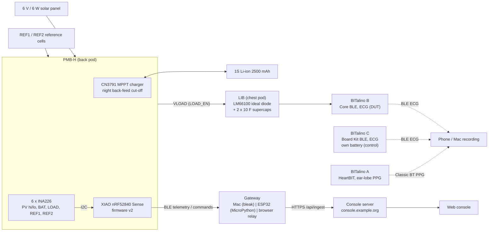
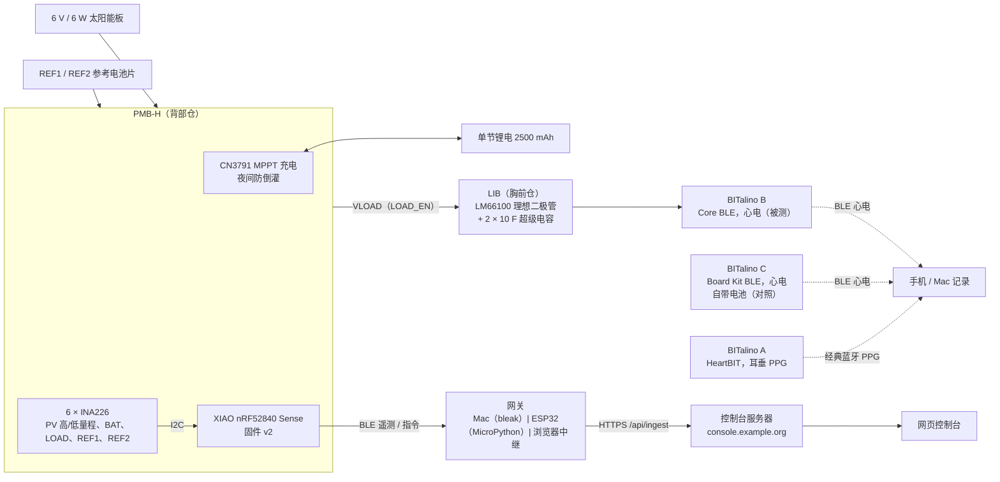

<div align="center">

# Solar Vest

**A self-powered, solar-harvesting wearable for ECG research**<br>
**一件为心电研究而做的太阳能自供电可穿戴背心**


**[English](#english) | [中文](#中文)**

</div>

---


## English

### What it is

Solar Vest is a research platform that answers one question:

> **Can a body-worn 6 V / 6 W solar panel keep a Bluetooth ECG acquisition unit running, and does solar powering change the ECG signal compared with an identical battery-powered control recorded on the same subject at the same time?**

A rigid 6 V / 6 W panel rides on the back of a vest. It charges a 1S Li-ion cell through **PMB-H**, an MPPT charger and power-monitor board of our own design. The battery feeds **BITalino B** (the device under test) through **LIB**, an ideal-diode hold-up board with supercapacitors. **BITalino C** records ECG from mirror-symmetric electrodes on its own battery as the control, and **BITalino A** (HeartBIT) adds ear-lobe PPG. Six INA226 monitors log every energy path, and a XIAO nRF52840 streams the telemetry over BLE to a gateway and on to a remote web console.

The energy budget (see [docs/architecture-v3.md](docs/architecture-v3.md)) says continuous acquisition is only fully self-powered on good days; on a typical day the panel extends runtime by about 76 %, and duty-cycled measurement reaches energy balance.

### System architecture



### Hardware

| Part | What it is | Where |
|---|---|---|
| **PMB-H** (back pod) | CN3791 MPPT charger (set point 5.93 V), night back-feed cut-off, 6 × INA226 (panel high / indoor range, battery, load, two reference cells), NTC, XIAO nRF52840 Sense logger | [`hardware/pcb/pmbh/`](hardware/pcb/pmbh/) |
| **LIB** (chest pod) | Hold-up board: feeds BITalino Core B through an LM66100 ideal diode; 2 × 10 F supercaps take over if the supply drops | [`hardware/pcb/libb/`](hardware/pcb/libb/) |
| Fabrication outputs | KiCad 10 projects (generated from SKiDL), schematics PDF, Gerbers, JLCPCB BOM + CPL (`*_v3.xlsx` are the ordered files), 3D models, final placement images, rotation audit | [`hardware/pcb/`](hardware/pcb/) |
| Enclosures | 18 printable parts (STEP / STL / 3MF): back pod, chest pod, C case, ear clip, six panel shoes (18–52 mm air gap), REF holders, bench stand, webbing hook | [`hardware/enclosures/`](hardware/enclosures/) (read `README_print-list.txt`) |
| Vest patterns | Shell, lining and accessory patterns: DXF, 1:1 plotter PDF, A4 tiles, body-fitted placement data | [`hardware/vest/`](hardware/vest/) |
| Wiring | 20-wire harness specified pin-to-pin with routed lengths: table (md / csv), system diagram (svg), interactive guide | [`hardware/wiring/`](hardware/wiring/) |
| BITalino A / B / C | A: HeartBIT (Core BT) + ear-lobe PPG · B: Core BLE, solar-powered DUT · C: Board Kit BLE on its own battery (control) | [`docs/bom-and-system-overview.md`](docs/bom-and-system-overview.md) |

### Software

| Component | What it is | Where |
|---|---|---|
| Firmware | Arduino sketch for the XIAO nRF52840: INA226 sampling, MPPT / charge / load control, safety lockouts, BLE GATT telemetry and commands, settings persisted in flash | [`firmware/solarvest_pmb/`](firmware/solarvest_pmb/) |
| Bring-up sketch | Serial-console bench test for PMB-H (toggle every control pin, read every INA226) | [`firmware/pmbh_bringup/`](firmware/pmbh_bringup/), [`tools/serial_bridge.py`](tools/serial_bridge.py) |
| Console server | Python 3.12, standard library only; SQLite storage, session login, device-token ingest, command queue; single-file HTML console with Web Bluetooth relay | [`software/server/`](software/server/) |
| Mac gateway | Python + `bleak`; BLE central → HTTPS, offline buffer, runs unattended under `caffeinate` | [`software/gateway-mac/`](software/gateway-mac/) |
| ESP32 gateway | MicroPython 1.28 port of the same gateway (uses `aioble`) | [`software/gateway-esp32/`](software/gateway-esp32/) |
| Protocol | Interface spec (GATT layout, HTTP API, console UI) and shared decode test vectors | [`software/SPEC.md`](software/SPEC.md), [`software/protocol/vectors.json`](software/protocol/vectors.json) |
| CAD / EDA generators | build123d enclosures, SKiDL / pcbnew board scripts, JLCPCB rotation check, vest patterns, harness, fit checks, ngspice testbenches | [`tools/cad/`](tools/cad/) |

### Repository map

```text
.
├── docs/          Architecture v3 (+ v1/v2 history), v3.1 change list, build & assembly guide,
│                  BOM cross-reference, retrospective, tailoring survey, renders
├── hardware/      PCB projects and fab files, printable enclosures, vest patterns, wiring
├── firmware/      XIAO nRF52840 firmware, bench bring-up sketch, packing check
├── software/      Console server, Mac and ESP32 gateways, protocol spec and test vectors
├── simulation/    ngspice report and figures (MPPT stability, night back-feed, hold-up)
├── explorer/      Interactive 3D explorer (open index.html, works offline)
├── viewer/        Earlier glTF viewer of the full assembly (incl. a body-fitted variant)
├── modeling/      Component models: BITalino Core, panel, supercap, HeartBIT kit, viewer
├── body/          Body reconstruction used to fit the vest (owner's data, published with consent)
├── research/      Toolchain survey and the parametric samples that validated it
├── tools/         CAD/EDA/simulation generators, explorer source, serial bridge
├── pdf/           Pipeline that typesets the architecture documents to PDF (fonts not included)
└── THIRD_PARTY_NOTICES.md
```

Start with [docs/build-and-assembly-guide.md](docs/build-and-assembly-guide.md).

### Quick start

<details>
<summary><b>See the design</b></summary>

Open [`explorer/index.html`](explorer/index.html) in Chrome, Edge or Safari (works offline). Press `P` for the guided tour, `X` for X-ray and `E` to explode. The wiring guide is [`hardware/wiring/wiring-guide.html`](hardware/wiring/wiring-guide.html).

</details>

<details>
<summary><b>Build and flash the firmware</b></summary>

Core `Seeeduino:nrf52` 1.1.13 (Adafruit Bluefruit based). No external libraries are needed.

```bash
arduino-cli config add board_manager.additional_urls \
  https://files.seeedstudio.com/arduino/package_seeeduino_boards_index.json
arduino-cli core update-index
arduino-cli core install Seeeduino:nrf52@1.1.13

FQBN=Seeeduino:nrf52:xiaonRF52840Sense
arduino-cli compile --fqbn $FQBN firmware/solarvest_pmb
arduino-cli upload  --fqbn $FQBN -p /dev/cu.usbmodem101 firmware/solarvest_pmb

python3 firmware/pack_check.py          # firmware packing vs protocol vectors
```

For a first power-up use `firmware/pmbh_bringup` instead (serial 115200; `h` prints help).

</details>

<details>
<summary><b>Run the server tests and a local server</b></summary>

```bash
cd software/server
python3 test_server.py                  # end-to-end HTTP tests (stdlib unittest)
node test_decoder.mjs                   # console JS decoder vs vectors.json
python3 ../gateway-esp32/test_host.py   # ESP32 gateway logic on CPython

SV_CONSOLE_PASSWORD=change-me SV_DEVICE_TOKEN=dev-token SV_SESSION_SECRET=$(openssl rand -hex 32) \
SV_DB=./solarvest.db SV_COOKIE_SECURE=0 PORT=8790 python3 server.py
# then open http://localhost:8790
```

</details>

<details>
<summary><b>Deploy (Docker behind Caddy)</b></summary>

[`software/deploy.sh`](software/deploy.sh) copies the server to a Docker host that already runs a Caddy edge container, builds the image and adds a site block. Everything is set through environment variables; the values below are placeholders.

```bash
# ~/.config/solarvest/server.env holds SV_CONSOLE_PASSWORD, SV_DEVICE_TOKEN, SV_SESSION_SECRET
SV_SSH_HOST=your-server SV_DOMAIN=console.example.org \
SV_DOCKER_NETWORK=web SV_EDGE_CONTAINER=caddy ./software/deploy.sh
```

</details>

<details>
<summary><b>Run a gateway</b></summary>

**Mac** (unattended, sleep prevented):

```bash
mkdir -p ~/.config/solarvest
printf 'SV_URL=https://console.example.org\nSV_DEVICE_TOKEN=...\n' > ~/.config/solarvest/gateway.env
./software/gateway-mac/run.sh            # creates .venv, installs bleak, runs gateway.py
python3 software/gateway-mac/gateway.py --selftest   # decoder check, exit 0/1
python3 software/gateway-mac/gateway.py --dry-run    # replay vectors without Bluetooth
```

**Browser relay**: log in to the console in Chrome / Edge on Android or a Mac and use the panel *Use this device as the gateway* (Web Bluetooth; the screen must stay on; not available in Safari / iOS).

**ESP32**: `software/gateway-esp32/push.sh [port]` uploads `aioble`, `main.py` and a `config.json` built from `~/.config/solarvest/gateway.env` and `~/.config/solarvest/wifi.json`.

</details>

<details>
<summary><b>Rebuild the CAD, PCBs and explorer</b></summary>

Everything is generated by code; there is no GUI CAD.

| What | How |
|---|---|
| Explorer | `cd tools/cad/SolarVest_Explorer_src && npm install && npm run build` (three 0.160, three-mesh-bvh 0.8, esbuild) |
| Enclosures | Python 3.12 + `build123d trimesh manifold3d scipy shapely`: `tools/cad/enclosures.py` (the panel shoes also need the body model, which is not included) |
| Fit check | `python tools/cad/check_fit.py <parts dir> <data dir>`: interference and free travel of every board and battery |
| PCBs | KiCad 10 + SKiDL: `tools/cad/pmbh.py`, `libb.py`, then `place_*.py`, `fab.py` (Gerbers, BOM, CPL), `jlc_rotcheck.py` (pad-matched placement rotations) |
| Simulation | ngspice through KiCad's bundled libngspice: `tools/cad/simulation/` |

Some scripts expect tool locations from the original workstation (KiCad app path, scratch directories); adapt them as needed.

</details>

### Current status

**Bench bring-up done (2026-10-28):**

- [x] Both PCBs manufactured and assembled by JLCPCB, powered up on the bench
- [x] All six INA226 monitors answer and read plausible values
- [x] BITalino Core B powered through LIB and streaming ECG over BLE
- [x] Remote console live, with a full command round-trip (console → server → gateway → XIAO → ack)
- [x] Firmware v2: autoload (load on at ≥ 3.7 V, persisted in flash) and gateway keepalive

**Next:**

- [ ] Sunny-day charging validation outdoors (MPPT operating point, energy balance)
- [ ] ECG comparison: B (solar) vs C (battery control), same subject, same time
- [ ] Sew the vest and move from bench to body

### Safety

> [!WARNING]
> BITalino is a research device, **not a medical device**.

- **Electrodes and mains**: while electrodes are on the body, never connect USB or any mains-powered equipment to any unit. Data goes over Bluetooth only; B has no USB port in the chest pod and draws power only from the vest battery. Charge A and C only after the vest is taken off.
- **Li-ion**: use a protected cell; the firmware limits charging to 0–45 °C via the battery NTC and locks out the load on low voltage. The back pod sits outside the panel's shadow. Check polarity (red wire to J2 "+") before connecting.
- **Heat**: on a sunny day the back of the panel can reach 60–70 °C; keep the air gap and stop extended wear if the vest surface under the panel exceeds 40 °C.

Details: [docs/bom-and-system-overview.md](docs/bom-and-system-overview.md).

### Credits and third-party content

- See [THIRD_PARTY_NOTICES.md](THIRD_PARTY_NOTICES.md) for every item and its license.
- **PLUX / BITalino**: dimensions are cited from PLUX's manuals and data sheets; PLUX documentation, photos and vendor CAD are not redistributed.
- **Thingiverse models** by BITalinoWorld / BEE Very Creative: CC BY 4.0 (Plugged Casing, ECG Sensor Housing) and CC0 1.0 (PulseSensor Housing), in `modeling/`.
- **micropython-lib `aioble`** (MIT, © 2021 Jim Mussared), vendored in `software/gateway-esp32/lib/aioble/`.
- three.js, three-mesh-bvh and the meshopt decoder (MIT) are bundled in the web viewers.

### Privacy

Personal identifiers (names, institution, e-mail addresses, local paths, third-party contacts) have been removed; the supervisor is referred to by role only. The body data in `body/` and `viewer/*_PRIVATE*.glb` belongs to the project owner and is published with their consent.

### License

No license has been chosen yet, so all rights are reserved by the author. Third-party parts keep their own licenses (see the notices).

<p align="right"><a href="#solar-vest">Back to top</a></p>

---


## 中文

### 这是什么

Solar Vest 是一个研究平台，要回答的问题只有一个：

> **一块穿在身上的 6 V / 6 W 太阳能板，能不能让蓝牙心电采集单元持续工作？和同一个人、同一时间、用电池供电的同款对照组相比，太阳能供电会不会影响心电信号？**

背心后背装一块 6 V / 6 W 硬质太阳能板，经自研的 MPPT 充电与功率监测板 **PMB-H** 给单节锂电充电。电池通过 **LIB**（理想二极管 + 超级电容的掉电保持板）给 **BITalino B**（被测设备）供电；**BITalino C** 用自己的电池、在镜像对称的电极位置同步采集心电作为对照；**BITalino A**（HeartBIT）另外采集耳垂 PPG。6 路 INA226 记录每一条能量路径，XIAO nRF52840 把遥测数据经 BLE 发给网关，再上传到远程网页控制台。

按能量预算（见 [docs/architecture-v3.md](docs/architecture-v3.md)）：连续采集只有在好天气下才能完全自供电；典型日子里太阳能能把续航延长约 76%，改为间歇测量则可以做到能量收支平衡。

### 系统架构



### 硬件

| 部分 | 说明 | 位置 |
|---|---|---|
| **PMB-H**（背部仓） | CN3791 MPPT 充电（设定点 5.93 V）、夜间防倒灌、6 × INA226（太阳能板高量程/室内量程、电池、负载、两块参考电池片）、NTC、XIAO nRF52840 Sense 记录仪 | [`hardware/pcb/pmbh/`](hardware/pcb/pmbh/) |
| **LIB**（胸前仓） | 掉电保持板：经 LM66100 理想二极管给 BITalino Core B 供电，供电跌落时由 2 × 10 F 超级电容接管 | [`hardware/pcb/libb/`](hardware/pcb/libb/) |
| 生产文件 | KiCad 10 工程（由 SKiDL 生成）、原理图 PDF、Gerber、嘉立创 BOM + 坐标文件（`*_v3.xlsx` 为实际下单版本）、3D 模型、最终贴片图、旋转角核对 | [`hardware/pcb/`](hardware/pcb/) |
| 外壳 | 18 个打印件（STEP / STL / 3MF）：背部仓、胸前仓、C 外壳、耳夹、6 个太阳能板支脚（留 18–52 mm 空气层）、参考电池片支架、桌面支架、织带挂钩 | [`hardware/enclosures/`](hardware/enclosures/)（先看 `README_print-list.txt`） |
| 背心版型 | 面料、里料、配件版型：DXF、1:1 绘图仪 PDF、A4 拼贴、贴合身体的布局数据 | [`hardware/vest/`](hardware/vest/) |
| 接线 | 20 根线的线束，逐针定义并给出走线长度：接线表（md / csv）、系统接线图（svg）、交互式指南 | [`hardware/wiring/`](hardware/wiring/) |
| BITalino A / B / C | A：HeartBIT（Core BT）+ 耳垂 PPG · B：Core BLE，太阳能供电的被测设备 · C：Board Kit BLE，自带电池（对照） | [`docs/bom-and-system-overview.md`](docs/bom-and-system-overview.md) |

### 软件

| 组件 | 说明 | 位置 |
|---|---|---|
| 固件 | XIAO nRF52840 的 Arduino 程序：INA226 采样、MPPT / 充电 / 负载控制、安全锁定、BLE GATT 遥测与指令、设置存入 flash | [`firmware/solarvest_pmb/`](firmware/solarvest_pmb/) |
| 点亮测试程序 | PMB-H 桌面测试，走串口：逐个切换控制引脚、读取每颗 INA226 | [`firmware/pmbh_bringup/`](firmware/pmbh_bringup/)、[`tools/serial_bridge.py`](tools/serial_bridge.py) |
| 控制台服务器 | Python 3.12，只用标准库；SQLite 存储、登录会话、设备令牌上传、指令队列；单文件 HTML 控制台，自带 Web Bluetooth 中继 | [`software/server/`](software/server/) |
| Mac 网关 | Python + `bleak`；BLE 主机 → HTTPS，离线缓存，用 `caffeinate` 防休眠、无人值守运行 | [`software/gateway-mac/`](software/gateway-mac/) |
| ESP32 网关 | 同一网关的 MicroPython 1.28 移植版（基于 `aioble`） | [`software/gateway-esp32/`](software/gateway-esp32/) |
| 协议 | 接口规范（GATT 布局、HTTP API、控制台界面）和共用的解码测试向量 | [`software/SPEC.md`](software/SPEC.md)、[`software/protocol/vectors.json`](software/protocol/vectors.json) |
| CAD / EDA 生成脚本 | build123d 外壳、SKiDL / pcbnew 电路板脚本、嘉立创旋转角核对、背心版型、线束、装配干涉检查、ngspice 仿真 | [`tools/cad/`](tools/cad/) |

### 目录结构

```text
.
├── docs/          架构文档 v3（及 v1/v2 历史版本）、v3.1 变更清单、制造与装配指南、
│                  物料对照、项目回顾、裁缝调研、效果图
├── hardware/      PCB 工程与生产文件、可打印外壳、背心版型、接线
├── firmware/      XIAO nRF52840 固件、桌面点亮程序、打包校验
├── software/      控制台服务器、Mac 与 ESP32 网关、协议规范与测试向量
├── simulation/    ngspice 仿真报告与图（MPPT 稳定性、夜间倒灌、掉电保持）
├── explorer/      交互式 3D 浏览器（打开 index.html，可离线使用）
├── viewer/        早期的整机 glTF 查看器（含贴合人体的版本）
├── modeling/      元件建模：BITalino Core、太阳能板、超级电容、HeartBIT 套件、查看器
├── body/          用于背心贴合的人体还原（项目负责人本人数据，经本人同意公开）
├── research/      工具链调研及验证用的参数化样例
├── tools/         CAD/EDA/仿真生成脚本、3D 浏览器源码、串口桥
├── pdf/           把架构文档排版成 PDF 的流程（不含字体）
└── THIRD_PARTY_NOTICES.md
```

建议从 [docs/build-and-assembly-guide.md](docs/build-and-assembly-guide.md) 开始看。

### 快速上手

<details>
<summary><b>查看设计</b></summary>

用 Chrome、Edge 或 Safari 打开 [`explorer/index.html`](explorer/index.html)（可离线）。按 `P` 进入导览，`X` 透视，`E` 爆炸视图。接线指南见 [`hardware/wiring/wiring-guide.html`](hardware/wiring/wiring-guide.html)。

</details>

<details>
<summary><b>编译和烧录固件</b></summary>

内核 `Seeeduino:nrf52` 1.1.13（基于 Adafruit Bluefruit），不需要额外的库。

```bash
arduino-cli config add board_manager.additional_urls \
  https://files.seeedstudio.com/arduino/package_seeeduino_boards_index.json
arduino-cli core update-index
arduino-cli core install Seeeduino:nrf52@1.1.13

FQBN=Seeeduino:nrf52:xiaonRF52840Sense
arduino-cli compile --fqbn $FQBN firmware/solarvest_pmb
arduino-cli upload  --fqbn $FQBN -p /dev/cu.usbmodem101 firmware/solarvest_pmb

python3 firmware/pack_check.py          # 校验固件打包与协议测试向量一致
```

第一次上电请改用 `firmware/pmbh_bringup`（串口 115200，输入 `h` 查看帮助）。

</details>

<details>
<summary><b>运行服务器测试和本地服务器</b></summary>

```bash
cd software/server
python3 test_server.py                  # 端到端 HTTP 测试（标准库 unittest）
node test_decoder.mjs                   # 控制台 JS 解码器对照 vectors.json
python3 ../gateway-esp32/test_host.py   # 在 CPython 上测试 ESP32 网关逻辑

SV_CONSOLE_PASSWORD=change-me SV_DEVICE_TOKEN=dev-token SV_SESSION_SECRET=$(openssl rand -hex 32) \
SV_DB=./solarvest.db SV_COOKIE_SECURE=0 PORT=8790 python3 server.py
# 然后打开 http://localhost:8790
```

</details>

<details>
<summary><b>部署（Docker + Caddy）</b></summary>

[`software/deploy.sh`](software/deploy.sh) 把服务器拷到一台已经运行 Caddy 入口容器的 Docker 主机上，构建镜像并追加站点配置。所有设置都通过环境变量传入，下面的值都是占位符。

```bash
# ~/.config/solarvest/server.env 中写 SV_CONSOLE_PASSWORD、SV_DEVICE_TOKEN、SV_SESSION_SECRET
SV_SSH_HOST=your-server SV_DOMAIN=console.example.org \
SV_DOCKER_NETWORK=web SV_EDGE_CONTAINER=caddy ./software/deploy.sh
```

</details>

<details>
<summary><b>运行网关</b></summary>

**Mac**（无人值守，防休眠）：

```bash
mkdir -p ~/.config/solarvest
printf 'SV_URL=https://console.example.org\nSV_DEVICE_TOKEN=...\n' > ~/.config/solarvest/gateway.env
./software/gateway-mac/run.sh            # 自动建 .venv、装 bleak、运行 gateway.py
python3 software/gateway-mac/gateway.py --selftest   # 解码器自检，返回 0/1
python3 software/gateway-mac/gateway.py --dry-run    # 不用蓝牙，回放测试向量
```

**浏览器中继**：在安卓或 Mac 上用 Chrome / Edge 登录控制台，使用面板 *Use this device as the gateway*（基于 Web Bluetooth；屏幕需保持常亮；Safari / iOS 不支持）。

**ESP32**：`software/gateway-esp32/push.sh [串口]` 会上传 `aioble`、`main.py`，以及由 `~/.config/solarvest/gateway.env` 和 `~/.config/solarvest/wifi.json` 生成的 `config.json`。

</details>

<details>
<summary><b>重新生成 CAD、PCB 和 3D 浏览器</b></summary>

所有内容都由代码生成，不用图形界面 CAD。

| 内容 | 方法 |
|---|---|
| 3D 浏览器 | `cd tools/cad/SolarVest_Explorer_src && npm install && npm run build`（three 0.160、three-mesh-bvh 0.8、esbuild） |
| 外壳 | Python 3.12 + `build123d trimesh manifold3d scipy shapely`：`tools/cad/enclosures.py`（太阳能板支脚还需要人体模型，仓库中未包含） |
| 干涉检查 | `python tools/cad/check_fit.py <零件目录> <数据目录>`：检查每块板和电池的干涉与活动余量 |
| PCB | KiCad 10 + SKiDL：`tools/cad/pmbh.py`、`libb.py`，然后 `place_*.py`、`fab.py`（Gerber、BOM、坐标）、`jlc_rotcheck.py`（按焊盘匹配的贴片旋转角） |
| 仿真 | 通过 KiCad 自带的 libngspice 调用 ngspice：`tools/cad/simulation/` |

部分脚本写死了原工作站上的工具路径（KiCad 安装路径、临时目录），使用时请按需修改。

</details>

### 当前进度

**桌面联调已完成（2026-10-28）：**

- [x] 两块 PCB 由嘉立创生产贴片，已在桌面上电
- [x] 6 颗 INA226 全部应答，读数合理
- [x] BITalino Core B 经 LIB 供电，通过 BLE 传输心电
- [x] 远程控制台上线，指令完整往返（控制台 → 服务器 → 网关 → XIAO → 回执）
- [x] 固件 v2：自动带载（电池 ≥ 3.7 V 时开负载，设置存入 flash）和网关保活

**下一步：**

- [ ] 晴天户外充电验证（MPPT 工作点、能量收支）
- [ ] 心电对比：B（太阳能）对 C（电池对照），同一人、同一时间
- [ ] 缝制背心，从桌面走上身体

### 安全须知

> [!WARNING]
> BITalino 是科研设备，**不是医疗器械**。

- **电极与市电**：电极贴在身上时，任何一台设备都不能接 USB 或任何市电供电的设备。数据只走蓝牙；胸前仓里的 B 没有 USB 口，只从背心电池取电。A 和 C 必须脱下背心后再充电。
- **锂电池**：使用带保护板的电芯；固件通过电池 NTC 把充电温度限制在 0–45 °C，电压过低时锁定负载。背部仓放在太阳能板阴影区之外。接电池前确认极性（红线接 J2 的“+”）。
- **发热**：晴天时太阳能板背面可达 60–70 °C；保留空气层，板下背心表面超过 40 °C 时不要长时间穿着。

详见 [docs/bom-and-system-overview.md](docs/bom-and-system-overview.md)。

### 致谢与第三方内容

- 各项第三方内容及其许可见 [THIRD_PARTY_NOTICES.md](THIRD_PARTY_NOTICES.md)。
- **PLUX / BITalino**：尺寸引自 PLUX 的手册和数据手册；PLUX 的文档、照片和厂商 CAD 均未在此转载。
- **Thingiverse 模型**（BITalinoWorld / BEE Very Creative）：CC BY 4.0（Plugged Casing、ECG Sensor Housing）和 CC0 1.0（PulseSensor Housing），位于 `modeling/`。
- **micropython-lib `aioble`**（MIT，© 2021 Jim Mussared），随附于 `software/gateway-esp32/lib/aioble/`。
- 网页查看器中打包了 three.js、three-mesh-bvh 和 meshopt 解码器（MIT）。

### 隐私说明

已去除个人身份信息（姓名、学校、邮箱、本地路径、第三方联系方式），导师只以身份称呼。`body/` 和 `viewer/*_PRIVATE*.glb` 中的身体数据属于项目负责人本人，经本人同意公开。

### 许可

目前尚未选择开源许可，因此作者保留所有权利。第三方内容仍遵循各自的许可（见第三方声明）。

<p align="right"><a href="#solar-vest">回到顶部</a></p>
