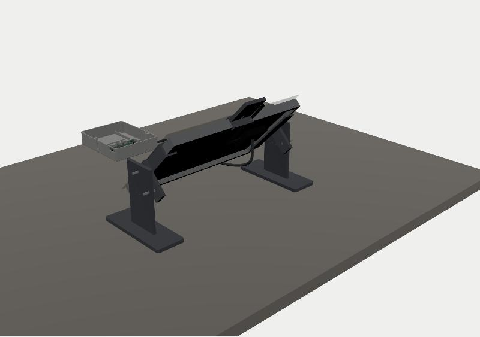

# BOM Cross-Reference and System Overview

2026-10-12

This document answers four questions:

1. What touches the skin? Is it safe?
2. Where does each of the three BITalinos go?
3. Which structures are not worn on the body?
4. Where is every item on your list, and every item in the HeartBIT kit, used?

---

## 1. Things that touch the skin

**Yes, but only two kinds:**

| Where | What | Belongs to | Qty |
|---|---|---|---|
| Left and right clavicle + lower right ribs (inferior costal margin) | Disposable ECG electrodes (Ag/AgCl gel) | B (device under test, solar-powered) | 3 |
| 50 mm directly below B's two electrodes + lower left ribs | Disposable ECG electrodes | C (control, battery) | 3 |
| Left earlobe | PulseSensor photoplethysmographic heart-rate sensor, in a printed ear clip | A (HeartBIT) | 1 |

The solar panel, batteries, circuit boards and the three pods **do not touch the skin**.

**Electrode placement** follows Lead I from PLUX manual §2.3: measuring electrodes on the clavicles. The manual puts the reference electrode on the iliac crest, but that is more than 30 cm from the sensor and the stock leads cannot reach, so it goes on the lower ribs instead, which are likewise a bony site with little muscle (EMG) activity.

- Groups B and C are offset vertically by 50 mm.
- The two groups' reference electrodes are left/right mirror images.
- This exactly meets the v3.1 TC-05 requirement: "same subject, same time, leads mirror-symmetric".
- Lead colours: red = IN+, black = IN−, white = REF (manual, Table 2).

**The vest should be worn next to the skin**:

- The lining is 3D spacer mesh: breathable and fine in direct skin contact.
- The leads run from the electrodes between the skin and the lining, held by an elastic loop roughly every 8 cm, and finally pass through two brass-eyelet "cable holes" into the outer pockets.
- Near the clavicles the vest stands 10 mm off the skin so it does not flatten the electrode snaps.
- If a T-shirt must be worn underneath, the leads have to be routed out through the T-shirt's neckline or hem. It works, but it is fiddly and tends to tug on the electrodes.

### Safety (must read)

BITalino is **not a medical device**; it is a research-grade physiological signal acquisition board. The electrodes are medical disposables.

| Risk | Mitigation |
|---|---|
| **Electric shock via mains coupling** (the PLUX datasheet warns verbatim: "direct or indirect coupling to the mains may result in shocking hazard") | While worn: • Never plug in any USB, and never connect any mains-powered device. Data goes over Bluetooth to the phone only. • The chest pod **has no USB port for B**; B draws power only from the back Li-ion battery. • A and C are charged only after the vest is taken off. • The Mac connects to the BITalinos over Bluetooth, never by cable. |
| Skin irritation | Electrodes are single-use, ≤ 24 h per application. Clean with an alcohol swab and let dry before applying. Do not apply on broken skin. Stop if redness or itching occurs. |
| Heat | On a sunny day the back of the panel can reach 60–70 °C. • There is at least an 18 mm air layer between the panel and the vest. • The vest's load-bearing area has a 1000D reinforcement patch and an HDPE stiffener. • Thermocouple TC2 specifically measures the vest surface below the panel; **above 40 °C, do not wear it for extended periods**. • The HP600 thermal pad sits only inside the back pod, **never on the body side** (v3 §5.4). |
| Li-ion battery | The back pod is light-coloured PETG and sits outside the shadow area under the panel. An NTC is attached to the battery, and the firmware limits charging to 0–45 °C. |
| Cable snagging | A 5P magnetic connector can be inserted midway in the back → chest W06 cable so it breaks away when snagged. |

---

## 2. Positions of the three BITalinos (all body-worn)

| Code | What | Where | Power | Connections | Data |
|---|---|---|---|---|---|
| **A** | Core **BT** (Classic Bluetooth) from the HeartBIT kit, in its original red-and-white case | **Lower-left front pocket P2**, near the armpit (78×72×18 mm) | Built-in 700 mAh | Port A3 ← PulseSensor (left-earlobe clip, W13) | Classic Bluetooth → **Android phone** |
| **B** | Core **BLE** (bare board, device under test) | **Right chest**, in the printed chest pod, stacked with LIB | Back Li-ion → PMB-H → LIB | A2 ← HeartBIT ECG sensor (W09/W10), I1 ← SYNC (W08) | BLE → Android phone |
| **C** | Board **BLE** (full board, control) | **Left-chest pocket P3** (right next to C's electrodes, so the leads can reach), in the printed C housing (126.5×85.8×18 mm), with the 523450 battery underneath the board | The 523450 1000 mAh from your list | On-board ECG module ← 3-lead electrode cable (W11) | BLE → Android phone |

**Why all three are worn:**

- B and C worn simultaneously form the TC-05 ECG-quality comparison.
- A's earlobe PPG heart rate is compared with the ECG heart rate from B and C for the TC-25 agreement analysis (Bland–Altman).
- All three also go through the TC-01 power-consumption comparison on the bench, to measure the power difference between Classic Bluetooth and BLE.

**Using an Android phone is good news**:

- Android supports Classic Bluetooth serial, so A, B and C plus the XIAO on PMB-H, four devices in total, can connect to the same phone **simultaneously**.
- No laptop needs to be carried during walking experiments. An iPhone cannot do this.
- The phone goes in the lower-right pocket (fits ≤ 165×78×9 mm).

**Mac**:

- Use OpenSignals on the Mac to view data from the three BITalinos. The Mac has built-in Bluetooth that handles both Classic Bluetooth and BLE, so the USB Bluetooth adapter in the HeartBIT kit is **not needed** (it is meant for Windows PCs without Bluetooth).
- The XIAO firmware is flashed from the Mac over USB-C; only do this with the vest taken off.

---

## 3. Structures not worn on the body (bench rig)

| Structure | What | File / method | Used in experiment |
|---|---|---|---|
| **Panel test stand** | Base ×2 + cradle ×2 (printed), M4×25 bolt + wing nut ×4. Scale 0 = vertical, 90 = flat, 15° per step. Pivot height 100 mm, so the panel clears the table over the full travel | `hardware/enclosures/stand_base`, `stand_cradle` | TC-02 panel I-V, reference-cell calibration, TC-03b, TC-21, TC-24, charger burn-in |
| **Panel shading covers ×3** | One pattern made up in three fabrics: blackout cloth (TC-24 shading control), ND mesh / window screen (TC-03b small-panel emulation), garment-fabric sample (TC-21 clothing shading). Corners sewn as box corners, elastic cord threaded through the edge, fits straight over the panel on the vest or on the bench | `hardware/vest/pattern_accessories_*` (COVER) | TC-03b / TC-21 / TC-24 |
| REF1 position on the bench | The stand's cradles occupy the panel's short edges, so on the bench REF1 is clipped to the middle of the **upper long edge** instead (the frame cross-section is the same on all four sides) | Same `ref1_holder` | Reference-cell calibration |
| **Power measurement (TC-01)** | Battery → breadboard → multimeter on mA range in series → device | Breadboard, Dupont wires, PH2 straight-pin leads and multimeter from your list; **no soldering** | Power of A and C. B needs no separate measurement: the INA226 (0x42) on PMB-H measures it continuously |
| Panel I-V (TC-02) | Connect the panel directly to a set of 5 W cement (ceramic-encased wirewound) resistors (to purchase), measure voltage with the multimeter, I = V/R; open circuit gives Voc, short circuit gives Isc | Purchase resistor set | Real panel Voc / Isc / Pmax |
| Bench power | Adjustable lab supply 7 V, 1 A current limit, into PMB-H J1 (in place of the panel) | — | Firmware bring-up, charger burn-in |
| Charging and charge level | The "multifunction USB tester" from your list, in series with the charging cables of A and C and the XIAO programming cable | — | Battery capacity, charge current |
| Computer side | Mac + OpenSignals | — | Indoor experiments, data checks |

---

## 4. Your list (component overview CSV), line by line

| # | Item on list | Qty | Where used | Status |
|---|---|---|---|---|
| 1 | Digital temperature-controlled soldering station | 1 | 10 joints in total: supercapacitors 4, two reference cells 4, W08 SYNC cable 2 | ✅ Tool |
| 2 | 395×460 18 V 30 W solar panel | 1 | Not used (the supervisor switched to 6 V 6 W). ⚠ **Must not be connected to PMB-H**: open-circuit voltage is about 22 V, far above the 10 V input TVS | ⏸ Idle |
| 3 | Pocket multimeter | 1 | TC-01 series current measurement, TC-02 voltage measurement | ✅ Bench |
| 4 | Mini thermocouple thermometer | 1 | Reads TC1 (panel backsheet) and TC2 (vest surface below the panel). The plug normally rests in the lower-left front "thermocouple plug pocket" | ✅ Body-worn (plugged in when reading) |
| 5 | EVK10941 | 1 | The AEM10941 input limit is 5 V and a 6 V panel would overvoltage it, so it is not used in this design. If a flexible panel < 5 V becomes available later, it could serve a low-light comparison branch | ⏸ Idle |
| 6 | Dupont wires | Assorted | TC-01: breadboard to multimeter | ✅ Bench |
| 7 | PH2 mm straight-pin pre-wired leads | 50 | W04 / W05 reference-cell leads, TC-01 adapters | ✅ |
| 8 | Thermal grease | 1 | Between the TC1 thermocouple tip and the panel backsheet, for more accurate readings | ✅ |
| 9 | Wire strippers | 1 | Stripping the W01 panel lead, W08 | ✅ Tool |
| 10 | 523450 1000 mAh Li-ion battery | 1 | **C's battery** (W12), underneath the Board | ✅ Body-worn |
| 11 | YJL3404A | 1 | Spare: same SOT-23 N-MOSFET with the same pinout as the AO3400A on PMB-H (Q2/Q3/Q4/Q6); can be hand-soldered as a replacement if one fails | ⏸ Spare |
| 12 | Solder wire | 1 | Same as line 1 | ✅ Tool |
| 13 | PH2.0 cables (straight pin) | Assorted | W07 (LIB → Core B battery socket, 10 cm double-ended); W04 / W05 extensions | ✅ |
| 14 | Insulating sleeving / cable protection sleeve | Assorted | Heat-shrink on every solder joint; sheathing on exposed cable runs on the vest (W06 at the pod entries, W13 neck section) | ✅ |
| 15 | BITalino | 2 | **B** (Core BLE, device under test) and **C** (Board BLE, control) | ✅ Body-worn |
| 16 | Multifunction USB tester | 1 | Bench: charge current and charge level of A and C, XIAO flashing | ✅ Bench |
| 17 | Breadboard | 1 | TC-01 power measurement, solderless | ✅ Bench |
| 18 | Bar clamps | 3 | Bench: clamp the test-stand bases to the table edge against wind; hold multiple webbing layers while sewing | ✅ Tool |
| 19 | 2.7 V 10 F capacitors | 3 | SC1, SC2 on LIB; the 3rd is a spare | ✅ |
| 20 | K-type surface thermocouples | 2 | TC1: centre of the panel backsheet (high-temperature aluminium-foil tape + thermal grease). TC2: vest surface directly below the panel, measuring heat passed to the body (W14/W15) | ✅ Body-worn |
| 21 | TEUCER HP600 silicone thermal pad | 1 | Cut to 20×20 mm, placed on the **thermal-pad pedestal** in the floor of the back pod, under the back side of the PMB-H charger area (CN3791 / M1 / D5 / L1). **Not on the body side** | ✅ |
| 22 | Disposable ECG electrodes | 1 pack | 6 per wear (B 3 + C 3) | ✅ Skin contact |
| 23 | BITalino HeartBIT kit | 1 set | See section 5 | ✅ |

---

## 5. HeartBIT kit, item by item

| Kit item | Where used |
|---|---|
| BITalino Core **BT** + original red-and-white case + 700 mAh battery | **A**, lower-left front pocket P2, unmodified |
| ECG sensor (with 3 × 30 cm leads + UC-E6 cable) | Used for **B**: the sensor sits in the sternum inner pocket P6 on the lining, with leads to B's three electrodes (routed 14–19 cm); the 30 cm UC-E6 cable (routed 15 cm) passes through cable hole B into B's A2 |
| PulseSensor (with UC-E6 cable, 61 cm) | Plugs into A's A3, fitted in the printed **ear clip** on the left earlobe. The cable runs through the elastic loop on the left front yoke up to the side of the neck: routed 51 cm, 10 cm spare |
| PLUX electrodes Ø24 mm | Used interchangeably with the disposable electrodes from your list |
| USB Bluetooth adapter | The Mac has built-in Bluetooth; not needed |
| Charging cable | Charges A and C (when not worn) |

If the Board kit (C) came with a 3-lead electrode cable, use it as W11. If not, borrow one from the HeartBIT kit or buy a PLUX 3-lead electrode cable.

---

## 6. Still to buy (summary)

| Item | Spec | Qty | Purpose |
|---|---|---|---|
| XIAO nRF52840 **Sense** | Pre-soldered headers | 1 (2 recommended) | PMB-H main controller |
| 1S Li-ion battery | 2500 mAh, with protection board, PH2.0, outline ≤ 50×64×10.5 mm | 1 | Main back battery (⚠ red wire to the "+" of J2) |
| NTC 10 kΩ B3950 | With PH2.0 2P lead | 1 | W03 |
| Reference solar cells | Epoxy-encapsulated, ≤ 40×30×3 mm, **Isc ≤ 150 mA** | 2 | REF1, REF2. Above this current the 0.47 Ω shunt with the INA226 goes over range |
| PH2.0 5P double-ended **same-orientation** cable | **0.7 m** | 1 | W06 (actual routed length 0.53 m) |
| PLUX "UC-E6 to open-ended" sensor cable (Arduino sensor cable) | — | 1 | W08 SYNC → I1. If not bought, leave SYNC unconnected and use software time alignment |
| M2 self-tapping screws (pan head, PA) | M2×6 ×10 (PMB-H 4, hooks 4, LIB 2), M2×8 ×12 (4 for each of the three lids) | 1 box | — |
| M4×25 bolts + wing nuts | — | 4 each | Test stand |
| 5 W cement (ceramic-encased wirewound) resistors | 3.3 / 4.7 / 6.8 / 10 / 15 / 22 / 33 / 68 / 150 Ω | 1 each | TC-02 I-V |
| Shading-cover fabrics | Blackout cloth 0.4 m, window screen or ND mesh 0.4 m (layered), 3 mm elastic cord 3 m | — | Panel shading covers ×3 |
| Vest fabrics and trims | See *Build and Assembly Guide* §4 | — | — |
| Brass eyelets Ø7 mm | — | 2 | Cable holes B, C |
| 10 mm elastic | — | 1 m | Lead-retaining loops, PPG cable loop |
| High-temperature aluminium-foil tape, medical tape, 2 mm double-sided foam tape | — | 1 each | TC1 fixing, lead fixing, battery padding |
| Optional: 5P magnetic connector | — | 1 | Inserted midway in W06 for snag protection |
