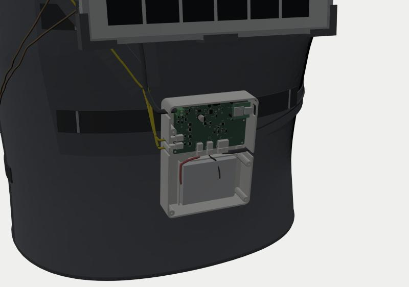
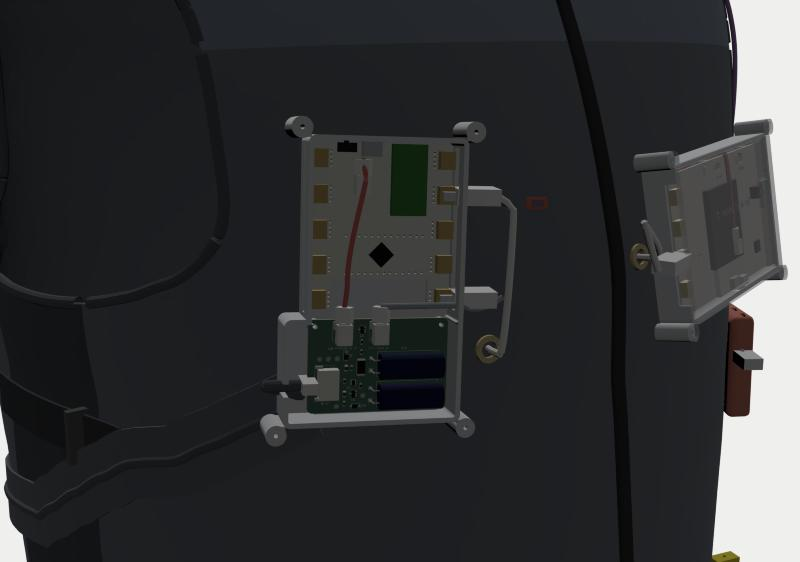
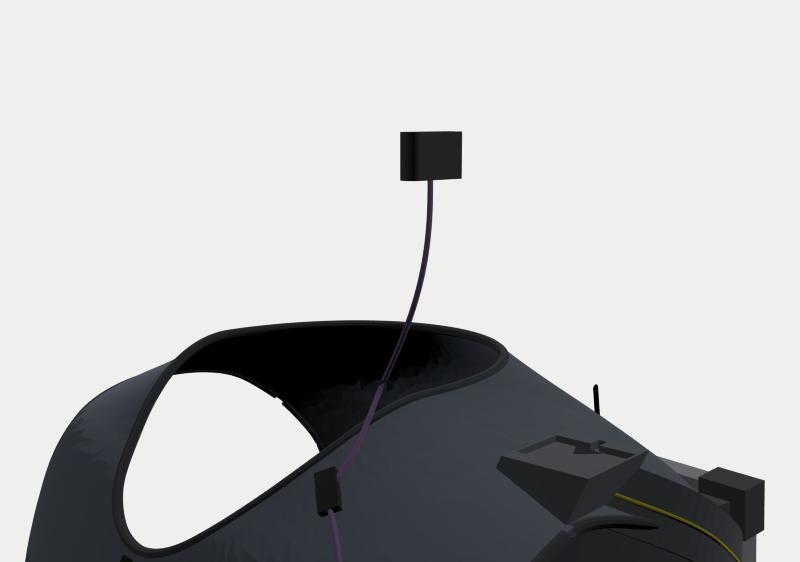

# Solar Wearable Vest: Build and Assembly Guide

2026-10-12 · Corresponds to architecture v3.1

> Companion documents:
> - [bom-and-system-overview.md](bom-and-system-overview.md): where every item on your list is used, what touches the skin, safety notes, where the three BITalinos go, and the bench-rig structures.
> - [hardware/wiring/wiring-table.md](../hardware/wiring/wiring-table.md): pin-by-pin connections for all 20 cables, with the [system wiring diagram](../hardware/wiring/system-wiring-diagram.svg).
> - [hardware/wiring/cable-length-check.md](../hardware/wiring/cable-length-check.md): how long each cable needs to be versus how long it actually is (photo measurements + official specs).
> - [simulation/simulation-report.md](../simulation/simulation-report.md): circuit simulation of both boards, 22 checks, and the 4 design changes that resulted.
> - [tailoring/tailor-survey.md](tailoring/tailor-survey.md): who should make the vest, what to bring, and what to ask.

---

## 0. What you need to do (shortest list)

| # | Task | Time |
|---|---|---|
| 1 | Order both boards from JLCPCB (PCB + SMT): upload the 3 files per §2, and glance at the orientations in the placement preview | 30 min |
| 2 | Purchase per [BOM overview §6](bom-and-system-overview.md) | 30 min |
| 3 | Print 18 parts (§3): 16 body-worn + 4 bench-rig parts (including 2 hooks) | The printer runs on its own |
| 4 | Vest: hand the [hardware/vest/](../hardware/vest/) folder and §4 of this guide to a sampling studio (who to use: see the [tailor survey](tailoring/tailor-survey.md)) | Outsourced |
| 5 | Solder 10 joints: supercapacitors 4, the two reference cells 4, SYNC cable 2 | 30 min |
| 6 | Assemble per §5: drive screws, plug in cables, apply electrodes, mount the panel | 1.5 h |

**You do not need to measure anything.** Only a few things need a quick look:

- When buying the battery and PH2.0 cables, check the plug polarity (marked ⚠).
- On delivery, check the length of 3 cables; see [cable-length check §3](../hardware/wiring/cable-length-check.md).
- **Ask the supervisor before cutting the panel lead**: the panel belongs to the supervisor, and a cut cannot be undone. There is also an alternative that needs no cutting; see [cable-length check §1](../hardware/wiring/cable-length-check.md).

---

## 1. What is in the folders

| Folder / file | Contents |
|---|---|
| [hardware/pcb/pmbh/](../hardware/pcb/pmbh/), [hardware/pcb/libb/](../hardware/pcb/libb/) | Gerbers, BOM, CPL, schematic PDF, STEP, GLB and KiCad project for both boards |
| [hardware/enclosures/](../hardware/enclosures/) | 18 printed parts, each as STEP, STL and 3MF; `parts_meta.json` holds volumes and materials |
| [hardware/vest/](../hardware/vest/) | Three pattern sets: shell fabric, lining, and accessories (pockets / inner pocket / panel shading covers), each as SVG, DXF, plotter PDF and A4-tiled PDF. Also the 3D vest `vest.glb`, `placement.json` (panel and mounting shoes) and `system_layout.json` (electrodes, pockets, cable routing) |
| [hardware/wiring/](../hardware/wiring/) | Wiring table (md + csv), system wiring diagram (svg), `harness.json` (raw harness data) |
| [viewer/](../viewer/) | 3D viewer with two scenes, "Worn / Bench". The `*_PRIVATE.glb` files contain the author's own body model (published with the author's consent) |
| [renders/](renders/) | 8 screenshots |
| [tools/cad/](../tools/cad/) | All generator scripts |

To open the viewer: in a terminal, go to the repository root, run `python3 -m http.server 8794`, then open `http://localhost:8794/viewer/`.

---

## 2. PCB: JLCPCB PCB + SMT

| Board | ERC | DRC | Unconnected | BOM |
|---|---|---|---|---|
| PMB-H (86×60 mm) | 0 | 1 warning (terminal block intentionally overhangs the board edge) | 0 | 35 lines, 78 parts: 18 Basic-library + 17 Extended-library types |
| LIB (56×37 mm) | 0 | 0 | 0 | 12 lines, 17 parts: 6 Basic-library + 6 Extended-library types |

**What changed after simulation** (details in the [simulation report](../simulation/simulation-report.md)):

| Change | Reason |
|---|---|
| Added Q8 + R19 + R20; XIAO D10 repurposed as PV_EN | At night, when the panel is not generating, the battery back-feeds into the panel through Q1: 1.1 mA typical, 10 mA worst case. Switching off via PV_EN cuts this to 51 µA |
| R5 / R6 changed to 200k / 51k, MPPT set point 5.93 V | Based on all-day irradiance and panel-temperature statistics, all-day capture efficiency rises from 93.6 % to 98.4 % (old set point 6.40 V); indoor 30 W/m² rises from 40 % to 91 % |
| RS1B 0.47 Ω → **0.22 Ω** | If full sun suddenly arrives while in the indoor range, the old value would pull the INA226 input to −0.42 V (beyond the −0.3 V absolute maximum), and the resistor itself would be over its power rating |
| C10 100 nF → **1 µF** | Load-switch turn-on inrush drops from 2.5–3.2 A to below 1 A |
| J6-4 made a no-connect, R16 removed | On the LIB side this line only ever went to a test point |
| **Added C15: 100 µF / 35 V SMD aluminium electrolytic** (C2836437, 6.3×7.7 mm), in parallel with the panel input | The CN3791 datasheet requires an electrolytic capacitor at the input. With ceramics only, the ~5 kHz input resonance is almost undamped and the MPPT loop may oscillate at moderate irradiance. With C15 fitted, the gain margin is infinite regardless of the chip's internal transconductance |

After adding C15 the whole board was re-autorouted: 0 unrouted, DRC unchanged. The top of C15 has 11 mm clearance to the back-pod lid.

⚠ **When ordering, check C15's polarity in the placement preview**: an electrolytic placed backwards will be destroyed. The silkscreen "+" end should face left (towards D2 / the panel input side). The CPL file already applies a 180° correction to C15 from the community rotation database.

**Ordering steps** (place a separate order for each board):

1. Upload `*_gerber_JLC.zip`.
2. Options: 2 layers, 1.6 mm, lead-free HASL; order number: "Specify a location".
3. Tick SMT, choose **Standard PCBA** (PMB-H has 3 through-hole parts), top side only.
4. Upload `*_BOM_JLC.csv` and `*_CPL_JLC.csv`, and glance at the orientations in the placement preview.

**Parts JLCPCB does not fit, which you handle yourself**:

- LIB: two supercapacitors mounted lying flat, long lead into the square pad (silkscreen "+"), 4 joints in total.
- PMB-H: buy the XIAO nRF52840 Sense with pre-soldered headers and simply plug it in, USB-C towards the board edge.

---

## 3. 3D-printed parts (18)

| File | Qty | Material | Print orientation | Purpose |
|---|---|---|---|---|
| `back_pod_base` / `_lid` | 1 each | PETG, **white or light grey** | Base down / lid top-face down | Back pod: PMB-H + 2500 mAh battery. The pod floor has an HP600 thermal-pad pedestal |
| `webbing_hook` | 2 | PETG | On its side | Hangs the back pod on webbing C |
| `chest_pod_base` / `_lid` | 1 each | PETG | As above | Chest pod: LIB (bottom) + Core B (top). **No USB port** (USB must never be connected while worn) |
| `c_case_base` / `_lid` | 1 each | PETG | As above | C: BITalino Board + 523450. ECG lead plugs in through the left window; the micro-USB on the lower edge is for charging only when not worn. A flexible key in the lid presses the board's BTN, used to insert event markers during experiments |
| `ear_clip_pulsesensor` | 1 | PETG or TPU | On its side | Ear clip for A's PulseSensor (left earlobe); line the jaws with 0.5 mm foam |
| `panel_shoe_TL/TR/BL/BR/TM/BM` | 1 each | **ASA** (UV resistant); PETG also works | Tree supports, 30 % infill | Panel mounting shoes. Each sole angle is computed individually for your back curvature, so they are **not interchangeable** |
| `ref1_holder` / `ref2_holder` | 1 each | ASA/PETG | — | REF1 coplanar with the panel (left short edge); REF2 on the left shoulder, kept horizontal |
| `stand_base` / `stand_cradle` | **2** each | PETG | — | **Bench rig**: panel test stand, 0–90° in 15° steps |

- General settings: 0.2 mm layer height, 4 walls, 25–30 % gyroid infill.
- Solid volume: 363 cm³ for body-worn parts, 217 cm³ for bench parts; with the settings above, actual filament use is about 350 g.
- Screws: M2 self-tapping, 10 × M2×6 and 12 × M2×8; the stand additionally needs 4 sets of M4×25 bolt + wing nut.
- Check results:
  - All part meshes are watertight.
  - Solid Boolean operations were used to check interference between the PCBs, Core, Board, XIAO and battery and the housings and lids; overlap volume is 0. The check itself was also validated: deliberately sinking a board by 3 mm is detected as an overlap.

---

## 4. Custom vest

### 4.1 Fit

- **Body-shape source**:
  - Waist to chest uses the torso mesh from the "undressed reconstruction".
  - The shoulder/neck region uses a parametric torso calibrated against scan cross-sections and body proportions.
  - Key measurements: waist 110, chest 115, neck base 48 cm.
- **Ease** (distance from lining to skin):
  - Chest and waist 13 mm.
  - Upper chest 10–11 mm, leaving room for the electrode snaps over the clavicles.
  - Neck 5 mm.
  - Side panels in stretch mesh, plus 4 adjustment straps.
- **Pattern**:
  - 10 main pieces: back yoke, centre back, two side-back panels, two fronts, two front yokes, two side panels.
  - Flattened from the 3D vest with the ARAP algorithm; seam-length error ≤ 3.6 mm.
  - Seam allowances included: 10 mm on ordinary seams, 12 mm at the front opening, none at bound edges.

### 4.2 Pockets and openings (all drawn on the pattern)

| ID | Position | Holds | Size (pocket face × gusset depth) |
|---|---|---|---|
| P1 | Right chest | Chest pod (B + LIB) | 75×125 × 24 mm |
| P2 | Lower left front, near the armpit | A: HeartBIT | 78×72 × 18 mm |
| P3 | Left chest | C: Board housing (right next to C's electrodes, so the leads can reach) | 130×88 × 22 mm |
| P4 | Lower right front | Android phone | 86×172 × 14 mm |
| P5 | Lower left front | Thermocouple plug | 44×54 × 20 mm |
| P6 | Over the sternum, right of the zip, inside the lining | HeartBIT ECG sensor | Mesh, 34×30 mm |
| Cable holes B / C | Centre-front side of P1 and P3 | Leads pass through | Brass eyelet Ø7 |
| Other | — | — | PPG cable elastic loop (left front yoke), REF2 hook-and-loop patch (back yoke, left shoulder), lead-retaining loops on the lining (about every 8 cm; positions marked on the lining pattern) |

### 4.3 Fabrics and trims

| Material | Quantity |
|---|---|
| 500D Cordura shell fabric | 1.2 m (body plus pockets) |
| 3D spacer-mesh lining | 1.0 m |
| Four-way stretch mesh | 0.3 m (side panels + P6) |
| 1000D reinforcement patch | 40×35 cm |
| HDPE sheet 1.5 mm | 30×25 cm |
| 25 mm webbing | 1.5 m |
| 20 mm webbing + tri-glide buckles | 1.6 m + 4 pcs |
| 25 mm binding tape | 5 m |
| No. 5 open-end zip | 45 cm |
| Hook-and-loop tape | As needed |
| 10 mm elastic | 1 m |
| Brass eyelets Ø7 | 2 pcs |
| 30 mm cable-channel tape | 2 m |
| Shading-cover fabric | See BOM overview §6 |

### 4.4 Sewing sequence (for the tailor)

1. Centre-back shell: first sew on the reinforcement patch, then the three rows of webbing A / B / C. Bar-tack the webbing only at the circles marked on the pattern; do not stitch between bar tacks.
2. Make the HDPE stiffener sleeve, open at the bottom.
3. Sew bellows pockets P1–P5 onto the shell at the pattern positions: on the accessories pattern, notch the four corners of each pocket face and fold into a 3D pocket, with a flap and hook-and-loop closure.
4. Lining: sew the P6 inner pocket, lead-retaining loops and cable channels; set brass eyelets at cable holes B and C (through both shell and lining).
5. Assemble shell and lining separately, then baste them wrong sides together.
6. Attach side panels and adjustment straps, and the front zip; bind the neckline, armholes and hem.
7. Attach the PPG elastic loop on the left front yoke; sew the REF2 loop-side hook-and-loop on the left shoulder of the back yoke.

---

## 5. Assembly

### 5.1 Back pod (W01–W06)

1. Cut a 20×20 mm piece of HP600, place it on the thermal-pad pedestal, then clamp PMB-H on top with 4 × M2×6.
2. Plug in the XIAO.
3. Battery:
   1. Stick 2 mm foam underneath and place it in the battery bay.
   2. Plug into J2. ⚠ Check polarity first.
   3. Stick the NTC onto the battery and plug into J3.
4. Wiring (connections per the [wiring table](../hardware/wiring/wiring-table.md)):

| Cable | Pod entry | Plug into |
|---|---|---|
| W01 panel lead | Left PANEL port | J1: red → 1, blue → 2 |
| W04 REF1 | Left REF1 port | J7 |
| W05 REF2 | Left REF2 port | J8 |
| W06 | Right CHEST port | J6 |

   The strain-relief tongues on the lid clamp each cable; W01 and W06 additionally get one cable tie around the cable-tie bridge inside the pod for strain relief.
5. Close the lid with 4 × M2×8.
6. Fit the 2 hooks and hang the pod on webbing C.

### 5.2 Chest pod (W06–W09)

1. Mount LIB in the lower section with 2 × M2×6.
2. Lay Core B flat on the four corner pads in the upper section.
3. Wiring:
   - W07: LIB J2 → Core battery socket. ⚠ Check polarity first; it must match the red-wire position of the Core's original battery plug.
   - W08: LIB J3 → out through the right-hand window → UC-E6 plug into **I1**.
   - W06: enters through the lower-left BACK UNIT port, plug into LIB J1.
4. Close the lid with 4 × M2×8.
5. Place it in right-chest pocket P1. Put the HeartBIT ECG sensor in the sternum inner pocket P6 on the lining; its UC-E6 cable (W09) passes through cable hole B and plugs into **A2**, with the excess coiled once inside the pocket.

### 5.3 C and A

1. **C**:
   1. Place the 523450 battery in the bottom of the C housing and plug W12 into the Board's power socket.
   2. Set the Board on the 6 standoffs and close the lid.
   3. Plug the 3-lead electrode cable (W11) into the **ECG** port in the left window and pass it through cable hole C into the vest.
   4. Place the housing in left-chest pocket P3. The three leads separate on the inner (skin) side of the cable hole and each runs to its electrode.
2. **A**:
   1. Leave the HeartBIT as shipped and place it in lower-left front pocket P2.
   2. Plug the PulseSensor into **A3**; the cable exits the top of the pocket, passes through the elastic loop on the left front yoke, and runs to the left earlobe.
   3. Fit the PulseSensor into the ear clip and clip it to the earlobe.

### 5.4 Applying electrodes (every wear)

1. Clean the 6 sites with alcohol swabs and let them dry.
2. Apply the electrodes per the table below; lead colours: red = IN+, black = IN−, white = REF.

| Electrode | Position | Lead |
|---|---|---|
| B_IN+ | Left clavicle, 8.5 cm from the midline | Red |
| B_IN− | Right clavicle, 8.5 cm from the midline | Black |
| B_REF | Lower right ribs (inferior costal margin), 10 cm from the midline | White |
| C_IN+ | 5 cm directly below B_IN+ | Red |
| C_IN− | 5 cm directly below B_IN− | Black |
| C_REF | Lower left ribs, mirror of B_REF | White |

The reference electrodes are not placed on the iliac crest as the PLUX manual says: that is more than 30 cm from the sensor and the stock leads cannot reach. The lower ribs are likewise a bony site with little muscle (EMG) activity.

3. Put on the vest (next to the skin), close the zip, and tighten the side adjustment straps.
4. Route the leads through the retaining loops on the lining and snap on the connectors.
5. Switch on the three BITalinos and PMB-H, and connect them to the Android phone.

### 5.5 Mounting the panel on the vest

1. On a table, fit the 6 mounting shoes onto the panel.
2. Clip REF1 to the left short edge of the panel.
3. Thermocouple TC1: apply thermal grease to the tip and tape it to the centre of the panel backsheet with aluminium-foil tape.
4. Press the panel, with its shoes, down as one unit: the upper row of hooks engages webbing A, the lower row engages webbing B. To remove, lift the whole unit 30 mm upwards.
5. Tape TC2 to the vest surface directly below the panel; route both thermocouple cables along the cable channel to the P5 plug pocket.
6. Attach REF2 to the left shoulder with hook-and-loop.

**Design figures**:

- Panel position: top edge at 1.50 m; tilted 4.75° following the upper-back curve, glass face angled slightly skywards.
- Air gap: 18–52 mm.
- Shoe heights: corners 42–43 mm, top middle 27.4 mm, bottom middle 20.2 mm.
- Cable lengths: back → chest W06 routed length 53 cm (buy 0.7 m); PPG cable routed length 51 cm (stock 61 cm, 10 cm spare). For all cables see the [cable-length check](../hardware/wiring/cable-length-check.md).

---

## 6. Bench rig (not worn)

Details in [BOM overview §3](bom-and-system-overview.md).

| Structure / experiment | How |
|---|---|
| Test stand | Panel + REF1 (clipped to the upper long edge) + TC1 |
| TC-02 panel I-V | Panel connected to resistor steps, voltage measured with a multimeter |
| TC-03b / TC-21 / TC-24 | Fit one of the three shading covers |
| TC-01 power consumption | Breadboard + multimeter in series to measure the current of A and C (solderless); B is measured by PMB-H itself |
| Bench power | Lab supply 7 V / 1 A into J1 |
| Charging / charge level | USB tester in series with the charging cables of A and C and the XIAO programming cable |
| Computer side | Mac + OpenSignals |

---

## 7. Open items and risks

| Item | Handling |
|---|---|
| The SYNC cable needs PLUX's "UC-E6 to open-ended" cable | Purchase. If not bought, leave SYNC unconnected and use software time alignment |
| UC-E6 wire colours have changed between batches | Wire by signal name (SIGNAL / GND) only, never by colour |
| C's Board outline was traced from the datasheet drawing (±1 mm) | Margin left in the left window; socket positions engraved on the lid |
| Shoulder/neck shape comes from body proportions, not direct measurement | Absorbed by the stretch side panels + 4 adjustment straps; for extra safety, make a calico toile first (optional) |
| Panel outline ±2 mm (photo measurement) | Shoes leave 0.6 mm clearance and can slide ±3 mm along the webbing |
| Reference-cell current | Choose cells with Isc ≤ 150 mA |
| Panel lead must be cut | The panel belongs to the supervisor: **get permission first**; for the no-cut alternative see [cable-length check §1](../hardware/wiring/cable-length-check.md) |
| 523450 lead and thermocouple cable lengths | Check on delivery; see [cable-length check §3](../hardware/wiring/cable-length-check.md) |
| Plugging the 2500 mAh battery in reversed will burn the board | The board has no battery reverse-polarity protection. Before plugging into J2, check the red wire aligns with the silkscreen "+" |
| CN3791 error-amplifier transconductance is not given in the datasheet | With C15 fitted, the loop is insensitive to transconductance ([simulation report §4](../simulation/simulation-report.md)). On the bench, check the VPV ripple once with an oscilloscope; it should be < 100 mV. Either use the real panel on a cloudy day, or use a lab supply at 9 V in series with a 33 Ω / 1 W resistor to emulate the panel's dynamic resistance at 400 W/m² |
| Safety | While worn, no USB and no mains-powered equipment connected; if TC2 reads above 40 °C, stop extended wear (see BOM overview §1) |

---

## 7a. Rules the firmware must obey (from simulation)

| Rule | Why |
|---|---|
| **PV_EN (D10)**: pull low once both reference cells see no light (Isc < 1 mA) for 5 minutes; pull high immediately when there is light | With the switch-off at night, battery leakage is 51 µA; without it, 1.1 mA (up to 10 mA as the panel ages). Default at power-up is high (R20 pull-up), so charging still works if the firmware hangs |
| **CHG_INH (D6)**: pull high to inhibit charging when the NTC is below 0 °C or above 45 °C; inhibiting between 0 and 10 °C is also recommended | Charge current in full sun is 1.19 A (0.48 C); high-current charging of a Li-ion cell at low temperature causes lithium plating |
| **RANGE_LO (D7)**: switch to the indoor range only when panel current is below 150 mA; switch back immediately above 300 mA | The indoor range is 372 mA full scale. The hardware already guarantees no damage if the firmware fails to react (after the RS1B value change) |
| **LOAD_EN (D3)**: off by default at power-up, turned on by firmware | When off, B is held up only by the supercapacitors for 17–60 s |
| While worn, write data to the XIAO's flash first, then upload over BLE | BLE from the back pod to the phone on the front has to pass through the body, with 20–40 dB attenuation, and will drop out |

---

## 8. Regenerating

| What to change | Which scripts to run (in [tools/cad/](../tools/cad/)) |
|---|---|
| Circuit | `pmbh.py`, `libb.py` → `build_board.py` → `post.py` → `sch.py` → `fab.py`. To change only component values without changing footprints, use `patch_values.py` to edit the board directly and keep the routing |
| Simulation | `tb_*.py` under `tools/cad/simulation/` (ngspice; device models in `models.lib`); plots via `plots.py` |
| Vest | `torso.py`, `vest_geom.py` → `placement.py` → `system_layout.py` → `patterns.py` → `vest3d.py` |
| Printed parts and assembly | `enclosures.py` → `assembly.py` (calls `harness.py` internally) → `bench.py` → `docs_wiring.py` |
