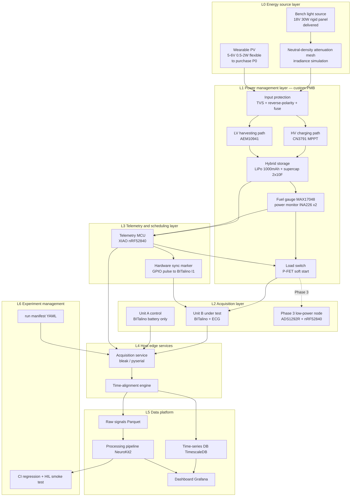
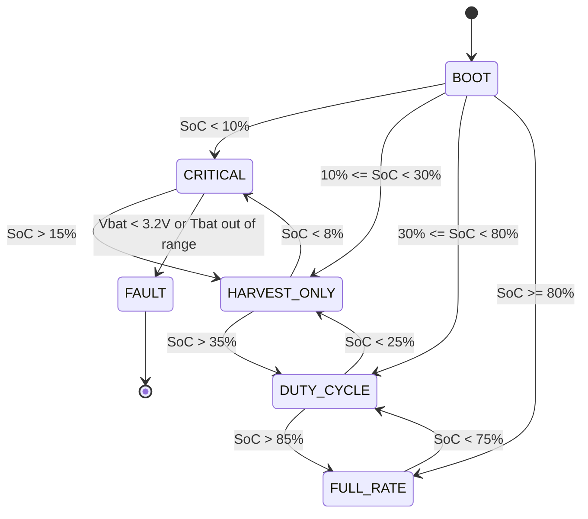

# Solar Self-Powered Wearable Health Monitoring System — Production-Grade Architecture Design

> **Version** v1.0 · **Date** 2026-09-15
> **Inputs**: (a) the as-delivered hardware list `component-inventory.csv`; (b) your relayed "LLM summary of the supervisor's email".
> **Important disclaimer**: I have not seen the original email. Everywhere below that cites "the email's requirements" relies on that **second-hand summary**. Several items in the summary conflict seriously with the delivered hardware; I flag each one and ask you to check against the original before finalising (see the §13 question list).

## Confidence-marker conventions

This document uses the following markers throughout; use them to decide whether you need to go to the datasheet:

| Marker | Meaning |
|---|---|
| ✅ | High confidence; you can act on it directly |
| ⚠️ | Given from experience; **must be verified against the datasheet / the physical part before you act** |
| ❓ | I cannot determine this from the list; needs on-site identification or a question |
| 🚨 | Blocking issue; if unresolved it will damage hardware or invalidate conclusions |

---

# 0. Executive Summary (TL;DR)

## 0.1 Three blocking issues that must be resolved first

### 🚨 P0-1: The delivered solar panel cannot be connected to the EVK10941 — a direct connection will destroy it

- Delivered: a `395mm × 460mm, 18V, 30W` rigid panel. Voc ≈ 21–22 V ⚠️, Vmp 18 V, Imp ≈ 1.67 A.
- The heart of the EVK10941 is the e-peas **AEM10941**, whose PV input (SRC) operating range is about **50 mV – 5 V**, with an absolute maximum rating of about 5.5 V ⚠️.
- **18 V is 3.6× its upper limit. Direct connection = instant chip destruction.** This is not "low efficiency"; it is "magic smoke".
- Also: the email summary says "5–6 V, 0.5–2 W flexible panel", but what arrived is an 18 V / 30 W rigid panel. **The purchase does not match the requirement** — this is the first thing to confirm with the supervisor.

### 🚨 P0-2: This panel is physically impossible to wear

395 × 460 mm ≈ 0.18 m², roughly an **A2 sheet** (a size bigger than A3). It is a bench/desktop panel, not a wearable device.
**Zero small flexible wearable panels have been delivered so far** (the PowerFilm on the earlier list did not appear in this delivery).

### 🚨 P0-3: BITalino is not a low-power load; continuous acquisition can never be self-powered

- BITalino's typical operating current is about **65 mA @ 3.7 V ≈ 240 mW** ⚠️ (verify for your specific BT/BLE model).
- According to the email summary, the supervisor wants a "**low-power** health sensor with BLE communication and intermittent measurement". BITalino is about **50×** above that target.
- The detailed energy budget is in §2. The conclusion up front:
  - **Continuous acquisition + wearable-size PV → ~7% self-powered ratio; impossible.**
  - **Duty cycle reduced to ≈ 6.7% (40 s of acquisition every 10 minutes) → self-powered in outdoor scenarios.**
  - **Switch to a genuine low-power front end (ADS1292R/MAX86150 + nRF52840, ≈ 5 mW) → more than 3× self-power margin; this is the "production-grade" answer.**

## 0.2 The architecture in one sentence

> Use **BITalino as the gold-standard reference instrument** (you have 2 units — exactly one for control and one under test),
> use a **custom power mezzanine board (PMB)** as the real energy chain,
> evolve the final load into a **custom low-power BLE node**;
> throughout, an **independent telemetry link + data platform** records energy and signal quality, so the data prove exactly how far the claim "self-powered" actually holds.

## 0.3 Five things you can do today (no purchases needed)

1. **Do not connect the solar panel to the EVK10941.** First put a label on both leads: `18V — DO NOT CONNECT TO AEM`.
2. With the multimeter, measure the 18 V panel's Voc (unshaded, outdoors) and Isc (multimeter on the **10 A range, lead in the 10 A jack**), and record the weather/time. This is the baseline for all later irradiance calibration.
3. Unpack the HeartBIT kit, tick off the §1.4 checklist item by item, and take **complete photos of the silkscreen markings** on both BITalino boards.
4. Follow the three-minute procedure in §1.5 to determine with the multimeter whether `YJL3404A` is a MOSFET or an LDO.
5. Turn the §13 question list into a draft email (don't send it yet; wait until you've read §1).

---

# 1. Delivered-Hardware Verification and Gap Analysis

## 1.1 Item-by-item reading of the CSV

I interpret the CSV's `PIN` column as **number of leads/pins** (solar panel 2, battery 2, YJL3404A 3), not a part number. ⚠️ If that's not what it means, please correct me — it affects the §1.5 determination.

| # | Item | Qty | Role in the architecture | Status |
|---|---|---|---|---|
| 1 | Digital temperature-controlled soldering station | 1 | Assembly tool | ✅ Adequate (but see §5.4 on QFN) |
| 2 | 395×460mm 18V 30W solar panel | 1 | **Bench light source / I-V characterisation only** | 🚨 Not wearable; must not connect to AEM |
| 3 | Handheld multimeter | 1 | Basic measurement | ✅ |
| 4 | Mini thermocouple thermometer | 1 | Readout for thermal-safety tests | ✅ |
| 5 | EVK10941 | 1 | Low-voltage PV harvester evaluation board (AEM10941) | ⚠️ Only usable with a flexible panel below 5 V |
| 6 | Dupont jumper wires | ∞ | Bench wiring | ✅ Bench only; never on the body (see §11) |
| 7 | PH2.0 straight-pin leads | 50 | Battery/load connections | ✅ |
| 8 | Thermal grease | 1 | Thermocouple attachment / thermal interface | ✅ |
| 9 | Wire strippers | 1 | Assembly tool | ✅ |
| 10 | 523450 1000mAh 3.7V Li-ion battery pack | 1 | Main energy storage | ⚠️ Only 1; not enough for a two-unit comparison (see §7) |
| 11 | YJL3404A | 1 | ❓ Unidentified | ❓ See the §1.5 on-site identification procedure |
| 12 | Solder wire | 1 | Assembly | ⚠️ Confirm leaded/lead-free (affects iron temperature) |
| 13 | PH2.0 connecting leads (straight pin) | ∞ | Same as #7 | ✅ |
| 14 | Insulating sleeving / heat-shrink tubing | ∞ | Insulation of battery solder joints (mandatory) | ✅ |
| 15 | **BITalino** | **2** | Acquisition platform / gold-standard reference | ❓ Model unknown; see §1.4 |
| 16 | Multi-function USB tester | 1 | USB charging energy metering | ✅ But only measures the USB line, not PV/battery nodes |
| 17 | Breadboard | 1 | Quick bench validation | ⚠️ Never use for charging loops >1 A (contact resistance heating) |
| 18 | Board clamps | 3 | ❓ Presumably PCB holders / helping hands | ❓ |
| 19 | 2.7V 10F capacitor | 3 | Supercapacitor, pulse buffering / cold-start storage | ✅ See the series-connection and inrush warnings in §5.6 |
| 20 | K-type surface thermocouple | 2 | Panel back temperature + skin-side temperature | ✅ Exactly two channels, matching the dual-point thermal-safety measurement |
| 21 | TEUCER HP600 | 1 | ⚠️ Presumably a thermal interface material (thermal paste) | ⚠️ Verify that it is a TIM |
| 22 | Disposable ECG electrodes | 1 (pack) | Consumable | ⚠️ Seriously insufficient; see §7 |
| 23 | **BITalino HeartBIT kit** | 1 set | Complete ECG acquisition kit | ❓ See dedicated §1.4 |

## 1.2 Email summary vs. hardware: gap matrix

| Requirement in the email summary | Actually delivered | Nature of gap | Action |
|---|---|---|---|
| Small flexible panel, 5–6 V, 0.5–2 W | 18 V / 30 W rigid, A2 size | 🚨 **Complete mismatch** | Use current panel on the bench; wearable panel must be bought separately (§7 P0) |
| Charge controller, MPPT acceptable | EVK10941 (AEM10941, input ≤5 V) | 🚨 **Electrically incompatible with the existing panel** | Dual-path design (§5.2): HV path via CN3791, LV path via AEM |
| 3.7 V Li-Po storage | 523450 1000mAh ✅ | ✅ Matches, but only 1 unit | Buy 2 more (§7 P1) |
| Regulator output 3.3 V / 5 V | `YJL3404A` ❓ | ❓ Part unidentified | Identify on site (§1.5); architecture does not depend on it |
| Load: BLE, intermittent measurement, **low-power** health sensor | BITalino (≈ 240 mW) | 🚨 **50× higher; positioning conflict** | BITalino demoted to reference instrument; production load is custom (§3, §4) |
| Earlier list: PowerFilm flexible panel | ❌ Not delivered | Missing | See §7 P0 |
| Earlier list: thermoelectric generator (TEG) | ❌ Not delivered (only temperature thermocouples) | Missing | Thermoelectric comparison experiment **currently impossible**; see §1.3 |
| Earlier list: supercapacitors | ✅ 2.7V 10F ×3 | ✅ | Used for pulse buffering (§5.6) |

## 1.3 Clear conclusion on the "thermoelectric comparison experiment"

The email summary says the 7 September email "neither explicitly cancelled nor required continuing the thermoelectric comparison experiment". From the hardware:

- What arrived is **K-type surface thermocouples ×2 + thermocouple thermometer + thermal grease + TEUCER HP600**.
- These are all **temperature-measurement** and **heat-conduction** parts, **not power-generating parts**.
- **Not a single thermoelectric generator module (TEG, e.g. a TEC1-12706 used in reverse / Marlow / Micropelt) has arrived.**

Therefore:

> **The thermoelectric generation comparison experiment cannot be carried out with the current materials.**
> But this batch of thermal parts has a more important use that is mandatory for "production grade": **thermal-safety verification**.
> A solar panel worn on the body heats up, and the skin-side contact temperature must be limited (IEC 60601-1 gives an upper limit of roughly 41–43 °C for non-heating applied parts in prolonged skin contact; the exact tier depends on material and contact duration ⚠️ verify against Tables 23/24).
> The two thermocouples are exactly what is needed for synchronised dual-point measurement of **panel back temperature + skin-side interface temperature**. I have written this into the §10 verification plan (TC-07).

If the supervisor really does still want the thermoelectric comparison, TEG modules + heat sinks must be bought (§7 P2).

## 1.4 [Dedicated] Verification of BITalino ×2 and the HeartBIT kit

This is the item you specifically asked to confirm; I have split it into three independent questions.

### Question A: How many boards are there really? Is something double-counted?

In the CSV, `BITalino = 2` (row 16) and `BITalino biosignal acquisition system HeartBIT = special (a complete system)` (row 24) are **two separate entries**. There are two possibilities:

| Case | Meaning | Impact on architecture |
|---|---|---|
| **Case 1**: 2 standalone boards **+** 1 more inside the HeartBIT kit = 3 in total | Ideal | Three units possible: DUT / control / spare |
| **Case 2**: `BITalino=2` counts the board inside the kit, or the kit and loose boards overlap = 2 in total | More likely | Two-unit comparison still possible, no spare |

**Must be confirmed on site**. Method: lay out all BITalino main boards and count them, and photograph **the complete silkscreen of every board** (model + revision + Bluetooth module part number).

### Question B: Is it BT (Bluetooth Classic) or BLE? — this one decides the whole power architecture

This is **more critical than "how many boards"**. ⚠️

| Version | Communication | Typical power | Host-side software stack | Impact on self-powering |
|---|---|---|---|---|
| BITalino (r)evolution **BT** | Bluetooth Classic SPP | ≈ 65 mA ⚠️ | `pyserial` / virtual serial port | Self-powering nearly impossible; slow reconnection (seconds), unsuitable for frequent power cycling |
| BITalino (r)evolution **BLE** | BLE | Significantly lower ⚠️ (must be measured) | `bleak` / GATT | Duty-cycle scheme becomes far more feasible; fast reconnection |

**Action**: use the USB tester + multimeter to measure the current of both boards during continuous 1000 Hz acquisition (method in §10 TC-01). **Don't trust my estimate, and don't trust only the official rating — measure it.** This number is the foundation of every later energy budget.

### Question C: What exactly is in the HeartBIT kit?

HeartBIT is PLUX's packaged product for ECG/cardiac signals. ⚠️ **The following is a typical configuration; be sure to tick it off against your packing list item by item — don't just copy my table.**

```
□ BITalino (r)evolution main board (Core or full board)   Model: ____________  Rev: ______
□ Communication                                          □ BT (Classic)   □ BLE
□ ECG sensor module                                      □ Integrated on board   □ Separate module
□ Accelerometer ACC                                      □ Yes  □ No
□ 3.7V Li-ion battery (included in kit)                  Capacity: ________ mAh
□ 3-lead ECG cable (snap electrode leads)                Count: ______
□ Disposable ECG electrodes (included in kit)            Count: ______
□ micro-USB / mini-USB cable                             □ Yes  □ No
□ Enclosure / strap / storage case                       □ Yes  □ No
□ Software licence (OpenSignals)                         □ Yes  □ No
```

### Conclusion: two boards form an ideal experimental design ✅

Whether it ends up being 2 or 3 boards, **you have at least 2**, which is a gift for the experimental design, not a problem:

```
        ┌──────────────────────────────┐
        │  Same subject, same moment   │
        │  Same lead config (or mirror)│
        └──────────┬───────────────────┘
                   │
      ┌────────────┴────────────┐
      │                         │
┌─────▼──────────┐      ┌───────▼─────────┐
│ Unit A (ctrl)  │      │ Unit B (DUT)    │
│ Battery only   │      │ PMB solar power │
│ No harvester   │      │ Harvester on    │
│ = gold std     │      │ = to be verified│
└────────────────┘      └─────────────────┘
      │                         │
      └──────────┬──────────────┘
                 ▼
     Differential signal-quality analysis: SNR / baseline wander /
     0.5–40Hz noise floor / R-peak detection agreement
```

**This two-unit comparison is exactly the most publishable part of the whole project**: it quantitatively answers "how much does ECG signal quality actually degrade once a solar harvester is added?". Boost-converter switching noise coupling into the ECG passband is a real and underestimated risk (§5.7 is dedicated to how to suppress it). Without a control group this question simply cannot be answered.

## 1.5 On-site identification procedure for unidentified parts

### `YJL3404A` (3 pins, 1 unit) ❓

I can't be sure what it is. The two most likely candidates: **an N-channel MOSFET in SOT-23 (a Chinese domestic part in the AO3404 family)** or **a three-terminal LDO regulator**. A multimeter settles it in 3 minutes:

```
Step 1: Set the multimeter to "diode mode" and measure every pair of the three pins in both directions (6 readings total); record them.

  → If one pair reads ≈ 0.4–0.7 V in one direction and OL (open) in the other,
    and all other combinations read OL
    ⇒ Very likely a MOSFET (you measured the body diode: S→D conducts, D→S blocks)
    ⇒ Pinout per usual SOT-23 convention: 1=G (gate) 2=S (source) 3=D (drain)
    ⇒ Use: [high-side/low-side load switch] in this architecture, see §5.5

  → If readings across the three pairs are messy, with several ≈ 0.5 V drops, or a near-0 path
    ⇒ Possibly an LDO; go to Step 2

Step 2 (only if an LDO is suspected): build a minimal circuit on the breadboard
  IN ← 5.0V (supplied from USB + USB tester)
  GND ← ground
  OUT → 10 kΩ to ground; measure OUT-to-ground voltage with the multimeter
  Add 1 µF input cap + 1 µF output cap (skip if you don't have them; reading may be unstable)
  → Stable 3.3 V / 5.0 V / 1.8 V ⇒ it's an LDO; note the output voltage
  → 0 V or equal to input ⇒ pinout guessed wrong; retry with another IN/GND/OUT assignment (6 in total)

⚠️ Safety: limit current to under 100 mA throughout; an LDO with reversed pins heats up immediately —
   cut power the moment it feels hot.
```

**Whatever the result, this architecture does not depend on this part.** There is only 1 of it, so it has no reproducible engineering value (a production-grade design cannot be built on "there's one mystery part in stock"). Once identified: if it's a MOSFET, use it as a prototype validation part for the load switch; if it's an LDO, keep it as a bench aid. The formal BOM is in §7.

### `TEUCER HP600` ⚠️

Presumably a **thermal interface material (thermal paste / heat-sink compound)** from the UK brand TEUCER. Verification: check the thermal conductivity (W/mK) printed on the package.
- If it's a TIM (≈ 0.9–3 W/mK): use it for thermocouple attachment and panel-back thermal coupling.
- If it's something else (e.g. potting compound, thermal pad): different use; tell me and I'll adjust the §10 thermal test plan.

### `Board clamps ×3` ❓

Presumably **PCB holders / soldering helping hands (third hand)**. If so, great — the §6 soldering SOP uses them. If they're something else (e.g. board shears), please tell me.

---

# 2. Energy Budget Model (do the maths first, then draw the architecture)

**This section is the foundation of the entire document.** Every argument about "can it be self-powered" is settled here, with numbers.

## 2.1 Load model

⚠️ The BITalino values in the table below are empirical estimates and **must be replaced with §10 TC-01 measurements**. I've written the formulas parametrically so you can substitute measured values directly.

| State | Current @3.7V | Power | Notes |
|---|---|---|---|
| BITalino BT, continuous 1000 Hz acquisition | ≈ 65 mA ⚠️ | **≈ 240 mW** | Baseline for all calculations in this document |
| BITalino BLE, continuous 1000 Hz acquisition | To be measured ❓ | ? | Possibly significantly lower |
| BITalino powered but idle (not connected) | To be measured ❓ | ? | Usually not much lower |
| System quiescent with PMB load switch open | ≈ 30–60 µA ⚠️ | ≈ 150 µW | AEM quiescent + fuel gauge + MCU sleep |
| Telemetry MCU (nRF52840, 1 Hz sampling + BLE advertising) | Average ≈ 0.5 mA ⚠️ | ≈ 1.9 mW | |
| **Comparison: true low-power front end** (ADS1292R + nRF52840) | Average ≈ 1.4 mA ⚠️ | **≈ 5 mW** | Target load of §4 Phase 3 |

**Remember this 50× gap: 240 mW vs 5 mW. It determines the direction of the whole project.**

## 2.2 Harvesting model

### Realistic output of wearable-size PV

Assume a **realistically wearable** flexible panel: `100 × 60 mm = 60 cm² = 0.006 m²`, monocrystalline flexible, nominal efficiency 18%.

| Scenario | Effective irradiance | Instantaneous power | Hours per day | Energy per day |
|---|---|---|---|---|
| Outdoor direct sun (ideal, facing the sun) | 1000 W/m² | 1.08 W | — | Reference value |
| **Outdoor, actually worn** (body shading, random orientation, clothing, clouds) | ≈ 250 W/m² ⚠️ | ≈ 270 mW | 2 h | **0.54 Wh** |
| Indoor office lighting 500 lux (≈ 1.5 W/m², indoor efficiency drops to ≈ 8%) | 1.5 W/m² | ≈ 0.72 mW | 8 h | **0.0058 Wh** |
| Night | 0 | 0 | 14 h | 0 |

**Harvesting-chain efficiency**: harvester conversion ≈ 80% ⚠️ × battery charge/discharge round trip ≈ 90% ⚠️ = **≈ 0.72**

```
Usable daily energy H = (0.54 + 0.0058) Wh × 0.72 ≈ 0.39 Wh/day
Average available power P_avail = 0.39 Wh ÷ 24 h ≈ 16.3 mW
```

> **Key insight: indoor lighting contributes 5.8 mWh/day, 1.5% of the total.**
> At this scale, indoor PV is **essentially zero**. Any "it charges itself in the office" narrative does not hold up.
> This exactly confirms the supervisor's cautious wording in the email summary: "solar can extend runtime, but it cannot be guaranteed in advance that a small panel will free the device entirely from external charging". **She is right, and the situation is even more severe than the summary says.**

## 2.3 Self-powering feasibility: solving the duty-cycle equation

Let the duty cycle be D (fraction of time spent acquiring); then:

```
P_avg = D × (P_BITalino + P_MCU) + (1 − D) × P_standby
      = D × 242 mW + (1 − D) × 0.2 mW

Setting P_avg = P_avail = 16.3 mW:
      16.3 = 241.8 D + 0.2
      D = 6.7%
```

### Conclusion table

| Operating mode | Power demand | Feasibility | Notes |
|---|---|---|---|
| **Continuous acquisition (BITalino)** | 242 mW | ❌ **EAR ≈ 6.7%** | Self-powered ratio below 7%. Solar only extends runtime from 15.4 h to ≈ 16.5 h, ≈ 7% longer |
| **Duty cycle 6.7%** (40 s every 10 min) | 16.3 mW | ✅ **EAR ≈ 1.0** | Exactly breaks even in the 2 h/day outdoor scenario |
| **Duty cycle 3%** (18 s every 10 min) | 7.5 mW | ✅ **EAR ≈ 2.2** | 2× margin; survives cloudy days |
| **Low-power front end, continuous acquisition** | 5 mW | ✅ **EAR ≈ 3.3** | **A true "self-powered wearable"** |

### Reverse check: how big a panel would continuous BITalino operation need?

```
Demand 242 mW × 24 h = 5.81 Wh/day
Linear extrapolation from 60 cm² producing 0.39 Wh/day:
Required area = 60 × (5.81 / 0.39) ≈ 894 cm² ≈ 0.09 m²
≈ three A4 sheets laid flat, and it must be well oriented all day
```

**Not wearable. This is why the load must change, not the panel size.**

## 2.4 Defining the two core KPIs (metrics for the paper/report)

From here on, the project speaks in these two quantitative metrics, no longer in binary "can/cannot be self-powered" terms:

| Metric | Definition | Target |
|---|---|---|
| **EAR** (Energy Autonomy Ratio) | Harvested energy ÷ consumed energy over a 24 h window | Phase 2 ≥ 1.0 (outdoor scenario); Phase 3 ≥ 2.0 |
| **RES** (Runtime Extension by Solar) | (Runtime with harvester − runtime without harvester) ÷ runtime without harvester | Measured and reported for all scenarios; no hard target |

Auxiliary metrics: `MTBC` (Mean Time Between Charges, average interval between external charges), `SQI_delta` (difference in ECG SNR with the harvester on vs. off; see §10 TC-05).

---

# 3. System Architecture (Layered)

## 3.1 Overview diagram



## 3.2 Layer responsibilities and boundaries

| Layer | Responsibility | Key design constraint | When **not** to build this layer |
|---|---|---|---|
| **L0 Energy source** | Provide light energy and **modulate it reproducibly** | Irradiance must be measurable and reproducible, otherwise all conclusions are invalid | Always needed |
| **L1 Power management (PMB)** | MPPT, charging, storage, protection, load switching | Must **not pollute** the ECG passband; must have built-in metering | For Phase 1 bench only, modules can be cobbled together, but metering is still required |
| **L2 Acquisition** | Biosignal capture | Unit A must be fully electrically isolated from Unit B | — |
| **L3 Telemetry and scheduling** | Record energy independently of the load, and control the duty cycle | **Must be independent**; cannot piggyback on BITalino | Can be simplified to pure logging if the duty-cycle scheme is abandoned |
| **L4 Edge services** | Multi-source acquisition, time alignment, persistence to disk | Time-alignment error must be <10 ms and provable | Can be skipped for single-source one-off experiments, but not for long-term research |
| **L5 Data platform** | Storage, processing, visualisation | Raw data immutable; processing re-runnable | With fewer than 10 experiments, files + notebooks will do at first |
| **L6 Experiment management** | Reproducibility | Every run must be traceable to a hardware-configuration hash | **Never skip** — this is the lifeline of academic work |

## 3.3 Key architecture decisions (ADR summaries)

### ADR-001: The battery belongs to the PMB; BITalino is treated as a "pure load"

**Decision**: Do not use BITalino's built-in USB charging path; the PMB owns the battery and delivers a "battery-equivalent output" to BITalino via JST-PH.

**Rationale**:
1. BITalino's charging circuit is a black box: it cannot be instrumented for measurement, nor can it do MPPT.
2. The AEM10941's HVOUT current limit is about 80 mA ⚠️, while BITalino needs 65 mA — only 23% headroom; any transient causes a dropout. **So BITalino must never hang off the AEM's LDO output**; it must connect directly to the battery node so the battery absorbs transients.
3. Only by bringing ownership of charging and metering onto the custom board can we talk about "production grade".

**Cost**: Complete charge protection and over-discharge protection must be implemented ourselves (see §5.5, §11).

### ADR-002: Dual charging paths, rather than "find a way to step 18 V down and feed it to the AEM"

**Decision**: Two mutually exclusive paths coexist on the PMB, selected by 0 Ω resistors/jumpers.

- **Path A (HV)**: 18 V panel → `CN3791` (MPPT single-cell Li-ion charger, input withstand ≈ 28 V ⚠️, SOP-8, hand-solderable) → battery
- **Path B (LV)**: 5–6 V flexible panel → `AEM10941` (EVK or custom) → battery

**Rationale**: Putting a buck stage in front to drop 18 V to 3 V before the AEM would make the AEM's MPPT meaningless (it would be tracking the buck's output characteristic, not the panel's I-V curve), and the experimental conclusions would be wrong. Two independent paths are actually simpler and more honest.

### ADR-003: BITalino is demoted from "final product" to "reference instrument"

**Decision**: Phase 1/2 use BITalino to validate the energy chain; the Phase 3 production load is a custom low-power node, and BITalino becomes the gold-standard control.

**Rationale**: The maths of §2.3. A 240 mW load is physically incompatible with a "self-powered wearable".
**This is the most important decision in this architecture, and the one that most needs the supervisor's sign-off** (§13 Q3).

### ADR-004: Separate the energy chain and the measurement chain in time (Time-Division Harvesting)

**Decision**: The default policy is **no charging while acquiring, no acquiring while charging**, scheduled by the telemetry MCU.

**Rationale**: In PFM/burst mode, a boost converter's burst repetition frequency falls in the Hz–kHz range, cutting right through the ECG passband (0.05–40 Hz), and it gets demodulated into baseband noise across the electrode–skin interface impedance. Time-division multiplexing is the most thorough fix (filtering is the second line of defence; see §5.7).

**Cost**: Sacrifices "charge while acquiring"; §10 TC-05 must quantify whether this policy is worth it.

### ADR-005: Hardware-level time synchronisation, not software timestamps

**Decision**: The telemetry MCU drives sync pulses on one GPIO into BITalino's digital input I1; the MCU timestamps each pulse itself at the same time.

**Rationale**: BITalino and the telemetry MCU are two independent BLE links; host-side timestamps suffer Bluetooth buffering jitter of tens to hundreds of milliseconds. To match "the lighting/charging state at this instant" with "the ECG waveform at this instant", a hardware marker embedded in the data stream is required.
**This is where almost every similar project gets it wrong; getting it right is a methodological contribution in itself.**

---

# 4. Evolution Roadmap: Four Phases

```
Phase 0 ──► Phase 1 ──► Phase 2 ──► Phase 3
Bench setup  Energy chain  On-body      Production-grade
             validation    prototype    node
(Weeks 1-2)  (Weeks 3-5)   (Weeks 6-10) (Weeks 11-18)
```

## Phase 0: Bench setup and part identification (Weeks 1–2)

**Use only delivered materials + a few purchases; no PCB soldering.**

- Identify `YJL3404A`, verify the HeartBIT kit, count the BITalino boards and determine their models
- Measure BITalino power consumption (TC-01) and the 18 V panel's I-V curve (TC-02)
- Set up an irradiance reference (reference cell or lux meter)
- Set up the Git repository and the run-manifest convention (L6 first; don't wait for hardware)

**Exit criterion**: every item in `docs/inventory-verified.md` has a measured number or a photo; no ❓ remains.

## Phase 1: Energy-chain validation (Weeks 3–5, breadboard/perfboard)

**Goal: prove the "light → electricity → battery → load" chain closes on the bench, and every node is metered.**

```
18V 30W panel ──[ND mesh]──► [fuse+TVS+reverse-pol.] ──► CN3791 MPPT module
                                                          │
                                        INA226 #1 (PV-side metering)
                                                          ▼
                                                   523450 LiPo 1000mAh
                                                     + NTC temperature monitoring
                                                          │
                                       INA226 #2 (load side) + MAX17048 fuel gauge
                                                          ▼
                                                   P-FET load switch
                                                          ▼
                                              JST-PH ──► BITalino Unit B
```

> ⚠️ **Use the breadboard only for signal and low-current sections. The charging loop (up to 0.5 A) must use soldered perfboard or point-to-point wiring; breadboard contact resistance heats up and the readings cannot be trusted.**

**Exit criterion**: 72 h of continuous unattended operation, telemetry data completeness >99%, and the first real EAR curve.

## Phase 2: On-body wearable prototype (Weeks 6–10, PMB Rev A)

- Flexible PV panel arrives; switch to the LV path (AEM10941)
- PMB Rev A prototype build (see §5.3)
- Introduce duty-cycle scheduling (the §8.2 state machine)
- Formal start of the two-unit comparison experiment (Unit A vs Unit B)
- Thermal-safety verification (TC-07)

**Exit criterion**: outdoor EAR ≥ 1.0 and ECG signal-quality degradation within the acceptable range (TC-05 criteria).

## Phase 3: Production-grade low-power node (Weeks 11–18, PMB Rev B)

- Custom ECG node: `ADS1292R` (2-channel ECG + respiration impedance) or `MAX86150` (integrated PPG+ECG) + `nRF52840`
- PMB Rev B: formal PCB + PCBA, integrating harvester + node + storage
- BITalino becomes the gold standard for Bland-Altman agreement analysis (HR, HRV metrics)
- Long-term wear study

**Exit criterion**: EAR ≥ 2.0; HR agreement LoA with BITalino within the clinically acceptable range; ready for paper submission/demo.

---

# 5. Detailed Hardware Design

## 5.1 Phase 1 bench wiring (buildable with existing materials + a few purchases)

### 5.1.1 PV input stage

```
Panel (+) ─────┬── F1 fuse 2A slow-blow ─┬── D1 SS34 rev-pol ┬──► CN3791 VIN
               │                        │                  │
              TVS1                     C1                  C2
            SMAJ24A                 100µF/35V            100nF
               │                        │                  │
Panel (−) ─────┴────────────────────────┴──────────────────┴──► GND
```

**Part-selection notes**:
- `F1`: the 18 V panel's Isc is ≈ 1.8 A, so use a 2 A slow-blow fuse.
- `TVS1`: `SMAJ24A` (breakdown ≈ 26.7 V, above Voc 22 V, below the CN3791's 28 V rating). ⚠️ Choose the final grade after measuring Voc: **TVS breakdown voltage must be > measured Voc × 1.1**, otherwise it will conduct and heat up continuously on sunny days.
- `D1`: `SS34` (40 V / 3 A Schottky), drop ≈ 0.4 V @ 1 A. A 2% loss at 18 V — acceptable.
  ⚠️ **But on the Phase 2 5 V flexible-panel path, 0.4 V is an 8% loss; it must be replaced with an ideal diode (`LM66100`, drop ≈ 10 mV).**
- `C1`: 100 µF low-ESR electrolytic, placed close to the CN3791 input.

### 5.1.2 Charging stage (HV path)

`CN3791` MPPT single-cell Li-ion charge controller ⚠️ key parameters must be confirmed in the datasheet:

| Parameter | How to set | Value for this project |
|---|---|---|
| MPPT voltage point | Resistor divider from VIN to the MPPT pin | Set to ≈ 0.76 × Voc ≈ 16.5 V ⚠️ |
| Charge current | Sense resistor Rcs on the CS pin | **0.5 A (0.5C)** |
| Termination voltage | Fixed 4.2 V in the chip | 4.2 V |

> 🚨 **Severe mismatch warning**: 18 V × 1.67 A = 30 W input; at 90% efficiency it could push **6.9 A** into a 3.9 V battery. But 1C for a 1000 mAh cell is 1 A, and the safe charge rate should be 0.5C = **0.5 A**.
> **Only about 6% of this panel's capability is used.** Connect it without Rcs current limiting and you will blow up the battery.
>
> So the real role of this 30 W panel in this project is:
> 1. **A stable bench source that "never runs short of light"** — even on cloudy days or half shaded, it can still saturate a 0.5 A charge;
> 2. **An I-V characterisation and teaching sample**;
> 3. **The carrier for irradiance simulation** (with ND mesh; see below).
> It is **not**, and never will be, part of the wearable solution.

### 5.1.3 Irradiance simulation: the right way and the wrong way

To simulate on the bench "how a small wearable panel behaves in low light", you must **attenuate the entire panel uniformly**:

```
✅ Right: cover the whole panel with neutral-density mesh (window screen / ND filter), stacking layers to set the attenuation
         → current drops proportionally, voltage falls only logarithmically, I-V curve shape is preserved
         → measure the irradiance actually reaching the panel simultaneously with a reference cell

❌ Wrong: cover part of the panel with cardboard
         → the shaded cell in the series string becomes the current-limiting element; the whole string's current collapses
         → the I-V curve becomes multi-peaked; MPPT locks onto the wrong peak
         → 🚨 More dangerous: the shaded cell is reverse-biased by the others, forming a [hot spot];
            local temperature can exceed 100 °C, permanently damaging the panel or even igniting it
```

**This must be written into the lab operating procedures.** Partial-shading experiments may only be done in an explicit hot-spot study, with bypass diodes and infrared monitoring.

## 5.2 PMB (Power Mezzanine Board) functional-block breakdown

The PMB is the only circuit board this project needs to design in-house. Functional blocks:

```
┌────────────────────────────────────────────────────────────────────┐
│                      PMB — Power Mezzanine Board                   │
│                                                                    │
│  ┌─────────┐   ┌──────────────┐                                    │
│  │ J1 PV in│──►│ Input protect│──┬──► [Path A] U1 CN3791 MPPT ─┐   │
│  │ term/XT30│  │ F1/TVS/D1/C1 │  │                              │   │
│  └─────────┘   └──────────────┘  └──► [Path B] U2 AEM10941 ────┬─┤   │
│                       │                                        │ │   │
│                  RS1 0.1Ω ──► U4 INA226 #1 (PV metering)      │ │   │
│                                                                ▼ ▼   │
│  ┌──────────────────────────────────────────────────────── BAT node │
│  │                                                                  │
│  │  ┌───────────┐  ┌──────────────────┐  ┌──────────────────┐      │
│  │  │ J2 JST-PH │  │ Supercap buffer  │  │ U3 MAX17048      │      │
│  │  │ LiPo 1000 │  │ 2× 2.7V10F series│  │ fuel gauge I²C   │      │
│  │  │ + J3 NTC  │  │ + balance+softst.│  │                  │      │
│  │  └───────────┘  └──────────────────┘  └──────────────────┘      │
│  └───┬──────────────────────────────────────────────────────────────┤
│      │                                                              │
│      ▼  RS2 0.05Ω ──► U5 INA226 #2 (load metering)                  │
│  ┌──────────────┐                                                   │
│  │ Q1 load sw.  │◄── GPIO (from U7)  + hardware watchdog            │
│  │ P-FET softst.│                                                   │
│  └──────┬───────┘                                                   │
│         ▼                                                           │
│  ┌──────────────┐   ┌────────────────┐   ┌──────────────────────┐  │
│  │ π filter     │──►│ J4 JST-PH out  │   │ J5 sync pulse → I1   │  │
│  │ 10µH+22µF×2  │   │ → BITalino bat │   │ 1kΩ series + clamp   │  │
│  └──────────────┘   └────────────────┘   └──────────────────────┘  │
│                                                                    │
│  ┌──────────────────────────────────────────────────────────────┐ │
│  │ U7 telemetry MCU (XIAO nRF52840 module SMD) — I²C host+BLE+sched│ │
│  └──────────────────────────────────────────────────────────────┘ │
│                                                                    │
│  Test points: TP_PV+ TP_PV− TP_BAT TP_LOAD TP_GND×3 + two Kelvin pad pairs │
└────────────────────────────────────────────────────────────────────┘
```

## 5.3 PMB Rev A (hand-built version — you solder it yourself)

**Goal**: validate topology and firmware; size is not a concern.

**Process choice**: **perfboard (stripboard/protoboard) + modules**, no PCB fabrication. Rationale: Rev A's value lies in fast iteration; a board order takes 5–7 days, and changing a single trace means re-ordering.

| Ref | What to use | Form | Hand-soldering difficulty |
|---|---|---|---|
| Charger | **CN3791 MPPT module** (ready-made module with potentiometer) | Module | ★☆☆ pin headers only |
| Harvester | **EVK10941** (delivered) | Evaluation board | ★☆☆ wiring only |
| Power metering | **INA226 module ×2** (GY-226 type) | Module | ★☆☆ |
| Fuel gauge | **MAX17048 or CW2015 module** | Module | ★☆☆ |
| Telemetry MCU | **Seeed XIAO nRF52840** | Castellated module | ★★☆ castellations can take pin headers |
| Load switch | **AO3401 P-MOS** (or the YJL3404A once identified) | SOT-23 | ★★★ needs an adapter board |
| Protection parts | SS34 / SMAJ24A / fuse holder | Through-hole | ★☆☆ |
| Supercaps | 2.7V 10F ×2 (delivered) | Through-hole | ★☆☆ |

> 💡 **SOT-23 hand-soldering tip**: buy **SOT-23-to-DIP adapter boards** (a few cents each), solder onto the adapter first, then plug it into the perfboard. Use the temperature-controlled station at 340 °C + fine solder + flux; tack one corner first, then solder the other two pins.

**Rev A estimated size**: ≈ 90 × 70 mm perfboard. Stays on the desk, not on the body.

## 5.4 PMB Rev B (formal PCB — key decision: don't hand-solder everything)

### 🚨 Hard constraints on process feasibility

All you have is one **temperature-controlled soldering iron** (no hot-air station, no reflow oven, no stencil). That determines:

| Package | Hand-solderable? | Verdict |
|---|---|---|
| SOP-8 (CN3791) | ✅ Yes | OK |
| SOT-23 (MOSFET) | ✅ Yes (with adapter board or some practice) | OK |
| VSSOP-10 (INA226, 0.5 mm pitch) | ⚠️ Barely (needs drag soldering + lots of flux + solder wick) | High risk |
| TDFN / WLP (MAX17048) | ❌ Bottom pads; the iron can't reach them | **Impossible** |
| **QFN-40 5×5 (AEM10941)** | ❌ **Absolutely impossible** | **Must be machine-placed** |

### Conclusion: Rev B goes to **PCBA contract assembly** (JLCPCB SMT)

```
┌──────────────────────────────────────────────────────────┐
│ Division of labour                                       │
├──────────────────────────────────────────────────────────┤
│ [Factory placement] All SMD: AEM10941, CN3791, INA226×2, │
│             MAX17048, MOSFET, all 0402/0603 R/C,         │
│             inductors, TVS, Schottky                     │
│                                                          │
│ [You hand-solder] Through-hole only: JST-PH conn. ×4,    │
│             screw terminals, supercaps ×2, headers, TPs  │
│             ← exactly what your iron is good at          │
└──────────────────────────────────────────────────────────┘
```

**This has a hidden benefit too**: factory placement is far more consistent than hand soldering, which is what makes your Unit A / Unit B comparison meaningful — if both boards were hand-soldered, signal differences could come from soldering quality rather than the solar harvester, and the whole comparison would be invalidated.

### Rev B prototype-order parameters (can be entered directly on the order page)

| Item | Value | Rationale |
|---|---|---|
| Layer count | **4 layers** (Sig / GND / PWR / Sig) | A solid ground plane is crucial for ECG noise suppression; the extra cost is far below the debugging cost |
| Board thickness | 1.0 mm | Weight saving for wearables; 1.6 mm also fine |
| Copper weight | 1 oz | 0.5 A max; sufficient |
| Surface finish | **ENIG (immersion gold)** | Not HASL: HASL pads are uneven, giving low yield for fine-pitch placement; ENIG is also more corrosion-resistant (worn against sweaty skin) |
| Solder mask | Blue/black, either | — |
| Size | ≈ **50 × 35 mm** | Target wearable size |
| Prototype quantity | **5 bare boards + 3 assembled** | 3 = DUT + control + spare |
| Parts library | Prefer **JLCPCB Basic library** parts | No feeder-loading fee |

⚠️ `AEM10941` may not be in the Basic library; it must go through the **Extended library or consigned (self-sourced) parts**, adding cost and lead time. **Search the parts library to confirm stock before ordering** — if this gets stuck, the whole Rev B timeline slips.

## 5.5 Key sub-circuit design points

### 5.5.1 Load switch (Q1) — it can't be just a single MOSFET

```
        BAT ──────┬──────────────┐
                  │              │
                  │         ┌────┴────┐
                 R1         │   Q1    │  P-MOS (AO3401 or YJL3404A)
                100kΩ       │  S   D  │
                  │         └──┬───┬──┘
        GPIO ──R2─┴─── G ──────┘   └──────► Load out
              10kΩ    │
                     C1  ← soft-start cap 100nF
                      │      (forms an RC with R2, limiting gate slew rate)
                     GND
```

**Three things it must include** (missing any one means it isn't production grade):

1. **Soft start**: BITalino's inrush current at power-on can reach several hundred mA. The gate RC stretches the turn-on ramp to ≈ 1 ms and suppresses the inrush. Without it, the battery voltage sags on every power-up and the fuel-gauge readings go haywire.
2. **Off by default**: `R1` pulls the gate up to the source, so the load disconnects automatically when the MCU resets/loses power (fail-safe).
3. **Hardware watchdog**: if the MCU runs away, a watchdog must be able to force the load off. Otherwise a single firmware bug will drain the battery overnight. ⚠️ The nRF52840's internal WDT can only reset the MCU; if GPIOs default to high-impedance after reset, `R1` guarantees the load turns off — **be sure to confirm this path holds during schematic review**.

### 5.5.2 Over-discharge protection — dual redundancy

> 🚨 The AEM10941's over-discharge protection covers only its own LDO output. **If the load hangs directly off the battery node (which is exactly what this architecture's ADR-001 does), the AEM cannot protect it.**

Three lines of defence, none optional:

| Level | Mechanism | Threshold | Notes |
|---|---|---|---|
| 1 | Battery pack's built-in PCM protection board | ≈ 2.5 V ⚠️ | Last resort; requires reactivation after tripping; an abnormal event |
| 2 | PMB load switch (software) | **3.4 V** | MCU reads the MAX17048 and disconnects the load below threshold |
| 3 | PMB hardware comparator (optional, added in Rev B) | 3.2 V | Backstop if software fails |

⚠️ **First confirm whether the 523450 battery pack really has a PCM**: look for a small protection board at the top of the battery, or do an over-discharge test with an adjustable supply (risky; recommend only visual inspection + checking the supplier's spec). **If there is no PCM, levels 2 and 3 are the only defences, and Rev A must add the hardware comparator.**

### 5.5.3 Metering chain (this is the watershed between "production grade" and "homework grade")

```
INA226 #1 @ PV side: Rshunt = 0.1 Ω
  Range: 18V path max 0.5A → 50 mV, within the INA226's 81.92 mV full scale ✅
  Resolution: 2.5 µV LSB / 0.1Ω = 25 µA ✅ enough to measure µA-level currents in low light

INA226 #2 @ load side: Rshunt = 0.05 Ω
  Range: max 0.5A → 25 mV ✅
  Resolution: 50 µA ✅

⚠️ Shunt resistors must be 1% or better, and must use a [Kelvin four-wire connection]:
   current flows through wide copper; sense traces leave from the middle of the resistor pads and must never share the current path.
   This is the most common beginner mistake and introduces 10-30% systematic error.
```

**Why two INA226s instead of one?** Because to compute EAR you must know "how much comes in" and "how much goes out" **simultaneously**. Measure only one end, and battery self-discharge, supercap leakage and the PMB's own quiescent consumption all become unaccountable — the EAR would be made up.

### 5.5.4 NTC battery temperature monitoring

A 10 kΩ B3950 NTC is attached to the cell surface (fixed with thermal grease + Kapton tape); after a divider it goes to the MCU ADC.
**Policy**: **charging is forbidden** below 0 °C or above 45 °C (charging Li-ion at low temperature causes lithium plating, a common cause of safety incidents). ⚠️ This is mandatory; the CN3791 has no built-in temperature protection.

## 5.6 Supercapacitor subsystem (the correct use of 2.7V 10F ×3)

### Usage decision

| Option | Configuration | Usable energy | Assessment |
|---|---|---|---|
| A | Single 2.7 V 10F on a low-voltage node | — | ❌ 2.7 V can't sit on a 3.7 V battery node |
| B | **2 in series = 5.4 V / 5 F, across the battery node** | 4.2→3.4 V: **15.2 J** | ✅ **Adopted** |
| C | 3 in series = 8.1 V / 3.33 F | Less usable energy | ❌ Wasteful |

**Three roles of option B**:
1. **Pulse buffering**: current spikes during Bluetooth transmission are supplied by the supercaps, reducing the drop across battery internal resistance → steadier fuel-gauge readings and longer battery life.
2. **Cold-start / deep-discharge scenarios**: at low temperature or near empty, battery internal resistance is high; the supercaps can carry BITalino's power-on inrush.
3. **Dawn scenario**: after battery protection has tripped, the energy stored in the supercaps is enough for the MCU to wake up and judge whether light has returned.

### 🚨 Two pitfalls that must be handled

**Pitfall 1: inrush.** Connecting a discharged 5 F capacitor directly across a 4.0 V Li-ion cell gives an instantaneous current = 4.0 V ÷ (battery internal resistance + supercap ESR) ≈ **tens of amps**. This will trip the battery protection board, burn traces, and can even damage the cell.

```
A pre-charge circuit is mandatory:
        BAT ──┬── R_pre 100Ω ──┬── supercap bank
              │                │
              └── Q2 (N-MOS) ──┘
        MCU delays ~5s after power-up (5RC≈5×100×5=2500s ❌ far too slow)
        → use R_pre = 10Ω instead: τ = 10×5 = 50s, 5τ = 250s ≈ 4 minutes
        → or use constant-current pre-charge (LM317 wired as a 100mA CC source): 5F×0.8V/0.1A = 40s ✅ recommended
        When pre-charge completes (difference <50 mV) the MCU turns on Q2 to bypass R_pre
```

**Pitfall 2: leakage current.** Typical supercap leakage is 10–30 µA each ⚠️. Two in series + balancing resistors:
- Leakage 30 µA × 4.0 V ≈ **120 µW**
- Balancing resistors at 100 kΩ: an extra 40 µA × 4.0 V = **160 µW**
- Total ≈ **280 µW**

Compare with the indoor harvesting power of **720 µW** in §2.2 — **the supercap subsystem would eat 39% of indoor harvest!**

```
✅ Countermeasures:
   1. Use 1 MΩ balancing resistors (leakage drops to 4 µA, ≈ 16 µW)
      ⚠️ Cost: slow balancing (time constant 5F×1MΩ = 58 days),
         acceptable for "long-term slowly varying" applications; verify in Rev B that imbalance stays within limits
   2. Better: use an MCU-controlled N-MOS to disconnect the whole supercap bank during [prolonged low light]
      → completely eliminates this 280 µW loss indoors/at night
   3. Rev B can consider active balancing (e.g. TL431 or a dedicated balancing IC)
```

> **This 280 µW analysis is exactly what "production-grade" thinking looks like**: in an energy-harvesting system, **every µW of parasitic loss must go into the ledger**. A buffer capacitor that "can't hurt to add" may be a net negative in low-light scenarios.

## 5.7 🚨 EMC: boost-converter noise must not pollute the ECG (the biggest technical risk in this project)

### Risk mechanism

```
AEM10941 / CN3791 switching ──► tens to hundreds of kHz switching noise
         │
         ├─► Conducted coupling: enters BITalino's analog front end via the supply lines
         │
         ├─► Radiated coupling: the switching loop (high-di/dt loop formed by inductor–switch–diode)
         │              radiates into the ECG lead wires
         │
         └─► 🚨 The most insidious path: in PFM/burst mode the burst [repetition frequency]
             varies with input power and can drop to the Hz–kHz range.
             This envelope is demodulated by the nonlinear electrode–skin interface impedance
             and lands directly in the ECG passband 0.05–40 Hz — conventional high-frequency filtering
             is completely ineffective against it, and it varies with the lighting,
             so it looks just like a "physiological signal".
```

**This is the most dangerous failure mode**: it doesn't crash the system; it makes your data **look right while actually being wrong**.

### Five lines of defence

| # | Measure | Where | Effectiveness |
|---|---|---|---|
| 1 | **Time-division multiplexing** (ADR-004): charging off while acquiring | Firmware scheduling | ★★★★★ Most thorough |
| 2 | **π filter**: 10 µH + 22 µF × 2 at the load output | PMB | ★★★★☆ |
| 3 | **Minimise switching-loop area**: keep the loop formed by inductor, switch, diode and input/output capacitors as small as possible | PCB layout | ★★★★☆ |
| 4 | **Star grounding**: analog ground and power ground meet at a single point at the battery negative | PCB layout | ★★★☆☆ |
| 5 | **Physical separation**: don't route PV cables parallel to ECG lead wires, spacing > 50 mm; add ferrite rings on PV cables | Mechanical design | ★★★☆☆ |

### Mandatory verification (TC-05, see §10)

Do the comparison with an **ECG phantom** (not a human), because human signals have intrinsic variability that can neither mask nor prove the noise:

```
ECG phantom circuit (solder it yourself, cost < CNY 10):
  Signal source (phone audio output / function generator, 1 mV amplitude, 1 Hz)
       │
      R1 1kΩ ──┬── electrode terminal RA
               │
              R2 10Ω        ← divides down to the mV level
               │
               ├── electrode terminal LA
              R3 1kΩ
               │
              GND ───────── electrode terminal RL
  
  Each electrode terminal gets 51kΩ in series + 47nF in parallel to emulate the electrode–skin interface impedance
```

**Criterion**: 0.5–40 Hz noise floor (µV_rms) with the harvester OFF vs ON.
**Requirement: noise-floor increase in the ON state < 10 µV_rms** (relative to a typical 1 mV R wave, i.e. SNR degradation < 0.1%). ⚠️ I set this threshold from engineering experience; a formal report should cite an ECG-equipment standard (e.g. the noise requirements in IEC 60601-2-25).

---

# 6. Soldering and Assembly Work Instructions (SOP)

> You asked: "if I need to make a PCB or solder anything along the way, tell me all of it". This section is the complete answer: **every place where the soldering iron comes out, listed in order**.

## 6.0 Setup before starting

### Iron temperature (confirm the solder type first)

```
Check the label on the solder wire:
  Sn63Pb37 / Sn60Pb40 (leaded) → set iron to 300–330 °C
  Sn99.3Cu0.7 / SAC305 (lead-free) → set iron to 340–370 °C
  No label? → start at 340 °C; if the solder doesn't flow, +10 °C

High-thermal-mass joints (battery leads, thick wire, ground copper): temporarily +20 °C, or change tip (T12-D24/K)
Fine-pitch SMD: use a T12-BC2 bevel (hoof) tip + plenty of flux and drag-solder
```

### General rules

- Finish each joint **within 3 seconds**. Past 5 seconds, stop, let it cool, and switch to a larger tip (not more time).
- After soldering, **inspect visually**: a joint should be a shiny concave cone. **Balled, dull or grainy = cold joint; must be reworked.**
- After each joint, **verify with the multimeter's continuity mode**, and check for **shorts between adjacent joints**.
- Clean flux residue with isopropyl alcohol (IPA) + a brush (especially for body-worn parts; residue absorbs moisture and corrodes).

---

## 6.1 [Task S-1] Solar panel lead termination — 🚨 live; cover it first

> **Safety**: a solar panel in light is **always live; there is no switch**. Before starting, **fully cover the panel** with opaque cloth/cardboard, or move it to a dark room.

| Step | Action | Verification |
|---|---|---|
| 1 | Cover from light. Multimeter Voc should read < 1 V | Confirm reading |
| 2 | Identify and **mark polarity with a marker pen** (usually red=+, black=−; if unsure, briefly uncover and measure once) | Photograph for records |
| 3 | Strip 8 mm (use the correct gauge notch on the strippers) | No broken copper strands |
| 4 | **Tin** the wire ends (pre-tin, within 3 seconds) | Even solder coat |
| 5 | Solder to an **XT30 male** connector or a 2.54/5.08 screw terminal | — |
| 6 | **Slide on the heat-shrink before soldering!** (forgetting to do this first is the most common reason for rework) | — |
| 7 | Shrink the tubing with a hot-air/heat gun at 120–150 °C | Fully covered, no bare copper |
| 8 | Continuity mode: confirm **no continuity between + and −** | Must read OL |
| 9 | Apply label: `18V 30W — DO NOT CONNECT TO AEM10941` | — |

**Time**: ≈ 20 minutes. **Difficulty**: ★☆☆

---

## 6.2 [Task S-2] Li-ion battery lead termination — 🚨 the most dangerous step

> 🚨 **Strictly forbidden**: never solder directly onto the cell body/tabs. The 523450 battery pack should ship with leads attached; you only terminate **the ends of those leads**.
> If it has no leads and only bare tabs — **stop and contact me or find someone with a spot welder**. Li-ion tabs must be **spot-welded**; soldering-iron heat damages the separator and causes internal shorts.

```
Order of operations (follow strictly; handle only one wire at a time):

  ┌─────────────────────────────────────────────────┐
  │ 1. Slide heat-shrink onto both leads first      │
  │    (push it to the far end)                     │
  │                                                 │
  │ 2. Strip only the [red wire (+)] 5mm and solder │
  │    a PH2.0 terminal immediately                 │
  │    ← the black wire is still fully insulated,   │
  │      so a short is impossible                   │
  │                                                 │
  │ 3. Push the heat-shrink up, shrink it, confirm  │
  │    the red joint is fully covered               │
  │                                                 │
  │ 4. Only now touch the [black wire (−)]: strip   │
  │    5mm, solder a PH2.0 terminal                 │
  │                                                 │
  │ 5. Heat-shrink over the black joint             │
  │                                                 │
  │ 6. Press both terminals into the PH2.0 housing  │
  └─────────────────────────────────────────────────┘

  🚨 Throughout: iron tip, tweezers and strippers must never touch both wires at once
  🚨 Clear all metal debris from the bench
  🚨 Keep a ceramic dish/sand tray nearby (in case of thermal runaway, drop it in)
```

**Mandatory verification after soldering (3 checks; fail any and rework)**:
1. Multimeter across the two PH2.0 pins reads ≈ **3.7–4.2 V**, and **polarity matches your record**
2. Continuity mode: the two pins are **not shorted**
3. Visual: no bare copper, heat-shrink fully covering

**Time**: ≈ 15 minutes. **Difficulty**: ★★☆ (hazard ★★★★)

---

## 6.3 [Task S-3] 🚨 BITalino battery connector polarity check — get it wrong once and a board is gone

> **This is the step in the whole project most likely to cause irreversible loss.** JST-PH connectors are **not keyed for polarity**: the two wires can be swapped in the housing, and the socket itself doesn't care. Different manufacturers use different pin orders.

```
Verification procedure (before connecting anything):

Step 1: Take BITalino's own battery (the one from the HeartBIT kit)
        and plug it into BITalino's battery socket — [do not power on]

Step 2: Multimeter on DC voltage; carefully touch the probes to
        the back of the two solder pins of BITalino's battery socket (board underside)
        or to the metal contacts of the supplied battery's connector

Step 3: Record which pin is positive, defined by the connector's [latch orientation]
        e.g. "with the latch facing up, the left pin is +"
        → draw a diagram + take a photo and save to repo docs/polarity.md

Step 4: Unplug the supplied battery, measure the polarity of [your own PH2.0 lead],
        and confirm it matches Step 3 exactly

Step 5: If it doesn't match — use small tweezers/a pick to lift the PH2.0 housing latch,
        pull the terminals out, swap their positions, and reinsert
        (do not cut and re-solder; the crimp terminals are removable)

Step 6: Measure again. It passes only when two readings agree.
```

> ⚠️ I'm not sure whether BITalino has reverse-polarity protection (❓). **Treat it as having none.**

**Time**: ≈ 15 minutes. **Difficulty**: ★☆☆ (but mandatory, and must be cross-checked by two people)

---

## 6.4 [Task S-4] Kelvin connection of the shunt resistors

```
Wrong wiring (❌ 10–30% error):
   current ──►┌──────────┐──► current
              │  Rshunt  │
              └──┬────┬──┘
                 │    │
            sense+  sense−    ← sense leads taken from the [current path],
                                so contact and trace resistance get measured too

Right wiring (✅ Kelvin four-wire):
   current ──►┌──────────┐──► current   ← current flows through the resistor's [two ends]
              │  Rshunt  │
              └─┬──────┬─┘
                │      │
            sense+   sense−   ← sense leads taken from the [middle of the resistor's own pads],
                                carrying no current
```

**Perfboard implementation**: use an SMD shunt (2512 package, 0.1Ω 1%) soldered onto an adapter board; route current through both ends with thick copper wire, and take the sense lines from the middle of the pads with fine enamelled wire.
**Rev B implementation**: draw Kelvin pads (four-pad layout) on the PCB and let the factory place it.

**Time**: ≈ 30 minutes each. **Difficulty**: ★★★

---

## 6.5 [Task S-5] Supercapacitor bank assembly

```
  BAT+ ──┬─────────────┬───────► to load
         │             │
  [pre-charge circuit] (bypass MOS Q2)
         │             │
         └──────┬──────┘
                │
            ┌───┴───┐
            │ C1    │ 2.7V 10F
            │  +    │
            ├───────┤◄──── midpoint: to the balancing-divider midpoint
            │ C2    │ 2.7V 10F
            │  +    │
            └───┬───┘
                │
  BAT− ─────────┘

  Balancing: BAT+ ──1MΩ── midpoint ──1MΩ── BAT−
```

**Soldering points**:
- Supercaps are **polarised parts**: long lead = positive, and the can has a negative-stripe marking. **Reverse connection causes bulging/venting**.
- Thick leads, high thermal mass: iron +20 °C, or use a knife tip. Still finish within 3–4 seconds.
- Before soldering, confirm with the multimeter that **both capacitors are discharged** (voltage < 0.1 V). New capacitors are usually empty, but used ones must first be discharged through a 100Ω resistor.
- 🚨 **Before connecting to the battery node for the first time, the pre-charge procedure is mandatory** (§5.6 pitfall 1). Direct parallel connection = tens of amps of inrush.

**Time**: ≈ 30 minutes. **Difficulty**: ★★☆

---

## 6.6 [Task S-6] Hardware sync line (PMB → BITalino I1)

```
  MCU GPIO ──── R 1kΩ ────┬──── BITalino digital input I1
                          │
                    ┌─────┴─────┐
                    │  clamp    │  BAT54S dual Schottky
                    │  to 3.3V  │  (to VDD and GND)
                    └───────────┘
                          │
  Common GND ─────────────┴──── BITalino GND
```

**Key points**:
- ⚠️ **Confirm the voltage range of BITalino's digital inputs** (should be 3.3 V logic, but verify). The nRF52840 is also 3.3 V, so in theory a direct connection works; the 1 kΩ series resistor is protection.
- **A common ground is mandatory.** The sync pulse is relative to a common reference; no common ground, no sync.
- BITalino's I/O interface is usually headers or pads; **prefer plugging into headers rather than soldering permanently** — you need to be able to take it apart for the comparison experiments.

**Time**: ≈ 20 minutes. **Difficulty**: ★★☆

---

## 6.7 [Task S-7] Thermocouple attachment (for thermal-safety testing)

| Position | Attachment method | Note |
|---|---|---|
| TC-A: **centre of the PV panel's back** | Thin coat of thermal grease + held down with Kapton tape | Only a thin layer of grease; more actually increases thermal resistance |
| TC-B: **skin-side interface** (device-to-skin contact surface) | Thermal grease + medical tape | This is the safety-criterion point; choose the hottest location |

**Key**: the thermocouple junction must be in **intimate contact** with the measured surface and **not exposed directly to ambient airflow**. Cover it with a small piece of insulating wool.
⚠️ A K-type thermocouple measures "junction temperature"; if the junction is floating in air, you're measuring air temperature and will underestimate skin temperature by several degrees.

**Time**: ≈ 15 minutes. **Difficulty**: ★☆☆

---

## 6.8 Hand work after the Rev B PCBs arrive

After the factory places the SMDs, what you need to hand-solder is **limited to**:

```
□ J1  Screw terminal / XT30      (PV input)          ★☆☆
□ J2  JST-PH 2.0 vertical        (battery)           ★☆☆
□ J3  2-pin header               (NTC)               ★☆☆
□ J4  JST-PH 2.0 vertical        (load output)       ★☆☆
□ J5  2-pin header               (sync pulse)        ★☆☆
□ C10/C11  Supercaps ×2          (through-hole, mind polarity) ★★☆
□ Test-point headers ×6                              ★☆☆
□ XIAO nRF52840 module (if the module option is chosen)  ★★☆ castellated
```

**About 1 hour in total, all ★☆☆–★★☆ difficulty.** That is exactly the value of choosing PCBA: outsource every difficult process and do only the parts your iron can do well.

---

## 6.9 Bring-up Checklist

> **Tick every item before powering any new board for the first time. Skipping this checklist is the number-one cause of rework in hardware projects.**

```
[Power-off checks]
□ Visual inspection of the whole board: no bridges, no missed joints, no parts in the wrong orientation
□ Continuity mode: BAT+ to BAT− not shorted
□ Continuity mode: VOUT to GND not shorted
□ Continuity mode: PV+ to PV− not shorted
□ Diode mode confirms D1 orientation (conducts in the PV+ → CN3791 direction)
□ Orientation of every polarised part (electrolytics, supercaps, diodes, IC pin 1) checked against photos

[Current-limited power-up — use an adjustable supply, not the battery!]
□ Supply set to 3.7 V, current limit 50 mA
□ Connect to the BAT node and watch the current:
    Normal: < 5 mA (quiescent)   →  continue
    Abnormal: goes straight to the 50 mA limit → 🚨 cut power immediately; there's a short, go back and find it
□ Lightly touch each IC with the back of your hand: nothing should be hot

[Functional power-up]
□ Measure the 3.3 V rail (MCU supply): should be 3.25–3.35 V
□ I²C scan: should find three addresses, INA226 ×2 + MAX17048
□ Read MAX17048 voltage: should match the multimeter reading (error < 30 mV)
□ Toggle the load switch: VOUT should switch between 0 V and battery voltage
□ Oscilloscope (if available) on the VOUT rising edge: should show a ≈ 1 ms soft-start ramp, no overshoot

[Connect the real battery — last step]
□ Re-verify the battery PH2.0 polarity (the conclusion of S-3)
□ Connect, repeat the functional power-up checks
□ Leave for 1 hour, measure battery voltage drop: should be < 5 mV (verifies quiescent current)

[Connect the solar panel — work while covered]
□ Wire up while covered from light
□ Uncover, and watch INA226 #1 show positive current
□ Watch the battery voltage rise slowly
□ Touch the CN3791 and the inductor: warm is acceptable; too hot to touch 🚨 cut power
```

---

# 7. Bill of Materials to Purchase (Gap BOM)

## P0 — Blocking; no progress without these

| # | Item | Spec | Qty | Purpose | Notes |
|---|---|---|---|---|---|
| 1 | **Flexible solar panel** | 5–6 V, 0.5–2 W, ≈ 100×60 mm, monocrystalline flexible/ETFE | **4** | Core of the Phase 2 wearable | 🚨 This is exactly what the email asked for, but it wasn't delivered. Buy 4: 2 for the two units, 2 as spares/for series-parallel experiments |
| 2 | **CN3791 MPPT charger module** | Input ≤28 V, 1S Li-ion, MPPT adjustable by potentiometer | 3 | HV-path charger | Pairs with the 18 V panel; charge current must be adjustable |
| 3 | **INA226 module** | I²C, with on-board or external shunt | 4 | Dual-point power metering | Metering is a prerequisite for EAR |
| 4 | **Precision shunt resistors** | 0.1 Ω / 0.05 Ω, 1%, 2512 package | 10 each | Kelvin sensing | Must be 1% accuracy |
| 5 | **Irradiance reference** | Small calibrated reference silicon cell **or** lux meter | 1 | Light calibration | ⚠️ **A lux meter measures lux ≠ W/m²**; the conversion depends on spectrum; a reference cell is the proper solution. On a tight budget buy the lux meter first, but the report must state the conversion assumptions |
| 6 | **Seeed XIAO nRF52840** | BLE, ultra-low power | 3 | Telemetry MCU + scheduler | An nRF52840 Dongle can serve as the receiver |
| 7 | **Disposable ECG electrodes** | Standard snap type, gel | **500** | Consumable | Only 1 pack on hand. Estimated as "3 per session × 2 sessions per day × 90 days" |
| 8 | **Li-ion battery 523450 1000mAh** | With PCM protection board | 3 | Two units + spare | Only 1 on hand; must confirm it has a protection board |

## P1 — Strongly recommended; affects data quality

| # | Item | Spec | Qty | Purpose |
|---|---|---|---|---|
| 9 | Fuel-gauge module | MAX17048 / CW2015 | 3 | Battery SoC estimation |
| 10 | Protection parts | SMAJ24A, SMAJ6.0A, SS34, LM66100 | 10 each | Input protection |
| 11 | P-MOS / N-MOS | AO3401 / AO3400, SOT-23 | 20 each | Load switch, supercap bypass |
| 12 | SOT-23-to-DIP adapter boards | — | 20 | Hand-soldering aid |
| 13 | DC electronic load | 60–150 W, adjustable constant current | 1 | I-V curve measurement, discharge testing |
| 14 | Adjustable DC power supply | 0–30 V / 0–5 A, with current limit | 1 | **Required for bring-up**; current limiting saves boards |
| 15 | NTC thermistors | 10 kΩ B3950, SMD | 10 | Battery temperature protection |
| 16 | Neutral-density attenuation mesh | Window screen / ND filters, multiple grades | 1 set | Irradiance simulation |
| 17 | Perfboard | Double-sided ENIG, 5×7 / 7×9 cm | 10 | Rev A |
| 18 | Flux + solder wick + IPA | — | 1 each | Soldering quality |
| 19 | Kapton tape | 10 mm wide | 1 roll | Thermocouple fixing, insulation |
| 20 | Ferrite rings/clip-on ferrites | Sized for PV cable gauge | 5 | EMC |

## P2 — Optional, depending on research scope

| # | Item | Purpose | Trigger condition |
|---|---|---|---|
| 21 | **TEG thermoelectric generator module** + heat sink | Thermoelectric comparison experiment | **Only if the supervisor confirms continuing the thermoelectric route** (§13 Q5) |
| 22 | ADS1292R module / MAX86150 module | Phase 3 low-power front end | When Phase 3 starts |
| 23 | Dimmable LED light box | Reproducible indoor lighting experiments | When rigorous indoor-scenario data are needed |
| 24 | Function generator | ECG phantom excitation | When phone audio output isn't stable enough |
| 25 | Oscilloscope (≥50 MHz) | Switching-noise analysis | No need to buy if the lab already has one |
| 26 | Infrared thermal camera | Hot spots / thermal distribution | For in-depth thermal-safety studies |

## PCB fabrication cost (Rev B)

| Item | Qty | Estimate ⚠️ |
|---|---|---|
| 4-layer PCB prototype 50×35 mm | 5 boards | Low (prototype pricing) |
| SMT assembly (single-sided) | 3 boards | Medium (incl. setup fee + stencil) |
| Basic-library parts | — | Low |
| Extended-library parts (AEM10941 etc.) | — | **Possibly high; check stock first** |

⚠️ Get the actual quote live on the order page; **be sure to confirm AEM10941 stock and minimum order quantity before ordering** — this is the largest uncertainty on the Rev B timeline.

---

# 8. Firmware Design (Telemetry MCU)

## 8.1 Responsibility boundary

The telemetry MCU (XIAO nRF52840) **does only three things**, never a fourth:

1. **Metering**: periodically read INA226 ×2, MAX17048 and the NTC, and timestamp the readings
2. **Scheduling**: switch the load on/off according to the energy state machine
3. **Synchronisation**: send hardware sync pulses to BITalino and record the pulse times

> **It does not acquire biosignals** (that's BITalino's job) and **does no signal processing** (that's the host's job).
> The purity of its responsibilities is for verifiability: if the telemetry MCU also took part in acquisition, you could not use it to independently verify the acquisition chain.

## 8.2 Energy state machine (core)



### State definition table

| State | Load switch | Charging | Acquisition duty cycle | Telemetry period | Notes |
|---|---|---|---|---|---|
| `BOOT` | OFF | ON | — | — | Self-test, I²C scan, read initial SoC |
| `CRITICAL` | **OFF** | ON | 0% | 60 s | Charge only, no discharge; wait for recovery |
| `HARVEST_ONLY` | OFF | ON | 0% | 30 s | As above, but denser telemetry to observe recovery speed |
| `DUTY_CYCLE` | Periodically ON | OFF while acquiring | **Configurable, default 3%** | 10 s | **Main operating mode** (ADR-004 time-division) |
| `FULL_RATE` | ON | OFF | 100% | 1 s | Continuous acquisition when charge is ample |
| `FAULT` | **OFF** | **OFF** | 0% | 60 s | Needs manual intervention; fault LED lit, BLE advertises the fault code |

### Hysteresis design (key detail)

Note every transition has **hysteresis** (e.g. enter at 30% / exit at 25%). Without hysteresis, when SoC jitters around a threshold the state machine switches wildly, the load switch toggles constantly, BITalino keeps reconnecting, and all the data are ruined.
⚠️ **The hysteresis band must be at least 5 percentage points**, and filtered SoC must be used (the MAX17048 output is already internally filtered, but an additional 8-point moving average is still recommended).

### Duty-cycle scheduling pseudocode

```python
# Scheduling logic in the DUTY_CYCLE state
PERIOD_S = 600          # 10-minute period
ACQUIRE_S = 18          # acquire for 18 s → 3% duty cycle
SETTLE_S  = 2           # wait for the analog front end to settle after power-up

def duty_cycle_tick():
    # Phase 1: disable charging (ADR-004 time-division, keeps switching noise out of the ECG)
    charger_disable()
    sleep_ms(50)                      # let the supply rail settle

    # Phase 2: turn the load on and wait for it to settle
    load_switch_on()                  # soft start, ≈ 1 ms ramp
    sleep_s(SETTLE_S)

    # Phase 3: send a sync pulse and record the local timestamp
    t_sync = micros()
    gpio_pulse(PIN_SYNC, width_us=10000)   # 10 ms pulse; BITalino sees 10 samples at 1000Hz
    log_sync_marker(t_sync)

    # Phase 4: log power at high rate during the acquisition window
    t_end = millis() + ACQUIRE_S * 1000
    while millis() < t_end:
        log_power_sample()            # 10 Hz
        sleep_ms(100)

    # Phase 5: wrap-up — send another sync pulse (anchors at both ends allow clock-drift correction)
    t_sync2 = micros()
    gpio_pulse(PIN_SYNC, width_us=10000)
    log_sync_marker(t_sync2)

    load_switch_off()

    # Phase 6: re-enable charging and enter low-power sleep
    charger_enable()
    deep_sleep_s(PERIOD_S - ACQUIRE_S - SETTLE_S)
```

> 💡 **"Dual-ended sync pulses"** (one in Phase 3 and one in Phase 5) are a small but crucial design element:
> Between the two pulses, the actual duration on the MCU side is known (µs-level precision), and the sample count on the BITalino side is also known.
> Their ratio = **the true rate of BITalino's sampling clock**.
> You will find it is not exactly 1000.000 Hz but 999.x or 1000.x Hz.
> Uncorrected, this drifts by several hundred milliseconds within 10 minutes. **This is the most commonly overlooked error source in long recordings.**

## 8.3 Firmware project structure

```
firmware/pmb-telemetry/
├── CMakeLists.txt / platformio.ini
├── prj.conf                    # Zephyr config (absent for the Arduino option)
├── boards/xiao_ble.overlay     # I²C and GPIO pin definitions
├── src/
│   ├── main.c
│   ├── power_fsm.c/.h          # §8.2 state machine (pure logic, unit-testable)
│   ├── drv_ina226.c/.h         # power-metering driver
│   ├── drv_max17048.c/.h       # fuel-gauge driver
│   ├── drv_ntc.c/.h            # ADC + Steinhart-Hart conversion
│   ├── load_switch.c/.h        # load switch + soft start + watchdog
│   ├── sync_marker.c/.h        # sync-pulse generation and timestamping
│   ├── ble_telemetry.c/.h      # custom GATT service
│   └── nvs_log.c/.h            # offline log (to flash while BLE is disconnected)
├── tests/
│   └── test_power_fsm.c        # pure-logic unit tests for the state machine (built and run on host)
└── docs/
    └── gatt-profile.md         # BLE service/characteristic definitions
```

**Design principle**: **no hardware calls whatsoever are allowed** in `power_fsm.c`; everything is injected via function pointers. That way the state machine can run unit tests on a PC, fed with synthetic SoC sequences, to verify hysteresis, verify it never deadlocks, and verify the FAULT path. **This is the single architectural constraint with the best return on investment in embedded work.**

## 8.4 BLE telemetry GATT specification

```
Service: Solar Wearable Telemetry   UUID: <custom 128-bit>
│
├── Char: PowerSample      (Notify, 20 bytes)
│     uint32 t_mcu_ms
│     int16  v_pv_mv       int16  i_pv_100ua
│     int16  v_bat_mv      int16  i_bat_100ua
│     uint8  soc_pct       int8   t_bat_c
│     uint8  fsm_state     uint8  flags
│     uint16 seq           ← for packet-loss detection
│
├── Char: SyncMarker       (Notify, 8 bytes)
│     uint32 t_mcu_us      uint16 marker_id      uint16 reserved
│
├── Char: Config           (Read/Write, 12 bytes)
│     uint16 period_s      uint16 acquire_s
│     uint8  soc_thresholds[4]    uint8 flags[4]
│
└── Char: Fault            (Notify + Read, 4 bytes)
      uint16 fault_code    uint16 fault_count
```

⚠️ The `seq` field is not optional. **Every wireless telemetry link must be able to prove it hasn't lost data**, otherwise the EAR integral is wrong (where did the energy in the lost segment go?).

## 8.5 Offline logging (you cannot assume BLE is always connected)

In on-body experiments BLE disconnection is normal (walking out of range, phone screen locked, interference). The firmware must:

1. While BLE is disconnected, write telemetry samples to the nRF52840's internal flash (NVS) or an external QSPI flash
2. After reconnection, first upload the backlog (with original timestamps), then switch to the live stream
3. The host side de-duplicates and merges by `seq`

**Capacity estimate**: 20 bytes/sample × 0.1 Hz (average in the DUTY_CYCLE state) = 2 B/s = **173 KB/day**. The nRF52840's internal 1 MB flash holds ≈ 5 days. ⚠️ For longer, add a QSPI flash (W25Q128, 16 MB, ≈ 90 days).

---

# 9. Host and Data Platform

> You have a SaaS background, so this section is written in language you know. **But first, a word of restraint**: the §3.2 table already marks "when not to build" each layer. Until you reach your 10th experiment, L5 can perfectly well be just files + notebooks. **Stand up L6 (reproducibility) first; L5 can come later.**

## 9.1 Repository structure

```
solar-wearable/
├── README.md
├── docs/
│   ├── architecture.md              # this document
│   ├── adr/                         # architecture decision records
│   │   ├── 001-pmb-owns-battery.md
│   │   ├── 002-dual-charge-path.md
│   │   ├── 003-bitalino-as-reference.md
│   │   ├── 004-time-division-harvesting.md
│   │   └── 005-hardware-time-sync.md
│   ├── inventory-verified.md        # §1 verification results (Phase 0 exit)
│   ├── polarity.md                  # §6.3 polarity record (with photos)
│   └── test-reports/                # one report per TC
├── hardware/
│   ├── pmb-rev-a/                   # perfboard: wiring diagram + photos
│   └── pmb-rev-b/                   # KiCad project
│       ├── pmb.kicad_sch
│       ├── pmb.kicad_pcb
│       ├── bom/                     # BOM + pick-and-place coordinates (CPL)
│       └── gerbers/
├── firmware/
│   └── pmb-telemetry/               # §8.3
├── host/
│   ├── pyproject.toml
│   ├── src/solarwear/
│   │   ├── collectors/
│   │   │   ├── bitalino_bt.py       # pyserial path
│   │   │   ├── bitalino_ble.py      # bleak path
│   │   │   └── pmb_ble.py           # telemetry link
│   │   ├── sync/
│   │   │   ├── marker_align.py      # sync-pulse detection and alignment
│   │   │   └── clock_fit.py         # sampling-clock rate fit (§8.2)
│   │   ├── storage/
│   │   │   ├── parquet_sink.py      # raw signals (immutable)
│   │   │   └── tsdb_sink.py         # telemetry → TimescaleDB
│   │   ├── processing/
│   │   │   ├── ecg_quality.py       # SNR, baseline wander, noise floor
│   │   │   ├── hrv.py               # NeuroKit2 wrapper
│   │   │   └── energy.py            # EAR / RES computation
│   │   └── cli.py
│   └── tests/
├── experiments/
│   ├── templates/run-manifest.yaml
│   └── runs/
│       └── 2026-09-22-TC01-bitalino-power/
│           ├── manifest.yaml
│           ├── raw/
│           └── report.ipynb
├── analysis/
│   └── notebooks/
└── .github/workflows/ci.yml
```

## 9.2 Run Manifest (the core of L6 — **do not skip this layer**)

One YAML per experiment, committed to Git together with the data:

```yaml
run_id: 2026-09-22-TC01-001
test_case: TC-01
operator: <your name>
date: 2026-09-22
phase: 1

hardware:
  pmb:
    revision: rev-a
    build_hash: a3f91c2          # perfboards have versions too: change one wire, +1
  bitalino:
    unit_role: DUT               # DUT | CONTROL
    serial: BT-XXXX
    model: "(r)evolution Core"   # copied from the silkscreen
    link: BT                     # BT | BLE
    firmware: "?"
  battery:
    model: 523450-1000mAh
    serial: BAT-01
    cycles_before_run: 12
  pv:
    model: "18V-30W-395x460"
    attenuation: "ND mesh x2"    # number of neutral-density mesh layers
  telemetry_mcu:
    model: XIAO-nRF52840
    firmware_git_sha: 7d21ab4    # ← mandatory: must be a real commit sha

config:
  fsm_period_s: 600
  fsm_acquire_s: 18
  charger_path: HV               # HV(CN3791) | LV(AEM10941)
  bitalino_sample_rate_hz: 1000
  bitalino_channels: [A1]        # A1 = ECG

environment:
  location: "Lab, east windowsill"
  irradiance_ref_wm2: 412        # measured with the reference cell
  ambient_temp_c: 24.5
  notes: "Cloudy, intermittent shading 14:00-16:00"

subject:                          # only for human-subject experiments
  id: null                        # pseudonymised ID; never a real name
  ethics_approval: null           # ethics approval number
  consent_on_file: false

outputs:
  raw_dir: raw/
  expected_duration_min: 120
```

> **Mandatory rule**: `firmware_git_sha` and `build_hash` must be real. Three months from now when you see a strange curve, the only thing that can save you is knowing "which firmware version and which hardware version was running at the time". **This is the watershed for whether academic work is reproducible.**

## 9.3 Time-alignment engine (software side of ADR-005)

```python
# Core logic of host/src/solarwear/sync/marker_align.py

def align(bitalino_digital_channel, mcu_sync_markers, fs_nominal=1000.0):
    """
    Inputs:
      bitalino_digital_channel: 0/1 sequence of BITalino channel I1 (indexed by sample)
      mcu_sync_markers:         list of MCU-side microsecond timestamps
    Outputs:
      a mapping function sample index → host UTC time, and the fitted true sample rate
    """
    # 1. Detect pulse rising edges on the BITalino digital channel → sample indices
    edges = detect_rising_edges(bitalino_digital_channel)

    # 2. Pair with MCU timestamps (counts should match; a mismatch means packet loss → alert)
    assert len(edges) == len(mcu_sync_markers), "Sync marker count mismatch; check for packet loss"

    # 3. Linear regression: sample_index = a * t_mcu_us + b
    #    slope a × 1e6 is the [true sample rate] (a is in samples per µs)
    a, b = linear_fit(mcu_sync_markers, edges)
    fs_real = a * 1e6

    # 4. Report clock deviation — this number goes into the experiment report
    drift_ppm = (fs_real - fs_nominal) / fs_nominal * 1e6
    log.info(f"BITalino true sample rate {fs_real:.3f} Hz, deviation {drift_ppm:.0f} ppm")

    # 5. Residual check: residual > 2 samples indicates packet loss or a clock jump
    residuals = edges - (a * mcu_sync_markers + b)
    if max(abs(residuals)) > 2:
        log.warning("Sync residual out of bounds; marking this segment as suspect")

    return make_mapper(a, b), fs_real, drift_ppm
```

**The output `drift_ppm` must go into every experiment report.** If it varies a lot between runs (e.g. with temperature), that in itself is a finding worth putting in the paper.

## 9.4 Data model

```sql
-- TimescaleDB: telemetry (high-rate, time series)
CREATE TABLE power_samples (
  run_id        TEXT NOT NULL,
  t_host        TIMESTAMPTZ NOT NULL,   -- host time after alignment
  t_mcu_ms      BIGINT NOT NULL,        -- raw MCU timestamp (kept for traceability)
  seq           INT NOT NULL,
  v_pv_mv       INT, i_pv_ua      INT,
  v_bat_mv      INT, i_bat_ua     INT,
  soc_pct       SMALLINT,
  t_bat_c       SMALLINT,
  t_panel_c     SMALLINT,              -- from thermocouple (manual or automatic entry)
  t_skin_c      SMALLINT,
  fsm_state     SMALLINT,
  flags         SMALLINT,
  PRIMARY KEY (run_id, seq)
);
SELECT create_hypertable('power_samples', 't_host');

-- Experiment metadata
CREATE TABLE runs (
  run_id             TEXT PRIMARY KEY,
  test_case          TEXT,
  phase              SMALLINT,
  started_at         TIMESTAMPTZ,
  ended_at           TIMESTAMPTZ,
  manifest_yaml      JSONB,        -- the entire manifest stored here
  fw_git_sha         TEXT,
  hw_build_hash      TEXT,
  fs_real_hz         DOUBLE PRECISION,  -- §9.3 fit result
  drift_ppm          DOUBLE PRECISION,
  raw_parquet_path   TEXT,
  status             TEXT          -- running | complete | aborted | suspect
);

-- Events (state transitions, reconnections, manual annotations)
CREATE TABLE events (
  run_id   TEXT, t_host TIMESTAMPTZ,
  kind     TEXT,     -- fsm_transition | ble_disconnect | manual_note | shade_start ...
  payload  JSONB
);
```

**Biosignals do not go into the database**; they are written to Parquet:

```
raw/
├── bio_dut_A1.parquet       # columns: sample_idx, t_host, raw_adc, mv
├── bio_ctrl_A1.parquet      # control group
├── bio_dut_I1.parquet       # digital channel (sync pulses)
└── meta.json                # channel mapping, gain, units, fs_real
```

Rationale: ECG is 1000 Hz × multiple channels × hours — not worth storing in a relational DB; Parquet gives columnar storage + compression and is read directly by pandas/polars. **And raw files are set read-only once written** — immutable raw data is a discipline.

## 9.5 Processing pipeline and CI

```yaml
# Key points of .github/workflows/ci.yml
jobs:
  unit:
    - pytest host/tests            # signal processing, EAR computation, sync alignment
    - firmware state-machine unit tests (host build)
  golden:
    - validate the detection algorithm on synthetic ECG (known R-peak positions), tolerance ±5 ms
    - validate EAR computation on synthetic power sequences against the analytical solution
  schema:
    - validate experiments/runs/*/manifest.yaml against the schema
    - validate that every manifest's fw_git_sha exists in the repo  ← prevents fabrication
  lint:
    - ruff / mypy
```

> The `fw_git_sha` existence check looks like nitpicking, but it forces you to **commit the firmware before running the experiment**, rather than "tweak it, run it on a whim, and later forget what changed". It's the most effective single piece of experimental discipline I've seen.

---

# 10. Verification and Experiment Plan

> The email summary says "voltage, current, temperature rise, supply stability under different lighting and runtime gain can serve as verification items for the experiment plan", and explicitly notes that **these are execution suggestions derived from the architecture, not acceptance criteria she specified item by item in her email**.
> The table below expands these suggestions into executable test cases. **Until the supervisor confirms, these are self-defined metrics we are proposing — do not present them in reports as her requirements.**

## 10.1 Test-case master table

| ID | Name | Purpose | Equipment needed | Criterion | Phase |
|---|---|---|---|---|---|
| **TC-01** | BITalino power baseline | Establish the load model (the foundation of every calculation) | USB tester / INA226 / multimeter | Measured current for each operating state | 0 |
| **TC-02** | 18V panel I-V characteristic | Light-source calibration | Electronic load or variable resistor + multimeter | Voc/Isc/Vmp/Imp and MPP obtained | 0 |
| **TC-03** | Flexible panel I-V characteristic (multiple irradiances) | Modelling the wearable panel | As above + ND mesh + irradiance reference | P-E relationship curve obtained | 1 |
| **TC-04** | Harvesting-chain efficiency | Pin → Pbat conversion efficiency | INA226 ×2 | Efficiency > 70% at each irradiance ⚠️ | 1 |
| **TC-05** | 🚨 **ECG noise injection (phantom comparison)** | Prove the harvester doesn't pollute the signal | ECG phantom + two units | Noise-floor increase in ON state < 10 µV_rms ⚠️ | 1 |
| **TC-06** | 72h energy budget | Measured EAR | Full telemetry setup | Data completeness > 99% | 1 |
| **TC-07** | 🚨 **Thermal safety (skin contact temperature)** | Human safety | 2× K-type thermocouples + thermometer | Skin side < 41 °C ⚠️ | 2 |
| **TC-08** | Two-unit signal agreement | DUT vs control | Two BITalinos | R-peak detection agreement > 99% | 2 |
| **TC-09** | Clock-drift characterisation | Sync quality | Sync pulses | Stable drift, residual < 2 samples | 1 |
| **TC-10** | Over-discharge/over-temperature protection | Safety-function verification | Adjustable supply + temperature chamber | All three protection levels act at their thresholds | 1 |
| **TC-11** | Outdoor wear EAR | Real-world scenario | Full setup | EAR ≥ 1.0 (Phase 2 target) | 2 |
| **TC-12** | Low-power node agreement | Phase 3 verification | Custom node + BITalino gold standard | Bland-Altman LoA meets target | 3 |

## 10.2 Detailed methods for a few key test cases

### TC-01: BITalino power baseline (the first experiment to run)

```
Equipment: USB tester (if the board supports USB power) or INA226 in series with the battery lead

Measurement matrix (60 s per cell; record average + peak):
                    │ Not conn. │ Conn. idle │ 1Hz acq │ 100Hz │ 1000Hz │
  ─────────────────┼───────────┼────────────┼─────────┼───────┼────────┤
  Unit A (board 1)  │           │            │         │       │        │
  Unit B (board 2)  │           │            │         │       │        │
  HeartBIT kit board│           │            │         │       │        │

Also record:
  □ Supply voltage (measure at 3.7V and at 4.0V separately; consumption differs)
  □ Peak current (during Bluetooth transmission) — view the shunt voltage on an oscilloscope,
    or sample with the INA226 at its maximum rate
  □ Ambient temperature

Output: fill in the §2.1 table, replacing every ⚠️-marked estimate,
     then [recompute the §2.3 duty-cycle equation]
```

> **Once this experiment is done, every number in §2 must be updated.** If measurement shows the BLE version needs only 15 mA, the feasibility of the whole project improves dramatically, and the priority of the architecture's Phase 3 can be adjusted. **Do this first, then everything else.**

### TC-05: ECG noise-injection comparison (the most publishable one)

```
Design: 2×2 factorial design, 5 repetitions per cell, 5 minutes each

                         │ Harvester OFF │ Harvester ON │
  ───────────────────────┼───────────────┼──────────────┤
  Phantom input = 0 (short)│   Cell 1      │   Cell 2     │  ← measures the pure noise floor
  Phantom input = 1mV/1Hz  │   Cell 3      │   Cell 4     │  ← measures SNR

Analysis:
  1. For each segment, compute the noise power spectral density in the 0.5–40 Hz band (Welch's method)
  2. Noise floor (µV_rms) = sqrt(∫PSD df) over 0.5–40 Hz
  3. Key metric: Δ noise floor = Cell 2 − Cell 1
  4. Look for [spectral peaks that move as the lighting changes] in the PSD
     → this is the PFM burst-frequency demodulation product described in §5.7;
       finding it and giving a quantitative relationship would itself be the core result of a paper

Controlled variables (must be fixed):
  □ Light intensity (fixed at one grade with ND mesh, confirmed with the reference cell)
  □ Battery voltage (charge to the same SoC before starting)
  □ Cable routing and spacing (photograph it; reproduce the same layout every time)
  □ Environment (same room, same time of day; avoid lift/air-conditioner start/stop)

Extension: vary light intensity (5 grades) and observe Δ noise floor vs. input power.
     The AEM's burst frequency differs at different input powers; this curve will be very interesting.
```

### TC-07: Thermal-safety verification 🚨

```
⚠️ Do the "off-body" version first; go on-body only once it's confirmed safe.

Stage 1 (off-body):
  Attach the whole wearable assembly (flexible panel + PMB + battery) to
  a [skin phantom]: a water bag/heating plate held at ≈ 37 °C,
  covered with a silicone sheet to emulate skin thermal resistance
  → TC-A on the panel back; TC-B on the assembly-to-"skin" contact surface
  → Run under the harshest conditions: direct midday sun + FULL_RATE acquisition + charging
  → 2 hours continuous; record both temperatures every 5 minutes

  Criterion: TC-B < 41 °C ⚠️ (IEC 60601-1 limit for non-heating applied parts
       in prolonged skin contact; the exact tier depends on material and contact duration;
       verify against Tables 23/24)

  🚨 If TC-B ≥ 41 °C: the design must change (add an insulating layer, move the panel,
     limit charge current, increase heat-spreading area); do not go on-body.

Stage 2 (on-body, only after Stage 1 passes):
  The subject is yourself; progress from indoors → outdoors
  Every 10 minutes: subjective rating (1-5 discomfort) + objective temperature
  Stop immediately if at any time the subjective rating ≥ 4 or TC-B ≥ 40 °C

Record the environment: air temperature, humidity, wind speed, irradiance, clothing.
```

> **Do not skip Stage 1.** The thermal behaviour of Li-ion battery + solar panel + body contact, all stacked together, cannot be calculated accurately on paper.

## 10.3 Report template

After each TC is completed, produce a `docs/test-reports/TC-XX-<date>.md`:

```markdown
# TC-XX Report
- run_id / manifest link / firmware sha / hardware hash
- Environmental conditions (irradiance, temperature, humidity)
- Raw data path
- Results (tables + figures)
- Criterion met: PASS / FAIL / PARTIAL
- Deviation from the expected model and explanation
- [Issues found] and [next actions]
- Photos of the original records (wiring, instrument readings)
```

---

# 11. Safety, Compliance and Ethics

## 11.1 🚨 Iron rules of electrical safety (when a human is involved)

```
┌───────────────────────────────────────────────────────────────┐
│  When electrodes are attached to [anyone]:                    │
│                                                               │
│  ⛔ No device in the system may be connected to mains power   │
│     — no laptop USB (laptop on its charger = on mains)        │
│     — no desktop PC, no oscilloscope probe, no bench supply   │
│                                                               │
│  ✅ All devices battery-powered + wireless transmission       │
│     — BITalino on battery + BLE/BT                            │
│     — Telemetry MCU on battery + BLE                          │
│     — Laptop must be [unplugged from its charger], on battery │
│                                                               │
│  Rationale: leakage-current paths. Even with a compliant      │
│        adapter, Y-capacitor leakage can reach hundreds of µA, │
│        while the patient leakage limit for direct cardiac     │
│        contact is on the order of 10 µA. With electrodes on   │
│        the chest, this is a real electric-shock risk.         │
└───────────────────────────────────────────────────────────────┘
```

**Corollary**: the TC-05 phantom experiment may use mains-powered equipment (no human involved); **TC-07 Stage 2, TC-08 and TC-11 absolutely may not**.

## 11.2 Li-ion battery safety

| Rule | Notes |
|---|---|
| Charging temperature window | **0 °C < T < 45 °C**. Charging forbidden outside it (low-temperature lithium plating = internal-short hazard) |
| Charge current | ≤ 0.5C (1000 mAh → 500 mA) |
| Termination voltage | 4.20 V, **never above 4.25 V** |
| Over-discharge | Three protection levels (§5.5.2). A cell that has ever dropped below 2.5 V should be scrapped and no longer used in experiments |
| Storage | For long-term storage charge to 50–60% SoC, keep in a cool place, in a fireproof bag |
| Physical | On any **swelling, leakage, odour or abnormal heating**, stop using it immediately, place it in a sand bucket/fireproof bag; never put it in ordinary rubbish |
| Soldering | Follow the §6.2 procedure; never solder on the cell body |
| Unattended | 72 h experiments must be run in a **fireproof tray/fire-resistant container**, with no flammables nearby and a smoke detector present |

## 11.3 Solar panel safety

- The panel is **always live** in light; cover it before wiring
- 🚨 **Partial shading is forbidden** (hot-spot risk, §5.1.3)
- 18 V is safety extra-low voltage (SELV), but a 1.8 A short-circuit current is enough to ignite thin wire → a fuse is mandatory
- In outdoor experiments, mind the effect of panel glare on other people

## 11.4 Human-subject ethics

```
Even if the subject is yourself:

□ Find out the institution's/hospital's ethics review requirements (IRB / ethics committee)
□ Submit and obtain approval [before any human data collection]
   ← retrospective approval is usually not accepted, and the data will be void
□ Informed consent form (sign one even for yourself; this is procedural justice)
□ Data pseudonymisation: subject.id in the manifest must be a code number, not a name
□ Data storage: biosignals are personal health information; encrypted storage + access control
□ Explicit statement: this system is a [research prototype], not for diagnosis or clinical decision-making
□ If an abnormality is incidentally found in the ECG → agree on a handling procedure in advance (inform the person + recommend seeing a doctor,
   but no diagnosis may be made)
```

⚠️ The specific ethics approval path varies by institution; this is what §13 Q6 asks.

## 11.5 Naming compliance (a requirement stated explicitly in the email)

> The email summary states explicitly: **"No WPT antenna or receiving coil is needed; do not call it a wireless power transfer system in the report"** — it is to be called a **"self-powered solar-harvesting wearable"**.

This is one of the few requirements in the summary with a clear stance, so:

```
✅ Correct terms:
   self-powered solar-harvesting wearable
   photovoltaic energy harvesting
   solar energy harvesting for wearable health monitoring
   solar-harvesting-powered wearable health monitoring (Chinese-language equivalent)

❌ Forbidden terms (confirm absence by full-text search):
   wireless power transfer / WPT
   wireless energy transmission / wireless charging (and their Chinese equivalents)
   receiving coil / resonant coupling (and their Chinese equivalents)
```

**Recommendation**: add a lint rule in CI that scans `docs/` and `README.md` and fails on any forbidden term. This kind of "terminology discipline" is easily lost in long-running projects.

---

# 12. Risk Register and Milestones

## 12.1 Risk register

| ID | Risk | Probability | Impact | Mitigation | Owner |
|---|---|---|---|---|---|
| R-01 | 🚨 18 V panel mistakenly connected to AEM10941 and destroys it | Medium | High | Physical labels + two-person check before wiring + no 18V-to-AEM path provided on the PMB | You |
| R-02 | 🚨 BITalino battery polarity reversed | Medium | High | Mandatory §6.3 procedure, two-person cross-check | You |
| R-03 | Long lead time for flexible panels delays Phase 2 | High | Medium | **Order this week**; meanwhile do equivalent-power pre-study with ND mesh + 18V panel | You |
| R-04 | AEM10941 out of stock in the parts library, Rev B stuck | Medium | Medium | Check stock before ordering; fallback: Rev B does only the HV path + EVK for the LV path | You |
| R-05 | Harvester noise pollutes ECG, signal unusable | **Medium-high** | **High** | ADR-004 time-division + §5.7 five lines of defence + run TC-05 early | You |
| R-06 | BITalino is the BT version: power too high and reconnection slow, duty-cycle scheme fails | Medium | High | Confirm with TC-01 as early as possible; if BT is confirmed, accelerate Phase 3 | You |
| R-07 | Ethics approval takes longer than expected | Medium | Medium | **Start immediately**, in parallel with hardware development | You |
| R-08 | Only 1 battery, two-unit comparison can't run simultaneously | High | Medium | Buy more (P0-8); until then run serially | You |
| R-09 | Thermal safety fails, mechanical structure must be redesigned | Medium | Medium | Run TC-07 Stage 1 early; don't wait until on-body to find out | You |
| R-10 | Relayed email content is wrong, architecture heads in the wrong direction | **Medium** | **High** | Send the §13 question list ASAP and get written confirmation | You |
| R-11 | Supercap leakage eats indoor harvest | Identified | Low | §5.6 1MΩ balancing + MCU disconnect policy; quantify in TC-04 | You |
| R-12 | Battery thermal event during unattended 72h experiment | Low | **Very high** | §11.2 fire precautions; run the first 72h experiment attended, in segments | You |

> **R-10 deserves a separate note**: this entire architecture is built on a **second-hand relay**. The relayed "5–6 V, 0.5–2 W" and the physical "18 V, 30 W" differ by an order of magnitude — either the relay is wrong, or the purchase is wrong, or the email was talking about two different things (e.g. the bench panel and the wearable panel purchased separately). **These three cases correspond to three completely different follow-up actions.** Until this is clarified, do not report any conclusion based on the §2 numbers to the supervisor.

## 12.2 Milestone plan

| Week | Phase | Deliverables | Gate |
|---|---|---|---|
| W1 | 0 | Part verification report, TC-01/TC-02 done, question list sent | All ❓ cleared |
| W2 | 0 | Repo set up, manifest convention, P0 purchases ordered, ethics application submitted | Purchases ordered |
| W3–4 | 1 | Rev A perfboard done, firmware v0.1, TC-09/TC-10 | Bring-up checklist fully passed |
| W5 | 1 | **TC-05 noise comparison**, TC-04 efficiency | **R-05 risk closed or mitigation plan settled** |
| W6 | 1 | TC-06 72h energy budget, first EAR curve | Data completeness > 99% |
| W7 | 2 | Flexible panels arrive, switch to LV path, PMB Rev B design review | Schematic review passed |
| W8 | 2 | Rev B prototype ordered, TC-07 Stage 1 thermal safety | **Continue only on thermal-safety PASS** |
| W9–10 | 2 | Rev B assembly and debugging, TC-08 two-unit agreement, TC-11 outdoor EAR | **EAR ≥ 1.0** |
| W11–13 | 3 | Low-power node part selection, schematic, prototype | — |
| W14–16 | 3 | Node firmware, TC-12 agreement verification | Bland-Altman LoA meets target |
| W17–18 | 3 | Long-term wear study, paper/report writing | Delivery |

⚠️ This timeline assumes **purchasing lead time ≤ 2 weeks**, **ethics approval ≤ 6 weeks**, **PCB prototyping ≤ 1 week**. If any one overruns, everything after it slips. W1–W2 have the highest parallelism; **purchasing and ethics must start in week one** — they are the critical path.

---

# 13. Question List for the Supervisor to Confirm

> Suggest turning this into a short email, **giving your proposed solution for every question**, so she only needs to reply "agree/disagree" rather than think from scratch. This is the most efficient way to keep things moving.

| # | Question | Background | My recommendation |
|---|---|---|---|
| **Q1** | Is the delivered 18 V / 30 W rigid panel (395×460 mm) for bench use? Do the 5–6 V flexible panels for the wearable need to be purchased separately? | The email suggested 5–6 V / 0.5–2 W; the hardware differs by an order of magnitude and is ≈ A2 size, physically unwearable | Recommend: use the current panel as bench light source and for I-V calibration; buy 4 flexible panels for the wearable prototype |
| **Q2** | Is the EVK10941 (AEM10941) still the designated harvester? | 🚨 AEM10941 input limit is ≈ 5 V, electrically incompatible with the 18 V panel; direct connection will destroy it | Recommend: dual path. 18 V panel via CN3791 MPPT; flexible panel via AEM10941. Keep both — this also enables a harvester comparison study |
| **Q3** | **Is BITalino the final product load, or a reference instrument for validation? Is developing a custom low-power node allowed?** | BITalino ≈ 240 mW, ≈ 50× higher than the "low-power BLE intermittent-measurement sensor" described in the email. Self-powered ratio under continuous acquisition only ≈ 7% (see energy budget) | Recommend: BITalino as gold-standard reference; custom production load (ADS1292R + nRF52840, ≈ 5 mW), with up to 3× self-power margin. **This is the most critical question** |
| **Q4** | Are the two BITalinos BT or BLE models? Does the HeartBIT kit contain an additional main board? | Affects the power model, host software stack, and feasibility of the two-unit comparison | Must be verified on site first (I'm doing this now). Recommend planning conservatively for BT; BLE would be a bonus |
| **Q5** | Does the thermoelectric comparison experiment continue? | What arrived are temperature thermocouples (K-type ×2), **not thermoelectric generator modules**. The thermoelectric generation experiment currently cannot be run | Recommend: if it continues, TEG modules + heat sinks must be bought. If not, repurpose the existing thermal parts for **thermal-safety verification** (skin contact temperature < 41 °C), which is mandatory in wearable projects |
| **Q6** | What is the ethics approval path and timeline for human experiments? | Even if the subject is the researcher, ECG acquisition counts as human data | Please specify the review body and process; we will submit the application before W2 |
| **Q7** | Status of access to the Smart Healthcare Workspace? Which instruments are available? | Determines whether to buy our own oscilloscope, electronic load, temperature chamber | Please confirm availability of: oscilloscope, adjustable supply, electronic load, temperature chamber, lux meter/irradiance meter |
| **Q8** | Form and deadlines of the final deliverable? | Paper / internal report / demonstrable prototype differ greatly in workload and focus | Recommend: "demonstrable prototype + technical report" as the main line; the TC-05 noise study could be a standalone paper |
| **Q9** | Are the project naming and terminology rules as I understand them? | The email explicitly requires "self-powered solar-harvesting wearable", not "wireless power transfer" | Terminology checks have been added to the docs and CI; please confirm my understanding is correct |
| **Q10** | Budget amount and purchasing process? | In the P0 list, the flexible panels, electrode consumables and PCB prototyping need funding | Please advise the amount and the reimbursement/purchase-request process |

> ⚠️ **Before sending**: reread the original 7 September email yourself, and check every "email requirement" I listed in §1.2. If the relay differs from the original, tell me and I'll revise the architecture accordingly.

---

# 14. Appendix

## 14.1 Key numbers at a glance

| Quantity | Value | Source |
|---|---|---|
| Solar panel Voc | ≈ 21–22 V ⚠️ | Estimated; to be measured in TC-02 |
| Solar panel Vmp / Imp | 18 V / 1.67 A | Nameplate |
| Solar panel area | 0.182 m² (395×460 mm) | Nameplate |
| Solar panel efficiency | ≈ 16.5% | 30 W ÷ (0.182 m² × 1000 W/m²) |
| AEM10941 input limit | ≈ 5 V (absolute max ≈ 5.5 V) ⚠️ | Verify in datasheet |
| AEM10941 HVOUT current limit | ≈ 80 mA ⚠️ | Verify in datasheet |
| Battery capacity | 1000 mAh / 3.7 Wh | Nameplate |
| Recommended charge current | 500 mA (0.5C) | Design in this document |
| BITalino power consumption | ≈ 65 mA / 240 mW ⚠️ | **To be replaced by TC-01 measurement** |
| Supercap bank (2 in series) | 5.4 V / 5 F, 15.2 J usable | Calculated |
| Supercap subsystem parasitic loss | ≈ 280 µW (≈ 136 µW with 1MΩ balancing) ⚠️ | §5.6 |
| Wearable panel daily output (60 cm²) | ≈ 0.39 Wh/day | §2.2 model |
| Critical duty cycle for self-powering | **≈ 6.7%** | §2.3 |
| Panel area required for continuous acquisition | ≈ 894 cm² | §2.3 |
| Skin contact temperature limit | ≈ 41 °C ⚠️ | IEC 60601-1; verify against the tables |

## 14.2 Items to verify (summary of ❓ and ⚠️)

```
Hardware identification
□ What is YJL3404A? (§1.5 three-minute procedure)
□ Is TEUCER HP600 a thermal interface material? Thermal conductivity?
□ What are the board clamps ×3?
□ Does the CSV's PIN column mean pin count?
□ Is the solder wire leaded or lead-free?

BITalino
□ Total number of main boards: 2 or 3?
□ Complete silkscreen model and revision of every board
□ BT or BLE?
□ HeartBIT kit packing list checked item by item
□ Pin polarity of BITalino's battery socket (photograph)
□ Voltage range of BITalino digital input I1
□ Does BITalino have battery reverse-polarity protection?
□ BITalino measured power consumption (TC-01)

Battery
□ Does the 523450 battery pack have a built-in PCM protection board?
□ PCM over-discharge / over-charge / over-current thresholds

Chip parameters (check datasheets)
□ AEM10941: SRC input range, absolute maximum, HVOUT current limit,
  MPPT configuration pins, battery-threshold configuration pins
□ CN3791: input voltage rating, MPPT divider calculation, Rcs vs. charge current
□ EVK10941 evaluation board: jumper definitions, whether it includes a small solar cell

Standards
□ Exact tiers of the skin-contact temperature limits in IEC 60601-1 Tables 23/24
□ Quantitative ECG noise requirements in IEC 60601-2-25

Solar panel
□ Measured Voc (determines TVS selection)
□ Measured Isc
□ Measured I-V curve and MPP
```

## 14.3 Glossary

| Abbreviation | Full name | Meaning |
|---|---|---|
| PMB | Power Mezzanine Board | The power mezzanine board designed in-house for this project |
| DUT | Device Under Test | Unit under test (Unit B, solar-powered) |
| EAR | Energy Autonomy Ratio | Energy autonomy ratio = harvested ÷ consumed |
| RES | Runtime Extension by Solar | Percentage runtime gain from solar |
| MPPT | Maximum Power Point Tracking | Tracking of the maximum power point |
| Voc / Isc | Open-Circuit Voltage / Short-Circuit Current | Open-circuit voltage / short-circuit current |
| Vmp / Imp | Voltage/Current at Maximum Power | Voltage/current at the maximum power point |
| SoC | State of Charge | Battery state of charge |
| PCM | Protection Circuit Module | Li-ion battery protection board |
| TIM | Thermal Interface Material | Thermal interface material |
| TEG | Thermoelectric Generator | Thermoelectric power-generation device |
| PFM | Pulse Frequency Modulation | Pulse frequency modulation (light-load mode of switching regulators) |
| SQI | Signal Quality Index | Signal quality metric |
| LoA | Limits of Agreement | Limits of agreement (Bland-Altman analysis) |
| ADR | Architecture Decision Record | Architecture decision record |
| HIL | Hardware In the Loop | Hardware-in-the-loop testing |

## 14.4 Limitations of this document

1. **The email is a second-hand relay**: I have not read the original. The "email requirement" column in §1.2 comes entirely from the LLM summary you provided; please check it against the original.
2. **Most part parameters are empirical values**: every ⚠️-marked number (especially the AEM10941 and BITalino parameters) must be updated against datasheets and measured data. **In particular BITalino's power consumption — it is the foundation of all calculations in §2; if the measured value differs, the §2.3 conclusions must be recomputed.**
3. **The energy model is first-order**: it ignores the effect of battery temperature on capacity, the PV temperature coefficient (output drops ≈ 0.4% per 1 °C rise in panel temperature), and ageing. These corrections should be introduced after Phase 2.
4. **Unidentified parts**: the uses of `YJL3404A`, `TEUCER HP600` and the `board clamps` are based on inference and may need adjusting once identified.
5. **The Phase 3 low-power node selection is only a suggestion**: ADS1292R / MAX86150 are common choices, but a formal selection review should take place after Q3 is answered.

---

*End of document. If any verification result disagrees with this document's assumptions (especially the TC-01 measured power, the BITalino BT/BLE version, and the original email), tell me and I'll update the corresponding sections and the downstream calculations.*
