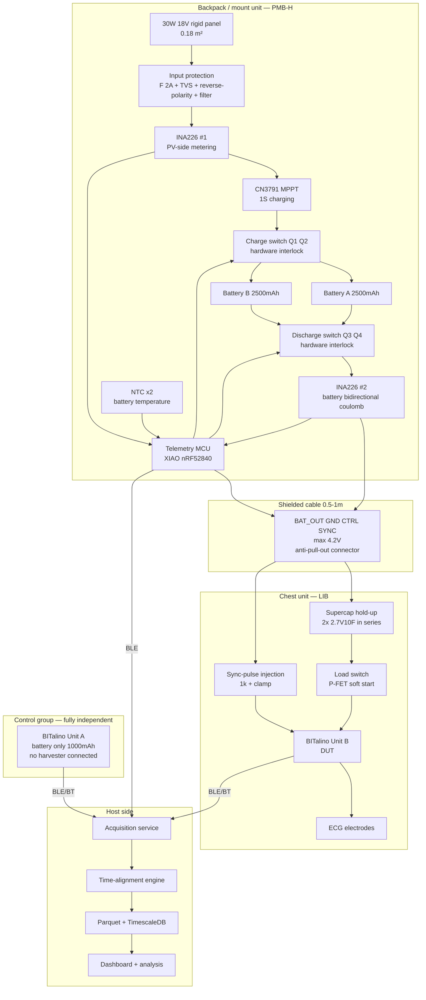

# Solar-Harvesting-Powered Health Monitoring System — Production-Grade Architecture Design v2.0

> **Version** v2.0 · **Date** 2026-09-15 · **Supersedes** v1.0 ([`architecture-v1.md`](architecture-v1.md))
> **Change trigger**: the supervisor confirmed a change of plan — **the 18V/30W rigid panel is confirmed**; small flexible panels will no longer be purchased.
> Component identification complete: `YJL3404A` = MOSFET; `TEUCER HP600` = silicone thermal pad (thermal interface pad).
> New capability: **the lab has in-house PCB fabrication equipment**.

---

# Change Log (v1.0 → v2.0)

| Section | Change | Impact level |
|---|---|---|
| §2 Energy model | **Conclusion reversed**: from "continuous acquisition infeasible, duty cycle must be cut to 6.7%" to **"continuous acquisition feasible, EAR 1.0–3.9"** | 🔴 Fundamental |
| §2.4 | New design variable: **Autonomy Days** replaces "not enough harvest" as the main constraint | 🔴 Fundamental |
| §3 Architecture | Added **ADR-006 dual-battery alternation** and **ADR-007 split topology**; PMB split into PMB-H + LIB | 🔴 Fundamental |
| §5.7 EMC | **Risk level raised**: power class rises from 0.27 W to 8 W (~30×); switching-noise source strength rises sharply | 🔴 Top risk |
| §4 Phases | Phase 3 "low-power node" downgraded from **mandatory** to **optional productisation direction** | 🟡 Important |
| §7 BOM | Purchase list rewritten: battery capacity increase becomes P0; flexible panel removed from P0; EMC and thermal-management materials added | 🟡 Important |
| §5.4 Process | Lab PCB fabrication capability introduced, with a three-case decision matrix; AEM10941 no longer on the main board → **QFN problem gone** | 🟡 Important |
| §5.5.2 | Fuel gauge changed to **INA226 bidirectional coulomb counting**; MAX17048 removed (package not solderable + black-box algorithm) | 🟢 Simplification |
| §5.6 | Supercapacitor role repositioned: from "low-light buffer" to **hold-up supply during battery switchover** | 🟢 Simplification |
| §11 Safety | New isolation requirements between the 18V power chain and the ECG front end; thermal-safety constraints tightened | 🟡 Important |
| §1.5 | `YJL3404A`/`TEUCER HP600` identified, ❓ cleared | 🟢 |

**Content in v1.0 that is now invalid and must no longer be cited**: P0-1/P0-2/P0-3 in §0.1, all numbers in §2, the 6.7% duty-cycle conclusion in §2.3, the P0-1 flexible panel in §7, the QFN hand-soldering dilemma in §5.4.

## Confidence markers

✅ High confidence, actionable · ⚠️ Rule-of-thumb value; check datasheet / measure before acting · ❓ Awaiting your confirmation · 🚨 Blocking

---

# 0. Executive Summary

## 0.1 In one sentence

> The concept has changed from "a self-powered wearable with the panel attached to clothing" to "**a body-carried panel (backpack/mount) + a split low-voltage wearable unit**".
> **The energy problem is solved** (margin 1.0–3.9×, continuous acquisition feasible);
> **the new top problem is electromagnetic compatibility** — an 8 W-class switching power supply now has to share one body with a µV-level ECG amplifier.
> The focus of the entire architecture has shifted from "how to save power" to "**how to keep a strong power supply from polluting a weak signal**".

## 0.2 Good news: the energy bottleneck is gone

| Scenario | Panel output | Daily harvest | vs consumption 5.76 Wh/day | EAR |
|---|---|---|---|---|
| Outdoor, vertical backpack face, sunny, 2h | 8.3 W | 14.1 Wh | ✅ | **2.4** |
| Outdoor, overcast, 2h | 3.5 W | 6.0 Wh | ✅ barely | **1.04** |
| Indoor, right at a south window <0.5m, 6h | 4.4 W | 22.5 Wh | ✅ | **3.9** |
| Indoor, 2m from window, 6h | 1.1 W | 5.4 Wh | ⚠️ marginal | **0.94** |
| Indoor, artificial lighting only | 0.045 W | 0.4 Wh | ❌ | 0.07 |

**The v1.0 conclusion (self-powered ratio only 7%, duty cycle must be cut to 6.7%) is withdrawn.**
BITalino **can now acquire continuously**, as long as the device gets **2 hours outdoors** or **6 hours right next to a window** of light per day.

> ⚠️ The only scenario that still does not work is **indoors under artificial lighting only** (under office fluorescent lights). Never claim "charges automatically under indoor lighting".

## 0.3 The cost: tension in project positioning and naming (stated once, then I follow your decision)

A 395×460mm rigid panel cannot be mounted on clothing. The concept has effectively changed from
`self-powered solar-harvesting wearable` (panel on the body)
to
`solar-harvested, body-carried power supply for a wearable monitor` (panel carried, powering a wearable).

The original email explicitly specified the naming and terminology. **These two are not the same thing, and reviewers / the thesis defence (viva) panel will very likely ask.**
My suggested wording (honest and not violating the terminology ban):

```
✅ solar-harvesting wearable health monitoring system
✅ body-carried photovoltaic energy harvesting for wearable biosignal acquisition
✅ solar-harvesting-powered wearable health monitoring system
⚠️ Use with care: "self-powered wearable" (will be read as panel-on-body)
❌ Still banned: wireless power transfer / WPT / wireless power transmission / receiver coil
```

The supervisor has decided on this panel, and I am proceeding accordingly. The above is only a suggestion to state the "panel mounting location" clearly in the report so the positioning is not challenged. **This is Q1 in §13.**

## 0.4 The new top technical risk: EMC 🚨

```
v1.0: 0.27 W harvester (µW–mW-class switching)  ←  weak noise source
v2.0: 8 W MPPT charger (18V / 1.7A switching)   ←  strong noise source, ~30× the power

On the same person, simultaneously:
  · an 18V, 1.7A, several-hundred-kHz switching converter
  · an ECG amplifier with ~±1.5 mV full scale (~1.5 µV resolution)

The two differ by 9 orders of magnitude.
```

**This problem cannot be solved by filtering; it must be solved by architecture.** v2 provides two hard measures:

1. **ADR-007 split topology**: all 18V stays in the backpack unit; only <4.2V reaches the chest. Noise source and amplifier are physically separated by ~0.5–1 m.
2. **ADR-006 dual-battery alternation**: one battery charges while the other powers BITalino; they swap periodically. **During acquisition there is no switching supply running on the supply path at all** — this is physical isolation, not suppression.

## 0.5 New architecture overview

```
        ┌───────── Backpack / mount unit (18V domain) ──────┐
        │                                                    │
  30W panel ─► Protect ─► CN3791 MPPT ─► [Charge sw] ─┬─ Bat A │
   18V        F/TVS/D      ▲                        └─ Bat B │
                           │                           │  │   │
                    Telemetry MCU ◄── INA226 ×2 ───────┘  │   │
                           │                              │   │
                           └──── [Discharge sw] ◄─────────┘   │
                                      │                        │
        └──────────────────────────────┼────────────────────────┘
                                       │  4-5 core shielded cable (<4.2V)
        ┌──────────────────────────────┼──── Chest unit ───────┐
        │                              ▼                        │
        │   Supercap hold-up ─► Load sw ─► BITalino ─► ECG elec.│
        │   (no dropout on swap)        └─► Sync pulse → I1     │
        └────────────────────────────────────────────────────────┘
```

## 0.6 Four things you can do today

1. **Weigh the solar panel**, and confirm whether it is glass-laminated or ETFE/PET-laminated — this decides whether it can be carried on the body (§13 Q1).
2. **Measure Voc and Isc** (multimeter 10A range, 10A jack) to choose the TVS rating.
3. **TC-01: measure BITalino power consumption**, replacing every ⚠️ 0.240 W in this document. **This is still the top-priority experiment.**
4. Turn the question list in §13 and the purchase list in §7 into one email.

---

# 1. Component Status Update

## 1.1 Confirmed (❓ cleared)

| Component | v1.0 status | v2.0 confirmed result | Role in the architecture |
|---|---|---|---|
| 18V 30W rigid panel | 🚨 Mismatch with requirements | ✅ **Confirmed for use** | Sole energy source (backpack/mount-mounted) |
| `YJL3404A` | ❓ Unidentified | ✅ **MOSFET** | Prototype part for load switch / battery switching |
| `TEUCER HP600` | ⚠️ Presumed TIM | ✅ **Silicone thermal pad (thermal interface pad)** | ⚠️ **Usage needs correcting, see §1.2** |
| PCB fabrication | Outsourced prototyping needed | ✅ **Lab-owned equipment** | Iteration cycle cut from 5–7 days to same day |

## 1.2 🚨 Correcting the use of the TEUCER HP600

**A silicone thermal pad conducts heat; it does not insulate. Put in the wrong place, it will deliver heat into the body.**

```
✅ Correct use: thermal path from component → enclosure/heatsink
   · CN3791 module inductor and MOSFETs  →  metal enclosure
   · Battery pack surface  →  heat spreader (avoid local hot spots)
   · Thermocouple junction  →  measured surface (improves contact thermal resistance)

❌ Wrong use: placed between the back of the solar panel and the body
   → Panel back can reach 60–70 °C in sunlight ⚠️
   → The thermal pad would efficiently transfer that heat to the skin
   → This is using a heat-conducting part as an insulator; the result is burns

✅ What the body side needs is [insulation]: air gap (10–20 mm) + low-conductivity foam/aerogel pad
   → This is a new P0 purchase item (§7)
```

## 1.3 What to do with the EVK10941: don't let it sit idle

With the switch to a high-voltage large panel, the AEM10941 (input ≤5V) no longer has a place in the main chain.
**But don't abandon it** — spend a few tens of yuan on **a small 5–6V / 1W flexible panel** and you keep a valuable research line:

> **Harvester comparison study**: same load, same lighting conditions,
> "large-area high-voltage panel + CN3791 MPPT" vs "small-area low-voltage panel + AEM10941 ultra-low-power harvester"
> compared on efficiency, start-up threshold, and low-light performance.
>
> This upgrades the paper from "we built a system" to "we compared two energy-harvesting paths and give a selection rationale".
> Costs a few tens of yuan, high value. Listed as P1-15 in §7.

## 1.4 BITalino / HeartBIT: verification items still outstanding

The verification in v1.0 §1.4 **has had no results reported back yet**; these items are still blocking:

```
□ Total number of main boards: 2 or 3?
□ Full silkscreen model and revision of each board (photograph)
□ 🚨 BT (Bluetooth Classic) or BLE?  ← affects the power model and host software stack
□ Item-by-item check of the HeartBIT kit packing list
□ 🚨 BITalino battery-connector pin polarity (photograph and record)
□ Voltage range of BITalino digital input I1
□ Measured power consumption (TC-01)
```

> ⚠️ Now that the energy margin is generous, **the impact of BT vs BLE has dropped** (no longer a feasibility question, only a question of margin size).
> But **the importance of the polarity check (§6.3) has not dropped at all** — reversing it once destroys a board, regardless of the energy budget.

## 1.5 Items to verify (new items)

```
Solar panel mechanical properties (new, because it will be carried)
□ 🚨 Measured weight (kg) — decides whether it can be carried on the back
□ Lamination type: glass / ETFE / PET
□ Frame: aluminium frame / frameless
□ Location of rear junction box and cable exit
□ Measured Voc (decides TVS rating)
□ Measured Isc
□ Measured rear temperature in operation (sunny noon)

YJL3404A (known to be a MOSFET, parameters unknown)
□ N-channel or P-channel?
□ Vds / Id / Rds(on) / Vgs(th)
□ Package (SOT-23?)
   → Only 1 piece; cannot be used for production, prototype validation only. Production part see §7

Lab PCB equipment capability (new, decides the §5.4 process route)
□ Machine type: milling/engraving machine / etching line / other
□ Does it support [via plating]?
□ Can it do [solder mask]?
□ Minimum trace width / minimum clearance (mm)
□ Is there a reflow oven / hot-air station / stencil / pick-and-place?
□ Maximum board size

Battery
□ Does the 523450 battery pack have a built-in PCM protection board? Its thresholds?
□ ❓ Your message "lithium battery pack," seems unfinished — what did you want to confirm?
```

---

# 2. Energy Budget Model v2 (conclusion reversed)

## 2.1 Panel model

```
Area A = 0.395 × 0.460 = 0.1817 m²
STC efficiency η = 30 W ÷ (0.1817 m² × 1000 W/m²) = 16.5%
Temperature coefficient ≈ −0.4 %/°C (typical crystalline silicon) ⚠️, reference cell temperature 25 °C

Output power P = 30 × (G / 1000) × [1 − 0.004 × (Tcell − 25)]
```

> **Temperature correction is not optional.** At sunny noon the panel cell temperature can reach 60 °C, and output will be ~14% below the STC rating.
> v1.0 ignored this term; v2 includes it everywhere.

## 2.2 Scenario yield table

| Scenario | Plane irradiance G | Cell temperature | Panel output | Effective duration | Daily harvest (incl. 85% chain efficiency) |
|---|---|---|---|---|---|
| Outdoor, horizontal, facing sun, sunny | 900 W/m² | 60 °C | **23.2 W** | Reference | — |
| **Outdoor, vertical backpack face, sunny, average orientation** | 300 W/m² ⚠️ | 45 °C | **8.3 W** | 2 h | **14.1 Wh** |
| Outdoor, overcast | 120 W/m² | 30 °C | **3.5 W** | 2 h | **6.0 Wh** |
| **Indoor, right at a south window <0.5 m** | 150 W/m² ⚠️ | 30 °C | **4.4 W** | 6 h | **22.5 Wh** |
| Indoor, 2 m from window | 35 W/m² ⚠️ | 25 °C | **1.1 W** | 6 h | **5.4 Wh** |
| Indoor, artificial lighting only, 500 lux | 1.5 W/m² | 25 °C | 0.045 W | 8 h | **0.4 Wh** |

⚠️ The irradiance values are rule-of-thumb estimates and **must be replaced with reference-cell measurements** (TC-02/TC-03). Indoor window-side irradiance is extremely sensitive to orientation, season, and glass coating, and can span a factor of 5.

## 2.3 Load model (unchanged)

| State | Power | Notes |
|---|---|---|
| BITalino continuous acquisition at 1000 Hz | **~240 mW** ⚠️ | **To be replaced by TC-01 measurement; this is the foundation of every calculation** |
| Daily consumption (continuous 24 h) | **5.76 Wh/day** | 240 mW × 24 h |
| Telemetry MCU | ~2 mW | |
| PMB quiescent (load off) | ~0.3 mW | |

## 2.4 EAR and the new design variable: autonomy

```
EAR = daily harvest ÷ daily consumption (5.76 Wh)
```

| Scenario | Daily harvest | **EAR** | Verdict |
|---|---|---|---|
| Outdoor backpack, sunny 2h | 14.1 Wh | **2.45** | ✅ Ample |
| Indoor by window 6h | 22.5 Wh | **3.91** | ✅ Ample |
| Outdoor overcast 2h | 6.0 Wh | **1.04** | ✅ Marginal pass |
| Indoor 2m from window 6h | 5.4 Wh | **0.94** | ⚠️ Slight deficit |
| Artificial lighting only | 0.4 Wh | 0.07 | ❌ |

> **Conclusion: continuous acquisition is feasible.** In everyday use, as long as there are "2 hours outdoors per day" **or** "the backpack is placed by a window while working", the system is energy-positive.

### 🔴 But the constraint has moved: the bottleneck is now battery capacity

There is enough energy, but **it can't be stored**. Daily harvest is 14–22 Wh, while the existing 1000 mAh battery holds only 3.7 Wh.
This means: the battery is full early in the day and all further energy is wasted; and two consecutive rainy days shut the system down immediately.

The standard design variable for off-grid PV systems is **Autonomy Days** — how many days the system can last with no light at all:

| Battery capacity | Energy | **Autonomy** | 0.5C charge current | Charge power |
|---|---|---|---|---|
| 1000 mAh (existing) | 3.70 Wh | **0.64 days** ❌ | 0.50 A | 1.9 W |
| 2000 mAh | 7.40 Wh | 1.28 days | 1.00 A | 3.9 W |
| **2500 mAh ×2 (recommended)** | 9.25 Wh ×2 | **3.21 days** ✅ | 1.25 A | 4.9 W |
| 3000 mAh | 11.10 Wh | 1.93 days | 1.50 A | 5.8 W |
| 5000 mAh | 18.50 Wh | 3.21 days | 2.50 A | 9.8 W |

**Recommendation: 2 × 2500 mAh**, for three reasons:
1. 3.2 days of autonomy, in line with the 3–5-day engineering convention for off-grid systems; rides through consecutive rainy days
2. Fits exactly with the **ADR-006 dual-battery alternation architecture** (this is the main reason)
3. A per-battery charge current of 1.25 A is within the CN3791's capability ⚠️ (its maximum charge current needs verifying)

> **The existing 1000 mAh battery is not discarded**: it continues to serve Unit A (control group). The control group is not connected to solar, and 0.64 days of autonomy is more than enough for a single 2–4-hour control experiment.

### Why a 30W panel for a 5W load is not "waste"

The panel capability (8–23 W) far exceeds what the charger can absorb (~5 W). This **is not a design flaw; it is standard off-grid PV practice**, called an **oversized array for low-light robustness**:

```
Sizing the panel to "just enough at sunny noon"  →  fails entirely on overcast days, in winter, or with poor orientation
Sizing the panel to "enough even when overcast" →  current-limited on sunny days, surplus energy discarded, but the system works year-round

A 30W panel still delivers 3.5 W when overcast, enough to charge at full rate.
That is its value — not peak power, but [guaranteed capability in the worst case].
```

**This argument must go into the report.** Otherwise "driving a 0.24W load with a 30W panel" looks like bad arithmetic.

## 2.5 Duty-cycle scheduling: downgraded from "mandatory" to "optimisation tool"

In v1.0, duty cycling was **the precondition for feasibility** (without cutting to 6.7%, self-powering was impossible).
In v2.0 it becomes **an optional optimisation**, and its purpose changes to:

| Original purpose (v1.0) | New purpose (v2.0) |
|---|---|
| Barely achieve energy balance | Extend autonomy through rainy spells (from 3.2 days to 10+ days) |
| — | Degraded-operation strategy in the `CRITICAL` state |
| — | As an experimental variable, to study the "duty cycle vs clinical information content" trade-off |

The energy state machine in §8.2 is retained, but `FULL_RATE` (continuous acquisition) changes from "exception" to **the default state**.

---

# 3. Architecture

## 3.1 New architecture decisions

### ADR-006: Dual-battery alternation — solve EMC with physical isolation, not filtering 🔴

**Decision**: two batteries; at any moment **one is charging and the other is supplying**, with the MCU swapping roles on a timer (default 30 minutes). During the swap, a supercapacitor keeps the load powered without interruption.

```
          ┌──── Charge switch ───┐        ┌── Discharge switch ──┐
          │                  │            │                  │
 MPPT ────┤ Q1 ──► Bat A ────┼────────────┤ Q3 ──────────────┼──► Supercap ──► Load
 charger  │                  │            │                  │
          │ Q2 ──► Bat B ────┼────────────┤ Q4 ──────────────┘
          └──────────────────┘            └──────────────────┘

  State 1: Q1 on  Q2 off | Q3 off Q4 on   →  A charging, B supplying
  State 2: Q1 off Q2 on  | Q3 on  Q4 off  →  B charging, A supplying

  🚨 Hardware interlock: Q1/Q2 must never conduct simultaneously, nor Q3/Q4
     Otherwise the two batteries are directly paralleled; with a 0.5V difference the circulating current can reach several amps
```

**Rationale**:
**No switching supply is running on the supply path at all.** This is not filtering the noise out; it is making the noise **absent from the measurement loop**.
For a system measuring µV-level signals, this is the only reliable approach.

**The supercapacitor has finally found its proper role**:
```
Switching requires break-before-make, leaving a gap of a few hundred microseconds to a few milliseconds.
A 5 F / 5.4 V supercap bank stores 15.2 J, which sustains a 240 mW load for 63 seconds.
Relative to a switching window of a few milliseconds, the margin exceeds 10000×.  ✅ More than enough
```

**Costs and risks**:
- Requires 4 power MOSFETs + hardware interlock + careful timing design
- The two batteries age unevenly; cycle counts must be recorded separately in the manifest
- At the moment of switching the load voltage takes a small step (the two batteries have different SoC) → must verify it produces no artefact on the ECG (TC-05b)

**Why not use the simpler ADR-004 (time-division multiplexing, charging off during acquisition)?**
**Both should be done.** ADR-004 is a software strategy (simple, zero cost); ADR-006 is a hardware guarantee (thorough, works during continuous acquisition).
Phase 1 does ADR-004 first to verify how bad the noise actually is; if TC-05 shows it is acceptable, ADR-006 can be simplified away. **Measure first, then decide whether to add complexity.**

### ADR-007: Split topology — no 18V on the chest 🔴

**Decision**: the system is split into two physical units; the entire 18V power chain stays in the backpack unit, and only <4.2V low voltage reaches the chest unit through a shielded cable.

```
┌─────────── Backpack / mount unit PMB-H ──────┐
│  30W panel, 18V protection, CN3791 MPPT,     │
│  Bat A/B, charge/discharge switching,        │
│  INA226 ×2, NTC, telemetry MCU, BLE          │
│  ← all switching supplies, all 18V, all heat │
└───────────────────┬──────────────────────────┘
                    │ 4–5 core [shielded] cable, ~0.5–1 m long
                    │ carries: BAT_OUT+ / GND / GND / CTRL / SYNC
                    │ ⚠️ maximum voltage 4.2 V
┌───────────────────▼────── Chest unit LIB ────┐
│  Supercap hold-up, load switch, sync-pulse   │
│  injection, ESD protection, JST-PH to BITalino│
│  ← no switching supply, no 18V, ~no heat     │
│  Size ~25 × 20 mm                            │
└──────────────────────────────────────────────┘
```

**Four problems solved at once**:

| Problem | How the split topology solves it |
|---|---|
| EMC: switching noise coupling into the ECG | Noise source is 0.5–1 m from the amplifier, with no common-mode path between them |
| Safety: 18V near the ECG electrodes | 18V never enters the chest unit; physically impossible |
| Thermal: charger heat against the body | All heat is in the backpack; chest unit dissipates <1 mW |
| Human factors: weight distribution | Panel + batteries (~2–3 kg) carried by the backpack; chest carries only a few tens of grams |

**Cost**: one extra cable (may get pulled) → requires an **anti-pull-out design** (magnetic breakaway connector or breakaway design), see §5.8.

### ADR-008: Use INA226 bidirectional coulomb counting instead of a dedicated fuel gauge 🟢

**Decision**: remove the MAX17048; implement a coulomb counter using bidirectional current integration on the battery-node INA226.

**Rationale**:
1. **Package**: the MAX17048 is TDFN/WLP with a bottom pad; neither the lab equipment nor your soldering iron can handle it
2. **Research credibility**: the MAX17048's ModelGauge is a black-box algorithm; you don't know what corrections it applies internally. **Raw coulomb counting drifts, but it is explainable** and can be described clearly in the paper
3. **Accuracy**: INA226 16-bit resolution + 0.05 Ω shunt → 50 µA LSB, better than voltage-based SoC estimation

**Implementation notes**:
```
SoC(t) = SoC(0) + ∫ I_bat dt / Q_nominal

Must handle:
□ The MCU must not lose power, or the integral is lost  →  write the accumulator to flash every 60 s
□ Drift accumulation  →  reset to 100% on every [full-charge event] (CV-phase current drops to 0.05C)
□ On every [deep-discharge event] (voltage drops to 3.2 V) reset to the calibrated lower bound
□ Temperature correction: capacity varies with temperature; log the NTC and correct in post-processing
□ Initial calibration: one complete full-charge / full-discharge cycle to obtain the true Q_nominal
```

⚠️ This is a bit more firmware work than the MAX17048, but for a research project it is a net gain.

## 3.2 Full architecture diagram



## 3.3 Decisions retained from v1.0

| ADR | Content | v2 status |
|---|---|---|
| ADR-001 | PMB owns the battery; BITalino is a pure load | ✅ Retained, even more valid |
| ADR-002 | Dual charging paths (HV/LV) | 🔄 **Revised**: main chain keeps only HV (CN3791); LV (AEM10941) demoted to a separate comparison-study branch |
| ADR-003 | BITalino as reference instrument | 🔄 **Weakened**: with ample energy, BITalino can be the final load; the Phase 3 custom node becomes optional |
| ADR-004 | Time-division multiplexing (no charging during acquisition) | ✅ Retained, validated first as the simplified version of ADR-006 |
| ADR-005 | Hardware-level time synchronisation | ✅ Retained, completely unchanged |

---

# 4. Roadmap v2

```
Phase 0 ──► Phase 1 ──► Phase 2 ──► Phase 3 (optional)
Component   Energy      Wearable     Productisation /
verif.      chain+EMC   prototype    low-power node
(W1-2)      (W3-6)      (W7-11)      (W12+)
```

| Phase | Goal | Exit criteria | v1.0 → v2.0 change |
|---|---|---|---|
| **0** | Component verification, baseline measurements, set up repo, place purchase orders | All ❓ cleared; TC-01/TC-02 done | Unchanged |
| **1** | Bench-validate the energy chain + **answer the EMC question** | **TC-05 noise comparison gives a quantitative conclusion** → decides whether to adopt ADR-006 | 🔴 Focus shifts from "is there enough energy" to "how much noise" |
| **2** | Split wearable prototype (PMB-H + LIB) | Thermal safety PASS; EAR ≥ 1.0 under continuous acquisition; 72h unattended | 🔴 Goal changes from "duty cycle feasible" to "continuous acquisition feasible" |
| **3** | Productisation direction (optional) | Depends on the answer to Q3 | 🟡 Downgraded from mandatory to optional |

> **The key decision point of Phase 1 is in W5–W6**: the TC-05 result decides the direction of the architecture.
> - If the noise is acceptable (Δnoise floor < 10 µV_rms) → use only ADR-004 software time-division multiplexing, **cut ADR-006 dual-battery**, saving half the complexity
> - If the noise is unacceptable → adopt ADR-006
>
> **Measure first, then decide on complexity. Do not solder up the dual-battery architecture from the start.**

---

# 5. Detailed Hardware Design v2

## 5.1 PV input stage (18V, re-selection after the power increase)

```
                    ┌── Panel-side fuse (mount it in the junction box!)
                    │
Solar panel (+) ─┬── F1 2A slow-blow ─┬── D1 ──┬── L1 ──┬──► CN3791 VIN
                 │                    │        │ ferrite │
               TVS1                  C1      CM choke   C2
             SMAJ26A            220µF/35V              100nF
                 │                    │                  │
Solar panel (−) ─┴────────────────────┴──────────────────┴──► PGND
```

**Revisions relative to v1.0**:

| Component | v1.0 | v2.0 | Rationale |
|---|---|---|---|
| F1 location | On the PMB | **Inside the panel junction box** | If the cable shorts, the fuse must be on the **source side** to be of any use. Mounted at the load end it cannot protect the cable itself |
| TVS1 | SMAJ24A | **SMAJ26A** ⚠️ | Final rating after measuring Voc. Rule: **breakdown voltage > measured Voc × 1.15**, otherwise it conducts continuously and heats up on sunny days |
| D1 | SS34 | **SS54 or ideal diode** | Current rises from 0.5A to 1.7A; the SS34's 3A rating leaves insufficient margin |
| C1 | 100 µF | **220 µF / 35V low ESR** | Higher input power requires more input energy storage |
| L1 | None | **New common-mode choke + ferrite ring** | 🚨 EMC: suppresses common-mode noise conducted along the cable |

> 🚨 **An 18V/1.8A short circuit will draw an arc.** The panel cable must:
> - Use 18 AWG silicone wire (temperature-resistant, flexible, flex-durable)
> - Use XT30 connectors (rated 30A, far above requirement, low contact resistance and hard to dislodge)
> - **Have a fuse at the panel end**

## 5.2 MPPT charging stage

```
CN3791 key configuration (⚠️ all values must be checked against the datasheet):

  MPPT voltage set point:  VIN divided down to the MPPT pin
    Target ≈ 0.76 × Voc ≈ 16.5 V (recalculate after measuring Voc)

  Charge current setting:  Rcs sense resistor
    2500 mAh battery @ 0.5C = 1.25 A

  ⚠️ Must verify: the CN3791's maximum rated charge current
     If < 1.25 A  →  reduce to 0.4C, or switch to LT3652 (2A, 32V input, with MPPT)
     
  ⚠️ Must verify: the inductor saturation current and MOSFET ratings on the CN3791 module
     Taobao modules often use parts below the chip's capability; 1.25A continuous may run very hot
```

**Heat estimate**: input 18V × 0.31A = 5.6 W, output 4.2V × 1.25A = 5.25 W, loss ~0.35 W.
Not large, but concentrated in the inductor and the synchronous rectifier. **Use the TEUCER HP600 thermal pad to couple them to the metal enclosure** (the correct use from §1.2).

## 5.3 Battery switching circuit (implementation of ADR-006)

```
Charge switching (high side, P-FET, source to charger output):
                    CHG_OUT (4.2V)
                         │
            ┌────────────┴────────────┐
            │                         │
        ┌───┴───┐                 ┌───┴───┐
        │  Q1   │  P-FET          │  Q2   │  P-FET
        │ S   D │                 │ S   D │
        └───┬───┘                 └───┬───┘
            │                         │
         BAT_A+                    BAT_B+

Discharge switching (high side, P-FET, source to the respective battery):
         BAT_A+                    BAT_B+
            │                         │
        ┌───┴───┐                 ┌───┴───┐
        │  Q3   │                 │  Q4   │
        └───┬───┘                 └───┬───┘
            │                         │
            └────────────┬────────────┘
                         │
                     LOAD_OUT ──► cable ──► LIB supercap ──► BITalino
```

### 🚨 Three mandatory safety rules

```
Rule 1: Hardware interlock
  There must be a [hardware] interlock between the gate drives of Q1/Q2, and between Q3/Q4
  (inverter + AND gate, or a dedicated driver with built-in interlock)
  ⛔ Do not rely on firmware alone to guarantee "never on simultaneously" — if the MCU crashes, the two batteries are directly paralleled

Rule 2: Break-before-make
  Switching sequence: open the old path first → wait t_dead → then close the new path
  Suggested t_dead is 1 ms (far longer than MOSFET turn-off time, far shorter than the supercap's 63 s hold-up)
  The gap on the discharge side is filled by the supercap; a gap on the charge side doesn't matter

Rule 3: Body-diode orientation
  🚨 The P-FET body diode must be oriented to [block] reverse current
  If Q3/Q4 are oriented wrongly, even with the gates off the body diodes will parallel the two batteries through the diodes
  → Must use [back-to-back dual FETs] or a load-switch IC with reverse blocking
  ← This is the easiest place to get the dual-battery architecture wrong; check it carefully in schematic review
```

⚠️ **Recommended: avoid this pitfall with an off-the-shelf IC**: an ideal-diode ORing controller (e.g. `LM66100`, with reverse blocking) or a dedicated battery-switching IC is far more reliable than building 4 discrete FETs yourself. Listed as P0-9 in §7.

### Quantifying the circulating-current risk

```
If Q1/Q2 accidentally conduct simultaneously, with a battery voltage difference ΔV = 0.5 V,
internal resistance ~50 mΩ each ⚠️, traces ~20 mΩ:
  I_circ = 0.5 / (0.05 + 0.05 + 0.02) = 4.2 A

→ Far above the safe discharge rate of a 2500 mAh battery
→ Will trip the PCM protection; repeated tripping damages the cell
→ This is why a hardware interlock is mandatory
```

## 5.4 PCB process decision matrix (using the lab equipment)

The lab has PCB fabrication equipment. This changes the prototyping pace, but **does not necessarily** change assembly capability. Three cases:

| Case | Equipment capability | How to build PMB-H | How to build LIB | Iteration cycle |
|---|---|---|---|---|
| **A: Milling machine only**<br>(no via plating, no solder mask) | Single/double-sided copper, rivet vias | In-house 2-layer board; **fine-pitch parts (INA226 VSSOP-10) replaced by plug-in off-the-shelf modules** | In-house, all large packages | **Same day** ✅ |
| **B: Etching line + via plating + solder mask** | Close to an industrial 2-layer board | In-house 2-layer board; VSSOP-10 can be mounted directly | In-house | **1–2 days** ✅ |
| **C: B + reflow oven / hot air / stencil** | Complete prototype line | Everything in-house, any package | In-house | **1–2 days** ✅✅ |

> **Good news: the QFN problem is gone.** The AEM10941 (QFN-40) is no longer in the main chain (§1.3);
> the hardest package left is the **INA226's VSSOP-10 (0.5 mm pitch)**, which in case A is avoided by using a module.
> **So in all three cases, Rev B does not need outsourced PCBA.**

### Recommended practices regardless of case

```
□ A 2-layer board is enough for PMB-H (for a power board, a complete ground plane matters more than layer count)
□ 🚨 Make [physical zones] on the PCB, separated by a ≥3 mm copper-free isolation strip:
     [18V power zone]  |isolation strip|  [battery & low-voltage zone]  |isolation strip|  [MCU digital zone]
□ Minimise the switching-loop area (inductor–MOSFET–diode–input/output capacitors)
□ Star grounding: power ground and signal ground meet at a single point at the [battery negative]
□ High-current traces: 1.25A on 1oz copper needs ≥1 mm width; on a milling machine, simply leave 2–3 mm copper pours
□ Milling machine has no solder mask → after soldering, must clean with IPA + apply conformal coating (body-worn parts need sweat/moisture protection)
□ Leave ample test points: TP_PV+ TP_BAT_A TP_BAT_B TP_LOAD TP_GND×3 + Kelvin pads×2
```

## 5.5 Metering chain (v2 update)

```
INA226 #1 @ PV side: Rshunt = 0.05 Ω
  Range: max 1.8 A → 90 mV
  🚨 Exceeds the INA226's 81.92 mV full scale! → must change to 0.02 Ω
  0.02 Ω: 1.8 A → 36 mV ✅   resolution 2.5µV/0.02Ω = 125 µA ✅
  Dissipation: 1.8² × 0.02 = 65 mW (acceptable, 0.8% of 8W)

INA226 #2 @ battery node: Rshunt = 0.02 Ω (bidirectional, doubles as coulomb counter)
  Charging +1.25 A → +25 mV  |  discharging −0.07 A → −1.4 mV
  Resolution 125 µA, relative to a 70 mA discharge current → 0.18% ✅ sufficient
```

> ⚠️ **The v1.0 choice of 0.1 Ω would exceed range in v2**; this is something that must be recalculated after the power increase.
> **Every resistor / current / heat value in v1.0 must be recalculated for the new power class.**

The Kelvin four-wire connection requirement is unchanged (see v1.0 §6.4, still valid).

## 5.6 Supercapacitor: role repositioned

| | v1.0 | v2.0 |
|---|---|---|
| Main role | Low-light buffer, pulse buffer | **Hold-up supply during battery switchover** |
| Location | PMB battery node | **LIB (chest unit), load side** |
| Quantity | 2 in series (5.4V 5F) | 2 in series (5.4V 5F), 3rd as spare |
| Leakage concern | 🚨 Severe (39% of indoor harvest) | ✅ **No longer an issue** (280 µW vs 1–8 W harvest, <0.03%) |
| Pre-charge circuit | Required | Still required (inrush has nothing to do with the amount of energy) |
| Balancing resistors | Must be 1 MΩ (to save power) | **100 kΩ is fine** (faster balancing; leakage no longer matters) |

> **This is a good example**: the same component, after the energy budget changed, has its constraints completely reversed.
> The 280 µW leakage that v1.0 worked hard to optimise is irrelevant in v2.0 — but **the pre-charge inrush risk has not changed at all**, because that is a charge problem, not an energy problem.

## 5.7 🚨 EMC: now the top risk

### Risk level reassessed

```
                         v1.0            v2.0            Change
Switching-supply power   0.27 W          8 W             ×30
Switching current        ~50 mA          ~1.7 A          ×34
Input voltage            5 V             18 V            ×3.6
Noise source–ECG dist.   same board      0.5-1 m         ✅ improved (ADR-007)
Noise source state       running         [off]           ✅ eliminated (ADR-006)
during measurement
```

**Net effect**: noise-source strength rises ~30×, but through the two architectural measures ADR-006 + ADR-007,
the coupling path is **physically cut** rather than attenuated. **Architectural measures are far more effective than filtering.**

### Five layers of protection (ranked by effectiveness)

| # | Measure | Belongs to | Effectiveness | Phase |
|---|---|---|---|---|
| 1 | **ADR-006 dual battery**: no switching supply on the supply path during measurement | Architecture | ★★★★★ | 2 (if TC-05 requires it) |
| 2 | **ADR-007 split topology**: noise source 0.5–1 m from the amplifier | Architecture | ★★★★★ | 2 |
| 3 | **ADR-004 time-division multiplexing**: charging off during acquisition | Firmware | ★★★★☆ | 1 |
| 4 | **Shielded cable + common-mode choke + ferrite ring** | Cabling | ★★★☆☆ | 1 |
| 5 | **π filter + minimal switching loop + star ground** | PCB | ★★★☆☆ | 1 |

### Cable-routing discipline (free but effective)

```
⛔ PV cable and ECG lead wires must [never run in parallel]
✅ If they must cross, cross at 90°
✅ Spacing > 100 mm (v1.0 was 50 mm; doubled after the power increase)
✅ PV cable twisted pair + shield grounded at one end only (to the PMB-H power ground)
✅ ECG lead wires as short as possible, routed along the body surface, never sharing a path with any power cable
✅ Photograph the cable layout for every experiment to ensure reproducibility
```

### Tightening the TC-05 criterion

After the power increase, the v1.0 criterion "Δnoise floor < 10 µV_rms" needs re-examining:
- If the measurement is far below 10 µV → the architectural measures work; **ADR-006 can be cut to save complexity**
- If it is close to or above → ADR-006 must be adopted and re-tested

⚠️ The threshold in the formal report should cite the quantitative noise requirements of IEC 60601-2-25 for electrocardiographs, not the rule-of-thumb value I gave.

## 5.8 Mechanical and human factors (new because of the large panel)

### Anti-pull-out design 🚨

A cable runs across the body between the backpack unit and the chest unit. **It will be pulled during falls, changing clothes, and vigorous movement.**

```
Must:
□ Use a [magnetic] connector, or
□ Design a [breakaway point], so that above ~20 N of pull the connector separates first rather than tugging the electrodes
□ Leave slack in the cable and secure it to the garment (cable clips)
□ After disconnection the system must be safe: supercap holds up → MCU detects load loss → logs the event → shuts off output
□ Reconnection must not cause inrush (covered by soft start)
```

### Weight and wearability ❓

```
To be measured:
□ Panel weight (glass-laminated ~2.5–3 kg / ETFE-laminated ~0.6–1 kg ⚠️)
□ Batteries 2×2500mAh ~100 g
□ PMB-H + enclosure ~150 g
□ Estimated total 1–3.5 kg

⚠️ If over 2 kg, acceptability for the target population must be assessed:
   Healthy adults, short duration: acceptable (comparable to a laptop)
   Elderly / patients / long duration: need a mount solution rather than a back-carried one
   → This is part of §13 Q1
```

### Thermal management (new constraint)

```
The back of the solar panel can reach 60–70 °C on a sunny day ⚠️

  Panel front (illuminated)
  ═══════════════════  ← 60–70 °C
  ░░░░░░░░░░░░░░░░░░░  ← [air gap 10–20 mm] + standoffs
  ▓▓▓▓▓▓▓▓▓▓▓▓▓▓▓▓▓▓▓  ← [insulation layer] EVA foam / aerogel pad (new purchase)
  ┃┃┃┃┃ backpack fabric ┃┃┃┃┃
  ～～～～ body ～～～～  ← target < 41 °C ⚠️

🚨 The TEUCER HP600 (thermal pad) must never be placed in this path (§1.2)
   It is only for: CN3791 inductor/MOSFET → metal enclosure
                   battery surface → heat spreader
                   thermocouple junction → measured surface
```

**Thermocouple measurement increases from 2 points to 4** → buy 2 more (§7 P1):
`TC-A` panel back · `TC-B` body side of insulation layer · `TC-C` battery surface · `TC-D` charger enclosure

---

# 6. Soldering and Assembly (increments relative to v1.0)

> All SOPs in v1.0 §6 remain valid, **especially S-2 lithium battery lead termination and S-3 BITalino polarity verification, whose importance has not dropped at all**.
> This section lists only work that is new or modified in v2.

## 6.1 [Modified] S-1 Panel lead-out wires — changes after the power increase

| Item | v1.0 | v2.0 |
|---|---|---|
| Wire gauge | Unspecified | **18 AWG silicone wire** (1.7A continuous + flexible and flex-durable) |
| Connector | XT30 or screw terminal | **XT30** (no screw terminals — they work loose) |
| Fuse location | On the PMB | 🚨 **Inside the panel junction box** (protects the cable close to the source) |
| Shielding | None | **Add a shield, grounded at one end** + ferrite ring |
| Covering the panel during work | Required | Required, **and even stricter because of the higher power** |

## 6.2 [New] S-8 Battery switching circuit assembly

```
Difficulty ★★★★  — this is the most error-prone circuit in the whole project

Before assembly:
□ Schematic review: draw out and confirm the body-diode orientation of each of the 4 FETs (§5.3 Rule 3)
□ Verify the interlock logic on paper: list the 4 gate combinations and confirm none of them parallels the batteries

During assembly:
□ Fit only the [charge side] Q1/Q2 first, not the discharge side
□ Simulate the two batteries with two [adjustable power supplies] (set to 3.9V and 3.7V, current limit 100 mA)
   ← 🚨 Never test the interlock with real batteries at first! A current-limited supply will save you
□ Test the 4 gate combinations one by one, watching an ammeter for circulating current
□ Once there is no circulating current, fit the discharge side Q3/Q4 and repeat the tests
□ Only after everything passes, switch to real batteries

Verification:
□ Multimeter: with Q1 off, BAT_A+ and CHG_OUT must be [non-conducting in both directions]
   ← this specifically verifies body-diode orientation. If it conducts one way = wrong orientation, rework
□ Test Q2/Q3/Q4 the same way
□ Oscilloscope on the switching waveform: the dip in LOAD_OUT at the switching instant should be < 100 mV
```

## 6.3 [New] S-9 Split cable and anti-pull-out connector

```
□ Use a 4–5 core [shielded] cable, 0.5–1 m long (leave it long first, trim after assembly)
□ Define the pinout and [write it on labels at both ends]:
     1 = BAT_OUT+   2 = GND   3 = GND   4 = CTRL_LOAD   5 = SYNC
□ Connect the shield to power ground [only at the PMB-H end] (single-ended grounding, avoids ground loops)
□ Fit a magnetic connector (or breakaway connector) at each end
□ 🚨 Verify: when the connector is pulled out, the system degrades safely rather than misbehaving
     → supercap holds up for tens of seconds → MCU logs the event → orderly shutdown
□ 🚨 Verify: when BAT_OUT+ is shorted to GND, the fuse / current limit must protect it; it must not catch fire
```

## 6.4 [New] S-10 Thermal management assembly

```
Heat-conduction path (using the TEUCER HP600 silicone thermal pad):
□ Cut the thermal pad to cover the CN3791 module's inductor and MOSFETs
□ Press it against the inner wall of the metal enclosure, ~20–30% compression (pad slightly thicker than the gap)
□ Apply a piece of thermal pad to the battery surface → heat spreader (prevents local hot spots)

Insulation path (using EVA foam / aerogel pad, new purchase):
□ Panel back → standoffs forming a 10–20 mm air gap
□ After the air gap → insulation layer → backpack
□ 🚨 Confirm there is [no] thermal pad anywhere on this path

Thermocouple attachment (4 points):
□ TC-A centre of panel back   □ TC-B body side of insulation layer
□ TC-C battery surface        □ TC-D charger enclosure
□ Fix each with thermal paste + Kapton, covered with insulating wool so wind doesn't hit it
```

## 6.5 Power-up checklist (v2 additions)

**Add** to the v1.0 §6.9 checklist:

```
[18V path]
□ Fuse fitted in the panel junction box, rated 2A slow-blow
□ TVS breakdown voltage > measured Voc × 1.15
□ D1 orientation correct (verify with diode mode)
□ 🚨 Multimeter: no unintended continuity between the 18V zone and the battery / low-voltage zone
□ 🚨 Multimeter: the 18V zone is [isolated] from every core of the LIB cable

[Dual battery]
□ All 4 gate combinations tested, no circulating current (with current-limited supply, not real batteries)
□ Bidirectional blocking in the off state verified for all 4 FETs
□ Hardware interlock: force the MCU to output an illegal combination, verify the interlock takes effect

[Split topology]
□ Pinout consistent at both cable ends (core-by-core continuity test)
□ Shield grounded at one end, other end floating (confirmed by measurement)
□ Plug/unplug test: hot-plug 10 times, no system anomaly

[Thermal]
□ After 30 min of full-power charging, TC-C (battery) < 45 °C
□ TC-D (charger enclosure) < 70 °C
□ No part too hot to touch
```

---

# 7. Purchase List (the part you asked for)

> Grouped by priority, **with a "why" for every item**, so you can forward it directly to the supervisor.
> ⚠️ Part numbers are suggestions; when buying, any equivalent that is actually available is fine.

## P0 — Can't make progress without these (11 items)

| # | Item | Specification | Qty | Why it is required |
|---|---|---|---|---|
| 1 | **1S lithium battery** | 3.7V **2500 mAh**, **with PCM protection board**, PH2.0 lead | **4** | 🔴 Existing 1000 mAh gives only 0.64 days of autonomy; consecutive rainy days cut power. 2500×2 = 3.2 days of autonomy. 4 pieces = dual-battery architecture + spares |
| 2 | **MPPT charger module** | CN3791 module, input ≤28V, charge current adjustable to ≥1.25A | **3** | 🔴 The only charging path. ⚠️ Before ordering, confirm the module's maximum charge current and inductor spec |
| 3 | **INA226 module** | I²C, accepts an external shunt resistor | **4** | 🔴 The entire basis of the EAR. One on the PV side + one on the battery side, ×2 units |
| 4 | **Precision shunt resistor** | **0.02 Ω**, 1%, 2512 | **20** | 🔴 v1.0's 0.1Ω exceeds range at the new power level (§5.5); must be replaced |
| 5 | **Irradiance reference** | Calibrated reference silicon cell (preferred) **or** lux meter | **1** | 🔴 Without it, no experimental conclusion "under different lighting" can be reproduced. ⚠️ A lux meter measures lux ≠ W/m²; the conversion assumption must be stated in the report |
| 6 | **Telemetry MCU** | Seeed XIAO nRF52840 | **3** | 🔴 Hosts metering + scheduling + synchronisation |
| 7 | **Power MOSFET** | P-channel AO3401 / N-channel AO3400, SOT-23 | **30 each** | 🔴 Battery switching + load switch. There is only 1 YJL3404A on hand — not enough and not reproducible |
| 8 | **ECG electrodes** | Standard snap-type disposable gel electrodes | **500** | 🔴 Pure consumable. Estimated as 3 per session × 2 sessions per day × 90 days |
| 9 | **Ideal diode / battery-switching IC** | LM66100 or similar with reverse blocking | **10** | 🔴 Avoids the body-diode trap of §5.3 Rule 3; far more reliable than discrete FETs |
| 10 | **Thermal insulation** | EVA foam pad / aerogel pad, 3–5 mm thick | **1 roll** | 🔴 Panel back reaches 60–70 °C; the body side must be insulated. **A thermal pad cannot substitute** (§1.2) |
| 11 | **18V cable and connectors** | 2 m 18AWG shielded silicone wire, 5 each XT30 male/female, 2A slow-blow fuse holders + 10 fuses | 1 set | 🔴 An 18V/1.8A short will arc; fuses and proper cable are the safety baseline |

## P1 — Strongly recommended (affect data quality and safety)

| # | Item | Specification | Qty | Rationale |
|---|---|---|---|---|
| 12 | **Adjustable DC power supply** | 0–30V / 0–5A, **with current limit** | 1 | Both power-up checks and the §6.2 interlock test require a current-limited supply. **This is the single instrument most likely to prevent burnt boards** |
| 13 | **DC electronic load** | 60–150 W, adjustable constant current | 1 | Panel I-V curves, battery discharge curves |
| 14 | **Type-K surface thermocouple** | Compatible with the existing thermometer | **4** | Hot spots increased from 2 to 4 (§5.8) |
| 15 | **Small flexible PV panel** | 5–6V / ~1W | 2 | Keeps the EVK10941 from sitting idle and preserves the "harvester comparison study" line (§1.3). Very low cost, high value for the paper |
| 16 | **EMC materials** | Common-mode chokes, clip-on ferrites, copper-foil shielding tape | 10 each | 🚨 Mitigation for the top risk |
| 17 | **Protection components** | SMAJ26A, SS54, 220µF/35V low-ESR, Polyfuse | 10 each | Re-selected for the new power class (§5.1) |
| 18 | **NTC thermistor** | 10kΩ B3950 | 10 | Battery temperature protection (0–45 °C charging window) |
| 19 | **Anti-pull-out connector** | Magnetic 5-pin or breakaway connector | 4 | 🚨 Safety part for the split topology (§5.8) |
| 20 | **PCB consumables** | Copper-clad board, end mills/drills, via rivets, conformal coating, IPA | 1 batch | For use with the lab PCB equipment; **boards without solder mask must be conformally coated** (body-worn, sweat protection) |
| 21 | **Assembly consumables** | Flux, solder wick, Kapton tape, heat-shrink tubing, cable clips | 1 each | |

## P2 — Optional (depends on research scope and the answers to Q3/Q5)

| # | Item | Trigger condition |
|---|---|---|
| 22 | TEG thermoelectric generator module + heatsink | **Only if the supervisor confirms continuing the thermoelectric line** (Q5) |
| 23 | ADS1292R / MAX86150 module | Only if Phase 3 starts (Q3) |
| 24 | Oscilloscope (≥50 MHz) | **Strongly recommended if the Workspace doesn't have one** — EMC troubleshooting is impossible without it |
| 25 | Infrared thermal camera | In-depth study of heat distribution; can also be borrowed |
| 26 | Function generator | ECG phantom excitation (a phone's audio output can stand in at first) |
| 27 | Carrying / mount structural parts | Depends on the mounting option chosen in Q1 |

## Panel mounting: choose one of three, depends on Q1 ❓

I wrote the whole architecture for the "back-carried" option, but if the actual scenario differs, the purchase items change:

| Option | Use case | Needs to buy | Impact on the architecture |
|---|---|---|---|
| **A Back-carried** (assumed in this document) | Outdoor activity, healthy adults | Backpack + panel fixings + insulation layer | Thermal safety and human factors are the focus |
| **B Mobility-aid mount** (wheelchair / walker / pushchair) | Rehabilitation, elderly, assistive-device scenarios | Mount clamp + adjustable-angle bracket | ✅ **Heat and weight problems greatly reduced**, and a more fitting clinical scenario |
| **C Fixed base station** (windowsill / bedside) | Home monitoring, hospital ward | Mount + longer cable | ❌ Loses the "wearable" positioning; becomes a "solar charging dock" |

> 💡 **My recommendation is option B**. Reasons:
> - A 0.18 m² panel looks perfectly natural on a wheelchair backrest or walker, while hanging it on someone's back is a bit of a stretch
> - The weight is carried by the device, completely removing the main human-factors and thermal-safety concerns
> - **"PV on an assistive device + wearable physiological monitoring" is a scenario with clear clinical value in rehabilitation medicine and assistive technology**, more convincing than "making a healthy person carry a panel"
> - Still fully consistent with the "solar-harvesting-powered health monitoring system" positioning
>
> This is worth raising with the supervisor under Q1.

## Purchasing notes

```
□ Batteries (P0-1) may have a long lead time, and some couriers don't accept lithium batteries → [order first]
□ CN3791 module (P0-2): Taobao module quality varies; suggest buying from 2 different sellers for comparison
□ Reference cell (P0-5): calibrated ones are not cheap; the fallback is a lux meter + stating in the report
  "lux→W/m² uses the XXX spectral assumption", which is an acceptable academic treatment
□ Adjustable current-limited supply (P1-12): if the Smart Healthcare Workspace has one, no need to buy (Q7)
□ Oscilloscope (P2-24): same as above; confirm Workspace resources first
```

---

# 8. Firmware Update (increments relative to v1.0)

> The state machine, GATT spec, project structure, and offline-logging design of v1.0 §8 are **all retained**. This section lists only the changes.

## 8.1 State machine: default state changed

| State | v1.0 | v2.0 |
|---|---|---|
| `FULL_RATE` (continuous acquisition) | Exception, only when SoC ≥ 80% | **Default operating state** |
| `DUTY_CYCLE` | Main operating mode | Demoted to a **power-saving mode** for rainy spells |
| Threshold | SoC 80% to enter FULL_RATE | **SoC 40% is enough to enter FULL_RATE** (energy is ample, no need to be conservative) |

## 8.2 New module: battery switch manager

```c
// firmware/pmb-telemetry/src/battery_switch.c
//
// Responsibility: manage Q1-Q4, implementing ADR-006 dual-battery alternation
// 🚨 Every line of this module affects hardware safety; it must have complete unit tests

typedef enum { ROLE_CHARGE, ROLE_DISCHARGE, ROLE_IDLE } bat_role_t;

// Mandatory invariants (checked at runtime with assert):
//   1. At any moment, Q1 and Q2 are not both on
//   2. At any moment, Q3 and Q4 are not both on
//   3. At any moment, the same battery is not both CHARGE and DISCHARGE
//   4. At least one battery is in DISCHARGE (otherwise the load loses power)

void battery_swap(void) {
    // Break-before-make; the gap on the discharge side is filled by the supercap
    uint32_t t0 = micros();

    gpio_set(PIN_Q3, OFF);          // Open the old discharge path
    gpio_set(PIN_Q4, OFF);
    delay_us(T_DEAD_US);            // 1000 µs dead time

    assert(!gpio_get(PIN_Q3) && !gpio_get(PIN_Q4));   // Invariant 2

    swap_roles();                   // Swap the role records

    gpio_set(new_discharge_pin, ON);
    delay_us(T_DEAD_US);
    gpio_set(new_charge_pin, ON);

    log_event(EVT_BATTERY_SWAP, micros() - t0);
    // 🚨 Swap events must be logged — post-processing must check whether a corresponding artefact appears on the ECG
}
```

**Required unit tests** (compiled and run on the host, not on hardware):
```
□ Enumerate every possible state transition and assert the 4 invariants are never violated
□ Inject an "MCU resets mid-swap" scenario and verify the state is safe after recovery
□ Inject a "one battery has an abnormal voltage" scenario and verify degradation to single-battery mode
□ Fuzz test: random call sequences 10^6 times; invariants must never be violated
```

## 8.3 New module: coulomb counter (ADR-008)

```c
// src/coulomb_counter.c
//
// Uses INA226 bidirectional current integration instead of a dedicated fuel gauge

void coulomb_tick(void) {          // Called at 1 Hz
    int32_t i_ua = ina226_read_current_ua(INA_BATTERY);
    accumulated_uas += i_ua;       // Accumulate in µA·s

    // Persist every 60 s to avoid losing it on power loss
    if (++tick_count % 60 == 0) nvs_write_accumulator();

    // Full-charge recalibration: CV-phase current below 0.05C
    if (is_cv_phase() && i_ua < (capacity_mah * 50)) {
        accumulated_uas = capacity_mah * 3600000;   // Reset to 100%
        log_event(EVT_SOC_RECALIBRATE_FULL, 0);
    }

    // Deep-discharge recalibration
    if (v_bat_mv < 3200) {
        accumulated_uas = soc_empty_calibrated;
        log_event(EVT_SOC_RECALIBRATE_EMPTY, 0);
    }
}
```

⚠️ **Initial calibration is mandatory**: one complete full-charge → full-discharge cycle to measure the true `capacity_mah`.
A battery rated at 2500 mAh may measure only 2200–2400 mAh; without calibration every SoC reading will be systematically high.

## 8.4 Host software stack

The repository structure, run manifest, time-alignment engine, data model, and CI of v1.0 §9 are **all retained unchanged**.
Fields to add:

```yaml
# New manifest fields
hardware:
  pmb_h:                          # Backpack unit
    revision: rev-a
    build_hash: <hash>
  lib:                            # Chest unit
    revision: rev-a
    build_hash: <hash>
  battery_a:
    model: 2500mAh-XXXX
    serial: BAT-A-01
    cycles_before_run: 5
    capacity_calibrated_mah: 2380   # ← measured value, not the rated value
  battery_b: { ... }
  cable:
    length_mm: 800
    shielded: true
  mounting: backpack              # backpack | wheelchair | fixed

config:
  battery_swap_period_s: 1800
  charge_current_ma: 1250
  emc_strategy: [adr004, adr006, adr007]   # Which measures are enabled in this run
```

```sql
-- Database additions
ALTER TABLE power_samples ADD COLUMN active_discharge_battery CHAR(1);  -- 'A' | 'B'
ALTER TABLE power_samples ADD COLUMN t_panel_c SMALLINT;   -- TC-A
ALTER TABLE power_samples ADD COLUMN t_skin_c  SMALLINT;   -- TC-B
ALTER TABLE power_samples ADD COLUMN t_bat_c   SMALLINT;   -- TC-C
ALTER TABLE power_samples ADD COLUMN t_chgr_c  SMALLINT;   -- TC-D
ALTER TABLE power_samples ADD COLUMN irradiance_wm2 REAL;  -- Reference cell
```

---

# 9. Verification Plan Update

> The test-case table of v1.0 §10 is retained. This section lists changes and additions.

## 9.1 Changed test cases

| ID | v1.0 criterion | v2.0 criterion | Notes |
|---|---|---|---|
| **TC-05** | Δnoise floor < 10 µV_rms | **Same, but this is the key decision point of Phase 1** | The result decides whether to adopt ADR-006 (§4) |
| **TC-06** | 72h EAR | Same | Target raised from EAR≈1 to **EAR ≥ 1.5** |
| **TC-07** | Skin side < 41 °C | Same, but **measured at 4 points** | Heat-source power is higher, so risk is higher |
| **TC-11** | Outdoor EAR ≥ 1.0 | **EAR ≥ 1.5 under continuous acquisition** | Duty cycling no longer needed |

## 9.2 New test cases

| ID | Name | Purpose | Criterion |
|---|---|---|---|
| **TC-13** | 🚨 **Battery-switch interlock verification** | Prove battery paralleling cannot occur under any condition | 4 gate combinations + fault injection, circulating current = 0; tested with current-limited supplies |
| **TC-14** | **Effect of switching transients on the ECG** | Verify ADR-006 itself introduces no artefacts | No detectable step in the ECG within ±2 s of the switching instant; load-voltage dip < 100 mV |
| **TC-15** | **Supercap hold-up duration** | Verify the margin over the switching gap | After removing supply, the load is sustained > 30 s (design value 63 s) |
| **TC-16** | **Cable pull-out safety** | Failure mode of the split topology | Orderly degradation after pull-out; fuse operates on short circuit; no anomaly over 100 plug/unplug cycles |
| **TC-17** | **Panel temperature vs output** | Calibrate the temperature coefficient | Obtain a measured %/°C to replace the −0.4% assumption |
| **TC-18** | **Harvester comparison** (if the flexible panel was bought) | AEM10941 vs CN3791 | Comparison curves of efficiency, start-up threshold, and low-light performance under the same lighting |
| **TC-19** | **Measured autonomy** | Verify the 3.2-day design value | Continuous run time after shading ≥ 2.5 days |

## 9.3 How to run TC-13 (the most critical safety test)

```
🚨 Use [adjustable current-limited supplies] throughout; never real batteries

Setup:
  Supply 1 → BAT_A node, set to 3.90 V, current limit 100 mA
  Supply 2 → BAT_B node, set to 3.70 V, current limit 100 mA
  (0.2 V difference, enough to expose any parallel path)

Test matrix (Q1,Q2,Q3,Q4 each with 2 states = 16 combinations):
  For each combination:
    □ Record the current reading of both supplies
    □ Either current > 10 mA  ⇒  an unintended path exists, FAIL
    □ Pay particular attention to the [all off] state: current should be close to 0
      (if not 0 ⇒ wrong body-diode orientation, §5.3 Rule 3)

Fault injection:
  □ Force the MCU to output Q1=ON, Q2=ON  ⇒  the hardware interlock must block it, current still 0
  □ Force Q3=ON, Q4=ON                    ⇒  same as above
  □ During MCU reset (GPIO high-impedance) ⇒  all FETs must default to off
  □ Remove MCU power                      ⇒  same as above

Only when all 16 combinations + 4 fault injections [pass] may real batteries be connected.
```

---

# 10. Safety Update

> All of v1.0 §11 remains valid. This section adds to it following the power increase.

## 10.1 🚨 Isolation between the 18V power chain and the ECG front end

```
New risk: the system now contains an 18V / 1.8A energy source,
          while the ECG electrodes are attached directly to the skin of the chest.

Mandatory requirements:
□ ADR-007 split topology — 18V physically never enters the chest unit (the first and strongest barrier)
□ PCB isolation strip ≥ 3 mm between the 18V zone and the low-voltage zone on PMB-H
□ 18V cable and LIB cable [do not share a harness or a connector]
□ Panel-side fuse (limits fault current)
□ 🚨 Single-fault analysis: suppose 18V reaches BAT_OUT+ through any single fault —
    what is the consequence? → there must be a TVS/clamp guaranteeing it cannot reach the electrodes
□ At the electrode end itself: BITalino's ECG input has current-limiting resistors, but it is not medical-grade isolation
    → This is a [research prototype], must not be used clinically, and this must be stated in the report
```

## 10.2 Thermal safety (constraints tightened)

| | v1.0 | v2.0 |
|---|---|---|
| Heat source | 0.27 W harvester | **8 W charger + 60–70 °C panel** |
| Measurement points | 2 points | **4 points** |
| Insulation | Not considered | **Required** (P0-10) |
| TC-07 | Stage 1 off-body + Stage 2 on-body | Same, **but never go on-body unless Stage 1 passes** |

🚨 **Until TC-07 Stage 1 passes, any test involving contact between the panel and the body is prohibited.**

## 10.3 Lithium batteries (new dual-battery items)

```
In addition to v1.0 §11.2:
□ Number the two batteries individually and record cycle count and calibrated capacity for each separately
□ Do not mix batteries of different batches / different health for switching (large voltage difference → large switching transient)
□ Perform a capacity calibration monthly; replace when capacity has faded by > 20%
□ 🚨 The biggest risk of the dual-battery architecture is accidental paralleling → TC-13 must pass
□ Capacity rises from 1000 to 2500 mAh, so the energy released in thermal runaway also rises 2.5×
    → Fire-safety measures for unattended experiments must be raised accordingly (fire-safe bag / sand tray, away from flammables)
```

## 10.4 Panel mechanical safety (new)

```
□ Edges of a rigid panel may be sharp → apply edge protection
□ Fall risk when back-carried: with the panel on the back, falling backwards could injure the spine
    → 🚨 If the back-carried option is adopted, there must be a cushioning layer between panel and back
    → This is also one reason for recommending option B (mount)
□ Wind load: a 0.18 m² flat panel produces a considerable moment in strong wind
□ Glare: may affect others (cycling/driving scenarios need assessment)
□ Outdoor drops: if the panel is glass-laminated, breakage produces sharp fragments
```

---

# 11. Risk Register v2

| ID | Risk | Probability | Impact | v2 change | Mitigation |
|---|---|---|---|---|---|
| **R-05** | 🚨 **Switching noise contaminates the ECG** | **High** | **High** | 🔺 **Promoted to top risk** (power ×30) | ADR-004/006/007 triple measures; run TC-05 as early as possible |
| **R-13** | 🚨 **Accidental battery paralleling** | Medium | **High** | 🆕 New (introduced by the dual-battery architecture) | Hardware interlock + TC-13 must fully pass before real batteries |
| **R-14** | 🚨 **Panel heat injures skin** | Medium | **High** | 🔺 Raised (60–70 °C heat source) | Insulation layer + air gap + TC-07 Stage 1 gate |
| **R-15** | Panel too heavy / human factors unacceptable | **Medium-high** | Medium | 🆕 New | Weigh it first (can be done today); fallback mount option B |
| **R-16** | Split cable pulled out | Medium | Medium | 🆕 New | Magnetic/breakaway connector + TC-16 |
| **R-17** | 18V reaches the electrodes through a single fault | Low | **Very high** | 🆕 New | ADR-007 + isolation strip + single-fault analysis |
| R-01 | 18V mistakenly connected to the AEM10941 | Low | High | 🔻 Reduced (AEM removed from main chain) | Physical labels |
| R-02 | BITalino polarity reversed | Medium | High | ➡️ Unchanged | §6.3 mandatory procedure, two-person check |
| R-03 | Flexible panel procurement delayed | — | — | ✅ **Eliminated** (no longer depended on) | — |
| R-04 | AEM10941 out of stock in the parts library | — | — | ✅ **Eliminated** (not on the main board) | — |
| R-06 | BITalino is the BT version with high power draw | Medium | Low | 🔻 **Reduced** (energy is ample; no longer a feasibility issue) | TC-01 |
| R-07 | Long ethics approval cycle | Medium | Medium | ➡️ Unchanged | **Start immediately**, in parallel with hardware |
| R-08 | Only 1 battery | — | — | 🔻 Resolved by P0-1 purchase | — |
| R-10 | Email relayed incorrectly | Low | High | 🔻 **Reduced** (you confirmed in person) | Remaining questions in §12 |
| R-12 | Unattended thermal event | Low | **Very high** | 🔺 Raised (battery capacity ×2.5) | Strengthened fire-safety measures; first 72h run attended in segments |
| R-18 | Lab PCB equipment not capable of fine pitch | Medium | Low | 🆕 New | §5.4 case A: avoid with modules |

## Milestones (v2 adjustments)

| Week | Deliverables | Gate |
|---|---|---|
| W1 | Component verification complete, panel weighed and Voc/Isc measured, **TC-01 power baseline**, purchase orders sent | All ❓ cleared |
| W2 | Repo + manifest spec, ethics application submitted, PCB equipment capability surveyed | Purchases ordered |
| W3–4 | PMB-H Rev A (in-house PCB), firmware v0.1, TC-02/TC-17 | Power-up checks all pass |
| **W5–6** | 🔴 **TC-05 noise comparison** + TC-04 efficiency | **Decision point: adopt ADR-006 or not** |
| W7 | Decide Rev B plan from the TC-05 result; TC-13 interlock (if dual battery adopted) | TC-13 fully passes |
| W8 | LIB + split cable, TC-15/TC-16, **TC-07 Stage 1 thermal safety** | **On-body only after thermal safety PASS** |
| W9–10 | Full-system integration, TC-06 72h, TC-19 autonomy | EAR ≥ 1.5 |
| W11 | TC-08 two-unit consistency, TC-11 outdoor, TC-07 Stage 2 | EAR ≥ 1.5 under continuous acquisition |
| W12+ | Phase 3 (optional) / paper and report | Depends on Q3 |

⚠️ **W5–6 is the pivot of the whole project.** The TC-05 result decides whether the rest follows the simple route or the complex route. Do not invest in dual-battery hardware work before then.

---

# 12. Open Questions (6 remaining)

> v1.0's Q2 (harvester), half of Q5, and Q10 have been resolved by this confirmation. These remain.

| # | Question | Why ask | My suggestion |
|---|---|---|---|
| **Q1** | 🔴 **How does the panel travel with the person? Back-carried / mounted on a wheelchair or walker / fixed base station?** | Decides thermal safety, human factors, mechanical-part purchases, and the project's clinical positioning | **Suggest option B: mount on a wheelchair / walker / pushchair**. The device carries the weight, thermal risk drops sharply, and "PV on an assistive device + wearable monitoring" has clear clinical value in rehabilitation medicine — more convincing than "making someone carry a panel" |
| **Q2** | Project name and terminology: the panel is no longer on the body — should it still be called "self-powered wearable"? | Positioning and paper wording, to avoid being challenged at the thesis defence (viva) | Suggest changing to `solar-harvesting wearable health monitoring system`, and stating the panel mounting location clearly in the methods section. **All WPT-related terminology remains banned** |
| **Q3** | Is BITalino the final load? Is a custom low-power node still needed? | With ample energy this goes from "mandatory" to "optional", directly affecting whether Phase 3 starts | Suggest: **use BITalino for Phases 1–2** (energy is sufficient). Decide Phase 3 later based on time and goals |
| **Q5** | Is the thermoelectric comparison experiment still going ahead? | Only temperature-measurement thermocouples arrived; **no generator module** | If yes, a TEG must be purchased (P2-22). If not, the existing thermal parts are used for thermal-safety verification (already in TC-07) |
| **Q6** | Route and timeline for human-subject ethics approval? | ECG acquisition is human data; **retrospective approval is usually invalid** | Please indicate the body and process; we will submit before W2 |
| **Q7** | Status of Smart Healthcare Workspace access? Which instruments are available? | Decides whether P1-12 (current-limited supply) and P2-24 (oscilloscope) need to be bought | Please confirm availability of: **adjustable current-limited supply, oscilloscope, electronic load, climate chamber, lux meter / irradiance meter, infrared thermal camera** |

## Key points for the email to the supervisor (suggested structure)

```
1. All components have been verified; the change of plan is understood and the architecture has been redone
2. [Good news] The 30W panel fully solves the energy problem:
   continuous acquisition is feasible, energy margin 1.0–3.9× (scenario table attached)
   The earlier constraint "sampling duty cycle must be cut to 6.7%" is lifted
3. [New technical focus] Electromagnetic compatibility:
   an 8W switching supply shares one body with a µV-level ECG amplifier;
   two architectural measures have been designed: split topology + dual-battery alternation
4. [Decision needed] Panel mounting method (Q1) — recommend mounting on an assistive device
5. [Purchases needed] 11 P0 items (list attached); batteries have the longest lead time, suggest ordering them first
6. [Needs starting] Ethics approval (Q6) — this is on the critical path; the sooner the better
```

---

# 13. Appendix: Key Numbers Quick Reference v2

| Quantity | v1.0 | **v2.0** | Source |
|---|---|---|---|
| Panel area | 0.182 m² | 0.1817 m² | Nameplate |
| Panel efficiency | 16.5% | 16.5% | Calculated |
| Temperature coefficient | Not included | **−0.4 %/°C** ⚠️ | Typical crystalline silicon, to be measured in TC-17 |
| Outdoor backpack output | — | **8.3 W** | G=300, Tc=45°C |
| Indoor by-window output | — | **4.4 W** | G=150, Tc=30°C |
| Daily harvest range | 0.39 Wh | **5.4 – 22.5 Wh** | §2.2 |
| BITalino daily consumption | 5.81 Wh | 5.76 Wh ⚠️ | **Pending TC-01 measurement** |
| **EAR** | **0.067** | **0.94 – 3.91** | 🔴 **Conclusion reversed** |
| Critical duty cycle | 6.7% | **No longer constrained (continuous possible)** | 🔴 |
| Recommended battery | 1000 mAh | **2500 mAh × 2** | 3.2 days autonomy |
| Autonomy | 0.64 days | **3.21 days** | §2.4 |
| Charge current | 0.5 A | **1.25 A** (0.5C) | |
| Charge power | 1.9 W | **4.9 W** | |
| PV-side shunt resistor | 0.1 Ω ❌ over range | **0.02 Ω** | §5.5 |
| Supercap stored energy | 15.2 J | 15.2 J | Unchanged |
| Supercap hold-up time | — | **63 s** | 15.2J / 0.24W |
| Switching dead time | — | **1 ms** | §8.2 |
| Panel back temperature | — | **60–70 °C** ⚠️ | To be measured |
| Skin temperature limit | 41 °C ⚠️ | 41 °C ⚠️ | IEC 60601-1, verify against the table |
| Switching-supply power | 0.27 W | **8 W (×30)** | 🔴 EMC risk source |

## Limitations of this document

1. **The irradiance scenario values are rule-of-thumb estimates** that can span a factor of 5 (especially indoors by a window) and must be replaced with reference-cell measurements. All EAR numbers in §2 will be updated accordingly.
2. **BITalino power consumption (0.240 W) is still an estimate**; TC-01 has not been done. It is the foundation of every calculation.
3. **The panel mounting method is undecided** (Q1); this document is written for the back-carried option. If it changes to a mount, the thermal and human-factors analysis in §5.8 must be rewritten (it will become more relaxed).
4. **The CN3791's maximum charge current and inductor spec have not been verified**; if below 1.25 A, switch to the LT3652 or lower the charge rate.
5. **The lab PCB equipment capability is unknown**; §5.4 gives a three-case matrix, which needs to converge after a survey.
6. **`YJL3404A` is confirmed as a MOSFET, but its parameters are unknown and there is only 1 piece**; it does not enter the formal BOM and is for prototype validation only.
7. **Whether the dual-battery architecture (ADR-006) is needed depends on the TC-05 result.** Do not invest in its hardware work before W5–6.

---

*End of v2.0. As soon as any one of these four has a result — TC-01 measured power consumption, measured panel weight and Voc/Isc, lab PCB equipment capability, or the Q1 mounting option — tell me, and I will update the corresponding sections and downstream calculations.*
