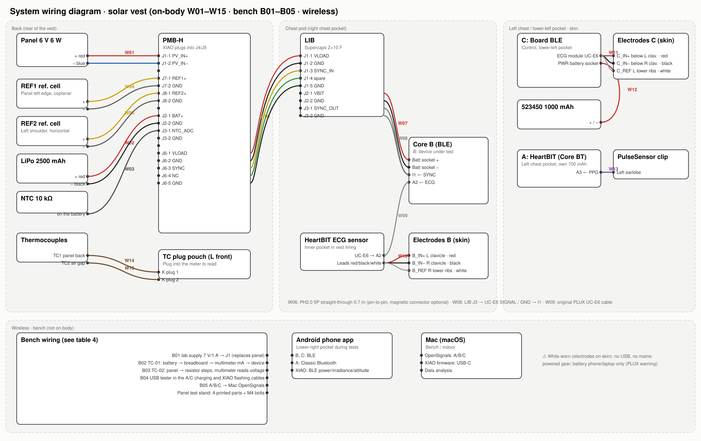

# Wiring table (all cables, pin by pin)

> Auto-generated from the 3D harness model: lengths are measured along the actual routes over the vest / inside the pods; cut length = route + 80 mm allowance, rounded up to 50 mm.
> Colours: electrode leads follow PLUX manual Table 2 (red IN+, black IN−, white REF).

## 1. On-body cables (W01–W15)

| ID | Name | Connectors (from → to) | Conductors: colour · from → to | Route length | Cut | Cable source | Route |
|---|---|---|---|---|---|---|---|
| **W01** | panel_lead | — → Bootlace ferrule / tinned end | + red · Panel junction box + → PMB-H J1-1 PV_IN+ − blue · Panel junction box − → PMB-H J1-2 PV_IN− | 221 mm | 350 mm | Original panel lead (measured from photo: junction box → waterproof connector ≈ 4.2 m, of which the coil ≈ 3.8 m; connector → stripped end 0.41 m + 7–8 cm of bare cores; OD 4.1 mm). Cut the panel side at 200 mm and solder it to the 100 mm tail left on the connector side (2 joints + heat-shrink); cut the other side of the connector to 200 mm, strip and clamp into the terminal | Panel back → channel T1 → back pod PANEL port (secured with a cable-tie bridge) |
| **W02** | battery | — → PH2.0 2P plug | red · Battery + (after PCM) → J2-1 BAT+ black · Battery − → J2-2 GND | 50 mm | 150 mm | Battery's own PH2.0 plug (⚠ red wire to J2 silkscreen +) | Inside pod: battery left end → over the divider → J2 |
| **W03** | ntc | — → PH2.0 2P plug | — · NTC 10 kΩ (non-polarised) → J3-1 NTC_ADC — · NTC → J3-2 GND | 36 mm | 150 mm | Ready-made NTC 10k B3950 with PH2.0 lead (purchased) | NTC taped to the middle of the battery with high-temperature tape |
| **W04** | ref1 | — → PH2.0 2P plug | red · REF1 cell + → J7-1 REF1+ black · REF1 cell − → J7-2 GND | 344 mm | 450 mm | Panel-lead offcut (2-core Ø4.1) 0.45 m + 1 × BOM "PH2mm straight-pin pre-wired" plug, 2 solder joints + heat-shrink | REF1 clip → panel left edge → channel T2 → REF1 port |
| **W05** | ref2 | — → PH2.0 2P plug | red · REF2 cell + → J8-1 REF2+ black · REF2 cell − → J8-2 GND | 482 mm | 600 mm | Panel-lead offcut 0.6 m + 1 × PH2 plug, 2 solder joints + heat-shrink | Left-shoulder REF2 → back yoke → channel T3 → REF2 port |
| **W06** | J6_back_to_chest | PH2.0 5P plug → PH2.0 5P plug | red · PMB-H J6-1 VLOAD → LIB J1-1 VLOAD black · J6-2 GND → J1-2 GND yellow · J6-3 SYNC → J1-3 SYNC_IN green · J6-4 unused (NC) → J1-4 spare (to TP5 only) black/blue · J6-5 GND → J1-5 GND | 531 mm | 650 mm | PH2.0 5P double-ended straight-through (pin 1 to pin 1) cable 0.7 m (purchased; route 531 mm, 0.6 m leaves no slack for bending); a 5P magnetic connector can be inserted in-line | Back pod CHEST port → channel T4 (right waistline) → chest pod BACK UNIT port |
| **W07** | lib_to_core_bat | PH2.0 2P plug → PH2.0 2P plug | red · LIB J2-1 VBIT → Core B battery socket + black · LIB J2-2 GND → Core B battery socket − | 59 mm | 150 mm | BOM "PH2.0 jumper cable", double-ended 10 cm (⚠ red wire in the same position as on the original Core battery plug) | Inside pod, passing over the Core |
| **W08** | sync_to_I1 | PH2.0 2P plug → UC-E6 plug | — · LIB J3-1 SYNC_OUT → UC-E6 SIGNAL → Core B port I1 — · LIB J3-2 GND → UC-E6 GND — · (not connected) → UC-E6 VCC / REF cut short and insulated | 53 mm | 150 mm | PLUX "UC-E6 to open-end" sensor cable with one end cut off (purchased) + PH2 pre-wired lead, crimped/soldered | Inside pod → out through the right window → into I1 |
| **W09** | ecg_B_uce6 | — → UC-E6 plug | — · HeartBIT ECG sensor UC-E6 → Core B port A2 (original PLUX cable, pin-to-pin) | 147 mm | 250 mm | 30 cm UC-E6 sensor cable supplied with the HeartBIT kit ECG sensor (there is also a 10 cm one — too short) | Inner pocket → cable hole B (brass eyelet) → pocket → into A2 |
| **W10a** | lead_B_IN+ | — → Electrode snap | red · HeartBIT ECG sensor IN+ → Electrode B_IN+ | 185 mm | 300 mm | Leads supplied with the HeartBIT kit ECG sensor | Between skin and lining, held by elastic loops |
| **W10b** | lead_B_IN− | — → Electrode snap | black · HeartBIT ECG sensor IN− → Electrode B_IN- | 142 mm | 250 mm | Leads supplied with the HeartBIT kit ECG sensor | Between skin and lining, held by elastic loops |
| **W10c** | lead_B_REF | — → Electrode snap | white · HeartBIT ECG sensor REF → Electrode B_REF | 172 mm | 300 mm | Leads supplied with the HeartBIT kit ECG sensor | Between skin and lining, held by elastic loops |
| **W12** | C_battery | — → PH2.0 2P plug | red · 523450 + → Board power block PWR + black · 523450 − → PWR − | 118 mm | 200 mm | Lead supplied with BOM "523450 1000 mAh"; if the plug differs, re-terminate with a "PH2mm straight-pin pre-wired" lead | Inside case, routed around the top edge of the board |
| **W11** | C_electrode_cable | UC-E6 plug → 3-lead split | red · UC-E6 → C's ECG module → Electrode C_IN+ (below left clavicle) black · — → Electrode C_IN− (below right clavicle) white · — → Electrode C_REF (left lower ribs) | 83 mm | 200 mm | PLUX 3-lead electrode cable (supplied with the Board kit, or taken from the HeartBIT kit) | C case left window → cable hole C → splits inside the vest → skin |
| **W11a** | lead_C_IN+ | — → Electrode snap | red · 3-lead split → Electrode C_IN+ | 124 mm | 250 mm | Same as W11 | Between skin and lining |
| **W11b** | lead_C_IN- | — → Electrode snap | black · 3-lead split → Electrode C_IN- | 148 mm | 250 mm | Same as W11 | Between skin and lining |
| **W11c** | lead_C_REF | — → Electrode snap | white · 3-lead split → Electrode C_REF | 163 mm | 250 mm | Same as W11 | Between skin and lining |
| **W13** | pulsesensor | UC-E6 plug → — | red · PulseSensor + → A port A3 VCC black · PulseSensor − → A3 GND purple · PulseSensor signal → A3 SIGNAL | 512 mm | 600 mm | Original HeartBIT kit PulseSensor cable (≈ 60 cm) | Top edge of A pocket → left-front yoke elastic loop → side of neck → left earlobe clip |
| **W14** | TC1_panel | — → Type-K mini plug | yellow/red · Type-K thermocouple + → Thermometer K plug + red/blue · Type-K thermocouple − → Thermometer K plug − | 592 mm | 700 mm | BOM "Type-K surface thermocouple", supplied with plug | Centre of panel backsheet (high-temperature aluminium-foil tape) → channel → left-front plug pouch |
| **W15** | TC2_airgap | — → Type-K mini plug | yellow/red · Type-K thermocouple + → Thermometer K plug + red/blue · Type-K thermocouple − → Thermometer K plug − | 597 mm | 700 mm | BOM "Type-K surface thermocouple", supplied with plug | Vest surface under the panel (heat reaching the body) → channel → plug pouch |

## 2. On-board connector pinouts

| Connector | 1 | 2 | 3 | 4 | 5 |
|---|---|---|---|---|---|
| PMB-H J1 (KF350 screw terminal) | PV_IN+ | PV_IN− | | | |
| PMB-H J2 (PH2.0) | BAT+ | GND | | | |
| PMB-H J3 | NTC_ADC | GND | | | |
| PMB-H J6 (PH2.0 5P → chest) | VLOAD | GND | SYNC | unused (NC) | GND |
| PMB-H J7 / J8 | REF1+ / REF2+ | GND | | | |
| LIB J1 (PH2.0 5P ← back) | VLOAD | GND | SYNC_IN | spare (to TP5 only) | GND |
| LIB J2 (→ Core B battery socket) | VBIT | GND | | | |
| LIB J3 (→ Core B I1) | SYNC_OUT | GND | | | |

**XIAO nRF52840 Sense socket** (plug-in, no wiring needed):

| XIAO pin | D0/A0 | D1 | D2 | D3 | D4 | D5 | D6 | D7 | D8 | D9 | D10 | 3V3 | GND | 5V |
|---|---|---|---|---|---|---|---|---|---|---|---|---|---|---|
| PMB-H net | NTC_ADC | NTC_EN | SYNC_OUT | LOAD_EN | SDA | SCL | CHG_INH | RANGE_LO | CHRG_N | DONE_N | PV_EN (disconnects panel input at night) | 3V3 | GND | not connected |

**UC-E6** (BITalino sensor port, 8 pins, looks like mini-USB): only SIGNAL and GND are used; VCC 3.3 V and REF (VCC/2) are cut short and insulated in W08. PLUX wire colours vary between batches — **go by signal name, not by colour**.

**BITalino port positions** (engraved on the lid): Core B one side I1 / A4 / A3 / A2 / A1, other side O1 / O2 / PWM / A6 / A5. B uses **A2 = ECG, I1 = SYNC**; C uses the on-board ECG module; A uses **A3 = PPG**.

## 3. Electrode positions (on skin)

| Electrode | Position | Lead colour | Connects to |
|---|---|---|---|
| B_IN+ | On left clavicle (85 mm from midline) | red | HeartBIT ECG sensor → B's A2 |
| B_IN− | On right clavicle | black | Same as above |
| B_REF | Right lower ribs (lower costal margin, 100 mm from midline) | white | Same as above |
| C_IN+ | Below left clavicle (50 mm directly below B_IN+) | red | C's 3-lead electrode cable → Board ECG module |
| C_IN− | Below right clavicle (50 mm directly below B_IN−) | black | Same as above |
| C_REF | Left lower ribs (mirror of B_REF) | white | Same as above |

Both sets are Einthoven lead I (measuring electrodes on the clavicles per PLUX manual §2.3; the reference electrode is moved from the iliac crest up to the lower ribs — likewise a bony site with little EMG, but close enough for leads ≤ 30 cm to reach). B and C are offset vertically by 50 mm and the reference electrodes are left/right mirrored, satisfying TC-05's "same subject, same time, mirror-symmetric leads". Electrode centres are ≥ 50 mm apart, so both the Ø24 PLUX electrodes and common Ø40–50 disposable electrodes fit.

## 4. Bench wiring (not on body)

| ID | Purpose | From | To | How to connect | Materials | Notes | Remarks |
|---|---|---|---|---|---|---|---|
| B01 | Bench supply replaces the panel | Adjustable DC supply (lab) | PMB-H J1 (screw terminal) | red → J1-1 PV_IN+; black → J1-2 PV_IN− | Banana plug / crocodile clip → stripped wire | 7.0 V, 1.0 A current limit. The board has reverse-polarity protection; a reversed connection will not damage it | Charger burn-in and firmware bring-up (no sunlight needed) |
| B02 | TC-01 power measurement (A or C) | Device's original battery plug | Device battery socket | Battery + → breadboard → multimeter mA range (in series) → breadboard → device +; − straight through | 2 × BOM "PH2mm straight-pin pre-wired" leads + 1 straight-pin header on the breadboard + Dupont jumpers | Not needed for B: U5 on PMB-H (INA226 0x42) already measures B's load current | A requires opening the HeartBIT case (two snap-fit halves) |
| B03 | TC-02 panel I-V curve | Panel waterproof quick connector | Resistor steps + multimeter | Panel + → resistor → panel −; multimeter across the resistor reads voltage, I = V / R | 5 W ceramic (cement) resistors 3.3/4.7/6.8/10/15/22/33/68/150 Ω (purchased); open circuit = Voc, short circuit = Isc (multimeter 10 A range) | Panel on the test stand, REF1 in the same plane records irradiance, TC1 records backsheet temperature | Clear day around solar noon; finish one set within 10 minutes |
| B04 | Charging / capacity | Mac or USB charger | micro-USB on A and C; USB-C on XIAO | Through the BOM "multi-function USB tester" inserted in between | Original cables | A and C are charged only when not being worn; B has no USB (powered by the back unit) | The tester reads mAh, which also verifies battery capacity |
| B05 | Data (bench) | A / B / C | Mac (OpenSignals) | A: pair with the Mac's built-in Bluetooth (Classic); B, C: BLE | Wireless | The USB Bluetooth dongle in the kit is not needed on a Mac | Firmware: flash XIAO over USB-C from the Mac |

## 5. Wireless data links

| Device | Link | Received by | Content |
|---|---|---|---|
| B (Core BLE, solar-powered) | BLE | Android phone app | ECG 1000 Hz + I1 sync pulse |
| C (Board BLE, battery) | BLE | Android phone app | ECG 1000 Hz (control) + acceleration |
| A (Core BT, HeartBIT) | Classic Bluetooth SPP | Android phone app (Android supports Classic Bluetooth) | PPG heart-rate reference |
| XIAO (on PMB-H) | BLE | Android phone app | Panel / battery / load power, reference-cell irradiance, IMU attitude, NTC temperature |
| Bench | BLE / Classic Bluetooth | Mac: OpenSignals | TC-01, TC-05 and other indoor experiments |

> Your phone is Android: all three BITalinos and the XIAO can connect to the same phone **simultaneously**, so no computer has to be carried during walking experiments. An iPhone cannot do this (no Classic Bluetooth serial support), which is why A could previously only connect to a computer.

