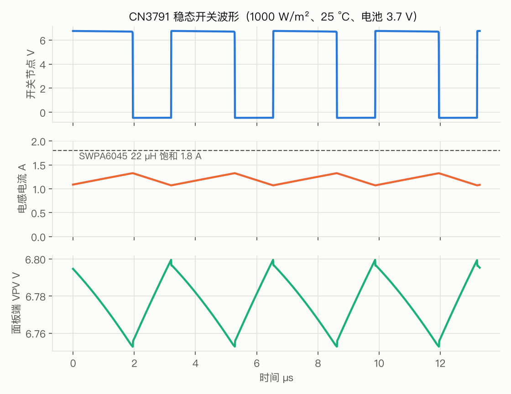
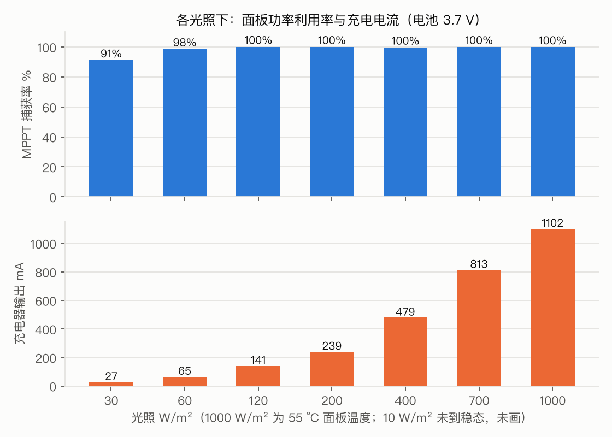
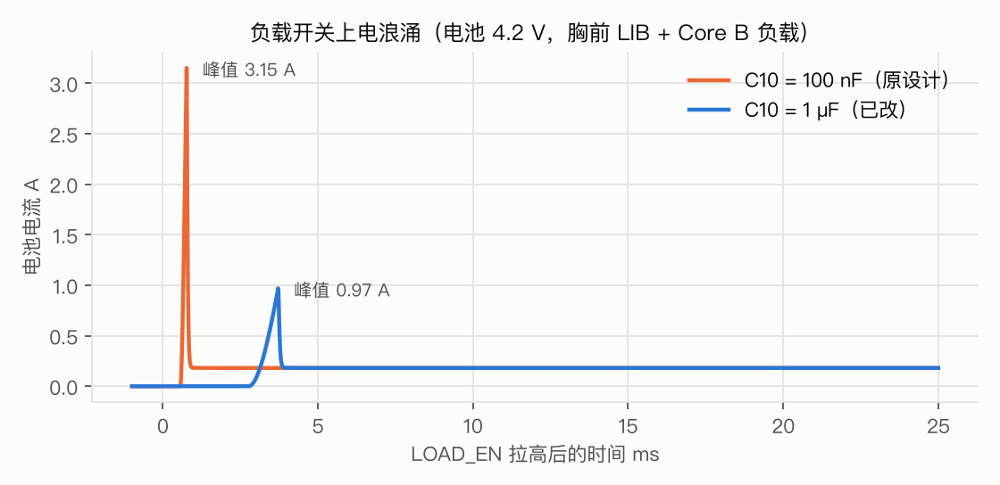

# PMB-H / LIB Circuit Simulation Report

2026-10-12 · Applies to PCBs: PMB-H (revision with C15, RS1B 0.22 Ω, C10 1 µF and PV_EN), LIB

> The requirement was: "theoretically feasible does not mean it works in practice — it must be made sure to work." This report therefore does three things:
> 1. Models the circuits with datasheet parameters and exercises every function of both boards.
> 2. States an explicit pass criterion for every item.
> 3. The simulation found **4 real problems, and the PCB has already been revised**. Whatever simulation cannot prove is listed in §7 for bench verification.

---

## 0. Summary

| # | Check | Pass criterion | Result | |
|---|---|---|---|---|
| 1 | MPPT regulation | VPV = 5.93 V ± 1 % when not current-limited | 5.930 V (all cases) | ✅ |
| 2 | MPPT capture ratio (30–1000 W/m²) | ≥ 90 % of panel maximum power | 91.0%–100.0% | ✅ |
| 3 | Charge current limit | ≤ 1.2 A (0.48 C for the 2500 mAh cell) | 1192 mA | ✅ |
| 4 | Constant-voltage phase (battery 4.15 V) | Current tapers automatically | 625 mA | ✅ |
| 5 | Inductor peak current | < 1.8 A saturation current | 1.35 A | ✅ |
| 6 | M1 gate-source / drain-source voltage | Vgs ≥ −12 V, Vds ≤ 30 V | -6.3 V / 8.2 V | ✅ |
| 7 | MPPT loop stability | Gain margin > 6 dB, phase margin > 30° (gm ≤ 5 mA/V) | Before fix: worst-case gain margin 0 dB ❌ → with C15: ∞, phase margin ≥ 34° | ✅ Fixed |
| 8 | Night-time battery back-feed | < 0.2 mA | 1.11 mA ❌ → 51 µA with PV_EN off | ✅ Fixed |
| 9 | Reverse-connected panel | No current, board does not power up | 0.00 mA | ✅ |
| 10 | −10 °C cold-panel hot-plug | VPV < 11.1 V TVS breakdown; Q1 Vgs > −12 V | 8.75 V; -8.75 V | ✅ |
| 11 | Indoor range hit by sudden full sun | PV_IN− > −0.3 V (INA226 absolute maximum) | −0.42 V ❌ → with RS1B changed to 0.22 Ω: -0.222 V, RS1B 0.15 W | ✅ Fixed |
| 12 | Load-switch turn-on inrush | < 1.5 A | 3.15 A ❌ → with C10 changed to 1 µF: 0.96 A (battery 4.2 V) | ✅ Fixed |
| 13 | Supercapacitor pre-charge | < 10 min to 90 % | 426 s | ✅ |
| 14 | Cable-pull hold-up (Core B 65 mA) | ≥ 10 s (enough for a loose connector or re-plugging) | 17 s (worst case) – 60 s | ✅ (the 45 s in the original document was wrong and has been corrected) |
| 15 | Core B voltage at changeover | > 3.3 V | 3.51 V | ✅ |
| 16 | Recovery after re-plugging | VBIT > 3.6 V | 3.77 V | ✅ |
| 17 | Supercapacitor voltage balancing | ≤ 2.7 V per cell | 1.76 V | ✅ |
| 18 | SYNC pulse | Rise time < 5 µs, high level < 4.3 V | 237 ns, 3.34 V | ✅ |
| 19 | 3V3 rail | ≥ 3.1 V at battery 3.2 V + BLE burst | 3.160 V | ✅ |
| 20 | Cold start (battery depleted, XIAO not running) | VPV rises above the 6.05 V start-up threshold | 6.61 / 7.06 / 7.55 V at 100 / 300 / 1000 W/m² | ✅ |
| 21 | Panel model | Matches the nameplate estimated from photos | At 25 °C: Voc 8.03 V, Isc 0.85 A, Pmax 5.34 W | ✅ |
| 22 | Very low light 10 W/m² | (informational) | Panel maximum is only 33 mW, less than the board's own ≈ 8 mA (30 mW) consumption; the battery net-discharges at about 7–8 mA. Not settled within 25 ms: panel current is only ≈ 8 mA, so C15 charges very slowly | ℹ️ |

**The 4 changes made because of the simulation** (all incorporated into the PCB and the production files):

| Change | What was found |
|---|---|
| **Added C15** 100 µF / 35 V aluminium electrolytic (C2836437) | With only ceramic capacitors at the input, the ≈ 5 kHz resonance is undamped. If the CN3791 error-amplifier transconductance is on the high side (the datasheet does not specify it), the MPPT loop oscillates: the switching-level simulation at 400 W/m² showed VPV swinging 403 mV and the inductor current cycling between 0 and 0.95 A. The CN3791 datasheet already calls for an electrolytic capacitor at the input. With it added, the swing drops to 19 mV |
| **RS1B** 0.47 Ω → 0.22 Ω | In the indoor range, a sudden increase in light pulls the INA226 input to −0.42 V, beyond the −0.3 V absolute maximum; the resistor's own 0.34 W also exceeds its 0.25 W rating |
| **C10** 100 nF → 1 µF | At load-switch turn-on the battery current peaks at 3.15 A (battery at 4.2 V), close to the ≈ 3 A over-current threshold of the battery protection board |
| **PV_EN** (Q8 + R19 + R20) + MPPT divider 200k / 51k | At night the battery back-feeds the panel through Q1 and the M1 body diode: 1.1 mA (up to 10 mA as the panel ages). The MPPT set point was moved from 6.40 V to 5.93 V, raising the all-day capture ratio from 93.6 % to 98.4 % |

---

## 1. Method

| Item | Approach |
|---|---|
| Simulator | ngspice (the libngspice bundled with KiCad 10, driven from Python) |
| Circuit | All component values taken from `pmbh.py` / `libb.py`, identical to the PCB; panel cable modelled as 0.5 m, 40 mΩ/m, 0.6 µH/m |
| MOSFET | AO3400A / AO3401A: fitted to the 3 datasheet Rds points and Vth, with Ciss, Crss, Rg and body diode |
| Diodes, TVS | SS34, B5819W, BAT54, BZT52C10, SMAJ10A, SMF5.0A: fitted to datasheet Vf / VBR |
| Panel | 12-cell series single-diode model: Isc 0.85 A, Voc 8.0 V (nameplate estimated from photos), with temperature coefficients |
| CN3791 | Behavioural model: MPPT 1.205 V, current limit 120 mV, float 4.2 V, 300 kHz, 94 % maximum duty cycle, DRV = VCC − 6.3 V, UVLO and sleep thresholds (all from the datasheet) |
| LM66100 | Behavioural model: turn-on −150 mV, turn-off +35 mV (with hysteresis), 91 mΩ, reverse blocking, ST open-drain |
| Three simulation types | ① Switching-level transient (≈ 170 points per cycle, run for 25 ms to steady state); ② long averaged-model transient (LIB 900 s); ③ small-signal loop analysis (Bode plot) |

**Pitfalls hit in the simulation itself**: if/else constructs in the behavioural models (comparators, anti-windup) make ngspice's time step collapse to 10⁻¹⁷ s, so a single case ran for over half an hour without converging. After rewriting them as continuous functions (tanh / max), one case takes about 1 minute. Of the conclusions from the earlier short 1.5 ms simulations, two (the 400 W/m² ripple and the zero current at 30 W/m²) had in fact not yet reached steady state; everything has been re-run with 25 ms long simulations.

## 2. Panel model

| Temperature | Voc | Vmp | Pmax |
|---|---|---|---|
| −10 °C | 8.76 V | 7.47 V | 6.04 W |
| 25 °C | 8.03 V | 6.69 V | 5.34 W |
| 55 °C (heated in sun on the back) | 7.39 V | 6.02 V | 4.75 W |

The panel has no nameplate; these figures are estimated from photos. Once the I-V curve has been measured on the bench (TC-02), the model can be re-fitted.

## 3. Charger (CN3791 MPPT buck)

| Irradiance W/m² | Panel temp. | Battery | VPV | VPV ripple | Panel power | Capture ratio | Battery current | Inductor current | Efficiency | Settled |
|---|---|---|---|---|---|---|---|---|---|---|
| 1000 | 55 °C | 3.70 V | 5.930 V | 42 mV | 4.735 W | 99.8% | 1094 mA | 1.00–1.20 A | 91.0% | ✓ |
| 1000 | 25 °C | 3.70 V | 6.776 V | 49 mV | 5.237 W | 98.1% | 1192 mA | 1.07–1.33 A | 89.4% | ✓ |
| 1000 | 0 °C | 3.70 V | 7.625 V | 51 mV | 5.276 W | 90.4% | 1192 mA | 1.05–1.35 A | 88.2% | ✓ |
| 1000 | 55 °C | 3.00 V | 6.373 V | 51 mV | 4.361 W | 91.9% | 1192 mA | 1.07–1.33 A | 87.4% | ✓ |
| 1000 | 55 °C | 4.15 V | 6.888 V | 25 mV | 2.885 W | 60.8% | 625 mA | 0.51–0.76 A | 93.6% | ✓ |
| 700 | 45 °C | 3.70 V | 5.930 V | 31 mV | 3.401 W | 99.9% | 805 mA | 0.71–0.92 A | 92.2% | ✓ |
| 400 | 37 °C | 3.70 V | 5.930 V | 19 mV | 1.941 W | 99.6% | 471 mA | 0.37–0.59 A | 93.5% | ✓ |
| 200 | 32 °C | 3.70 V | 5.930 V | 10 mV | 0.950 W | 99.9% | 231 mA | 0.13–0.35 A | 94.3% | ✓ |
| 120 | 29 °C | 3.70 V | 5.930 V | 7 mV | 0.555 W | 100.0% | 133 mA | 0.03–0.25 A | 94.3% | ✓ |
| 60 | 27 °C | 3.70 V | 5.930 V | 4 mV | 0.259 W | 98.5% | 57 mA | -0.01–0.17 A | 93.4% | ✓ |
| 30 | 26 °C | 3.70 V | 5.930 V | 2 mV | 0.110 W | 91.0% | 19 mA | -0.01–0.11 A | 90.4% | ✓ |
| 10 | 25 °C | 3.70 V | 4.843 V | 134 mV | 0.032 W | 99.8% | -8 mA | -0.01–0.01 A | 1.4% | ✗ |
| 120 | 29 °C | 3.00 V | 5.930 V | 8 mV | 0.555 W | 100.0% | 161 mA | 0.05–0.29 A | 91.9% | ✓ |
| 30 | 26 °C | 4.15 V | 5.930 V | 2 mV | 0.110 W | 91.0% | 16 mA | -0.01–0.10 A | 91.4% | ✓ |

**How to read it**:

- At 1000 W/m² with a cool panel (25 °C, 0 °C), or with a low battery voltage (3.0 V), VPV is above 5.93 V. This is because the charge current has already hit the 1.2 A limit, so the surplus power stays in the panel. This is by design, not an MPPT failure.
- At a battery voltage of 4.15 V the charger enters the constant-voltage phase and the current tapers naturally.
- Battery current = charger output − the board's own ≈ 8 mA (XIAO + 6 × INA226 + LDO).
- At 10 W/m² the panel's maximum power is only 33 mW, which cannot cover the 8 mA self-consumption, so the battery net-discharges. This is typical of an overcast day indoors and is consistent with the positioning "solar extends runtime but does not guarantee charge-free operation". The "Settled" column for this row is ✗: the panel current is only ≈ 8 mA, so the 100 µF C15 charges very slowly and the equilibrium is not reached within 25 ms. The conclusion is unaffected.

**Heat dissipation** (losses at 1000 W/m², 55 °C):
- D5 0.13 W, L1 0.11 W, R8 0.12 W, M1 ≈ 0.05 W; estimated temperature rise of 6–13 °C each.
- With the back enclosure at 55 °C ambient, the hottest component reaches about 70 °C, far below their 125–150 °C ratings.
- An HP600 thermal pad on the underside of the board conducts heat to the enclosure floor.

## 4. MPPT loop stability (the most important finding this time)

**Problem**:
- When a buck converter regulates its input voltage, the inductor and the input capacitance form a resonance at about 5 kHz.
- With ceramic capacitors only, this resonance is almost undamped.
- The CN3791 datasheet does not give the error-amplifier transconductance, so I swept it over 0.05–20 mA/V:

| Input capacitance | gm ≤ 1 mA/V | gm ≤ 5 mA/V |
|---|---|---|
| Ceramic only (before fix) | Phase margin ≥ 87°, gain margin ≥ 14 dB | Gain margin as low as **0 dB** (oscillates) |
| With C15 (25 °C, ESR 0.6 Ω) | Stable | Phase margin ≥ 34°, gain margin **∞** |
| With C15 (−10 °C, ESR taken as 3×) | Stable | Phase margin ≥ 53°, gain margin **∞** |

**Fix**:
- C15 was added, following the datasheet requirement "input capacitance = electrolytic + ceramic + high-frequency".
- An infinite gain margin means that no matter how high the chip's internal gain is, the phase never crosses −180°, so the loop cannot oscillate.
- Switching-level re-check: at 400 W/m² the VPV ripple drops from 403 mV to 19 mV and the inductor current returns to normal continuous-conduction ripple.

## 5. Protection circuits

| Scenario | Result |
|---|---|
| Night (panel not generating), PV_EN not switched off | Battery leakage 0.16 / 1.11 / 10.4 mA (panel shunt resistance 30k / 3k / 300 Ω, decreasing with age) |
| Night, PV_EN switched off | **51 µA**, independent of panel condition. Of this, CN3791 sleep 30 µA, MPPT divider 13 µA, INA226 bus inputs 8 µA. Only 0.6 mAh over 12 hours |
| Reverse-connected panel | Q1 off, 0 mA, board does not power up |
| −10 °C cold panel hot-plugged in full sun (5 m cable) | VPV peak 8.75 V (10 V TVS does not conduct), Q1 gate-source -8.75 V (Zener clamps it within 10 V) |
| Indoor range (Q2 off) hit by sudden full sun | PV_IN− -0.222 V (> −0.3 V), RS1B 0.15 W (1 W rating). No damage even if the firmware does not switch range |

## 6. Load switch and chest LIB

| Battery voltage | C10 = 100 nF (before) | C10 = 1 µF (after) | VLOAD rise time (after) |
|---|---|---|---|
| 3.4 V | 2.19 A | 0.70 A | 4.5 ms |
| 3.8 V | 2.53 A | 0.83 A | 4.1 ms |
| 4.2 V | 3.15 A | 0.96 A | 3.7 ms |

**Cable-pull hold-up**:
- Two 10 F supercapacitors in series give an equivalent 5 F, charged to about 0.2 V below VLOAD. Assuming a 3.3 V brown-out for the BITalino, the usable voltage window is only 0.3–0.8 V.
- Result: worst case **17 s**, when the supercapacitors are not yet fully charged 7 minutes after power-on and the battery is at 3.8 V; with a full battery and fully charged supercapacitors, about 60 s.
- The "about 45 s" in the original design document was calculated with a wider voltage window and has been corrected.
- For its purpose (a loose magnetic connector, or re-plugging when swapping cables), 17 s is sufficient.

**Other**:
- SYNC pulse rise time 237 ns; the high level is clamped to 3.34 V by the BAT54S.
- The 3V3 rail stays at a minimum of 3.160 V with the battery at 3.2 V and an 18 mA BLE burst.

## 7. What simulation cannot prove and must be confirmed on the bench

| # | What to test | How | Pass criterion |
|---|---|---|---|
| 1 | Check C15 polarity **before power-up** | Visual: the black half-circle on top of the capacitor marks the negative terminal and should face right; the silkscreen + is on the left | Correct orientation |
| 2 | Panel I-V | TC-02 (resistor steps + multimeter) | Re-fit the §2 model with measured values |
| 3 | VPV ripple | Oscilloscope; real panel on a cloudy day, or a 9 V bench supply in series with 33 Ω to emulate the panel | < 100 mV, no kHz-range oscillation |
| 4 | Actual brown-out voltage of the BITalino Core | Lower an adjustable supply slowly and note when the Core drops out | Determines the real cable-pull hold-up time |
| 5 | Night-time leakage | Multimeter on the µA range in series with the battery, panel covered, PV_EN pulled low | ≈ 51 µA + XIAO sleep current |
| 6 | Temperature in sunlight | TC1 / TC2 + on-board NTC | Board < 85 °C, TC2 < 40 °C |

## 8. Files

All scripts are in [tools/cad/simulation/](../tools/cad/simulation/); device models are in `models.lib`.

| Script | Contents |
|---|---|
| `tb_charger.py` / `tb_charger2.py` / `run_final.py` | Charger switching-level simulation, 14 cases |
| `loop_ss.py` | MPPT loop small-signal analysis (gm × irradiance × input capacitance) |
| `tb_night2.py`, `tb_hotplug2.py`, `tb_range.py` | Night-time leakage, hot-plug, auto-ranging |
| `tb_lib.py`, `tb_inrush.py` | Load-switch inrush, LIB hold-up, SYNC, 3V3 |
| `plots.py`, `gen_report.py` | Plotting; generation of this report (every number is read from the result JSON, never copied by hand) |
