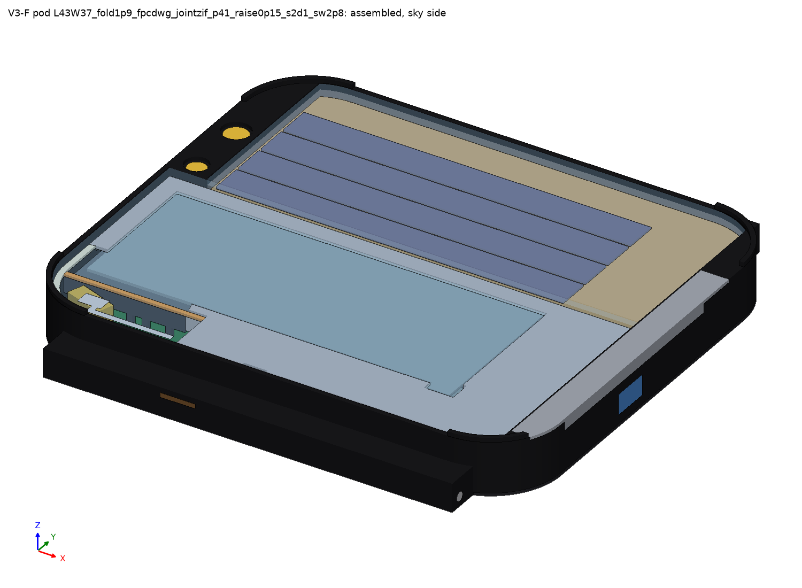

# SolarBand V3-F: light-harvesting health wristband

**Status: design complete, verified by simulation only, not built.** No prototype, lab measurement, wear trial or water test has been done. Every performance number below is a model or calculation output (⚠ in the reports) unless it is a tool result such as DRC or ERC (✅).

SolarBand is a sister project of the Solar Vest: a wrist-worn pod whose lid carries PV strips (plus PV cells on a strap wing) that charge the battery while it is worn. The pod measures ECG (two skin plates plus a third electrode on the lid), PPG (heart rate / SpO2), skin temperature and motion, and has a 1.08" reflective display, Bluetooth LE and a vibration motor. The battery sits in a capsule at a strap root; cable charging uses an isolated magnetic USB-C head. The band harvests light; it does not use wireless power transfer.

Start with [docs/FINAL_REPORT_EN.md](docs/FINAL_REPORT_EN.md).



## Key numbers (model output unless marked)

| Item | Value |
|---|---|
| Pod / board outline | 43 × 37 mm pod, 40 × 34 mm board, 8 copper layers, through vias only, via in pad, 0.09 / 0.09 mm |
| Board check | 242 footprints, 0 unconnected, 0 DRC errors ✅ (kicad-cli 10.0.7, zones refilled) |
| JLC package | BOM 91 lines, 207 placements; placement gate GREEN 192 / PREVIEW 15 / RED 0; closed-loop check G7 207/207; mutation tests G8 PASS ✅ |
| Thickness | 5.395 mm (maximum material), flat top |
| Mass | pod about 11.9 g, worn about 21.4 g |
| PV silicon | lid 333.8 mm² + strap wing 158.1 mm² |
| Dark autonomy | 38.4 days (30-min night blank), 34.3 days with the face always on |
| Indoors, 300 lx | 40.2 days from full |
| USB full charge | 2.14 h (1.98–2.34) |
| Antenna (lid strip) | 12.3 % on the body, S11 −10.44 dB, link margin 24.4 dB |
| ECG noise (limit 10 µVpp) | 6.23 µVpp, PASS only with the firmware rules F-9, P-2, P-2b (see the report) |
| Worst-case skin temperature | 42.82 °C pod bottom (limit 43 °C, 0.12 K margin) |

Open risks (antenna tune, ESD residual, drop bumpers, 8-layer 1.0 mm stack availability, stock of U15 / U4 / U5) are listed in section 6 of the report.

## How the board was routed (130 → 0)

Every step kept 0 DRC errors; only the unconnected count changed.

| Step | Unconnected |
|---|---|
| Freerouting on the first 41 × 34 mm board | 130 |
| Motor cut-out moved off the strip between the ECG plates, pod 2 mm longer | 88 |
| Own negotiated-congestion router (PathFinder-style, C core): all nets negotiate together instead of first-come routing | 58 |
| Six more nets forbidden over the ECG plates (noise), 6 layers | 75 |
| 8 layers | 55 |
| Neck-down to 0.09 mm within 1.5 mm of pads; forbidden nets allowed on the two shielded inner layers; fan-out may not close a neighbour's pad exit; router weights | 33 |
| Pod widened to 43 × 37 mm (board 40 × 34) | 16 |
| Two comparators moved from X2SON to SC70, whose centre pad could not escape | 16, all congestion, no dead ends |
| Evolutionary search (placement moves + router weights) on a rented 128-core machine | 7 |
| Local rip-up and reroute of the blocking segments, no part moved | 1 |
| One I2C via over plate E1, allowed as a named exception (I2C is silent during ECG by firmware) | **0** |

The first half came from diagnosis (why each connection could not route); the second half from search and finishing.

## Folder map

| Folder | What it holds | Private source (`v3/...` in the reports) |
|---|---|---|
| `docs/` | `FINAL_REPORT_EN.md` (entry point), `BASELINE.md` (specification; the "Final (stage F)" block wins), `DECISIONS.md`, `CHANGELOG.md`, `LEAD_NOTES.md` (rulings; working-mode notes removed) | `v3/final`, `v3/decide`, `v3/LEAD_NOTES.md` |
| `docs/zh/` | Chinese version of the final report, kept as-is | `v3/final/FINAL_REPORT.md` |
| `board/` | Delivery board: KiCad 10 project, custom DRC rules, DRC result | `v3/final/board` |
| `package/` | One-command JLC package (`make_package.sh`), its tools (placement gate, G7 closed loop, G8 mutations, BOM, review pictures), waivers and preview rules; `final/` is the package of the delivery board: `upload/` (Gerber zip, BOM, CPL, preview checks, sha256 manifest), `review/` (placement pictures + checklist), `assembly/`, `fab/`, `gate/` (report, provenance, per-part overlays), `silk/`, `board/` (board copy with the pin-1 marks) | `v3/package` |
| `design/` | Schematic flow: SKiDL sources (`src/`), tools (`tools/run_all.sh`), generated KiCad schematic (`kicad/v3f`), netlists, schematic PDF, ERC report, `parts.json`, BOMs, pin maps, footprint libraries (`lib/`), calculations and audit reports | `v3/design` (main variant `v3f` only) |
| `cad/` | build123d CAD sources of pod, lid and strap, the CAD report, sources list, renders and STEP exports (gzip-compressed) | `v3/final/cad`, `v3/cad`, `v3/final/img` |
| `routing/` | Our own placement and routing environment: `bundle/` (self-contained tree for a rented Linux box: C path-finder core `pf.c`, Python tools, `evolve.py` search, seed board; `install.sh`, `run.sh`), `finish/` (local finishing tools that took the best searched board to 0 unconnected), `results/` (curves, `results.jsonl` and best scores of the rented runs), reports `GROW8.md`, `EVAL8.md`, `README_T2E.md` | `v3/track2e`, `v3/grow8`, `v3/finish`, rented-run tarballs |
| `sim/` | Simulation scripts and summary reports: `power/`, `thermal/`, `ecg/`, `rf/`, `mech/` (Markdown + JSON; raw field dumps and logs left out) | `v3/sim` |

The scripts were written for the private work tree. Absolute paths in them were replaced by `/path/to/SolarVest_work/...` (or `@SVROOT@` in the routing bundle, which `install.sh` fills in). The package tools read `design/` relative to their own folder, so the package can be rebuilt from this repository.

## Regenerate the JLC package

Needs KiCad 10 (`kicad-cli`) and Python 3 with `numpy`, `matplotlib`, `pyyaml` and `shapely`. Offline: footprints and symbols come from `design/lib`.

```bash
cd wristband
PY=python3 KICAD_CLI=kicad-cli bash package/make_package.sh board/solarband_v3f_final_rf.kicad_pcb /tmp/solarband_pkg
# exit 0 = orderable; the upload set is /tmp/solarband_pkg/upload
```

Before paying, tick `upload/PREVIEW_CHECKS.md` (15 parts whose rotation must be confirmed in JLC's preview) and `review/checklist.md`. The stack-up (8 layers at 1.0 mm), consignment or pre-order for U15 / U4 / U5, and the antenna bench tune are open items (report, sections 5, 6 and 9).

## Regenerate the schematic

`design/tools/run_all.sh` builds the netlists, KiCad schematics, PDF, ERC reports and BOMs from `design/src` (SKiDL). It expects the private tree layout and a SKiDL environment; edit the paths at the top of the script.

## Left out of this copy

Earlier design generations (v1, v2, redesign), the evaluation boards of the searches, rented-run tarballs, intermediate stage folders, logs, environments, the EasyEDA 3D model library, cached data sheets and API responses. These remain in the private work tree.
