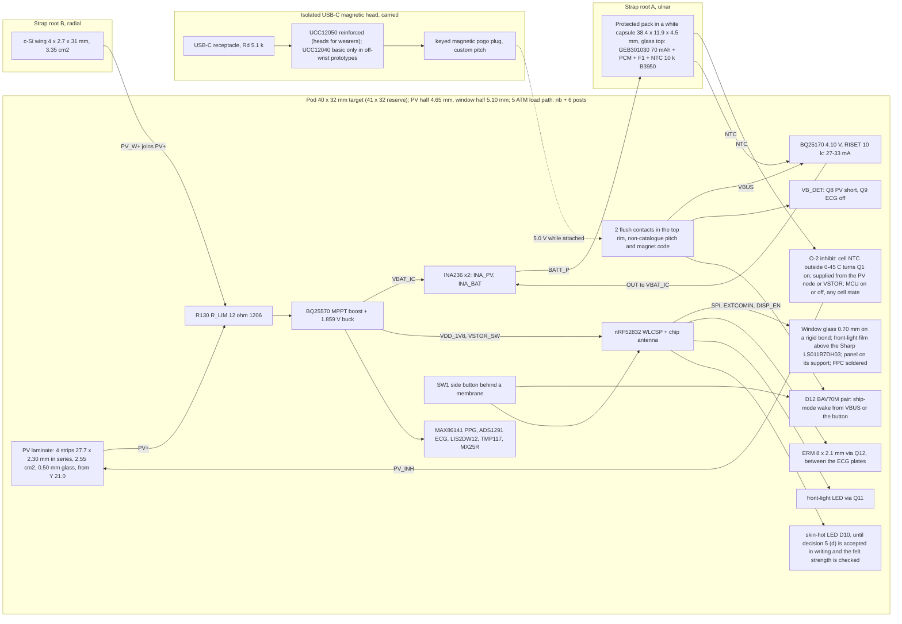

# SolarBand V3-F: baseline specification

> **Status:** 2026-11-13. Lead synthesis of the V3 decision study, revised the same day by the fix stage after two verification lenses (`verify/engineering.md`, `verify/experience.md`; changes with before → after in `CHANGELOG.md`). This is the configuration the next phase works from: gates V3-G1 to V3-G10, then layout, cplgate and the JLC package. The decisions and their reasons are in `DECISIONS.md`.
> **Source of every number:** `calc/baseline_calc.py` → `calc/baseline_calc.json` (fix-stage run 2026-11-13, exit 0; the command and the log are in `verify/PROGRESS.md` and `calc/baseline_calc_run.log`). Key paths are given as `json → key`. The script imports a guarded copy of `v3/integrate/v3_calc.py` (`calc/v3_calc_copy.py`), which imports `v3/integrate/energy/v3_energy.py` read-only. It reproduces V3-R as published exactly. The originals were not edited (sha1 checked). The synthesis version of the script is kept in `calc/pre_fix/`.
> **Marks:** ✅ read in a named source (lane files keep the URL, page and figure; JLC fields of the synthesis are in `calc/data/jlc_search.json`, those of the engineering lens in `verify_work/engineering/data_run2/`); ✅s search summary only; ⚠ estimate or model output (method named); ❓ unknown. P = project file.
> **Conventions:** V3_ARCH's, with two additions of the fix stage.
> - Thickness is the maximum-material sum including the 0.80 mm PPG mesa.
> - **Worn heights:** each item's thickness above the skin where it rests. The pod is taken with the mesa pressed in; a strap item at the far end of its free span, where it rests on the skin (V3 measured the USB-C tab, 4.6 mm, this way).
> - Pod mass is without the strap; worn mass adds the strap. Max-material mass takes the top of every range.
> - Autonomy uses the minimum cell capacity × 3.145 mWh/mAh. **T1 is given with the 30-min night blank (V3-F's policy) and with the face always on (V3's convention).**
> - Harvest is into the battery at 3.8 V.
> - Gate 1 is REDESIGN's utilisation (≤ 0.62); v1's bounding-box measure is the same × 1.108. V3-G1 must pass both.
> - Where a section is unchanged from V3-R, it says so and names the V3_ARCH section.
> **Naming:** the band harvests light. Nothing here is wireless power transfer. The supervisor and the user are named only by role.
> **Stage 1 (2026-11-14):** fix stage after the design and CAD reviews; changes listed in the next section and tagged "(stage 1: S1-nn)" in place.
> **Stage 2a (2026-11-15):** the lead's decisions a–e of `v3/LEAD_NOTES.md` §2, listed in the next section. **Where the S2 rows differ from the text further down, the S2 rows win**; the text below them is not rewritten (pre-stage-2a copy: `BASELINE.pre_stage2a.md`).
> **Final (stage F, 2026-11-17):** the delivery state. The block "Final (stage F)" below lists every change since stage 2a and the final numbers; **where it differs from any text further down, it wins** (pre-stage-F copy: `BASELINE.pre_stageF.md`).


## Final (stage F, 2026-11-17)

Delivery board: `v3/final/board/solarband_v3f_final_rf.kicad_pcb` (= `v3/finish/solarband_v3f_final.kicad_pcb` with the C215/L204 footprint IDs and values of the RF re-tune and the R172 footprint ID and value of R-172; copper identical). Package: `v3/package/final` (exit 0). Rules: `v3/LEAD_NOTES.md` §2b–§2r.

### Changes since stage 2a
| # | Change (stage 2a → final) | Ruling / source |
|---|---|---|
| F-01 | **Outline:** pod 41 × 34 → **43 × 37 mm**, board 38 × 31 → **40 × 34 mm** (R4.5 / R6); the extra 3 mm go to the PV half; plates E1/E2 +1.5 mm in Y | K-2, N-1, Q-5; `v3/track2/TRACK2_CAD.md` |
| F-02 | **8 copper layers** (GND In1, VDD_1V8 plane In4, signals F/In2/In3/In5/In6/B), through vias only, via in pad, 0.09/0.09 mm; 508 vias (220 in pads) | P-5, Q-1; `v3/package/final/fab/README_FAB.md` |
| F-03 | **Antenna on the lid:** printed strip L1 on the glass, fed by spring finger J40 BW0020AG (C2826518) at (3.68, 1.43) 340°; match **C215 7.6 nH LQW15AN7N6G80D (C2048575), L204 4.3 nH LQW15AN4N3B80D (C471381), C213 not fitted** (bench-tune land) | L-1..L-5, J-1, P-3; `v3/sim/rf/final/RF_FINAL.md` |
| F-04 | **U19/U20 TLV7031 in SC70-5** (TLV7031DCKR C2863637) instead of X2SON; PV-half only (1.10 mm) | ECO3; `v3/eco3/ECO3.md` |
| F-05 | **Motor Ø8 over plate E2**, cut-out Ø8.6 at board (34.25, 24.05); film stays under it | K-1; `v3/stage2d/STAGE2D.md` |
| F-06 | **Flat lid at 5.395 mm:** PV laminate flush with the window (T-1), window seat +0.09, stainless rail core, precision window column (M-2); PV glass chemically strengthened on a structural bond (M-1); capsule 4.6 mm with 0.50 mm glass (M-3) | T-1, M-1..M-4 |
| F-07 | **Thermal fixes:** IR-cut window coating (T-2), lid prints α ≤ 0.20 (F-5, N-6), wing silicon ends at s 8 mm (T-3), skin-hot vibration ≤ 5 % duty (T-4), U10 thermal island (T-5, R-5) | §2c, §2f |
| F-08 | **Mechanical fixes:** corner bumpers 0.36 mm (P-4; 0.37 needed at 11.87 g ⚠), GF-LCP rail section 0.20 mm deeper with posts at 2 mm pitch, parts under it ≤ 0.55 mm (P-4, F-4), rail feet X4/X6.7/X33.4 moved (K-5, N-5) | §2d, §2f, §2l, §2o |
| F-09 | **ECG / safety parts:** frame grounded (E-1, J19), Q20 CJBA7002K 60 V in series with J18 (E-2, F-8, J-2), D15 TPD1E10B06 within 1 mm of J18 (F-1, J-3), D14 PMEG10020AELR 100 V Schottky (E-4), BTN ESD + 10 k (E-6); chains stay 2 × 330 k (F-2) | §2d, §2f, §2g, §2j |
| F-10 | **R172 53.6 k, R105 383 k**; R172 part **C166160 RALEC RTT015362FTH** (0201, 1 %; replaces C423488, stock 0), same land | §2b, R-172 (§2r) |
| F-11 | **Plate rules:** R-1 double PI film, R-2 vias over plates, P-1 six more forbidden nets, **Q-1** 8-layer baseline, **Q-2** 0.09 mm neck within 1.5 mm of a pad, **Q-3** forbidden nets on In2/In3 over the plates, **Q-4** escape halo; **P-7** at most 2 I2C vias over E1 (1 used, 5.96 mm from a dot) | §2e, §2o–§2q; `v3/finish/FINISH.md` |
| F-12 | **Firmware requirements (ECG session):** F-9 display off; P-2 no I2C / NTC; **P-2b adopted**: IMU INT1 off (or IMU powered down), PPG and its interrupt paused, no flash writes (ECG kept in RAM or streamed over BLE, written afterwards). Board unchanged | §2g, §2o, P-2b (§2r); `v3/sim/ecg/final/ECG_FINAL.md` |
| F-13 | Patient DC current criterion **F-3**: ≤ 10 µA normal, ≤ 50 µA single fault (IEC 60601-1 structure; flagged for the supervisor) | §2f |
| F-14 | **Lid RFQ:** PV glass **0.60 mm** (0.50 mm reaches 228 MPa at 5 bar); corner bumpers **0.37 mm** | L-6 (§2r) |
| F-15 | **Purchase note:** BQ25170 U15 (orderable 0) and INA236 U4/U5 (54 orderable): the user chooses JLC consignment or a pre-order when ordering; board unchanged | B-1 (§2r) |

### Final numbers (⚠ model output unless marked ✅)
| Item | Value | Source |
|---|---|---|
| Pod thickness (max material) | **5.395 mm** flat top; worn top 4.59 mm; pod at P121 nominal 5.86 | `v3/track2/calc/baseline_calc_t2.json` → baseline_V3F.stack |
| Masses | pod 11.94 g typ / 12.88 max (calc), CAD 11.11 g, board-scaled 11.87 g; worn **21.4 g** typ / 23.5 max | baseline_calc_t2.json → mass; `v3/track2/track2.json` |
| PV silicon | lid **333.8 mm²** (4 strips 2.80 mm) + wing 158.1 mm² (T-3) | track2.json → pv; baseline_calc_t2.json → s3_wing |
| T1 dark (night blank / face always on) | **38.4 d** / 34.3 d; worst stack 21.9 / 18.7 d | baseline_calc_t2.json → energy |
| T2 / T3 / T4 / T5 / T6 / T7 | 98 d / **12.9 min/day** at 0.45 sun (57 overcast) / 0.74 / 37.6 d / 257 d shelf, 411 d ship / **2.14 h** (1.98–2.34) | baseline_calc_t2.json → energy |
| W2 (300 lx) / W7 (low outdoor office) | **40.2 d** / **43.9 d** from full (20.1 / 21.9 d from 50 %); W1, W4, W6 energy-positive | baseline_calc_t2.json → weeks_from_50pct |
| Cold start (wing lit / ¼ / dark) | 186 / 235 / 263 lx; a dead band off the wrist needs ≈ 330–690 lx (accepted deviation) | `v3/stage2d/STAGE2D.md` §3; LEAD_NOTES §2b |
| Thermal maxima (worst corner: perfusion 1e-3, wind × 0.6, print 0.20) | pod bottom **42.82 °C**, motor 5 % **42.88 °C** (≤ 43); glass 50.0, silicon 50.2 °C | `v3/track2/TRACK2_CAD.md`; `v3/track2/thermal/out/pod3d_W37_sw2.80.json` |
| 5-bar margins | PV glass 0.50: 14.6 / 9.7 bar at 228 MPa (0.60 recommended: 22.4 / 14.9 bar, 169 MPa); window 0.70: 17.3 / 7.3 bar; GF-LCP rail (P-4): 14.63 / 6.16 bar; bumper 0.36: −0.006 mm at 30° (0.37 needed) | track2.json → checks |
| Worn fit 130–200 mm, either wrist | PASS; tilt 75.5–47.6°; wrist extension 38.8° < 40° ⚠ | TRACK2_CAD.md; LEAD_NOTES N-6 |
| Antenna (lid L1, final board) | body **12.29 %**, S11 **−10.44 dB** (19 % of builds ≤ −10 dB), free-space −11.04 dB, hand 1.43 %; link **24.4 dB** (22.4 at P5, 15.1 hand) | `v3/sim/rf/final/RF_FINAL.md`, `rf_final_summary.json` |
| ECG M2 (limit 10 µVpp) | **6.23 µVpp PASS** under the firmware requirements F-9 + P-2 + P-2b (in-vivo worst 5.30); without P-2b 613.8 µVpp (IMU_INT1, SPI_SCK, PPG_INT over E1) | `v3/sim/ecg/final/ECG_FINAL.md`, `ecg_final.json` |
| Patient DC current (F-3) | normal **2.48 µA** ≤ 10; single fault max **25.39 µA** ≤ 50 (PASS F-3; > old 10 µA) | `v3/sim/ecg/ECG.md` row 2a/2d (stage-2c column) |
| Board | 242 footprints (232 top, 10 bottom), 0 unconnected, 0 DRC errors (kicad-cli 10.0.7 ✅) | `v3/finish/FINISH.md`; `v3/final/board/drc_r172.json` |
| Package | BOM 91 lines, 207 JLC placements; gate GREEN 192 / PREVIEW 15 / RED 0; G7 207/207; G8 PASS ✅ (run 2026-11-16 19:50 UTC, R172 C166160) | `v3/package/final/FINAL_PACKAGE.md` |
| Stock (JLC API 2026-11-16 19:44 UTC ✅) | no zero-stock line except U15 (orderable 0, B-1); U4/U5 orderable 54 (B-1) | `v3/package/final/assembly/stock_today.md` |

## Stage 2a (lead decisions 2026-11-15; `v3/stage2a/STAGE2A.md`, `v3/stage2a/stage2a.json`)

| Tag | Change (before → after) | Source |
|---|---|---|
| S2-01 | **Outline:** pod 40 × 32 (41 × 32 in the gate-1 base) → **41 × 34 mm**, board **38 × 31 mm** (lead decision a). Pod half width in the worn geometry 16 → 17 mm | LEAD_NOTES §2a; cad option `L41W34_fold1p9_fpcdwg_jointzif_raise0p15` |
| S2-02 | **Display FPC routing "A3":** FPC outline as drawn (9.47 mm wide for 5.63 mm, then a 5.5 mm tail), one 180° fold toward the panel rear **1.9 mm** from the glass edge, return run on the board (0.05 mm tape). Zero-height features (DNP lands, fiducials, test pads) may sit under the FPC ("ufpc"); no parts. FPC zones: fold 12.1, tail 25.5, wide part 16.7 mm² | cad `board_zones.json` (= the S2a zone file) |
| S2-03 | **J13 = top-contact ZIF** Hirose **FH34SRJ-10S-0.5SH(50)**, LCSC **C324723** (Sharp LD-29Y03 Table 8-1), JLC-placed, Extended, 22,206 orderable ✅ (JLC API 2026-11-15 11:11 UTC), USD 0.153 at 50. Body 7.0 ± 0.15 × 3.8 × **1.0 mm** ✅ (Hirose FH34 catalogue p.6); land = Hirose p.8–9 pattern, checked pad by pad; courtyard 7.66 × 4.30 = **32.9 mm²**. No soldered land, no bridge flex, no solder on the panel FPC (the bridge flex of gate-1 L0 is dropped) | design `parts.json`, `footprint_audit.md`; Hirose catalogue (Farnell 3932894.pdf) |
| S2-04 | **J13 pin order:** contact n = panel terminal n (1 SCLK, 2 SI, 3 SCS, 4 EXTCOMIN, 5 DISP, 6 VDDA, 7 VDD, 8 EXTMODE, 9 VSS, 10 VSSA; LD-29Y03 p.14); contact 1 at pod **+Y**, FPC entry facing the fold (+X), FPC inserted **terminals up**. Retention tabs to GND | `v3/stage2a/STAGE2A.md` §2; design `src/hmi.py` |
| S2-05 | **Placement safety J13:** class **1F** (computed: the 10-pad row cannot land on the 2 tab pads); JLC preview before payment (lead row away from the fold, contact 1 at +Y); **G10 (g)** with the panel inserted terminals up at a 20 mA limit (a flipped FPC mates 1↔10 and shows no pattern) | design `placement_proof.md` |
| S2-06 | **Panel raised 0.15 mm** (support legs longer) for the 1.0 mm ZIF under it: **window half 5.155 → 5.305 mm**; PV half **4.65 mm** unchanged; worn window half above the skin 4.36 → 4.50 mm; highest worn item the capsule 4.55 → 4.58 mm (200 mm wrist) | `stage2a/calc/baseline_calc_s2.json` stack; cad `checks_pod_<S2a>.json` z_stack |
| S2-07 | **Masses:** pod 9.92 → **10.54 g** typ (max 10.40 → 11.13), worn 19.8 → **20.4 g** (max 21.7 → 22.4) in the calc; CAD 41 × 32 → S2a: pod 9.96 → 10.21 g (board-scaled 10.04 → 10.49), worn 19.94 → 20.39 g ⚠ | `baseline_calc_s2.json` mass; cad `options_table.json` |
| S2-08 | **Lid PV silicon:** 4 strips 27.7 × 2.30 → **27.7 × 2.80 mm** (last 78.43 mm², chamfered), **255.7 → 311.1 mm²** (+21.7 %); laminate edge Y 21.0, PV glass span 12.6 mm | cad `checks_V3G9_<S2a>.json` |
| S2-09 | **Energy (⚠ model):** T1 38.4 d (dark, night blank) and 21.9 d (worst stack) unchanged; T3 11.2 → **10.5 min/day** at 0.45 sun (overcast 48 → 43); T4 0.86 → 0.95; T5 37.9 → 38.2 d; T2 98 d, T6 257 / 411 d, T7 2.14 h (1.98–2.34) unchanged; weeks from 50 %: W2 40.6 → 40.9 d, W3 56.9 → 60.1 d, W5 40.0 d, W7 45.4 → 46.4 d; W1, W4, W6 energy-positive (end SoC 0.758 / 0.675 / 0.689 → 0.797 / 0.698 / 0.721) | `baseline_calc_s2.json` energy |
| S2-10 | **Gate 1's real criterion** (lead decision e): a legal placement **and** a complete, DRC-clean routing of the whole board under JLC's rules. Both utilisation measures are still reported (S2a first order **0.621 / 0.687** on the CAD zones with the ZIF) but no longer stop the layout | LEAD_NOTES §2e; cad `options_table.json` row S2a |
| S2-11 | Netlist: dense level-0 schematic `v3/design` variant `v3f` (O-2 as built, 16 parts; LED chain and Ø8 motor kept): 233 parts, 198 JLC-placed, 143 nets; ERC 0 errors (4 known warnings); netlist cross-check 0 differences | design `netlist/solarband_v3f.net`, `parts.json` |
| S2-12 | V3-G9 pass 1 as written (§9 fit numbers of the 32 mm pod) **FAILS** at 34 mm because the numbers change: free span 14.73 → 15.22 mm, tilt 51.1 → 54.2° at 165 mm; capsule above the skin 4.51 → 4.54 mm; capsule below the PV top 2.05 → 2.28 mm; no strap item above the PV top (all four wrists). These values replace §9's for the 34 mm pod | cad `worn_checks_<S2a>.json` |

## Stage 1 changes (2026-11-14; `v3/stage1/STAGE1.md`; the text before them is in `BASELINE.pre_stage1.md`)

Each change carries its tag in the text below where a number or rule changed in place; "listed" means it is recorded here and in STAGE1.md only. Review ids in brackets (`v3/stage1/review_design.md`, `review_cad.md`); "lane" = a change the design lanes asked for, accepted in stage 1.

| Tag | Change | Source |
|---|---|---|
| S1-01 [D-1] | O-2: the firmware override (Q16) runs only on a **software heartbeat** on CHG_DIS (C175 220 pF + R176 1 MΩ, 10 µs at 10 Hz), never on VBAT_OK. A healthy band whose MCU is not running does not harvest; with VBAT_OK low the window comparators decide. G10 (k) restored (MCU in reset at 3.7 V and at 3.0 V). O-2 = 16 parts, **22.1 mm²** against the 12 mm² reserve | design `src/o2.py`, `calc/o2_inhibit.json` stage1 |
| S1-02 [D-2] | Head pin check: band model with D13 + D14; V1 ≥ 0.30 V at 2 ms and "V2 ≤ 2 LSB → FAULT"; EOL dummies include D14 | head `sim/pin_check.json` |
| S1-03 [D-3] | Head output **5.4 V** (UCC12050 SEL 100 kΩ to VISO, 5.1–5.7 V ✅ SNVSB38D p.7); ≥ 4.90 V at the contacts at 34 mA; U4 through D7, Q1 through Q3, ADC guard Q4 (PY32F002B 1.7–5.5 V, I/O ≤ VCC + 0.3 V ✅ datasheet p.29, p.31); head heat ≈ 296 mW typ ⚠ | head `calc/head_calc.json` |
| S1-04 [D-4] | Firmware rule: never drive NTC_EN while /PG is low; ignore NTC_ADC while /PG is low (with NTC_EN high the BQ25170 hot stop moves to 46.3–53.6 °C ⚠) | design `calc/o2_inhibit.json` stage1.D4 |
| S1-05 [D-6] | G10 (h): FL_EN → 8.3–9.1 mA into a 330 Ω ±1 % jig load at 3.80 V (R160 100 Ω) | design `calc/v3f_calc.json` |
| S1-06 [D-7, C-21] | No magnet repulsion: a reversed head is stopped by K1 unequal pins, K2 the window-glass step and K4 the head's pin check; the ferritic target only holds the magnet | head_interface.json, band_contacts.json |
| S1-07 [D-8] | **R140 RISET 10.2 kΩ** 1 % 0402 C11660 (60,305 / 46,407 ✅ JLC 2026-11-14): 26.2 / 29.4 / 32.7 mA; ≤ 0.495 C at 66 mAh nominal | design parts.json; `stage1/calc/baseline_calc_s1.json` |
| S1-08 [D-9] | SW1: EasyEDA pad 5 (ESD-pin land with paste) deleted; courtyard 4.04 × 6.54 = 26.4 mm² | design `lib/easyeda_rev.pretty` |
| S1-09 [D-12] | Motor: Q19 in series with Q12 (same gate); a single shorted FET no longer runs the motor from the unswitched VBAT_IC; EOL probes MOTOR_S; V3-G2 keeps the motor-on single fault | design `src/hmi.py` |
| S1-10 [D-16] | Contacts at rest: VBUS_K floats behind D14; R144/R145 hold VBUS and VB_DET at 0 V | design `src/charger.py` |
| S1-11 [D-11, D-15] | V3-G4 adds: V_O2 down to 1.6 V (window 0.55–4.10 / 34.58–44.31 °C, 0.55 / 0.69 K margin ⚠) and Q14 at VGSth max during a cold start (PV node ≥ 1.85 V at 711 lx ⚠) | design `calc/o2_inhibit.json` stage1 |
| S1-12 [D-13] | Stock (JLC API 2026-11-14 20:52–20:57 UTC): BQ25170 149 / 103 orderable; INA236 94 / 42 (21 boards); MAX86141 51 / 43; PMZ290UNE2YL 2,271 / 1,728 at 14 per board; UCC12050 0 (21:24 UTC) | design `stock_report.md`, head `data/jlc_parts.json` |
| S1-13 [C-1, C-19] | Window support: antenna-side **GF-LCP rail** Y 5.0–5.4, X 1.1–33.7 on 9 posts (≤ 4.0 mm apart, feet 0.8 × 0.8 mm); the frame is bonded **structurally** to the rail and the rib insert; free span 36.0 × 14.6 mm: 4.05 bar simply supported ⚠, about 13 bar clamped ⚠ (BASELINE's basis was 4.3 / 14 on 33 × 14.5). The PV laminate's rib seat needs a structural shelf-to-insert bond | `stage1/calc/window_plate_s1.json`; cad `geom_v3f.py` |
| S1-14 [C-10] | Window column **5.155 mm** (air gap 0.10 kept at the 0.855 mm max-material panel); rib insert 0.5 × 0.755 mm; window-glass step 0.505 mm | `baseline_calc_s1.json` stack |
| S1-15 [C-2] | K corner re-laid: strips at X 4.1–31.8; laminate from X 3.65, K top to X 3.55; pins VBUS Ø1.6 at (1.9, 21.9), GND Ø2.0 at (1.9, 27.3), **pitch 5.40 mm**; ≥ 0.30 mm PC walls at the largest counterbores; target at (1.5, 24.46) | cad `checks_pod_L40.json` K corner |
| S1-16 [C-3, C-4, C-5] | **Gate 1 with the CAD features** (FPC corridor 110 mm², lid tail, rail feet, legs, K and J11 zones = 132 mm²): 37 × 29 **0.734 / 0.813**, 38 × 29 **0.704 / 0.780**; reserves 1 + 3: 0.681 / 0.754 and 0.653 / 0.724. Board length for both measures: 44.2 mm as built, 42.0 mm with reserves 1 + 3 ⚠. Root-A lands X 5.1–11.1 | `stage1/checks/cross_check.json` |
| S1-17 [C-6] | D10 at the radial board edge (X 17.5–21.8), light turned up through a frame notch and a clear dot in the glass print inside the window bond (no new joint); lid flex tail to J6 at X 32.1–35.6 | cad `board_zones.json` |
| S1-18 [C-8] | J15 / J18 lands (2.5, 22.15) / (2.65, 26.2): finger body 0.10 mm from the max-material panel in plan, J18 0.20 mm from the J15 pin face; tip position open until the BW0036BG drawing is read | cad `geom_v3f.py` |
| S1-19 [C-9] | E3-net metal ≥ 4.0 mm from the panel: 40 mm pod tab 3.1 / J11 3.4 mm (fails; SIM-07 input), 41 mm pod 4.1 / 4.4 mm | cad `checks_pod_L4x.json` |
| S1-20 [C-11, C-16] | RF list adds the stainless window frame (267 mm², ≥ 5.01 mm from the keep-out) and the 30.2 mm rib insert (λ0/4 30.7 mm); the antenna type (chip vs printed) is still open | cad, design parts.json AE1 |
| S1-21 [C-13] | Masses with frame and rail: pod **9.92 / 10.40 g**, worn **19.8 / 21.7 g** ⚠ (CAD pod 9.83 g at 40 mm, 9.96 g at 41 mm) | `baseline_calc_s1.json` mass; cad `mass_L40.json` |
| S1-22 [C-12, lane] | Head housing 28.5 × 15 × 7 mm, seat face from y 21.0, rebate ≥ 0.8 mm high; the stage-0 head PCB layout is superseded | head_interface.json |
| S1-23 [D-5] | Head lands: 10 of 41 lands still OPEN (vendor drawing not compared) and block the head order; C547280 land corrected (SOT883 set) | head `footprint_audit.md` |
| S1-24 [lane] | Design-lane changes accepted (listed): O-2 as a default-off series PMOS Q14; ERM on VBAT_IC (D17 to VBAT_IC); DISP through U21 TXU0101 on P0.18 (no debug UART_TX); D14 NSR0240 reverse block; R149 1 MΩ; Q13 + R167 button shifter, R164 1 MΩ pull-up, R165 100 kΩ; R160 100 Ω C270366, R162 1 kΩ C270365, R165 100 kΩ C270364; root lands 1.0 × 4.0 mm; SW1 side actuated, 1.35 mm; R123 220 k ECG_PWR_EN → AVDD_EN; J15 / J18 split | design CHANGES_V3F.md §4 |
| S1-26 [C-12, D-7] | §16 head table: P1/P2 pogo pair at 5.40 mm, no repulsion key; head refs follow v3/head | head_interface.json |
| S1-25 [lane] | CAD-lane changes accepted (listed): panel at X 1.3–33.3, Y 5.7–19.7; rib insert X 3.8–34.0; window glass edge Y 20.45, laminate edge Y 20.55; E3 top from X 37.6; frame, 0.10 mm panel support on 4 legs, 0.40 mm PC lip, 0.8 mm bars, TPE membrane; capsule far-edge radius 1.0 mm (glass top 37.4 × 9.9 mm); J11 at (37.7, 9.5) | cad CAD.md |

---

## 0. 中文摘要

V3-F 是 V3-R 的表体（单层结构，表体里没有电芯），加上这次定下的改动：

1. **电芯：** 70 mAh 整包电池（GEB301030 类，电芯 + 保护板 + 保险 + NTC），放在表带根部 A 的白色小壳里（38.4 × 11.9 × 4.5 mm，顶面是 0.40 mm 强化玻璃）。电芯连焊点要 ≤ 33.4 mm。
2. **充电：** 表带上没有 C 口。表体顶面肘侧角两个平齐触点（目录磁吸插头插不上），配一个随盒附带的隔离 C 口磁吸充电头。发给佩戴者的头用加强隔离（UCC12050）。表带里只有 BATT_P、GND、NTC、GND 四根线。
3. **显示：** 屏同 V3-R。前光从第一版设计好，膜在屏的上面，屏下面保留支撑；30 分钟没光自动熄屏；有研究模式。
4. **交互和提醒：** 一个密封侧键；Ø8 低电流振动马达（在两块电极板之间）；抬腕后 3 秒内双击才有效。
5. **安全：** 电芯 NTC 驱动的硬件光充禁止，取电于光伏节点或 VSTOR，单片机关着、电芯没电时也有效。
6. **防水：** 上盖两块玻璃（光伏片 + 0.70 mm 屏窗），中间是带不锈钢芯、6 根小柱撑住的横梁；光伏条 2.30 mm 宽。产品目标 5 ATM；5 bar 测试通过前宣称 IP68 1.5 m。
7. **其他：** 左右手都能戴；外圈表带两种长度（约 130–210 mm），可快拆。

主要数字（⚠）：

| 项目 | 数值 |
|---|---|
| 表体外形 | 目标 40 × 32 mm；V3-G1 通过前，询价按 41 × 32 mm |
| 表体厚度 | 光伏那半 4.65 mm，屏那半 5.10 mm；按已查证的上盖工艺 5.12–5.42 mm |
| 戴着时各项离皮肤的厚度 | 小壳 4.50–4.55 mm（最厚）；表体屏那半 4.30 mm、光伏那半 3.85 mm |
| 佩戴质量 典型 / 最大实体 | 19.3 / 21.0 g |
| 主板利用率（项目口径 / v1 口径） | 0.565 / 0.626 ✗（41 mm 时 0.546 / 0.605） |
| 黑暗续航 T1：夜里熄屏 / 屏一直亮 | 38.4 / 34.3 天 |
| 最坏叠加：夜里熄屏 / 屏一直亮 | 21.9 / 18.7 天 |
| 每天要晒几分钟 T3 | 11.2 分钟（阴天 48 分钟；翼片被遮住 24.5 分钟） |
| 只在室内，满电多少天补一次 | 40.6 天 |
| 冬季办公周 | 45.4 天 |
| 普通待机存放 | 257 天 |
| USB 0 → 85 % | 2.0–2.3 h |

---

## 1. Concept

**The pod** keeps V3-R's structure (V3_ARCH §4.3): a one-layer pod; the board bonded to a 0.25 mm film floor with titanium plates; a black PC ring; no cell inside. The full 37 × 29 mm board carries everything. The outline target is 40 × 32 mm; the lid and ring RFQs are drawn at 41 × 32 mm until V3-G1 places the board at 40 mm on both gate-1 measures (§5.3).

**The top** is two glasses on a supported ring rib (the 5 ATM load path, E-5):
- The **PV laminate**: four strips 27.7 × 2.30 mm in series, running along the forearm and stacked across it (G-9), from Y 21.0 mm, at X 4.1–31.8 mm (stage 1: S1-15), 2.55 cm², with a 0.50 mm glass.
- The **window glass**: 0.70 mm, chemically strengthened, AR on both faces, UV-cut, on a rigid (structural) bond to a stainless frame over the Sharp LS011B7DH03. If SIM-14 shows the bond acts as simply supported, the glass becomes 0.80 mm. The frame is bonded structurally to the rib insert and to a GF-LCP rail on the antenna side (Y 5.0–5.4 mm, 9 posts to the board), so the glass spans 36.0 × 14.6 mm (stage 1: S1-13).
- The **rib**: Y 20.0–21.0 mm, beside the panel (which ends at Y 20.0), with a 0.5 × 0.755 mm stainless insert (stage 1: S1-14) and 6 posts to the board at a pitch of ≤ 6 mm. The window glass edge and the PV laminate edge are bonded on it.
- The **front light** sits above the panel: a custom 1.08" film (the film itself 0.05 mm ✅ on the 1.28" part; film + adhesive ≤ 0.25 mm in the RFQ), laminated to the panel front by Sharp's approved partner (as on Azumo's 1.28" module ✅) or to the underside of the window glass. The panel rests on V3-R's 0.10 mm support frame. Sharp's own notes allow no adhesive on the panel for the integrator ✅.

**The charging contacts:** two flush pins in the ring rim at the elbow-end corner (X 0.4–3.7, Y 20.2–31.6 mm), the only lid area outside both the PV strips and the window: VBUS Ø1.6 mm at (1.9, 21.9), GND Ø2.0 mm at (1.9, 27.3), pitch 5.40 mm, ≥ 0.30 mm PC walls around the counterbores (stage 1: S1-15).
- The pin pitch, recess and magnet code are non-standard, so catalogue magnetic plugs cannot mate (E-1). The ring drawing gives each pin an inner face ≥ 3.4 × 2.2 mm centred on its J15 land (E-13).
- One ferritic target sits between them; there is no magnet on the wrist. The target holds the head's magnet; it cannot make a reversed head repel (stage 1: S1-06).

**The side button:** in the hand-end wall, below E3. A C&K PTS840 side switch on the board edge, actuated through a membrane moulded into the ring, so the wall seal stays static. Its drawing is read before V3-G1 (E-13).

**The vibration motor:** an 8 mm coin ERM in an 8.6 mm board cut-out under the PV band, bonded to the PC-film part of the floor with the carrier film cut away under it. Planning centre X 20.0, Y 25.4 mm, between the ECG plates E1 and E2 (E-11).

**Strap root A** (the far long wall, ulnar on either wrist): a white capsule on the free span (s 2.0–13.9 mm).
- It holds the protected pack: GEB301030-class 70 mAh cell + PCM (XB5358D0 class) + F1 + 10 kΩ B 3950 K NTC, welded by the pack maker. Cell + tab joints ≤ 33.4 mm, PCM flat ≤ 4 mm (E-14).
- Its top is 0.40 mm chemically strengthened glass with the white print underneath, set flush in the PC rim (E-3).
- A 1-layer flex without parts carries BATT_P | GND | NTC | GND into the pod through a sealed slot; its entry lands sit at the elbow end of the board (X 5.1–11.1 mm, 1.0 × 4.0 mm pads; stage 1: S1-16).
- Root A ends at s 16 mm.

**Strap root B** (the antenna long wall, radial on either wrist): V3-R's c-Si wing (4 sub-cells 2.7 × 31 mm in series, 3.35 cm², no diode) on its free span.

**The textile band** beyond the roots is replaceable: two lengths (together about 130–210 mm), a tool-free quick release.

**On the right wrist** the band is turned 180°: the wing stays radial and the capsule ulnar; firmware flips the face and remaps the IMU.

**Accessory in the box:** an isolated USB-C magnetic head (§4, §17). Any USB-C cable or source works through it. Heads given to wearers use the reinforced UCC12050; prototypes with the basic UCC12040 are "off the wrist only".

**Charging rules:**
- Light charges the band while worn.
- Cable charging is done off the wrist until the supervisor adopts the worn-charging rule (DECISIONS §1.1) and the manufacturer's bench leakage test passes. Then only through reinforced heads.

---

## 2. Summary (⚠ unless marked; `json → baseline_V3F`)

| | V3-F | V3-R (V3_ARCH §4.1) |
|---|---|---|
| Case outline | 40 × 32 mm target; RFQs drawn at 41 × 32 mm until V3-G1 passes at 40 (§5.3) | 40 × 32 mm |
| Pod, max-material, lid at the RFQ target | **5.155 mm** (window column governs; PV column 4.65 mm) (stage 1: S1-14) | 4.65 mm |
| Pod with the verified P121 lid build-up, nominal / upper | 5.12 / 5.42 mm (PV column governs) | 5.12 / 5.42 mm |
| Pod, every tolerance worst case / RSS | 5.38 / 5.26 mm (window column, own tolerance list) (stage 1: S1-14) | 5.04 / 4.78 mm |
| Worn: thickness above the skin where each item rests | **capsule 4.50 / 4.51 / 4.55 mm** (140 / 165 / 200 mm wrists, the thickest item); pod window half 4.355 (stage 1: S1-14), PV half 3.85 (4.32–4.62 at P121); wing root 2.95–3.01 | USB tab 4.6; capsule 3.50–3.55; pod 3.85 |
| Pod mass typ / max-material | 9.92 / 10.40 g (stage 1: S1-21; stage 0: 9.38 / 9.73) | 8.46 / 8.66 g |
| Strap mass typ / max-material | 9.90 / 11.26 g | 10.61 / 11.56 g |
| **Worn mass typ / max-material** | **19.8 / 21.7 g** (stage 1: S1-21; stage 0: 19.3 / 21.0; +1.6 / +1.2 g if the cell weighs the datasheet's "approx 3 g" ❓; +0.2 g at 41 mm) | 19.1 / 20.2 g |
| Gate 1: courtyard / placement area | plan 455.4 / 806.3 mm² = 0.565 (v1 0.626 ✗); **as built with the CAD features (stage 1: S1-16): 490.8 / 668.7 mm² = 0.734 (v1 0.813 ✗) at 37 × 29; 0.704 (0.780 ✗) at 38 × 29** | 423.8 / 872.5 = 0.486 (0.538) |
| PV silicon | 2.55 lid (4 × 27.7 × 2.30 mm) + 3.35 wing = 5.90 cm² | 2.77 + 3.35 = 6.12 cm² |
| Cell (usable energy) | GEB301030 70 mAh minimum (220.1 mWh) | GMB201030 43 mAh (121.7 mWh) |
| R_LIM / RISET | 12 Ω 1206 C17913 / 10.2 kΩ C11660 (stage 1: S1-07), locked to a pack ≥ 66 mAh nominal, ≥ 60 mAh minimum | 22 Ω C17958 / 18 kΩ |
| T1 dark (≥ 14 d): night blank / face always on | **38.4 / 34.3 d** | 21.6 d (24.5 with the V3 dark policy) |
| T1 worst stack (≥ 14 d): night blank / face always on | **21.9 / 18.7 d** | 11.5 d ✗ (13.5 ✗) |
| T3 (≤ 20 min/day) | 11.2 min | 12.5 min |
| W2 indoor only / W7 winter office (days from full) | 40.6 / 45.4 d | 23.2 / 26.9 d |
| T6 SHELF / ship (≥ 182.6 d) | 257 / 411 d | 174 ✗ / 279 d |
| T7 0 → 85 % | 1.98–2.34 h (3.15 h cold, conservative) (stage 1: S1-07) | 2.00–2.47 h (3.04 h cold) |
| Cold start at 200 lx: wing lit / dark (need 21.4 µA) | 26.9 / 9.1 µA (167 / 358 lx needed) | 28.0 / 10.2 µA (162 / 332 lx) |
| Water | product target 5 ATM on the supported rib; claim IP68 1.5 m until the 5-bar test | 1–1.5 m class (receptacle) |
| Strap conductors | root A: BATT_P, GND, NTC, GND; root B: PV_W+, GND | root A adds VBUS |

---

## 3. Block diagram



## 4. Power tree

V3-R's tree (V3_ARCH §4.3), with these changes: R_LIM 12 Ω; VBUS from the contacts instead of a strap tab; the protected pack instead of the root-A flex PCBA; the D12 pair; and new branches for the front light, the motor, the button and the O-2 inhibit.

```
lid PV 2.55 cm2 --+
wing PV 3.35 cm2 -+- PV+ - D8 TVS - R111 1 ohm (INA_PV) - PV_SW -+- Q1 PV_INH (Isc probe; W-C band; firmware governor)
                                                                  +- Q8 shorts PV while VBUS is present
                                                                  +- Q14 O-2 series switch (default off) - R130 R_LIM 12 ohm 1 % 1206 250 mW (C17913) - VIN_DC - BQ25570 boost - VSTOR   (stage 1: S1-24)
VSTOR - BQ25570 VBAT switch - VBAT_IC - R112 1 ohm (INA_BAT) - BATT_P == FB link == root-A 1-layer flex (no parts) == PACK+
          protected pack (white capsule): PACK+ - F1 (hold >= 0.4 A, opens <= 1 A) - PCM (XB5358D0 class, Iq <= 6 uA) - cell GEB301030 70 mAh
          NTC 10 k B 3950 K +-1 % on the cell == NTC conductor -> BQ25170 TS (R149 100 k) + MCU AIN + O-2 ladder (biased only while PV is lit, VBUS absent)
contact pins (top rim) == VBUS_K 5.4 V from an isolated head only - D13 ESD761 - D14 NSR0240 - VBUS - BQ25170 (VSET 4.10 V, RISET 10.2 k: 26.2 / 29.4 / 32.7 mA) - OUT -> VBAT_IC   (stage 1: S1-03, S1-07, S1-24)
                      '- R144/R145 -> VB_DET -> Q8 (PV short), Q9 (AVDD_EN low: ECG off), D12 half A (EN_HOLD: ship-mode wake)
                      (a reversed attach puts -5 V here: D14 blocks it; VBUS_K floats at rest, R144/R145 hold VBUS at 0 V (stage 1: S1-10))
SW1 side button, active high from VBAT through R165: node BTN -> D12 half B -> EN_HOLD (ship-mode wake in the dark) and BTN -> P0.26 (SENSE wake)
          through a level-safe path with R164 (no back-feed into VDD_1V8 in ship mode); exact topology in V3-G4, SIM-03 (g)
O-2 inhibit (stage 1: S1-01, S1-24): Q14 in series with the PV, OFF by default; U19 / U20 TLV7031 window 0 C / 45 C on the cell NTC, supplied
          from the PV node through Q18 / D19A only while VBAT_OK is low (buck and MCU off); approval by Q17. Firmware override by Q16 ONLY while
          the firmware runs: a software heartbeat on CHG_DIS (10 us at 10 Hz) -> C175 220 pF -> Q16 gate (R176 1 M); no heartbeat = no override,
          so a healthy band whose MCU is in reset, halted, off or power-cycling does not harvest. 16 parts, 22.1 mm2. (Preferred alternative:
          the pack PCM opens its charge FET outside 0-45 C, down to a stated cell voltage; then the board O-2 is not fitted)
root-A conductor order: BATT_P | GND | NTC | GND, >= 0.5 mm apart, GND guards; no VBUS in the strap; one entry pad and one 0402 link per conductor
VSTOR -+- U12 SiP32431 - VSTOR_SW -+- R117 3.3 ohm - VLED (PPG LEDs, MAX86141 drivers)
       |                           +- R507 - D10 skin-hot LED (Q6)              [kept until decision 5 (d) is accepted in writing and the felt strength is checked]
       |                           +- U3 TPS7A2030 3.0 V - AVDD_ECG             (ECG sessions only; off while VBUS)
       |                           +- U16 TPS7A0230 3.0 V - VDD_DISP            (panel; DISP_EN)
       |                           '- R160 - front-light LED (film tail J16) - Q11 (P0.10, PWM: 1.5 mA night, 3-5 mA dim room)
       +- [stage 1: S1-24 moves the ERM to VBAT_IC] ERM 8 x 2.1 mm (J17) with D17 flyback - Q12 + Q19 in series, same gate (S1-09) (P0.04, PWM to about 3.0 V, 30 ms soft start, only at VBAT >= 3.60 V, never during ECG)
       '- BQ25570 buck - VDD_1V8 1.859 V - nRF52832, MAX86141, LIS2DW12, TMP117, MX25R, U17 VCCA/OE (DISP_EN), U13 - INA_VS
```

The isolated head (accessory; ENG_A §4.3 ⚠; design in V3-G10):

```
USB-C receptacle (sink, Rd 5.1 k x2) -> UCC12050 (reinforced, 5 kVrms) in every head given to wearers
                                        [UCC12040 (basic, 3 kVrms) only in prototypes labelled "off the wrist only"]
                                     -> 5.4 V (SEL 100 k; stage 1: S1-03) -> keyed pogo pair at 5.40 mm pitch (custom; two single pogos C2988082 in prototypes) -> band contacts
requirements: magnets only in the head; unequal pins, the window-glass step and the head's pin check make a reversed attach impossible (stage 1: S1-06); the head applies 5 V only after a
pin-impedance and polarity check (no sweat film); the isolator EN is off while the band draws no current; creepage and clearance >= 8 mm across
the barrier on the head PCB; hi-pot and charge test of every head at end of line; charge-status LED; keyring loop; spares sold; two heads per study kit
```

---

## 5. Parts against `v2/design` variant `dock_wlcsp`

### 5.1 Changes (C-numbers ✅ with the time and source of the query; courtyards in mm², ⚠ unless from parts.json)

| Change | Ref | Part | LCSC | Courtyard |
|---|---|---|---|---|
| moved off the main board into the pack PCM (pack maker's PCB, not a JLC board) | U14, R132, C123 | XB5358D0-class protector, 100 Ω, 100 nF. Pack spec: Iq ≤ 6 µA, thresholds as CALC.md §2 ✅ P | (C2760012, C22775, C1525 for the fallback flex) | −18.8 |
| kept until decision 5 (d) is accepted in writing and the felt strength is checked | D10, R507, Q6, R508 | KA-2810ASURSK, 100 Ω 0603, PMZ290UNE2YL, 1 MΩ (0201 in the p0201 set) | C598214, C22775, C478155, C295786 | 0 (−13.4 when removed) |
| replaced | R130 | 22 Ω 0603 → **12 Ω 1 % 1206 250 mW UNI-ROYAL 1206W4F120JT5E**: 99,038 in stock ✅ (JLC API 16:48 UTC). Locked to a pack ≥ 66 mAh nominal | C23345 → **C17913** | +7.3 |
| value change, same land | R131, R108 | 1 MΩ → 10 MΩ YAGEO AC0402FR-0710ML (stays 0402) ✅ (V3 query 10:26 UTC) | C26083 → C144806 | 0 |
| generic passives to 0201 (V2's p0201 variant, except R108/R131) | C107, C108, C113, C120, C314, C401, C405, C501, C504, C505, R116, R124, R127, R128, R311–R316, R401, R402, R501, R503–R506, R508 | 100 nF / 10 nF / 1 M / 10 k / 100 k / 4.7 k in 0201 ✅ P (parts.json `dock_wlcsp_p0201`) | C7393837, C285010, C295786, C473048, C270364, C270346 | −20.6 |
| added: USB charger block (V3-R, usbc lane §9) | U15 | TI BQ25170DSGR WSON-8: **153–158 in stock, at most 4 orderable** ✅ (JLC API 14:11–18:25 UTC): lock or consign | C5208201 | 6.76 |
| | C130, C131 | 1 µF 25 V 0402 | C52923 | 2.82 |
| | R140 | **RISET 10.2 kΩ 1 % 0402** UNI-ROYAL 0402WGF1022TCE (was 18 k; 10 k in stage 0): 26.2 / 29.4 / 32.7 mA, 60,305 / 46,407 ✅ (JLC API 2026-11-14 20:5x UTC, Extended); locked to the pack with R130 (stage 1: S1-07) | C11660 | 1.50 |
| | R141, C132 | ISET RC 2 kΩ + 4.7 nF across R140 ✅ (TI SLUAAG9, V3_ARCH §4.3) | C4109, C1538 | 2.91 |
| | R142, R143 | 36 kΩ (VSET 4.10 V), 220 kΩ (/PG pull-up) | C43676, C25767 | 3.00 |
| | R144, R145, R146 | 1 MΩ, in 0201 ✅ P | C295786 | 2.13 |
| | Q8, Q9, Q10 | PMZ290UNE2YL: 1,271 in stock, 714 orderable ✅ (JLC API 16:48 and 18:25 UTC); 10 per board in V3-F (Q1, Q4–Q12; 5 in dock_wlcsp ✅ P), so about 71 boards from the orderable stock | C478155 | 6.06 |
| | D12 | **BAV70M,315** common-cathode pair, SOT-883: half A = VBUS wake (replaces BAS521 C130414), half B = button wake. 1,481 in stock ✅ (JLC API 16:41 and 18:25 UTC) | C549313 | 2.02 (−3.12) |
| | D13, R149 | ESD761DPYR on VBUS at the pod entry; 100 kΩ AIN protection on the NTC node (0201) | C20345399, C270364 | 3.06 |
| added: display interface (V3-R, display lane §3.5) | U16 | TI TPS7A0230PDQNR (419 in stock ✅ display lane) | C2867950 | 2.75 |
| | U17 | TI TXU0104RUTR, OE tied to VCCA | C5187176 | 5.50 |
| | C1501, C1502; C1503, C1504, C1601, C1602; R1501 | 1 µF 0402; 100 nF 0201 ×4; 100 kΩ 0201 | C52923; C7393837; C270364 | 6.64 |
| | J13 | soldered FPC land: 10 pads 0.3 × 1.6 mm at 0.5 mm + an asymmetric key pad (not a JLC part) | – | 15.1 |
| added: front-light driver (eng_b §2.4) | Q11 | PMZ290UNE2YL, P0.10 PWM | C478155 | 2.02 |
| | R160, R161 | LED resistor (value and C-number chosen in V3-G1, about 150–560 Ω) ❓; 1 MΩ gate pull-down; both 0201 | ❓, C295786 | 1.40 |
| | J16 | front-light tail: 2 keyed asymmetric pads, hand-soldered | – | 3.0 |
| added: motor driver (eng_b §4.2) | Q12 | PMZ290UNE2YL, P0.04 PWM | C478155 | 2.02 |
| | D17 | flyback, common-cathode Schottky pair in DFN1006-3 (one half used): BAT54CM,315 (7,036 ✅) or SDM02M30CLP3-7B (19,975 ✅) (JLC API 16:40 UTC). Height 0.5 mm class | C549275 / C5244996 | 2.02 |
| | R162, R163 | gate series resistor (value and C-number chosen in V3-G1) ❓; 1 MΩ pull-down; both 0201 | ❓, C295786 | 1.40 |
| | J17 | motor wire pads ×2; the motor is hand-fitted in the cut-out | – | 3.0 |
| | cut-out | 8.6 mm board cut-out under the PV band, centre X 20.0, Y 25.4 mm (placement area −66.2 mm²) | – | – |
| added: side button (eng_b §3) | SW1 | C&K PTS840GKSMTRLFS SMD-5P 3.55 × 3.5 mm: 9,807 in stock ✅ (JLC API 16:48 and 18:24 UTC; JLC lists it "Surface Mount, Vertical", 2.2 N; a Digi-Key summary says "side actuated" ✅s). Drawing ❓: the 17.0 mm² and 1.05 mm are assumptions until it is read (E-13) | C221907 | 17.0 |
| | R164, R165 | level-safe input resistor to P0.26 (1 MΩ class) and series resistor from VBAT to the button (value and C-number chosen in V3-G1) ❓; both 0201; topology in V3-G4 | C295786, ❓ | 1.40 |
| added: O-2 hardware PV-charge inhibit (reserve) | U18 + ladder + OR parts | 2 comparators: TLV7031DPWR X2SON-5 (315 nA, 1.6–6.5 V, 3,925 ✅) or the SC-70-5 parts TLV7031DCKR (1.6–6.5 V, 5,180 ✅) / TLV3691IDCKR (75 nA, 0.9–6.5 V, 3,407 ✅) (JLC API 16:40 UTC); supplied from the PV node or VSTOR; NTC ladder switched on only while PV is lit and VBUS is absent; OR into the Q1 gate (0201 parts listed after V3-G4) | C2876045 / C2863637 / C180352 | 12.0 reserved |
| strap-line links | FB1–FB6 | 0 Ω 0402 UNI-ROYAL 0402WGF0000TCE (one per strap conductor, GND included) ✅ (V3 query) | C17168 | (in the V3 base) |
| charging contacts | J15 | 2 spring fingers BAT WIRELESS BW0036BG-L3.0W1.0H1.4: 6,372 in stock ✅ (JLC API 16:48 UTC); they touch insert-moulded pins in the ring, each pin with an inner face ≥ 3.4 × 2.2 mm centred on its land | C2826535 | 12.6 |
| rib posts (5 ATM load path) | – | 6 post feet on the board at Y 19.8–20.8 mm, X ≈ 4 / 10 / 16 / 22 / 28 / 33 mm | – | placement area −6.0 |
| fixed features | J3, J4, J5, J10 | cell-tab and NTC pads → root-A 4-pad land (BATT_P, GND, NTC, GND) at X 4.5–10.5 + root-B 2-pad land (PV_W+, GND), 6 mm² per pad | – | fixed |
| **total** | | V3 base with contacts 435.0 + front light 6.4 + motor 8.4 + button 18.4 + D12 merge −1.1 + O-2 12.0 − 0201 23.7 | | **455.4 mm²** on 806.3 mm² |

### 5.2 Off-board and hand-fitted parts

| Item | Spec | Source / status |
|---|---|---|
| Protected pack | GEB301030 class (3.0 / 3.5 mm × 10 × 30 mm, 70 mAh minimum, 1.0 C maximum charge, charge 0–45 °C ✅ datasheet via ENG_A §3.2).<br>Cell + tab joints ≤ 33.4 mm (tabs, 6.0 ± 1 mm as delivered ✅, trimmed before welding); PCM flat at the capsule's 4 mm end (XB5358D0 class, Iq ≤ 6 µA; a 0 / 45 °C charge-temperature cut-off if offered, with the cell voltage down to which it works).<br>≥ 66 mAh nominal and ≥ 60 mAh minimum (R130 / R140 lock).<br>F1 (hold ≥ 0.4 A, opens ≤ 1 A; fallback candidates C424346 / C136320 ✅, datasheets ❓).<br>NTC 10 kΩ B 3950 K ±1 % (C49247682 class ✅).<br>Leads keyed by colour and pad size. | pack maker RFQ ❓; UN 38.3 summary + IEC 62133-2 report required; weigh samples (sheet says "approx 3 g" ❓); a second source before the design freeze; ask also for a thin cell (≥ 66 / ≥ 60 mAh, ≤ 2.7 mm new, ≤ 10.5 × 30 mm) |
| Capsule shell | 38.4 × 11.9 × 4.5 mm, 0.40 mm PC walls, rounded far edge; top 0.40 mm chemically strengthened glass with white print underneath (α ≤ 0.15 for life), set flush in the PC rim; fallback top 0.20 mm 316L with a white film; about 41 mm long only if the pack cannot meet 33.4 mm | thin-wall moulder or film shell ❓; glass from the lid RFQ |
| ERM | Vybronics VCLP0820B004L class: Ø8 × 2.1 mm (2.2 mm max class ⚠), 30 / 35 mA, 0.25 Grms ✅ (ENG_B §4.1); bonded with a 0.05 mm PSA on the floor film, carrier film cut away under it. Fallback for felt strength: Ø10 CLP1020 class (0.75 G minimum ✅) in a 10.6 mm cut-out | samples ❓ (no coin motors in the JLC library ✅) |
| Display | Sharp LS011B7DH03 (C18337240, stock 0 ✅) | Sharp samples (Digi-Key: 1,600 at USD 8.008, 28 weeks ✅) |
| Front-light film | custom 1.08" film from Sharp's approved partner (Azumo class: 0.05 mm film, one LED, 5 mA typ / 25 mA max on the 1.28" part ✅); laminated on the panel front by that partner, or under the window glass; film + adhesive ≤ 0.25 mm | custom RFQ ❓ |
| PV laminate, window glass, rib, wing laminate | one lid RFQ: PV laminate (4 strips 27.7 × 2.30 mm, shunt test per piece); window glass 0.70 mm AR + UV-cut on a rigid bond to a stainless frame (0.80 mm if the bond is elastic); the rib's 0.5 × 0.7 × 33 mm stainless insert and 6 posts; wing as V3 | RFQ ❓ |
| Ring | black PC, insert-moulded contact pins (gold over a nickel-free layer, or 316L / Ti; EN 1811), non-standard pitch and recess, ferritic targets in a coded pattern, button membrane, rib seats | moulder RFQ ❓ |
| Floor disc under the motor (only if V3-G7 needs it) | 0.25 mm Ti, Ø 8.6 mm, insert-moulded flush like the plates (+0.05 g ⚠) | as the plates |
| Roots, band | root mouldings as V3 (root A without the tab); two textile band lengths with a quick release | RFQ ❓ |

### 5.3 Gate-1 reserves, in order (`json → variants`)

| Step | Utilisation, project / v1 measure | Cost | Who decides / what it waits for |
|---|---|---|---|
| V3-F as specified | 0.565 / 0.626 ✗ | – | – |
| 1. LED chain removed | 0.548 / 0.607 | none (vibration and the screen carry the alert) | the supervisor accepts decision 5 (d) in writing, and the manufacturer's felt-strength check (needs motor samples) has passed |
| 2. Pod and board 41 × 32 mm | 0.546 / 0.605 | +1 mm length, +0.2 g (19.5 / 21.2 g) | V3-G1; the only reserve that waits for nobody. **The lid and ring RFQs are drawn at 41 mm until V3-G1 passes both measures at 40 mm.** |
| 3. O-2 cut-off in the pack PCM | 0.550 / 0.609 | none | the pack RFQ answer |
| **As built with the CAD features (stage 1: S1-16)** | 37 × 29: 0.734 / 0.813; 38 × 29: 0.704 / 0.780; reserves 1 + 3: 0.681 / 0.754 and 0.653 / 0.724 ⚠ | – | none of the reserves, alone or together, passes v1's measure at 40 or 41 mm; the board needs about 44.2 mm (42.0 mm with 1 + 3) unless the 110 mm² display-FPC corridor shrinks (a shorter FPC from Sharp) |
| 1 + 3 | 0.533 / 0.591 | – | – |

The merged BAV70M pair saves 0.001 against a button without a ship-wake path (0.566).

Parts ≤ 0.58 mm under the panel (window column −0.12 mm) are not feasible: the zone for tall parts would rise to 0.72 (v1 0.80) ⚠ (`json → low_part_zone`). So the baseline keeps parts ≤ 0.70 mm under the panel. The tall zone is then at 0.47 (v1 0.52).

---

## 6. GPIO budget (`json → gpio`)

Unchanged by the fix stage. The spares in `dock_wlcsp` are P0.09, P0.10, P0.17, P0.19, P0.20 and P0.29 ✅ P (pin_budget.md). Two pins are freed without new hardware (eng_b §3).

| Pin | dock_wlcsp | V3-R | **V3-F** | Basis |
|---|---|---|---|---|
| P0.04 (inner ball) | ECG_START | ECG_START | **MOTOR_PWM** (Q12) | the ADS1291 is started by the START opcode with the START pin held low by R316 ✅ (ADS1291 p.44, p.48 via eng_b) |
| P0.09 (inner, NFC pad) | – | CHG_DIS | CHG_DIS (Q10 pulls TS low at 41 °C skin) | UICR NFCPINS |
| P0.10 (inner, NFC pad) | – | – | **FL_EN** (Q11, PWM) | UICR NFCPINS; 2–10 µA between the pads only while their levels differ ✅ (display lane) |
| P0.17 (inner) | – | EXTCOMIN | EXTCOMIN | RTC → PPI → GPIOTE |
| P0.19 (inner) | – | DISP_EN | DISP_EN | also VCCA and OE of U17 |
| P0.20 (inner) | – | /PG | /PG (head attached) | GPIO SENSE wakes System OFF |
| P0.24 (outer, near radio) | ALERT_LED | ALERT_LED | ALERT_LED (freed when the LED chain goes) | static |
| P0.26 (inner, near radio) | IMU_INT2 | IMU_INT2 | **BUTTON** (SENSE wake) | LIS2DW12 FIFO threshold routed to INT1 (CTRL4 INT1_FTH ✅ via eng_b); slow input |
| P0.29 (outer) | – | DISP_SCS | DISP_SCS | display lane |

No pin is left (P0.24 becomes free if the LED chain goes). P0.04, P0.09, P0.10, P0.17, P0.19, P0.20 and P0.26 are inner WLCSP balls, so V3-G1 needs via-in-pad escapes for them ✅ P. A further input would need the nRF52833/52840 class; none is proposed.

---

## 7. Plan views (`json → plan_views`; 1 character = 1 mm in X, 1 line = 1 mm in Y; elbow at the left on a left wrist; Y = 0 = root B, antenna long wall)

```
V3-F top face (40 x 32 mm case; lid set back 2.5 mm at the E3 end; two glasses on a supported rib: window glass to Y 20.5, rib Y 20.0-21.0, PV laminate from Y 21.0)
+----------------------------------------+
|KKKK..................................  |
|KKKKppppppppppppppppppppppppppp.......  |
|KKKKppppppppppppppppppppppppppp.......  |
|KKKK................................EEEE|
|KKKKPPPPPPPPPPPPPPPPPPPPPPPPPPP.....EEEE|
|KKKKPPPPPPPPPPPPPPPPPPPPPPPPPPP.....EEEE|
|KKKKppppppppppppppppppppppppppp.....EEEE|
|KKKKppppppppppppppppppppppppppp.....EEEE|
|KKKK................................EEEE|
|KKKKPPPPPPPPPPPPPPPPPPPPPPPPPPP.....EEEE|
|KKKKPPPPPPPPPPPPPPPPPPPPPPPPPPP.....EEEE|
|KKKKWWWWWWWWWWWWWWWWWWWWWWWWWWWWWW..EEEE|
|.DDDDDDDDDDDDDDDDDDDDDDDDDDDDDDDD...EEEE|
|.DDDDDDDDDDDDDDDDDDDDDDDDDDDDDDDD...EEEE|
|.DDDDDDDDDDDDDDDDDDDDDDDDDDDDDDDD...EEEB|
|.DDDDDDDDDDDDDDDDDDDDDDDDDDDDDDDD...EEEB|
|.DDDDDDDDDDDDDDDDDDDDDDDDDDDDDDDD...EEEB|
|.DDDDDDDDDDDDDDDDDDDDDDDDDDDDDDDD...EEEB|
|.DDDDDDDDDDDDDDDDDDDDDDDDDDDDDDDD...EEEB|
|.DDDDDDDDDDDDDDDDDDDDDDDDDDDDDDDD...EEEE|
|.DDDDDDDDDDDDDDDDDDDDDDDDDDDDDDDD...EEEE|
|.DDDDDDDDDDDDDDDDDDDDDDDDDDDDDDDD...EEEE|
|.DDDDDDDDDDDDDDDDDDDDDDDDDDDDDDDD...EEEE|
|.DDDDDDDDDDDDDDDDDDDDDDDDDDDDDDDD...EEEE|
|.DDDDDDDDDDDDDDDDDDDDDDDDDDDDDDDD...EEEE|
|.DDDDDDDDDDDDDDDDDDDDDDDDDDDDDDDD...EEEE|
|....................................EEEE|
|.AAAAAA.............................EEEE|
|.AAAAAA.............................EEEE|
|.AAAAAA...............................  |
|.AAAAAA...............................  |
|......................................  |
+----------------------------------------+
P / p = PV strips 27.7 x 2.30 mm (4 in series, from Y 21.0, gaps 0.27 mm); D = display window over the panel (X 1-33, Y 6-20);
W = rib with a stainless insert and 6 posts (Y 20.0-21.0); K = contact zone in the ring rim (two pins, 1.5-2.0 mm across outside, inner faces
>= 3.4 x 2.2 mm, non-standard pitch, 15.7 mm from the antenna keep-out); E = E3 strip on the top rim; B = side button in the hand-end wall,
below E3; A = antenna keep-out seen through the lid; . = lid outside PV and window
```

```
V3-F main board zones (37 x 29 mm board)
+----------------------------------------+
|                                        |
| KKKaaaaaaa............................ |
| KKKaaaaaaa.....MMMMMMMM............... |
| KKK............MMMMMMMM............... |
| KKK............MMMMMMMM............... |
| KKK............MMMMMMMM............... |
| KKK............MMMMMMMM............... |
| KKK............MMMMMMMM............... |
| KKK............MMMMMMMM............... |
| KKK............MMMMMMMM............... |
| KKK............MMMMMMMM............... |
| lloolllloolllloolllloolllloollloo..... |
| lllllllllllllllllllllllllllllllll..... |
| lllllllllllllccccccccccccllllllll..... |
| lllllllllllllccccccccccccllllllll.SSSS |
| lllllllllllllccccccccccccllllllll.SSSS |
| lllllllllllllccccccccccccllllllll.SSSS |
| lllllllllllllccccccccccccllllllll.SSSS |
| lllllllllllllccccccccccccllllllll.SSSS |
| lllllllllllllccccccccccccllllllll..... |
| lllllllllllllllllllllllllllllllll..... |
| lllllllllllllllllllllllllllllllll..... |
| lllllllllllllllllllllllllllllllll..... |
| lllllllllllllllllllllllllllllllll..... |
| lllllllllllllllllllllllllllllllll..... |
| lllllllllllllllllllllllllllllllll..... |
| lllllllllllllllllllllllllllllllll..... |
| AAAAAA................................ |
| AAAAAA................................ |
| AAAAAA.......bbbbbb................... |
| AAAAAA.......bbbbbb................... |
|                                        |
+----------------------------------------+
. = parts <= 1.05 mm; l = low-part zone under the panel (bodies <= 0.70 mm); A = antenna keep-out; c = PPG cap / optics (skin face);
a / b = root-A (4 pads, moved to X 4.5-10.5) / root-B (2 pads) entry lands; M = 8.6 mm motor cut-out (planning centre X 20.0, Y 25.4:
between plate E1, which ends near X 14, and plate E2, which starts near X 26 on the V2-B floor; no slack in Y between the post feet and
the board's 0.5 mm edge band); o = rib post feet (Y 19.8-20.8); K = contact spring fingers J15; S = side button SW1 at the board edge
```

Tall parts (> 0.70 mm) total 146.7 mm² and stay outside the panel footprint. That zone is at 0.47 ⚠ (`json → low_part_zone`). If gate 3a wants more antenna room, the PV and window halves swap sides, as in V3_ARCH §4.3 (the rib moves with them). The motor position, the post feet and the plate outlines are fixed together in V3-G9 before V3-G1; if no position exists, the Ø8 ERM does not fit and decision 5 stays with the LED.

---

## 8. Stack-up, max-material, sky to skin (`json → baseline_V3F.stack`)

| Layer | PV column | Window column (baseline) | Status |
|---|---|---|---|
| PV laminate: glass 0.50 / 0.20 / cells 0.165 / 0.15 / flex 0.12 | 1.20 | – | ⚠ RFQ maximum (1.67 nominal / 1.97 upper at the P121 build-up) |
| window glass, chemically strengthened, AR on both faces, UV-cut, on a rigid bond | – | **0.70** | ⚠ 5 ATM (§13.4); 0.80 if the bond is elastic |
| front-light film + adhesive, above the panel (on the panel front by Sharp's partner, or under the window glass); empty in unlit builds | – | 0.25 | ⚠ RFQ maximum; 0.22 nominal from the 1.28" drawing (±0.20 general tolerance) |
| air gap (no adhesive on the panel by the integrator ✅ LS013B7DH03 p.2); 0.10 kept at the 0.855 mm max-material panel ✅ LD-29Y03 p.42 (stage 1: S1-14) | – | 0.155 | ⚠ |
| LS011B7DH03 0.745 ✅ + 0.055 allowance | – | 0.80 | ✅ / ⚠ |
| panel support (frame on posts, as V3-R) | – | 0.10 | ⚠ |
| clearance | 0.15 | 0.15 | ⚠ |
| parts + solder | 1.05 | 0.75 (bodies ≤ 0.70) | ✅ heights / ⚠ rule |
| PCB 6-layer 1.0 mm + tolerance | 1.10 | 1.10 | ✅ JLC |
| carrier film | 0.10 | 0.10 | ⚠ |
| floor: 0.25 PC film with Ti plates | 0.25 | 0.25 | ⚠ |
| PPG mesa | 0.80 | 0.80 | ✅ / ⚠ |
| **Total** | **4.65** | **5.155** (stage 1: S1-14) | ⚠ |

- **Pod max-material:** 5.155 mm at the lid RFQ target (window half; stage 1: S1-14); 5.12 / 5.42 mm at the P121 build-up, where the PV column governs. The top is stepped: the window glass stands 0.505 mm above the PV laminate.
- **Tolerances:** each column has its own list (`json → stack.tolerance_lists`). PV column: ring 0.05, lid bond 0.05, lid glass 0.05, encapsulant front 0.05, silicon 0.04, encapsulant back 0.05, flex 0.03, cap 0.05, carrier film 0.02 = 0.39 worst case / 0.13 RSS. Window column: ring 0.05, window bond 0.05, window glass 0.05, cap 0.05, carrier film 0.02 = 0.22 / 0.10 (the film is booked at its RFQ maximum). Every-tolerance worst case 5.38 mm; RSS 5.26 mm (window column; stage 1: S1-14).
- **Ring:** from the floor top to the lid seat 2.20 mm under the PV half, as V3-R; the window frame seat stands higher.
- **Motor column:** under the PV band, floor top to lid 2.40 mm. With the carrier film cut away under the motor: PSA 0.05 + motor 2.20 max = 2.25 mm, 0.15 mm left ⚠. On the carrier film it would be 2.35 mm, 0.05 mm left.
- **Window glass:** 0.70 mm needs a rigid (structural) bond to a stainless frame. With an elastic bond it touches the film at 4.3 bar; it then needs ≥ 0.73 mm for 5 bar or 0.84 mm for a 1.5 × margin ⚠. Variant: 0.80 mm, pod 5.20 mm, +0.08 g. SIM-14 decides.
- **Fallback top:** one laminate with a corner notch and 0.70 mm glass over the whole top, rib and posts kept. It gives the same 5.10 mm, but the notch is a glass-cutting risk ❓ (`json → variants`).

---

## 9. Strap roots and worn geometry

```
root A (far long wall, Y = 32; ulnar on either wrist):
  bar|hinge|[ capsule: protected pack 70 mAh (cell + PCM end with F1 + NTC), glass top with white print, rounded far edge ]|end|~~ textile band, quick release ~~
  s: 0  2 ....................................................................................... 13.9 .... 16   (capsule 38.4 x 11.9 x 4.5 mm)
root B (antenna long wall, Y = 0; radial on either wrist):
  bar|hinge|[ c-Si wing: 4 sub-cells 2.7 mm along s, 31 mm across ]|~~~~ textile band, quick release ~~~~
  s: 0  2 ........................................ 13.7 16   (root 35 mm wide, active X 4.5-35.5 mm; laminate 1.75 mm planning, 0.87 mm RFQ target)
Free span (flat when worn): 13.7 / 14.0 / 14.7 / 15.7 mm on 130 / 140 / 165 / 200 mm wrists, tilt 66 / 61 / 51 / 42 deg (strap lane 3.1; 130 mm by the
same ellipse, fix stage)
```

| Root item | Layers, mm | Thickness | Fit ⚠ (`json → worn_geometry`) |
|---|---|---|---|
| Capsule (root A, s 2.0–13.9) | top 0.40 strengthened glass with white print / swelling gap 0.20 / cell 3.50 at end of life ✅ / bottom wall 0.40 PC; outline 38.4 × 11.9 mm with the 4 mm PCM end | **4.5 mm** | thickness above the skin at its far end **4.50 / 4.51 / 4.55 mm** on 140 / 165 / 200 mm wrists (the thickest worn item); outer top 2.78 / 2.05 / 1.37 mm below the pod top; inner face 0.00 / 0.03 / 0.07 mm from the skin at its far end; no overhang. On a 130 mm wrist it ends 0.23 mm past the tangent point and still rests on the skin (gap 0.002 mm) |
| Wing (root B, s 2–13.7) | as V3-R: laminate 1.75 mm (documented route) on a 1.20 mm TPU/FKM core; RFQ target 0.87 mm | 2.95 mm (2.07 at the RFQ target) | 2.95–3.01 mm above the skin; as V3-R (V3_ARCH §4.3) |
| Root-A flex | 1-layer 0.07 mm on the strap's neutral plane, RA copper requested (JLC does not state it ❓), no parts; one hinge zone at the bar (s 0–2 mm, ±10°, radius ≥ 9.1 mm) | – | no capsule–tab hinge (the tab is gone) |

**Worn profile (each item's thickness above the skin where it rests):**
- Capsule 4.50–4.55 mm (the thin-cell RFQ preference would give 4.20–4.25 mm).
- Pod window half 4.30 mm; PV half 3.85 mm (4.32–4.62 mm at P121).
- Wing root 2.95–3.01 mm.
- Textile band 1.5 mm.
- No strap item rises above the pod top plane; the capsule is the thickest item off the skin, on the ulnar side.

**Construction rules (V3_ARCH §4.3, unchanged):**
- The tail enters the pod through a sealed slot (option A).
- No FPC-overmoulding maker is known ❓; the fallback is a potted epoxy slot with a moulded strain relief.
- The capsule is a pre-made shell with a bonded lid. The cell is never insert-moulded (storage limit 45 °C ✅).

---

## 10. Masses (g; `json → baseline_V3F.mass`)

| Pod item | Typical | Note |
|---|---|---|
| top: PV laminate + window + panel + support frame (C1 top, display lane) | 2.83 | V3_ARCH |
| PCBA (6L 1.0 mm + parts) | 3.32 | V3_ARCH |
| ring walls 1.0 mm + strap bars | 0.83 | V3_ARCH |
| floor: PC film, Ti plates, carrier film | 0.97 | V3_ARCH |
| E3 strip and tab; optical cap | 0.15; 0.08 | V3_ARCH |
| contact pins, spring fingers, ferritic targets | 0.10 | usbc lane |
| adhesives, vent, posts, tails | 0.28 | V3_ARCH |
| front-light film + LED | 0.05 | eng_b ⚠ |
| ERM 0.45 g less 0.15 g of board removed by the cut-out | 0.30 | eng_b ⚠ |
| button, membrane, ship-wake parts | 0.10 | eng_b ⚠ |
| O-2 inhibit parts | 0.01 | ⚠ |
| stainless rib insert 0.5 × 0.755 × 30.2 mm + 6 posts (stage 1: S1-14) | 0.11 | ⚠ (E-5) |
| stainless window frame 0.25 mm (CAD) + GF-LCP window rail on 9 posts (stage 1: S1-13, S1-21) | 0.53 + 0.02 | ⚠ CAD |
| window glass 0.70 instead of 0.50 mm (33 × 15 mm at 2.5 g/cm³) | 0.25 | ⚠ |
| **Pod** | **9.92** (max-material 10.40) (stage 1: S1-21) | board at 1.10 mm, new parts +25 % |

| Strap item | Typical | Max-material |
|---|---|---|
| textile band (two lengths) | 5.50 | 6.00 |
| root A: textile replaced (16 × 20 × 1.5 mm) | −0.26 | −0.26 |
| root A: capsule shell PC at 4.5 mm | 0.66 | 0.66 |
| root A: cell GEB301030 | 1.40 | 1.80 |
| root A: PCM, F1, NTC, leads, flex | 0.11 | 0.11 |
| root A: TPU in the bar hinge (35 × 4.1 × 1.2 mm) | 0.21 | 0.21 |
| root A: capsule top 0.40 mm strengthened glass instead of 0.40 mm PC (max: 0.20 mm 316L fallback) | 0.24 | 0.50 |
| root B: textile replaced; TPU core; wing laminate (documented route) | −0.26 + 0.81 + 1.41 | same |
| quick release at both root ends | 0.10 | 0.30 |
| **Strap** | **9.90** | **11.26** |
| **Worn** | **19.8** (stage 1: S1-21) | **21.7** |

- The cell datasheet prints "approx 3 g" ❓. If that is the bare cell, the worn mass is 20.9 / 22.2 g. Weighing samples is a purchase item (§19).
- Variants: 41 × 32 mm pod 19.5 / 21.2 g; 0.80 mm window 19.4 / 21.1 g; 316L capsule top 19.5 / 21.0 g; 41 mm capsule 19.3 / 21.1 g; Ti disc under the motor +0.05 g.

---

## 11. Energy (all ⚠; `json → baseline_V3F.energy`)

### 11.1 Loads (battery-referred, µW)

| Item | Value | Source |
|---|---|---|
| base loads (V2-B planning + as-built G-4 + R131/R108 at 10 MΩ + BQ25170 idle), 70 mAh cell, PCM 2.8 µA typ / 6 µA max | from `v3_energy.loads()` | V3 model |
| display LS011B7DH03: on / raise-to-wake | 28.9 / 0.417 (max 72.7 / 0.974) | display lane |
| front light: typical night use / dark test (every one of 100 raises lit, 3 s at 1.5 mA) | 9.64 / 19.27 | eng_b model (10 night raises × 3 s at 1.5 mA + 20 dim-room raises × 3 s at 3 mA) |
| ERM: typical day 4.7 s (includes a 5 × 0.5 s wake alarm) / heavy day 15 s | 6.04 / 19.27 | eng_b |
| gated double tap (400 Hz for 3 s after each of 100 raises) | 0.67 | eng_b; LIS2DW12 Table 11 ✅ |
| O-2 inhibit (2 × 315 nA comparators at 3.7 V + divider while lit) | 2.5 (planning upper bound; ≤ 2.5 µW dark load is a V3-G4 pass item) | lead ⚠ |
| **MON, face on (lit day)** | **257.6** | used for T3, T5 |
| **MON, dark test with the night blank (light on every raise)** | **238.8** | used for T1 |
| MON, dark test with the face always on (V3 convention) | 267.2 | T1 face on |
| MON at maximum currents: night blank / face always on | 254.3 / 326.0 | |
| MON worst stack (LED gain 1, maxima, 15 %/month retention): night blank / face always on | 418.6 / 490.3 | |
| RAW W-C band (face always on, conservative) / worst stack | 346.6 / 579.3 | |
| ECO: conservative (light, motor, tap kept) / V3 convention (raise-to-wake only, + O-2) | 93.9 / 77.5 | |
| SHELF / ship mode | 35.7 / 22.3 | |
| one skin-hot event in the pattern of §14 item 7 (257 s of vibration at 30 mA) | 7.9 mWh = 3.6 % of the cell, 1.4 days of MON | E-4 |

### 11.2 Targets T1–T7 (REDESIGN conventions)

| Target | V3-F | V3-R | Pass |
|---|---|---|---|
| T1 MON dark ≥ 14 d: night blank / face always on | **38.4 / 34.3 d** | 21.6 d (24.5 dark policy) | ✓ / ✓ |
| T1 at maximum currents: night blank / face always on | 36.1 / 28.1 d | 17.3 d | ✓ / ✓ |
| T1 worst stack ≥ 14 d: night blank / face always on | **21.9 / 18.7 d** | 11.5 d ✗ (13.5 ✗) | ✓ / ✓ |
| RAW W-C week ≥ 7 d: typical / worst stack | 26.5 / 15.8 d | 15.7 / 9.6 d | ✓ |
| T2 ECO dark ≥ 60 d: conservative / V3 convention | 98 / 118 d | 72 d | ✓ |
| T3 50 klx MON-neutral ≤ 20 min/day, R_LIM 12 Ω, strips 2.30 mm | **11.2 min** (lid 35 / 45 °C: 11.0 / 11.5; wing dark: 24.5 ✗) | 12.5 (21.7 wing dark) | ✓ (the dark-wing case fails, as in V3-R) |
| T3 overcast 10 klx | 48 min/day (wing dark 118) | 43 | – |
| T4 ECO at 1000 lx × 10 h | 0.86 conservative / 1.04 V3 convention | 1.18 | not claimed until measured (REDESIGN) |
| T5 indoor only 300 lx × 10 h, days from full (formula, face always on) | 37.9 d (6.1 % of MON covered) | 23.2 d | – |
| T6 SHELF / ship mode ≥ 182.6 d | **257 / 411 d** | 174 ✗ / 279 d | ✓ (claimed in SHELF) |
| T7 0 → 85 % ≤ 3 h, CC + CV model | 1.95 / 2.11 / 2.30 h at 33 / 30 / 27 mA; 2.66 h at VREG −0.8 %; 3.11 h for a cold cell | 2.00–2.47; 2.75; 3.04 h | ✓, except the cold corner (the model keeps the 43 mAh cell's resistances; GEB states 150 mΩ incl. PCM ✅ via ENG_A, so the real CV phase is shorter) |
| 10-minute top-up on the head | 3.0 d of MON | 1.8 d | – |

- The narrowed strips (E-5) cost against full strips: T3 10.9 → 11.2 min, W2 40.7 → 40.6 d, W7 45.8 → 45.4 d, T5 38.0 → 37.9 d, cold start 28.0 → 26.9 µA.
- With a 60 mAh minimum (sensitivity): T1 32.9 d (29.4 face on), worst stack 18.8 d, W2 34.8 d, SHELF 220 d (all pass). The thin-cell RFQ preference (≥ 66 / ≥ 60 mAh): T1 33.0 d, worst 18.9 d, SHELF 224 d.
- With a heavy motor day (15 s): T1 36.4 d, W2 38.4 d.
- With the 22 Ω tables (conservative check): T3 13.9 min; all other values unchanged.

### 11.3 Harvest into the battery at R_LIM 12 Ω, strips 2.30 mm (µW; `json → harvest_uW_into_battery`)

| Desk 200 lx | 300 lx | 1000 lx | Lap 150 lx | Walking, overcast 0.1 sun | 0.2 sun | Sun 30°, 0.45 sun | 1 sun |
|---|---|---|---|---|---|---|---|
| 18.8 | 37.8 | 192.8 | 10.7 | 7,808 | 15,802 | 33,130 | 51,237 |

With full 2.50 mm strips the same points are 19.7 / 39.6 / 201.0 / 11.2 / 8,094 / 16,350 / 34,004 / 51,967 µW (V3-R's indoor values). At 22 Ω the 2.30 mm set gives 26,634 µW at 0.45 sun and 35,026 µW at 1 sun.

### 11.4 Worn through the SIM-05 weeks from 50 % SoC (night blank; R_LIM 12 Ω, strips 2.30 mm)

| Week | Harvest / load, mWh/d | Lowest SoC | Days to empty from 50 % / from full |
|---|---|---|---|
| W1 office | 14.04 / 5.93 | 0.49 | energy-positive |
| W2 indoor only, 300 lx × 10 h | 0.38 / 5.80 | 0.33 | 20.3 / **40.6** |
| W3 bright indoor, 1000 lx × 10 h | 1.93 / 5.80 | 0.38 | 28.4 / 56.9 |
| W4 20 min of 0.45 sun a day, nothing else | 11.04 / 5.52 | 0.49 | **energy-positive** |
| W5 dark | 0 / 5.50 | 0.33 | 20.0 / 40.0 |
| W6 campus | 11.75 / 5.82 | 0.49 | energy-positive |
| W7 winter office, 10 min shaded lunch light | 1.06 / 5.92 | 0.35 | 22.7 / **45.4** |

- **Solar claim, with its conditions (X-4):** with ≥ 20 min a day of direct sun (about 50 klx, 0.45 sun) on an uncovered face and wing, the wearer never needs to charge (W4). Overcast days need about 48 min; a sleeve over the wing needs about 25 min of sun. An indoor-only wearer charges about every 41 days, for 2.0–2.3 h: 1.4–1.7 h off the wrist per 30 days.
- **Without the head (X-3):** one day of MON is 5.73 mWh. It takes about 10 min at 0.45 sun, 22 min at 0.2 sun, 44 min at 0.1 sun (overcast) and about 2.6 h in dull daylight at 0.03 sun (outdoor-posture proxy) ⚠. Room light (200–1,000 lx: 18.8–192.8 µW) is below the 238.8–257.6 µW load: it only restarts a flat band (167–358 lx, §11.5). Resting in SHELF at 1000 lx it gains one day of use in about 36 h.
- Either-wrist wear keeps the wing radial, so V3's other-wrist case no longer applies.

### 11.5 Charge-current limits in hardware (`json → charge_limits`)

| Path | Value | Rule |
|---|---|---|
| PV through R_LIM 12 Ω, every string at 1.2 sun, k 0.72, cell 3.0 V: 0 / −10 / −20 °C (full 2.50 mm strips: an upper bound for 2.30 mm) | 0.368 / **0.385 / 0.404 C** (1 sun 25 °C: 0.304 C) | ≤ 0.5 C ✓ (cell maximum 1.0 C ✅) |
| BOM mix-up: 12 Ω with a 43 mAh cell, −10 / −20 °C | 0.63 / 0.66 C | ✗ → R130 = 12 Ω is locked to the pack (BOM kit + EOL check of the pack label and R130) |
| USB through the head, RISET 10.2 kΩ (stage 1: S1-07): typ / max (KISET max, R140 −1 %), by nominal capacity 70 / 66 / 60 mAh | 0.42 / 0.47; 0.45 / 0.495; 0.49 / 0.55 C | ≤ 0.5 C needs ≥ 66 mAh nominal → the R140 lock (FS-1) |
| PV and USB at once | prevented: Q8 shorts the PV while VBUS is present (hardware), PV_INH held while /PG is low (firmware backup) | as V3 |
| Deep-discharged cell (below about 1.2 V): 0 V at 1 sun 25 °C / 1.2 sun −10 °C; 0.5 V; 1.0 V | 0.71 / 0.89 C; 0.44 / 0.64 C; 0.07 / 0.28 C | inside the cell's 1.0 C ✅; above the project's 0.5 C, so V3's stated exception stays (RQ-03): the cell RFQ asks for the minimum recharge voltage in writing; ship mode keeps units out of the tripped state; O-2 must act in this state too (E-2) |
| Cold-start dissipation in R130 at 12 Ω: 1 sun 25 °C / 1.2 sun −10 °C | 36 / 52 mW | 1206 250 mW ✓ |
| Cold start at 200 lx (strips 2.30 mm): wing lit / quarter / dark | 26.9 µA (167 lx needed) / 14.2 µA (269 lx) / 9.1 µA (358 lx) | 21.4 µA needed. Off the wrist, a dead band needs about 360 lx or the head |

---

## 12. Thermal (lumped and 1-D planning numbers; SIM-13 replaces all of them; `json → thermal`)

- **Pod top in full sun** (W-C band, 35 °C air): V3-R's C1 top on the 4.65 mm pod gives skin 40.84 / 41.16 °C at display α 0.60 / 0.75 (lid 46.0 / 46.7 °C) ⚠ (V3_ARCH §7.1). V3-F changes the window glass (+0.20 mm), adds the film above the panel and the rib, and narrows the PV strips. It is expected at V3-R's level; it is a SIM-13 case.
- **Interim build with a masked window:** a dark mask behaves like V3-N's full lid (+0.41 K over V2-B ✅ P, V3_ARCH §7.1). The mask is specified at α ≤ 0.6, and the build is a SIM-13 case (E-12).
- **Capsule** (α 0.15 white top, h 5–20 W/m²K, wedges 0.5–3.0 mm): 37.5–41.3 °C; at α 0.30, 39.2–47.1 °C ⚠. The white print now sits under the glass top, protected from wear; it is still checked against a reference card between study sessions. The 4.5 mm capsule has the same per-area balance.
- **Winter capsule:** about 2 °C at −10 °C air with wind, about −10 °C at −20 °C ⚠ (physics lens via V3_ARCH §7.3). PV charging stops below 0 °C (firmware governor; O-2 hardware inhibit with the MCU off, in any cell state).
- **Skin under the wing** (165 mm wrist, perfusion 3e-3, 1-D bound): sub-cells 42.3 / 43.1 / 44.2 / 45.4 °C, against bare skin 43.8 °C in the same bound ⚠ (V3_ARCH §7.2). **Hard gate:** no human wear of the full wing before SIM-13 shows skin ≤ 43 °C. Otherwise ship the shortened wing (active area to s ≈ 8–10 mm; T3 up to +2 min).
- **Charging through the head:**
  - Charger loss in the pod: 39 mW typical (30 mA, 5.0 → 3.7 V), 73 mW worst (33 mA, 5.0 → 2.8 V) ⚠.
  - The head itself dissipates about 296 mW typ while charging at 33 mA ⚠ (head `calc/head_calc.json`, 5.4 V setting; stage 1: S1-03; stage 0 estimate 90–165 mW). Its no-load input current is not published ❓ (TI page read again today), so a head left attached after charge termination keeps heating: a V3-G2 case, and a V3-G10 requirement (isolator EN off at no load).
  - SIM-13 cases, worn and off the wrist, indoors and at a sunny window.
  - Firmware stops charging (CHG_DIS → Q10 → TS low) at 41 °C skin.
  - The TS window with the B 3950 K NTC is 1.9–44.8 °C at every tolerance corner ⚠ (V3_ARCH §7.4), computed with the TS bias alone; the O-2 ladder is off while VBUS is present, so it does not move it (V3-G4 checks).
- **Motor and front light:** 0.11 W for seconds, and 5–15 mW for 3 s: negligible ⚠. A skin-hot event runs the motor for up to 257 s at 0.11 W (inside the pod, while the skin is already hot): a SIM-13 case.

## 13. RF, safety and water

### 13.1 RF (`json → rf`; SIM-10/11 decides)

| Conductor near the 2.44 GHz antenna | Distance to the keep-out | Note |
|---|---|---|
| Display panel and FPC | 1.5 mm in plan (V3-R) | as V3_ARCH §8: no metal frame on the panel; option to swap PV and window sides |
| Window glass 0.70 mm over the antenna corner | over it | a SIM-10/11 input (E-12) |
| Stainless rib insert (X 3.8–34.0, 30.2 mm, Y 20.0–20.5) and the stainless window frame (C-shaped band, 267 mm², cut back ≥ 5.01 mm around the keep-out) (stage 1: S1-20) | 15.5 mm / 5.01 mm | 33 mm long, close to λ0/4 = 30.7 mm: checked grounded at the posts and floating; split if needed |
| Contact pins (top-rim corner) | 15.7 mm ⚠ | REDESIGN asks ≥ 11 mm ✅ (ENG_A §4.2) |
| ERM can and magnet | 20.9 mm (planning centre X 20.0, Y 25.4) ⚠ | rule ≥ 10 mm (eng_b) |
| Side button (hand-end wall) | 33.2 mm | – |
| Front-light LED tail (X 33–37 beside the panel) | 26.5 mm | – |
| Strap tails: root A BATT_P, GND, NTC, GND; root B PV_W+, GND | 14 mm runs, each tied to the board ground at the entry: quarter-wave monopoles (λ0/4 = 30.7 mm) | FB1–FB6 links, 0 Ω by default (ferrite bead or CM choke if SIM-10/11 asks) |
| Cell foil in the capsule (10 × 30 mm) | about 30 mm (root A) | primary suspect, as V3 |
| **Removed:** the USB-C shell and its 36 mm VBUS/GND feed | – | one primary suspect of V3-R gone |

### 13.2 Safety

| Topic | V3-F design | Status |
|---|---|---|
| BF patient leakage with charging | The band has no USB receptacle. Heads given to wearers have reinforced isolation (UCC12050); UCC12040 prototypes are off the wrist only. Intact head: barrier 3.5–50 pF → 0.35–5.0 µA at 264 V 60 Hz ⚠ against 100 µA NC / 500 µA SFC ✅. A shorted basic barrier, or a plain cable, gives 250 / 500 µA ⚠ (ENG_A §5.1 model): exactly the SFC limit, hence reinforced. A look-alike non-isolated magnetic cable on the contacts while worn gives 250–500 µA in normal condition ⚠: the contacts are made non-mateable with catalogue plugs (pitch, recess, magnet code). ECG off in hardware while VBUS (Q9); firmware refuses ECG while /PG is low; Q9 does not remove the leakage path (TVS to ground ahead of the 330 kΩ chains ✅ P) | **rule now: no cable charging while worn** (D-3 (b)); the target rule needs the supervisor and the manufacturer's bench test (DECISIONS §1.1); V3-G6 and V3-G10 |
| Cell short next to the skin | No VBUS in the strap (the VBUS–BATT_P fault is gone). Conductor order BATT_P \| GND \| NTC \| GND, ≥ 0.5 mm, GND guards. F1 in the pack (hold ≥ 0.4 A above the 0.28–0.37 A U12 inrush, opens ≤ 1 A). A 0.40 mm strengthened-glass capsule top: 30 N deflects it 0.03 mm spread, 0.07 mm on a 15 mm thumb and 0.15 mm on a 5 mm probe, against the 0.20 mm gap ⚠. Crush test with a soft-short criterion (skin face ≤ 43 °C, no venting) | V3-G7 (load case defined there); F1 part ❓; re-check the LED droop margins of CALC.md §5 with F1's resistance |
| Charge temperature 0–45 °C | USB: BQ25170 TS window 1.9–44.8 °C ⚠. PV with the MCU on: firmware governor. PV with the MCU off, in any cell state (0–2 V, PCM tripped): **O-2 hardware inhibit** supplied from the PV node or VSTOR (pack PCM cut-off preferred, with its lowest working cell voltage stated; board comparators otherwise) | O-2 designed and simulated in V3-G4 |
| Skin ≤ 43 °C | pod at V3-R's level; wing hard gate (§12); head on the pod, charging and at no load (SIM-13); capsule α ≤ 0.15 under glass; masked interim lid α ≤ 0.6 | SIM-13 |
| Skin-hot warning | decision 5 belongs to the supervisor; recommended (d): ERM first in the pattern of §14 item 7, full-screen warning overriding every display-off state, BLE flag; LED D10 kept until (d) is accepted in writing and the felt strength is checked | supervisor; manufacturer's sample test |
| ECG with the display, motor and light | display COM coupling as V3 (glass edge ≥ 4.0 mm from E3, grounded mask print, no SPI writes in an ECG session); motor and front light locked out during ECG sessions; a finger on the top-rim GND contact while another is on E3 (SIM-06/07, E-12) | SIM-07 |
| Strap conductors and insulation | coverlay + moulding (two insulation layers); conductors ≥ 1 mm from the root's skin face; EOL leakage test of each root conductor to a saline-wetted root (nA limit) | as V3 |
| Cell tabs | welded by the pack maker, trimmed so cell + joints ≤ 33.4 mm; our assembler solders only to the PCM board pads, never to the cell ✅ (Markyn p.9–10 via V3_ARCH) | pack RFQ |
| Charge rate | §11.5 (R130 and R140 locked to a ≥ 66 mAh-nominal pack) | – |
| Reversed or misaligned head | −5 V across the contacts is excluded by unequal pins, the window-glass step and the head's pin check, and blocked by D14 if it occurs (stage 1: S1-06); the head checks pin impedance and polarity before 5 V; a reverse-blocking element is fitted if V3-G4/G6 show the band is not safe at −5 V | V3-G4, V3-G6, V3-G10 |
| ESD | VBUS: D13 at the pod entry; PV+: D8; contacts, button and root entries in SIM-08; the panel is ESD-sensitive (±200 V class), so ESD-protected handling | SIM-08 |
| Corrosion | no drive on the contacts when the head is off: VBUS_K floats behind D14, R144/R145 hold VBUS at 0 V (stage 1: S1-10; charger asleep ✅ usbc lane §7); "dry before charging"; the head checks pin impedance before applying 5 V | head design ❓ |
| Nickel | contact pins gold over a nickel-free layer, or 316L / Ti; EN 1811 as for the electrodes ✅ (ARCH §1.5) | supplier ❓ |

### 13.3 Hardware interlocks kept from V3
- Q8 shorts the PV while VBUS is present.
- Q9 forces AVDD_EN low (ECG off).
- D12 half A wakes ship mode from VBUS.
- PV_INH is held while /PG is low (firmware backup, RQ-19).
- The Q8 single fault is a V3-G4 case.

### 13.4 Water (`json → water_pressure`; Navier plate model, simply supported upper bound, clamped about 3.2× ⚠; Levy series for a free edge)

| Element | First contact with what lies below | 5 bar? |
|---|---|---|
| PV laminate glass 0.50 mm between the ring and the supported rib (28.7 × 10.6 mm) | 7.7 bar (24.8 clamped) | yes |
| Window glass 0.70 mm (36.0 × 14.6 mm on the stage-1 rail and rib, 0.10 mm gap at the max-material panel) on a rigid bond (stage 1: S1-13) | 4.05 bar simply supported, about 13 clamped | **only with the rigid bond** |
| Window glass 0.70 mm on the stage-0 CAD supports (36 × 19 mm, elastic beads, 0.045 mm gap) | 0.75 bar | no (review C-1) |
| Window glass 0.80 mm (if the bond is elastic), stage-1 span | 6.05 bar simply supported (stage 1: S1-13) | yes |
| Window glass 0.50 mm, same span | 1.6 bar (5.1 clamped) | no margin |
| Stainless rib insert 0.5 × 0.7 mm with posts ≤ 6 mm apart (6.3 N/mm at 5 bar) | 0.038 mm between posts | yes (posts ≤ 6.4 mm apart for ≤ 0.05 mm) |
| Synthesis top without rib support (web edge free): PV glass / window | 0.35 / 0.32 bar | no (this is why the rib and posts were added; IP68 1.5 m held: 0.05–0.06 mm) |
| V3's single lid glass over the window | 0.15 bar | no |
| Capsule top 0.40 mm strengthened glass (37.4 × 10.9 mm) | 4.4 bar (14.3 clamped) | the pouch carries the rest (cell maker's agreement) |
| Capsule top 0.40 mm PC (V3) / 0.20 mm 316L (fallback) | 0.16 / 1.6 bar | the pouch carries the pressure |
| Floor film over the 8.6 mm motor cut-out | 29 N on the motor; 0.77 mm if unsupported, against 0.15 mm to the lid | V3-G7; a 0.25 mm Ti disc deflects 0.017 mm |
| Button membrane (3 × 3 mm assumed) | about 4.5 N, against the PTS840's 2.2 N | the switch is held pressed: firmware "stuck" rule (§14 item 5) |

- **Claims:** IP68 1.5 m until the 5-bar test passes on production units; then 5 ATM (ISO 22810). Warm showers yes; hot baths, saunas, hot springs and diving no. The same rule goes to participants (DECISIONS §1.3).
- **Joints, each leak-tested at end of line (pressure decay):** the two glass bonds, the rib and its posts; the ring-to-floor bond; E3; two root slots; two contact pins; the button membrane; the capsule lid.
- **Option 2 (if Sharp states a border pressure limit in writing):** the rib bears on the panel border, the posts go and the strips return to 2.50 mm (utilisation 0.561 / 0.621, T3 10.9 min).

---

## 14. Firmware rules (additions to V3's G-11 list)

1. **Display policy:**
   - Always on while there is light.
   - Blank after 30 min without light. The light index comes from INA_PV and the Isc probe, so the W-C band has it too.
   - A button press, or a raise outside the sleep window in consumer mode, wakes the face. In the dark the front light runs at 1.5 mA for 3 s; a second raise or press extends it.
   - In the sleep window a press must last ≥ 1 s to wake the face and the light; shorter presses are logged, not shown (X-10).
   - Gestures are off in the sleep window, and in study mode whenever the face is blank.
   - Minute updates of the changed lines; no SPI writes during an ECG session.
   - Off in ECO, SHELF, ship mode and at low battery, except for the safety banner.
2. **Consumer face:**
   - The time in large digits, the date.
   - Battery as days left at the current light (from the measured harvest); light and plug icons; alert text.
   - A detail page with today's light against need and the last ECG.
   - No phone notifications at launch: fewer distractions and no light or buzzing in bed (UX S28 ✅); a later consumer option, off by default.
3. **Study mode:**
   - Locked by the researcher over authenticated BLE; stored with a CRC; a small "S" icon shows it.
   - Shows time, date, battery, a recording icon, "charge me" and every safety alert.
   - Hides physiological values, the harvest, the sun icon and the W-S / W-C role. Both bands show identical faces on the same schedule.
   - Logs every display wake, alert, acknowledgement, button press (with its length) and charge interval.
   - The mode, the role and the wrist go into every telemetry frame.
4. **Data integrity:** no record is deleted or overwritten before the gateway acknowledges it. When the 1 Hz ring (about 11.8 h ✅ ARCHITECTURE §8.5) fills, the oldest unacknowledged records are reduced to summaries.
5. **Button:**
   - Short press (< 1 s): wake (with the light in the dark) or next page; in the sleep window only logged.
   - Double press: event mark (every window).
   - Long press (2–5 s): start ECG (finger on E3), or acknowledge an alert.
   - Held longer than 5 s: treated as stuck (for example, water pressure on the membrane at depth): logged and ignored; it never acknowledges a safety alarm (E-12).
   - A press in ship mode wakes the band through D12 half B.
6. **Haptics:**
   - Only at VBAT ≥ 3.60 V, with a 30 ms PWM soft start; whether PV support allows a lower limit is a V3-G4 item.
   - Never during an ECG session.
   - Motor intervals are tagged in the PPG and IMU data.
   - Consumer mode: a silent vibration wake alarm (inside the 4.7 s/day budget) (X-9).
   - Alarms stop on a button press and release.
7. **Skin-hot sequence** (if the supervisor accepts (d)): repeating 6-s sequences of 0.5-s pulses and 0.5-s pauses, a 1-s pause between sequences, until a button press and release or skin < 40 °C, for at most 10 min (about 257 s of vibration, 7.9 mWh) (E-4). The full-screen warning overrides every display-off state; the BLE flag always.
8. **Energy status:**
   - "Days left at your current light" and "today's light against need", from the measured harvest, not from the claim.
   - A warning at least 24 h before empty (target 3 d), by vibration and the screen.
   - Manual text: "Flat band: attach the head, or put it outdoors for 10–45 minutes. Room light restarts it only above about 700 lx." (X-3; stage 1: S1-24, the O-2 approval light 711 lx with the MCU off)
   - All hidden in study mode.
9. **Either wrist:** the face flips 180°; the IMU axes and the raise gesture are remapped; the wrist is set by the researcher or the user and recorded.
10. **Charging:**
    - ECG locked while /PG is low.
    - CHG_DIS at 41 °C skin.
    - Never drive NTC_EN while /PG is low; ignore NTC_ADC while /PG is low (the BQ25170 TS and the TMP117 govern) (stage 1: S1-04).
    - Charge intervals and TMP117 readings tagged.
    - PV_INH held while /PG is low.
11. **PV governor:** PV_INH outside 0–45 °C cell temperature, with the 0 °C inhibit explicit. **O-2 heartbeat (stage 1: S1-01):** CHG_DIS pulsed high for about 10 µs at 10 Hz, in software only (never PPI, a timer or PWM), only while /PG is high and the last NTC reading is inside 0–45 °C (0.5 K margin), never during an NTC reading; stop on any out-of-window reading. SHELF in System OFF does not harvest with a healthy cell. The O-2 hardware inhibit covers the MCU-off case and every cell state.
12. **Storage:** T6 is claimed in SHELF (motion or button wake). Ship mode is set at end of line at ≤ 30 % SoC for air freight (IATA PI 967 recommendation ✅ P, redesign/defects.md E-03) and 30–50 % otherwise. Stock older than 3 months is recharged.

---

## 15. Changes to V3's common G-items (V3_ARCH §11.1)

| Item | V3-F change |
|---|---|
| G-1 wear, bars, band | Root A carries only the capsule (no tab) and ends at s 16 mm. The outer band comes in two lengths (together about 130–210 mm; the 130 mm wrist is computed in §9; split set by the national wrist percentiles ❓) with a tool-free quick release at both root ends. Either-wrist wear. The lid and ring are drawn at 41 × 32 mm until V3-G1 passes at 40 mm |
| G-3 cell | A protected pack: UN 38.3 summary, IEC 62133-2 report, weighed samples, the minimum recharge voltage and pre-charge current in writing, 1.0 C maximum charge ✅, 0–45 °C charge ✅, cell + tab joints ≤ 33.4 mm, PCM flat at the capsule end, ≥ 66 mAh nominal |
| G-4 ship mode | wake by the button (D12 half B), the head (VBUS, half A) or light; the SoC rules of §14 item 12; SIM-03 (g) |
| G-8 light print ≤ 0.15 | the capsule top for life, printed under the glass |
| G-10 TVS | D8 on PV+ covers the wing; D13 on VBUS at the contacts |
| G-11 firmware | §14 |
| G-12 independent review | for the V3-F netlist (no root-A flex PCBA now) and for the head (V3-G10) |
| G-13 materials | + contact pins (EN 1811), button membrane (sunscreen wipe test), glass capsule top, stainless rib insert |
| G-14 elastic bond | the PV laminate keeps the elastic bead; the window glass gets a rigid (structural) bond to a stainless frame (else 0.80 mm glass) |
| G-15 charge limit | R_LIM 12 Ω 1206 (C17913) and RISET 10 kΩ only with a ≥ 66 mAh-nominal pack (BOM kit, EOL check); Q8; the deep-discharge exception stated |
| G-16 cell outside the pod | protected pack in a white capsule with a strengthened-glass top; no PV over the cell; crush and swelling rules; F1 in the pack; rounded far edge |
| G-17 strap conductors | root A: BATT_P \| GND \| NTC \| GND (no VBUS); FB1–FB6; one hinge zone |
| G-18 charging | contacts + isolated head; no receptacle on the band; contacts non-mateable with catalogue magnetic plugs; reinforced isolation in every head given to wearers; VBUS at 0 V at rest; dry before charging; worn charging only under the supervisor's rule after the bench test |
| G-19 display | + front light above the panel (≤ 0.25 mm, keyed tail J16, Q11 driver); panel on its support; 0.70 mm window on a rigid bond |
| new G-20 haptics and input | ERM in an 8.6 mm cut-out between the ECG plates, carrier film cut away, bonded with a 0.05 mm PSA; button behind a membrane moulded into the ring (static seal); EOL press and motor tests |
| new G-21 water | two glasses on a supported rib (stainless insert, 6 posts); every joint leak-tested at end of line; a 5-bar test per lot before any 5 ATM claim |
| new G-22 O-2 | hardware PV-charge inhibit from the cell NTC, active with the MCU off and in every cell state, supplied from the PV node or VSTOR (pack PCM preferred) |
| new G-23 head | the isolated head is a safety part: reinforced isolation for wearers, ≥ 8 mm creepage and clearance across the barrier, keyed and non-catalogue plug, hi-pot of every unit (V3-G10) |

---

## 16. Placement safety (project rule: a land that proves the rotation, or a JLC preview check before payment plus an electrical test; no part is "OK" while an item is open)

Classes as `v2/design/placement_proof.md` ✅ P:
- **1F:** the pad geometry decides.
- **2F / 4F:** the copper fits turned, so identity evidence and a G10 test are mandatory.
- **P:** a polar two-terminal part.
- **N:** a turned part connects the same nets.
- **M:** mechanically polar, electrically neutral.

Unchanged `dock_wlcsp` parts keep their classes and G10 items there (D3, D4, U6 1F; PD1, U3, U4, U5, U8–U13 2F; U1, U7 4F; D9, D11 P; …).

**Main board:**

| Ref | Part, package | Rotation provable from the land? | Class | Mitigation |
|---|---|---|---|---|
| U15 | BQ25170DSGR, WSON-8 + EP | 90° yes; 180° no | 2F | pin-map identity; **JLC preview of pin 1 before payment**; G10 (e): 5 V on the contacts → /PG low < 1 s, 27–33 mA, AVDD_EN low, PV shorted |
| U16 | TPS7A0230PDQNR, X2SON-4 | no (fits at 180°) | 2F | identity; **preview**; G10 (g): VDD_DISP 3.0 V with DISP_EN high |
| U17 | TXU0104RUTR, UQFN-12 | 90° yes; 180° no (the land is symmetric) | 2F | **preview** (JLC library pin 1 against our CPL rotation); G10 (g): test pattern at a 20 mA limit; OE tied to VCCA |
| Q8–Q12 | PMZ290UNE2YL, DFN1006-3 | yes, three unequal lands ✅ P | 1F | – (Q11 and Q12 also caught by G10 (h), (i)) |
| D12 | BAV70M,315, SOT-883 (3 pads) | expected yes (three unequal lands, as DFN1006-3) ❓ until `placement_proof.py` runs on its JLC land | 1F expected | until proven: **preview + G10 (f)**: ship mode in the dark, then 5 V on the contacts → VDD_1V8 > 1.7 V within 20 s; and the button pressed in ship mode in the dark → the same |
| D17 | BAT54CM,315 / SDM02M30CLP3-7B, SOT-883 / DFN1006-3 | expected yes ❓ (as D12) | 1F expected | until proven: preview + G10 (i): MOTOR_PWM at 3.8 V → 25–40 mA and vibration sensed; a reversed flyback shows as overcurrent |
| D13 | ESD761DPYR, X1SON-2 | no, irrelevant (bidirectional) | N | – |
| D10 | KA-2810ASURSK right-angle LED (kept) | no | P | preview (lens side) + G10 (b), as dock_wlcsp |
| SW1 | PTS840GKSMTRLFS, SMD-5P | ❓ drawing not read (LCSC links empty, C&K redirects to Littelfuse, HTTP 403); JLC "Vertical" vs Digi-Key "side actuated" ❓ | 2F until proven | read the C&K drawing before V3-G1 (if top-actuated: a side-actuated part, area and height re-run); `placement_proof.py`; **preview: actuator toward the wall**; G10 (j): press → P0.26 high; EOL press test through the membrane |
| U18 + O-2 ladder and OR parts | O-2 comparators: TLV7031DPWR X2SON-5, or SC-70-5 (TLV7031DCKR / TLV3691IDCKR); ladder and OR diodes or transistors after V3-G4 | X2SON-5 ❓; SC-70-5: 3 + 2 pads, a turn does not fit (as SOT-23-5) | X2SON-5 2F; SC-70-5 1F expected; OR parts: entries added after V3-G4 | prefer SC-70-5 if V3-G1 finds the area (about +7 mm² ⚠); else preview + G10 (k): NTC simulated below 0 °C and above 45 °C with the MCU in reset, and with BATT_P at 0 V → Q1 on |
| J15 | BW0036BG spring fingers ×2 | one land each; the mating pin's inner face ≥ 3.4 × 2.2 mm centred on the land makes a turn irrelevant ✅ P (as V2's J11 rule) — **only once the ring drawing states it** (E-13) | M | ring drawing + V3-G9 check of the inner face, or a JLC preview; EOL-1: contact resistance of both pins; contact polarity is fixed by the ring moulding and keyed by the head (unequal pins, window-glass step, the head's pin check; no repulsion: ferritic target only, stage 1: S1-06); EOL: the + pin charges, a reversed head cannot seat, D14 blocks −5 V |
| J13 | display FPC on a soldered keyed land (not JLC-placed) | – | assembly step | key in the lid frame; FPC bend rules ✅ (LD-29Y03 p.36); EOL test pattern |
| J16 | front-light tail, keyed asymmetric pads | – | assembly step | EOL light test: G10 (h), FL_EN → 1.5 / 5 mA |
| J17 | motor wire pads | – | assembly step | ERM polarity does not change the function; EOL motor run |
| Pack leads | PACK+, PACK−, NTC to the root-A flex pads | – | assembly step | colour-coded leads on asymmetric pads; polarity measured before soldering; pack PCM function on incoming samples (over-discharge trip, current), as G10 (d) moved to the pack |
| R130, R140, FB1–FB6, R131/R108, 0201 passives | 2 pads | – | non-polar | R130 and R140 values checked against the pack label at EOL (charge-limit lock); R160, R162, R165 values and C-numbers chosen in V3-G1 |

**Isolated head PCBA (a JLC PCBA; E-6):**

| Ref | Part, package | Rotation provable from the land? | Class | Mitigation |
|---|---|---|---|---|
| U1 | UCC12050 (wearers) / UCC12040 (off-wrist prototypes), SOIC-16 wide | no (the 16-pin land fits at 180°) | 2F | identity (marking photo at incoming), **JLC preview of pin 1 before payment**, EOL: hi-pot across the barrier and 5.0 V out at load |
| J1 | USB-C receptacle (e.g. C3020034) | mechanical pegs ❓ until its drawing is read | 1F expected | preview; EOL charge test through a cable in both plug orientations |
| P1, P2 | two pogo pins at 5.40 mm pitch (prototype C2988082; production custom low-force, flat Ø2.20 GND plunger) (stage 1: S1-06, S1-22) | single round pads | M | EOL: polarity; a reversed head cannot seat (K1, K2) and the pin check refuses it (K4); no repulsion. Head refs as in v3/head (U1 eFuse, U2 isolator, U3/U4 MCUs) |
| D1 | charge-status LED | no | P | preview + EOL light |
| U2 | pin-impedance / polarity check controller (part ❓) | ❓ | 2F until chosen | entry added in V3-G10 |

**New G10 / EOL items:**
- (e) charger
- (f) ship wake by VBUS and by the button
- (g) display rail and pattern
- (h) front light
- (i) motor
- (j) button
- (k) O-2 inhibit: (k1) MCU in reset at 3.70 V on the pack pads, NTC 47 k / 10 k / 3.6 k → VIN_DC 0 V in all three; (k2) MCU in reset at 3.0 V → 0 / > 1 V / 0 V, again with BATT_P at 0 V; (k3) heartbeat on → VIN_DC follows the PV, off → < 0.1 V within 2 s (stage 1: S1-01)
- (l) contacts and head keying: the four keys of `head_interface.json` (no repulsion) and D14 against −5 V (stage 1: S1-06)
- (h) front light: 8.3–9.1 mA into a 330 Ω jig load at 3.80 V (stage 1: S1-05); (i) motor: also MOTOR_S < 0.1 V with the gate low (stage 1: S1-09)
- (m) every head: hi-pot, output, keying (V3-G10)

The old (d) protector test becomes an incoming check of the pack.

---

## 17. Accessories

| Accessory | Spec | Status |
|---|---|---|
| Isolated USB-C magnetic head (in the box; spares sold; two per study kit) | as §4: **UCC12050** (reinforced, 5 kVrms ✅ JLC listing; JLC stock 0, presale only ✅ 18:25 UTC: consigned) in every head given to wearers; UCC12040DVER (C5216535, 744 ✅; basic 3 kVrms, 60 % peak, > 8 mm creepage and clearance ✅ TI page read again today) only in prototypes labelled "off the wrist only"; magnetic pogo plug with a custom pitch and magnet code (catalogue C5126841, 80 ✅, in prototypes only); Rd 5.1 kΩ C25905 ×2; any USB-C receptacle (e.g. C3020034); 28.5 × 15 × 7 mm (stage 1: S1-22), 4–6 g ⚠; about 296 mW typ while charging ⚠ (S1-03), no load 0.58 / 0.50 mA at 5 V (search / full band, head lane); pin-impedance and polarity check; LED; keyring loop | not designed (V3-G10); a JLC PCBA order and the UCC12050 consignment wait for the user |
| Isolated clip-on pack | WHOOP-style; about 32 × 18 × 7 mm, 9–12 g, about 1.5 band charges from 150 mAh ⚠ (ENG_A §4.3) | later accessory |

---

## 18. Gates that need no purchase (pass criteria)

| Gate | What (V3_ARCH §11.2 plus V3-F items) | Pass criterion |
|---|---|---|
| **V3-G1** placement and fan-out | V3-F netlist on 37 × 29 mm (and 38 × 29 mm for the 41 mm reserve):<br>• low-part zone under the panel (bodies ≤ 0.70 mm); tall parts (146.7 mm²) outside it<br>• 8.6 mm motor cut-out at the V3-G9 position; SW1 at the hand-end edge (after its drawing is read); J15 at the elbow-end corner; the root-A entry lands at the elbow end; 6 rib post feet<br>• O-2 reserve 12 mm² (as built 22.1 mm², stage 1: S1-01)<br>• the FPC corridor, the window-rail feet, D10, J6 and the lid tail of `v3/cad/board_zones.json` (stage 1: S1-16, S1-17)<br>• inner-ball escapes for P0.04, P0.09, P0.10, P0.17, P0.19, P0.20, P0.26<br>• six entry lands; B.Cu and L5 void under the plates; the narrow board strip beside the motor cut-out checked for routing and drop strength<br>• values and C-numbers of R160, R162, R165 | legal placement at ≤ 0.62 on the project metric **and** on v1's bounding-box measure, in total and per zone; fan-out DRC-clean. At planning level 40 mm fails v1's measure (0.626), so the lid and ring are drawn at 41 mm unless this gate passes at 40 mm. Reserves: (1) the LED chain, only with (d) in writing and the felt-strength check; (2) 41 mm; (3) the PCM O-2 if the pack RFQ confirms it |
| **V3-G2** SIM-13 | V3_ARCH §7.5 list, plus:<br>• the head on the pod top at 90–165 mW (worn and off the wrist; indoors and at a sunny window) and **the head attached at no load, worn, indefinitely**<br>• the 4.5 mm capsule with its glass top<br>• the 0.70 mm window with the film above the panel; the rib<br>• the interim build with a masked window (α ≤ 0.6)<br>• a skin-hot event (motor up to 257 s)<br>• the head on the pod at about 296 mW while charging (stage 1: S1-03)<br>• single fault: Q12 or Q19 shorted (the other still switches; stage 1: S1-09)<br>• the wing per sub-cell (**hard gate before human wear**)<br>• the cold cases | skin ≤ 43 °C in every case; not hotter than V2-B; cell ≤ 45 °C while PV can charge, ≤ 60 °C always, and no charging below 0 °C (with O-2); CHG_DIS acts at 41 °C skin |
| **V3-G3a** SIM-10/11 | as V3, without the USB tab and feed; plus the ERM can and magnet, the contact pins, the front-light tail, the button, **the 30.2 mm stainless rib insert (grounded at the posts and floating), the stainless window frame (stage 1: S1-20) and the 0.70 mm glass over the antenna corner**; the six tails as monopoles with their GND conductors; the turned pose on the right wrist | REDESIGN gate 3a criteria, with and without the FB links |
| **V3-G4** SIM-03 | (a) cold start with the wing at 1 / 0.5 / 0.25 / 0.1 / 0 of the lid's light, band off the wrist (strips 2.30 mm)<br>(e) PV_INH probe<br>(g) EN, ship mode and the D12 pair (VBUS and button wake)<br>**the O-2 inhibit:** design + simulation with its supply from the PV node or VSTOR; cell or BATT_P at 0, 0.5, 1.2 and 2.0 V and the PCM-tripped state; cell at −10 and +50 °C; MCU off; 0.1–1.2 sun; no oscillation when Q1 shorts the PV; the NTC node shared with the BQ25170 TS bias and the MCU AIN (TS window and MCU reading re-computed; the ladder off while VBUS is present); dark load ≤ 2.5 µW<br>haptic droop at VBAT 3.60 V and with PV support<br>stage 1 (S1-01, S1-04, S1-11): the heartbeat override (MCU in reset, halted and off at a healthy cell: no PV current); VBUS present with NTC_EN high (hot stop ≤ 45 °C or the firmware rule); V_O2 down to 1.6 V; Q14 at VGSth max during a cold start at 200–1000 lx<br>the R_LIM 12 Ω bound and the deep-discharge case<br>the Q8 single fault<br>the head's attach transient (inrush into C130) and **a reversed or misaligned head (−5 V on the contacts)** | no state above 0.5 C for a cell above the protector trip; deep discharge within the cell maker's written limit; ship wake by the button and the head; no brown-out at a motor start at VBAT ≥ 3.60 V; **no PV current into the cell outside 0–45 °C in any battery state, with the MCU off**; −5 V on the contacts harms nothing (else a reverse-blocking element is added) |
| **V3-G5** SIM-05 | this model as a project SIM with the final loads; the R12 tables for the 2.30 mm strips; the sleeve and dark-wing cases; office downlights; the edge-shunt sensitivity (the 2.30 mm strips have more cut edge per area); the night-light counts replaced by logged wakes when they exist | T1 ≥ 14 d at the worst stack on both conventions; T2 ≥ 60 d; T3 ≤ 20 min (range reported); T6 SHELF ≥ 182.6 d; T7 ≤ 3 h with the cold corner stated; W2 / W7 within ±10 % of §11.4 |
| **V3-G6** SIM-06 / 07 / 08 | VDD_DISP; ECG with the panel COM, the strap conductors and the VBUS interlock, motor and light locked out; **a finger on the top-rim GND contact while another is on E3**; patient current through the head (model), **including the single fault "barrier shorted" for each head type and the misuse case "non-isolated cable on the contacts, worn"**; a reversed head; ESD at the contacts, the button, the root entries and the display cover; root short with F1 | M2 10 µVpp with the display running; < 10 µA patient DC; modelled AC patient leakage through the head ≤ 100 µA NC / ≤ 500 µA SFC (the bench test is the manufacturer's); the misuse case stated as a residual risk; F1 opens on a 1 Ω root short before the bridge exceeds the skin limit |
| **V3-G7** SIM-14 and bench plans | capsule 30 N press with the glass top, defined as a spread load, a 15 mm thumb patch and a 5 mm probe (the cell not loaded); a drop and impact case for the glass top (1 m on the capsule edge, a steel ball on the top); crush with a soft-short criterion; 10⁵ bend cycles at the bar hinge with the conductor resistance logged, then a pressure-decay leak test (also after a sweat soak); **strap pull, including the quick release**; **the 5-bar case** (PV laminate on ring and rib, the rib with its real section and posts, 0.70 mm window on its rigid bond, capsule, button membrane, contact pins, **the floor film over the motor cut-out**); 1 m drop on the window glass edge; button press life | no cell damage, no flex crack, seals hold, skin face ≤ 43 °C and no venting under a soft short, no glass contact with the panel or parts at 5 bar, the motor not pushed into the lid (else the Ti floor disc), the quick release holds the strap-pull load |
| **V3-G8** cplgate dry runs | the main board, both sides (R3 bottom canary still needed for D3, D4, PD1 ✅ P); placement-proof entries for U15, U16, U17, D10, D12, D17, SW1, U18 and the O-2 parts; the head PCBA entries of §16 | GREEN, with every 2F part carrying its preview and G10 item |
| **V3-G9** CAD | the V3-F floor plate outlines first; then the motor cut-out between the plates with the rib post feet and the root-A entry lands (if no position exists, the Ø8 ERM does not fit and decision 5 stays with the LED); either-wrist pose on 130 / 140 / 165 / 200 mm wrists (E3, button, contacts, buckle, wing radial, capsule ulnar); the 4.5 mm capsule with its rounded far edge, glass top and desk and side-sleep contact; the two-glass top with the rib beside the panel (from the LD-29Y03 drawing); the contacts' inner faces ≥ 3.4 × 2.2 mm and the head footprint; the front-light tail; the button plunger and membrane; wrist extension against the hand-end wall and the pod's 40 mm length, on both wrists (on the right wrist the button sits at the elbow end) | the §9 fit numbers hold; the PV strips keep 2.30 mm (else the lid PV loss is stated and §11 re-run); a motor position exists |
| **V3-G10** isolated head (new; E-6) | review of the head schematic and layout: reinforced isolation in every head for wearers; creepage and clearance ≥ 8 mm across the barrier on the head PCB; the custom pogo pitch and magnet code (no catalogue plug mates the band, CAD); a reversed attach impossible (CAD); the pin-impedance and polarity check simulated with a sweat film; the isolator EN off while the band draws no current (no-load heat); placement-proof entries (§16); the end-of-line hi-pot and charge test of every head | every item shown; the head's no-load dissipation known and in V3-G2; the hi-pot level and limits written into the EOL plan |

---

## 19. Purchases and account actions that wait for the user

Nothing here has been done. Each item needs the user's decision. Bench tests belong to the manufacturer; the user does no lab work.

1. Sharp LS011B7DH03 samples through Sharp's sales channel. Digi-Key: 1,600 at USD 8.008, 28 weeks ✅; storage ≤ 3 months ✅. Ask Sharp in writing for the panel border's pressure limit (it decides option 2 of §13.4).
2. Custom 1.08" front-light film from Sharp's approved partner (Azumo or another; NRE, MOQ, lead time ❓), laminated on the panel front or for the window glass; ≤ 0.25 mm with adhesive.
3. *Optional, for firmware and optics on the bench:* LS013B7DH03 (Digi-Key 32,115 in stock, USD 12.39 ✅) + Azumo 11049 film (247, USD 47.87, 32 weeks ✅).
4. Protected-pack RFQ and samples (GEB301030 class or a second 70 mAh 10 × 30 mm source):
   - UN 38.3 summary, IEC 62133-2 report, weighed samples;
   - cell + tab joints ≤ 33.4 mm, PCM flat ≤ 4 mm;
   - ≥ 66 mAh nominal and ≥ 60 mAh minimum;
   - the PCM spec, and a charge-temperature cut-off if offered, with the lowest cell voltage at which it works;
   - also ask for a thin cell (≤ 2.7 mm new, ≤ 10.5 × 30 mm).
5. Lid RFQ: PV laminate (4 strips 27.7 × 2.30 mm) + 0.70 mm window glass on a rigid bond to a stainless frame + the rib insert and posts + the capsule's 0.40 mm glass top + the wing laminate (one RFQ), with a shunt test per piece. Catalogue fallback for the wing: ANYSOLAR KXOB25-03X4TF ✅ (V3_ARCH §11.2).
6. Capsule shell (thin-wall or film, glass top) and strap-root moulder, or the potted-slot design.
7. Ring moulder with insert-moulded contact pins (non-standard pitch, inner faces ≥ 3.4 × 2.2 mm), ferritic targets in a code, the rib seats and the button membrane.
8. ERM samples (Vybronics VCLP0820B004L class, and the Ø10 CLP1020 class as the fallback) for the felt-strength test by the manufacturer.
9. Isolated head prototypes (JLC PCBA order) and the UCC12050 consignment for heads given to wearers.
10. BQ25170DSGR stock lock or consignment: 153–158 in stock, at most 4 orderable ✅ (14:11–18:25 UTC); 149 / 103 orderable on 2026-11-14 20:5x UTC (stage 1: S1-12). Also lock INA236AIYBJR (94 / 42, 2 per board) and MAX86141ENP+T (51 / 43). PMZ290UNE2YL: 2,271 / 1,728 orderable at 14 per board (S1-12). The other thin baseline parts as V3_ARCH §11.2.
11. Chargers and sources for the manufacturer's bench leakage test: a pass-through power bank, a laptop docked to an earthed monitor, Class II 0.25 / 0.5 mA chargers, a Class I desktop; and a hi-pot tester for the heads.
12. Reading only (no purchase): the C&K PTS840 drawing; the F1 datasheets (C424346, C136320); the SOT-883 land drawings for `placement_proof.py`; the national wrist-circumference percentiles (GB/T 10000-2023); the UCC12040 / UCC12050 datasheets for the no-load input current.

---

## 20. What is verified and what is not

**Read in this stage (✅):**
- JLC public parts API, 16:40–16:48 UTC (`calc/data/jlc_search.json`):
  - TLV3691IDCKR C180352 3,407 (0.9–6.5 V); TLV7031DPWR C2876045 3,925 (1.6–6.5 V); TLV7031DCKR C2863637 5,180 (1.6–6.5 V);
  - BAT54CM,315 C549275 7,036; SDM02M30CLP3-7B C5244996 19,975; BAV70M,315 C549313 1,481;
  - BAS521 C130414 82,250; BQ25170DSGR C5208201 153 (presale −1); PMZ290UNE2YL C478155 1,271 / 714;
  - BW0036BG C2826535 6,372; PTS840GKSMTRLFS C221907 9,807 ("Surface Mount, Vertical"); 1206W4F120JT5E C17913 99,038;
  - UCC12040 744 (3 kV); UCC12050 0 (5 kV); C5126841 80 (3P magnetic pogo male).
- The engineering lens's JLC run, 18:23–18:25 UTC (`verify_work/engineering/data_run2/`): BQ25170DSGR 158 / 4 orderable; UCC12050 0, presale only; PTS840 2.2 N.
- Read again by the fix stage today: ti.com/product/UCC12040 ("Isolation rating Basic", 3 kVRMS, 60 % peak efficiency, > 8 mm creepage and clearance; no no-load current shown); PMC7783873 (Feeltact; 6-s sequences of 0.5-s vibrations and pauses, 1-s pauses, up to 10 min; intensity not reported; 94 / 99 / 100 % of alarms in 18 healthy subjects; 13 of 18 on every alarm).
- Project files: `v2/design/parts.json` (the p0201 courtyard differences); `v2/design/placement_proof.md` (the J11 inner-face rule); `redesign/REDESIGN_V2.md` §5.3 (plates E1, E2); `v2/sim/power/sim05/energy_budget_v2.py` (W4 = 20 min at 0.45 sun, nothing else); `decide/research/eng_b/notes_sources.md` (AZ_11049: film designed to laminate to the panel front; 0.96 mm stack ±0.20; CLP1020 2.1 ± 0.1 mm, 0.75 G).

**From the lanes and judges (their marks):** the GEB301030 datasheet, the display and front-light supply, the market and user-experience evidence, the PTS840 and ERM data, the ISO 14971 order.

**Estimates that carry the result (⚠):**
- the 5 ATM load path: the rib, its posts, the rigid window bond (plate and beam models);
- the front-light film thickness (RFQ maximum 0.25 mm);
- the capsule glass top under 30 N (plate model, simply supported edges);
- the motor position between the plates and its 0.15 mm height margin;
- the O-2 inhibit's area and current;
- the ERM mass and felt strength;
- the night-use counts of the front light;
- all masses of new parts;
- the head's heat;
- the CC + CV model at 70 mAh;
- the worn heights and the 130 mm wrist (the strap lane's ellipse);
- V3's estimates (lid ≤ 1.20 mm, wing width and laminate, thermal, RF, dark wing).

**Unknown (❓):**
- the GEB301030 mass and a second source; a thin ≥ 66 mAh cell;
- a PCM with a charge-temperature cut-off, and its lowest working cell voltage;
- the 1.08" film;
- the panel border's pressure limit;
- the PTS840 drawing and actuation;
- the SOT-883 lands' rotation proof;
- the F1 datasheet;
- an FPC overmoulder;
- the national wrist percentiles;
- the head's barrier capacitance and no-load current;
- a custom pogo plug's supplier.

**No project simulation (SIM-xx) was run for this stage.**

---

## 21. Files

| File | Content |
|---|---|
| `v3/decide/BASELINE.md` | this specification |
| `v3/decide/DECISIONS.md` | the decisions, scores, judges' choices, evidence and dissent |
| `v3/decide/CHANGELOG.md` | fix-stage changes: issue, verdict, change, before → after |
| `v3/decide/verify/engineering.md`, `verify/experience.md`, `verify/PROGRESS.md` | the lens returns (verbatim) and the fix-stage progress |
| `v3/decide/calc/baseline_calc.py` / `.json` / `_run.log` | every number above (`baseline_V3F`, `waterfall_V3R_to_V3F`, `variants`, `low_part_zone`, `charge_limits`, `cold_start`, `water_pressure`, `capsule_top_30N`, `worn_geometry`, `thermal`, `rf`, `d3_patient_current_uA`, `gpio`, `plan_views`, `parts`, `decision_scores`, `market_position`, `fix_stage_numbers`) |
| `v3/decide/calc/pre_fix/` | the synthesis version (script, JSON, log), unchanged |
| `v3/decide/calc/v3_calc_copy.py` / `.json` | the guarded copy of the V3 calculation |
| `v3/decide/calc/pv_tables_R12.json`, `pv_tables_R12_w230.json`, `pv_tables_R12_w240.json`, `pv_tables_R22_w230.json` | PV posture tables (R_LIM 12 Ω full and narrowed strips; 22 Ω narrowed) |
| `v3/decide/calc/tools/jlc.py`, `calc/data/jlc_search.json` | the JLC tool copy and the fields read by the synthesis |
| `v3/decide/PROGRESS_SYNTH.md` | synthesis progress, runs and integrity checks |
