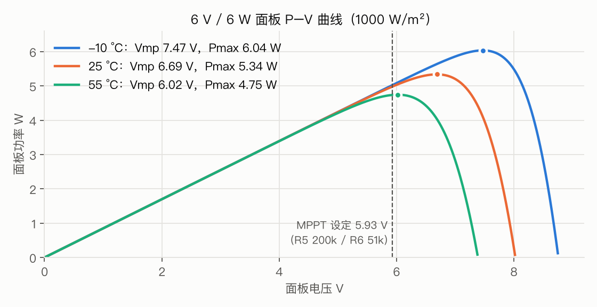
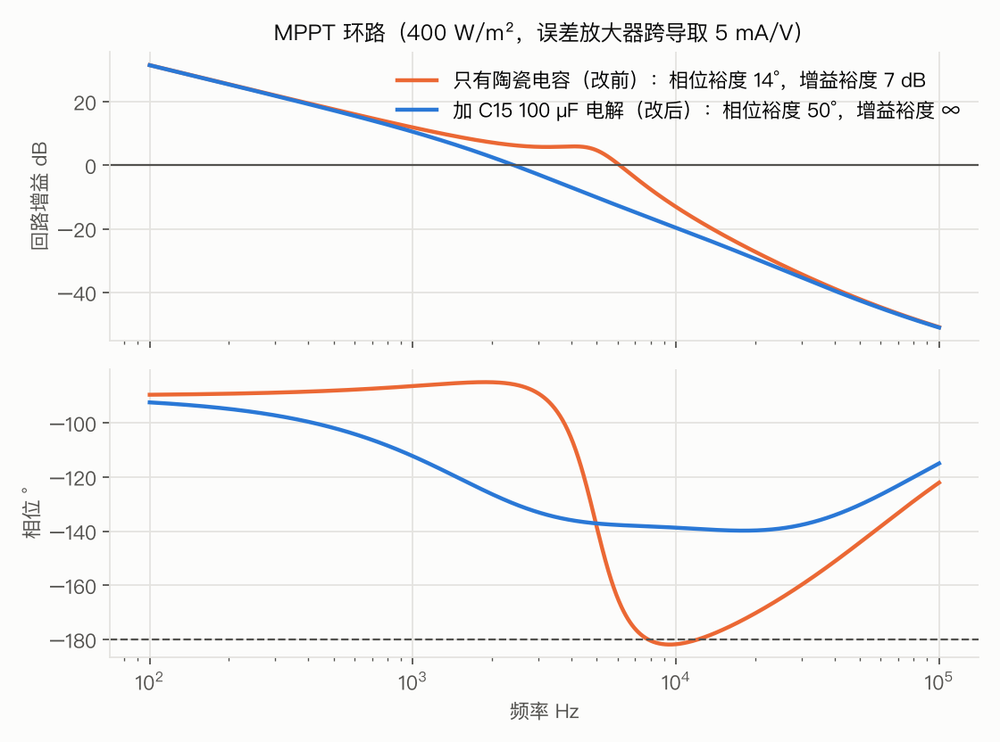
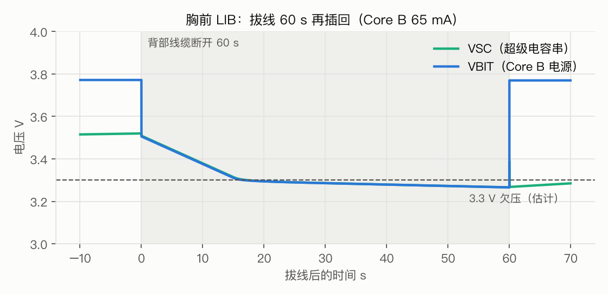

# PMB-H / LIB 电路仿真报告

2026-10-12 · 对应 PCB：PMB-H（加 C15、RS1B 0.22 Ω、C10 1 µF、PV_EN 版）、LIB

> 你说「理论可行不代表实际能用，需要确保能用」。所以这份报告做了三件事：
> 1. 用器件手册参数建模，把两块板子的每个功能都跑一遍。
> 2. 每一项都写明判定标准。
> 3. 仿真发现了 **4 处真实问题，已经改进 PCB**。仿真证明不了的，列在 §7，台架上验证。

---

## 0. 结论

| # | 检查项 | 判定标准 | 结果 | |
|---|---|---|---|---|
| 1 | MPPT 稳压 | 不限流时 VPV = 5.93 V ± 1 % | 5.930 V（全部工况） | ✅ |
| 2 | MPPT 捕获率（30–1000 W/m²） | ≥ 90 % 面板最大功率 | 91.0%–100.0% | ✅ |
| 3 | 充电限流 | ≤ 1.2 A（2500 mAh 电池的 0.48 C） | 1192 mA | ✅ |
| 4 | 恒压段（电池 4.15 V） | 电流自动减小 | 625 mA | ✅ |
| 5 | 电感峰值电流 | < 饱和电流 1.8 A | 1.35 A | ✅ |
| 6 | M1 栅源 / 漏源电压 | Vgs ≥ −12 V，Vds ≤ 30 V | -6.3 V / 8.2 V | ✅ |
| 7 | MPPT 环路稳定性 | 增益裕度 > 6 dB，相位裕度 > 30°（跨导 ≤ 5 mA/V） | 改前增益裕度最低 0 dB ❌ → 加 C15 后 ∞，相位裕度 ≥ 34° | ✅ 已改 |
| 8 | 夜间电池倒灌 | < 0.2 mA | 1.11 mA ❌ → PV_EN 关断后 51 µA | ✅ 已改 |
| 9 | 面板接反 | 无电流，板子不上电 | 0.00 mA | ✅ |
| 10 | −10 °C 冷面板热插拔 | VPV < TVS 击穿 11.1 V；Q1 的 Vgs > −12 V | 8.75 V；-8.75 V | ✅ |
| 11 | 室内档突遇全日照 | PV_IN− > −0.3 V（INA226 绝对最大值） | −0.42 V ❌ → RS1B 改 0.22 Ω 后 -0.222 V，RS1B 0.15 W | ✅ 已改 |
| 12 | 负载开关上电浪涌 | < 1.5 A | 3.15 A ❌ → C10 改 1 µF 后 0.96 A（电池 4.2 V） | ✅ 已改 |
| 13 | 超级电容预充 | < 10 分钟到 90 % | 426 s | ✅ |
| 14 | 拔线保持（Core B 65 mA） | ≥ 10 s（够接头松动、重新插拔） | 17 s（最坏）～ 60 s | ✅（原文档写的 45 s 有误，已更正） |
| 15 | 切换瞬间 Core B 电压 | > 3.3 V | 3.51 V | ✅ |
| 16 | 重新插线后恢复 | VBIT > 3.6 V | 3.77 V | ✅ |
| 17 | 超级电容均压 | 每只 ≤ 2.7 V | 1.76 V | ✅ |
| 18 | SYNC 脉冲 | 上升沿 < 5 µs，高电平 < 4.3 V | 237 ns，3.34 V | ✅ |
| 19 | 3V3 电源 | 电池 3.2 V + BLE 突发时 ≥ 3.1 V | 3.160 V | ✅ |
| 20 | 冷启动（电池耗尽、XIAO 不工作） | VPV 能升到 6.05 V 启动阈值以上 | 100 / 300 / 1000 W/m² 下 6.61 / 7.06 / 7.55 V | ✅ |
| 21 | 面板模型 | 与照片估算的铭牌一致 | 25 °C 时 Voc 8.03 V、Isc 0.85 A、Pmax 5.34 W | ✅ |
| 22 | 极弱光 10 W/m² | （说明性） | 面板最大只有 33 mW，小于板子自身约 8 mA（30 mW）的耗电，电池净放电约 7–8 mA。25 ms 内未到稳态：面板电流仅约 8 mA，给 C15 充电很慢 | ℹ️ |

**因为仿真改了的 4 处**（都已写进 PCB 和生产文件）：

| 改动 | 发现了什么 |
|---|---|
| **新增 C15** 100 µF / 35 V 铝电解（C2836437） | 输入只有陶瓷电容时，约 5 kHz 的谐振没有阻尼。如果 CN3791 的误差放大器跨导偏高（手册没给这个参数），MPPT 环路会振荡：开关级仿真在 400 W/m² 下 VPV 摆动 403 mV、电感电流在 0–0.95 A 之间来回。CN3791 手册本来就要求输入端有电解电容。加上后摆动降到 19 mV |
| **RS1B** 0.47 Ω → 0.22 Ω | 室内档时如果光照突然变强，INA226 输入被拉到 −0.42 V，超过 −0.3 V 的绝对最大值；电阻自身 0.34 W 也超过 0.25 W 额定 |
| **C10** 100 nF → 1 µF | 负载开关打开瞬间电池电流峰值 3.15 A（电池 4.2 V 时），接近电池保护板 3 A 左右的过流阈值 |
| **PV_EN**（Q8 + R19 + R20）+ MPPT 分压 200k / 51k | 夜里电池经 Q1 和 M1 体二极管倒灌给面板：1.1 mA（面板旧化后可到 10 mA）。MPPT 设定点从 6.40 V 改到 5.93 V，全天捕获率从 93.6 % 提到 98.4 % |

---

## 1. 方法

| 项目 | 做法 |
|---|---|
| 仿真器 | ngspice（KiCad 10 自带的 libngspice，Python 调用） |
| 电路 | 元件值全部取自 `pmbh.py` / `libb.py`，与 PCB 一致；面板线按 0.5 m、40 mΩ/m、0.6 µH/m 建模 |
| MOSFET | AO3400A / AO3401A：用手册里 3 个 Rds 点和 Vth 拟合，带 Ciss、Crss、Rg、体二极管 |
| 二极管、TVS | SS34、B5819W、BAT54、BZT52C10、SMAJ10A、SMF5.0A：按手册 Vf / VBR 拟合 |
| 面板 | 12 片串联单二极管模型：Isc 0.85 A，Voc 8.0 V（照片估算的铭牌），含温度系数 |
| CN3791 | 行为模型：MPPT 1.205 V、限流 120 mV、浮充 4.2 V、300 kHz、最大占空比 94 %、DRV = VCC − 6.3 V、欠压锁定和睡眠阈值（全部来自手册） |
| LM66100 | 行为模型：开启 −150 mV、关闭 +35 mV（带迟滞）、91 mΩ、反向截止、ST 开漏 |
| 三种仿真 | ① 开关级瞬态（每周期约 170 个点，跑 25 ms 到稳态）；② 平均模型长时间瞬态（LIB 900 s）；③ 小信号环路分析（伯德图） |

**仿真本身踩过的坑**：行为模型里的 if/else（比较器、抗饱和）在 ngspice 里会让步长塌到 10⁻¹⁷ s，一个工况跑半小时以上还不收敛。改成连续函数（tanh / max）后，一个工况约 1 分钟。之前 1.5 ms 的短仿真结论里，有两个（400 W/m² 纹波、30 W/m² 电流为 0）其实是还没到稳态，已全部用 25 ms 长仿真重做。

## 2. 面板模型

| 温度 | Voc | Vmp | Pmax |
|---|---|---|---|
| −10 °C | 8.76 V | 7.47 V | 6.04 W |
| 25 °C | 8.03 V | 6.69 V | 5.34 W |
| 55 °C（背上晒热） | 7.39 V | 6.02 V | 4.75 W |

面板没有铭牌，这几个数是按照片估算的。台架 TC-02 实测 I-V 后，可以重新拟合模型。

## 3. 充电器（CN3791 MPPT 降压）

| 光照 W/m² | 面板温度 | 电池 | VPV | VPV 纹波 | 面板功率 | 捕获率 | 电池电流 | 电感电流 | 效率 | 稳态 |
|---|---|---|---|---|---|---|---|---|---|---|
| 1000 | 55 °C | 3.70 V | 5.930 V | 42 mV | 4.735 W | 99.8% | 1094 mA | 1.00–1.20 A | 91.0% | ✓ |
| 1000 | 25 °C | 3.70 V | 6.776 V | 49 mV | 5.237 W | 98.1% | 1192 mA | 1.07–1.33 A | 89.4% | ✓ |
| 1000 | 0 °C | 3.70 V | 7.625 V | 51 mV | 5.276 W | 90.4% | 1192 mA | 1.05–1.35 A | 88.2% | ✓ |
| 1000 | 55 °C | 3.00 V | 6.373 V | 51 mV | 4.361 W | 91.9% | 1192 mA | 1.07–1.33 A | 87.4% | ✓ |
| 1000 | 55 °C | 4.15 V | 6.888 V | 25 mV | 2.885 W | 60.8% | 625 mA | 0.51–0.76 A | 93.6% | ✓ |
| 700 | 45 °C | 3.70 V | 5.930 V | 31 mV | 3.401 W | 99.9% | 805 mA | 0.71–0.92 A | 92.2% | ✓ |
| 400 | 37 °C | 3.70 V | 5.930 V | 19 mV | 1.941 W | 99.6% | 471 mA | 0.37–0.59 A | 93.5% | ✓ |
| 200 | 32 °C | 3.70 V | 5.930 V | 10 mV | 0.950 W | 99.9% | 231 mA | 0.13–0.35 A | 94.3% | ✓ |
| 120 | 29 °C | 3.70 V | 5.930 V | 7 mV | 0.555 W | 100.0% | 133 mA | 0.03–0.25 A | 94.3% | ✓ |
| 60 | 27 °C | 3.70 V | 5.930 V | 4 mV | 0.259 W | 98.5% | 57 mA | -0.01–0.17 A | 93.4% | ✓ |
| 30 | 26 °C | 3.70 V | 5.930 V | 2 mV | 0.110 W | 91.0% | 19 mA | -0.01–0.11 A | 90.4% | ✓ |
| 10 | 25 °C | 3.70 V | 4.843 V | 134 mV | 0.032 W | 99.8% | -8 mA | -0.01–0.01 A | 1.4% | ✗ |
| 120 | 29 °C | 3.00 V | 5.930 V | 8 mV | 0.555 W | 100.0% | 161 mA | 0.05–0.29 A | 91.9% | ✓ |
| 30 | 26 °C | 4.15 V | 5.930 V | 2 mV | 0.110 W | 91.0% | 16 mA | -0.01–0.10 A | 91.4% | ✓ |

**怎么读**：

- 1000 W/m² 且面板不热（25 °C、0 °C），或电池电压低（3.0 V）时，VPV 高于 5.93 V。原因是充电电流已经顶到 1.2 A 限流，多余的功率留在面板上。这是设计如此，不是 MPPT 失效。
- 电池 4.15 V 时进入恒压段，电流自然减小。
- 电池电流 = 充电器输出 − 板子自身约 8 mA（XIAO + 6 个 INA226 + LDO）。
- 10 W/m² 时，面板最大功率只有 33 mW，抵不过 8 mA 的自耗电，电池净放电。这是阴天室内的典型情况，符合「太阳能延长续航，但不保证免充电」的定位。这一行的「稳态」是 ✗：面板电流只有约 8 mA，给 100 µF 的 C15 充电很慢，25 ms 内没跑到平衡点。结论不受影响。

**发热**（1000 W/m²、55 °C 时的损耗）：
- D5 0.13 W、L1 0.11 W、R8 0.12 W、M1 约 0.05 W，估计各自温升 6–13 °C。
- 背部仓 55 °C 环境下，器件最高约 70 °C，离它们 125–150 °C 的额定还很远。
- 板子背面有 HP600 导热垫把热导到仓底。

## 4. MPPT 环路稳定性（这次最重要的发现）

**问题**：
- 降压电路以输入电压为控制对象时，电感和输入电容会在约 5 kHz 形成谐振。
- 只用陶瓷电容时，这个谐振几乎没有阻尼。
- CN3791 手册没给误差放大器的跨导，我在 0.05–20 mA/V 范围内扫了一遍：

| 输入电容 | 跨导 ≤ 1 mA/V | 跨导 ≤ 5 mA/V |
|---|---|---|
| 只有陶瓷（改前） | 相位裕度 ≥ 87°，增益裕度 ≥ 14 dB | 增益裕度低到 **0 dB**（会振荡） |
| 加 C15（25 °C，ESR 0.6 Ω） | 稳定 | 相位裕度 ≥ 34°，增益裕度 **∞** |
| 加 C15（−10 °C，ESR 按 3 倍算） | 稳定 | 相位裕度 ≥ 53°，增益裕度 **∞** |

**处理**：
- 按手册「输入电容 = 电解 + 陶瓷 + 高频」的要求，加了 C15。
- 增益裕度无限的意思是：无论芯片内部增益多大，相位都不会转过 −180°，环路不会振荡。
- 开关级仿真复核：400 W/m² 下 VPV 纹波从 403 mV 降到 19 mV，电感电流回到正常的连续导通纹波。

## 5. 保护电路

| 情况 | 结果 |
|---|---|
| 夜间（面板不发电），PV_EN 不关 | 电池漏电 0.16 / 1.11 / 10.4 mA（面板并联电阻 30k / 3k / 300 Ω，越旧越小） |
| 夜间，PV_EN 关断 | **51 µA**，与面板好坏无关。其中 CN3791 睡眠 30 µA、MPPT 分压 13 µA、INA226 总线输入 8 µA。12 小时只用 0.6 mAh |
| 面板接反 | Q1 截止，0 mA，板子不上电 |
| −10 °C 冷面板全日照热插拔（5 m 线） | VPV 峰值 8.75 V（TVS 10 V 不导通），Q1 栅源 -8.75 V（稳压管限在 10 V 以内） |
| 室内档（Q2 关）突遇全日照 | PV_IN− -0.222 V（> −0.3 V），RS1B 0.15 W（额定 1 W）。即使固件不切档也不会损坏 |

## 6. 负载开关与胸前 LIB

| 电池电压 | C10 = 100 nF（改前） | C10 = 1 µF（改后） | VLOAD 上升时间（改后） |
|---|---|---|---|
| 3.4 V | 2.19 A | 0.70 A | 4.5 ms |
| 3.8 V | 2.53 A | 0.83 A | 4.1 ms |
| 4.2 V | 3.15 A | 0.96 A | 3.7 ms |

**拔线保持**：
- 两只 10 F 超级电容串联，等效 5 F，充到比 VLOAD 低约 0.2 V。BITalino 按 3.3 V 欠压估算，可用的电压窗口只有 0.3–0.8 V。
- 结果：开机 7 分钟内没充满、电池 3.8 V 时最短 **17 s**；满电并充满时约 60 s。
- 原设计文档写的「约 45 s」是按更宽的电压窗口算的，已更正。
- 对它的用途（磁吸接头松动、换线时重新插拔）来说，17 s 足够。

**其他**：
- SYNC 脉冲上升沿 237 ns，高电平被 BAT54S 钳在 3.34 V。
- 3V3 在电池 3.2 V、BLE 突发 18 mA 时最低 3.160 V。

## 7. 仿真证明不了、要在台架上确认的

| # | 测什么 | 怎么测 | 通过标准 |
|---|---|---|---|
| 1 | **上电前**看 C15 极性 | 目视：电容顶上黑色半圆是负极，应朝右；丝印 + 在左 | 方向对 |
| 2 | 面板 I-V | TC-02（电阻档位 + 万用表） | 用实测值重拟合 §2 的模型 |
| 3 | VPV 纹波 | 示波器；多云天的真面板，或实验室电源 9 V 串 33 Ω 模拟 | < 100 mV，无 kHz 级摆动 |
| 4 | BITalino Core 的真实欠压电压 | 可调电源慢慢降压，看 Core 什么时候掉线 | 决定拔线保持的真实时间 |
| 5 | 夜间漏电 | 万用表 µA 档串电池，面板遮住，PV_EN 拉低 | 约 51 µA + XIAO 睡眠电流 |
| 6 | 晒太阳时的温度 | TC1 / TC2 + 板上 NTC | 板子 < 85 °C，TC2 < 40 °C |

## 8. 文件

全部脚本在 [源码/仿真/](../源码/仿真/)，器件模型在 `models.lib`。

| 脚本 | 内容 |
|---|---|
| `tb_charger.py` / `tb_charger2.py` / `run_final.py` | 充电器开关级仿真，14 个工况 |
| `loop_ss.py` | MPPT 环路小信号分析（跨导 × 光照 × 输入电容） |
| `tb_night2.py`、`tb_hotplug2.py`、`tb_range.py` | 夜间漏电、热插拔、自动量程 |
| `tb_lib.py`、`tb_inrush.py` | 负载开关浪涌、LIB 保持、SYNC、3V3 |
| `plots.py`、`gen_report.py` | 作图、生成本报告（数字全部从结果 JSON 读出，不手抄） |
