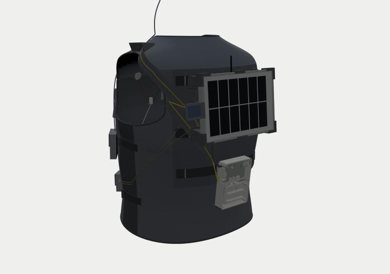
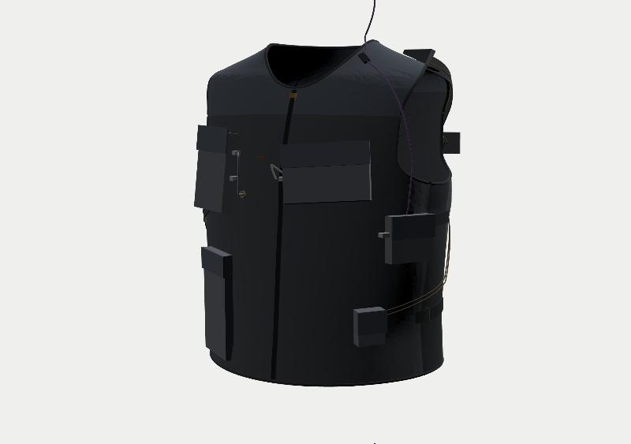

# 太阳能可穿戴背心：制造与装配指南

2026-10-12 · 对应架构 v3.1

> 配套文档：
> - [物料对照与系统说明.md](物料对照与系统说明.md)：你清单里每一样东西用在哪、哪些要贴皮肤、安全事项、三块 BITalino 的去向、台架结构。
> - [接线/接线表.md](接线/接线表.md)：20 条线逐针的接法，附 [系统接线图](接线/系统接线图.svg)。
> - [接线/线缆长度核对.md](接线/线缆长度核对.md)：每根线需要多长、实际有多长（照片实测 + 官方规格）。
> - [仿真/仿真报告.md](仿真/仿真报告.md)：两块板的电路仿真，22 项检查，以及因此改掉的 4 处设计。
> - [裁缝与打样/裁缝调研.md](裁缝与打样/裁缝调研.md)：背心找谁做、带什么去、问什么。

---

## 0. 你要做的事（最短清单）

| # | 事情 | 时间 |
|---|---|---|
| 1 | 嘉立创下单两块板（PCB + SMT），按 §2 上传 3 个文件，在贴片预览里看一眼方向 | 30 分钟 |
| 2 | 按[物料对照 §6](物料对照与系统说明.md) 采购 | 30 分钟 |
| 3 | 打印 18 个件（§3）：16 个上身 + 4 个台架件（含 2 个挂钩） | 打印机自己跑 |
| 4 | 背心：把 [背心/](背心/) 文件夹和本指南 §4 交给打样工作室（找谁见[裁缝调研](裁缝与打样/裁缝调研.md)） | 外包 |
| 5 | 焊 10 个点：超级电容 4、两片参考片 4、SYNC 线 2 | 30 分钟 |
| 6 | 按 §5 装配：拧螺丝、插线、贴电极、挂面板 | 1.5 小时 |

**不需要你量任何东西。** 只有几处要"看一眼"：

- 买电池和 PH2.0 线时，核对插头正负方向（标了 ⚠）。
- 到货时看 3 根线的长度，见[线缆长度核对 §3](接线/线缆长度核对.md)。
- **剪面板线之前先问副院长**：面板是副院长的，剪了不能恢复。不剪也有替代做法，见[线缆长度核对 §1](接线/线缆长度核对.md)。

---

## 1. 文件夹里有什么

| 文件夹 / 文件 | 内容 |
|---|---|
| [PCB/pmbh/](PCB/pmbh/)、[PCB/libb/](PCB/libb/) | 两块板的 Gerber、BOM、CPL、原理图 PDF、STEP、GLB、KiCad 工程 |
| [3D打印/](3D打印/) | 18 个打印件，每个都有 STEP、STL、3MF；`parts_meta.json` 里是体积和材料 |
| [背心/](背心/) | 纸样三套：面布、里布、附件（口袋 / 内袋 / 面板遮挡罩），每套都有 SVG、DXF、绘图仪 PDF、A4 拼贴 PDF。另有三维背心 `vest.glb`、`placement.json`（面板与支脚）、`system_layout.json`（电极、口袋、走线） |
| [接线/](接线/) | 接线表（md + csv）、系统接线图（svg）、`harness.json`（线束原始数据） |
| [查看器/](查看器/) | 三维查看器，分"穿戴 / 台架"两个场景。`*_PRIVATE.glb` 含本人身体模型（经本人同意公开） |
| [预览图/](预览图/) | 8 张截图 |
| [源码/](源码/) | 全部生成脚本 |

查看器的打开方式：在终端进入 `制造文件` 目录，运行 `python3 -m http.server 8794`，再打开 `http://localhost:8794/查看器/`。

---

## 2. PCB：嘉立创 PCB + SMT

| 板子 | ERC | DRC | 未连接 | BOM |
|---|---|---|---|---|
| PMB-H（86×60 mm） | 0 | 1 条警告（接线端子故意伸出板边） | 0 | 35 行、78 个件：18 种基础库 + 17 种扩展库 |
| LIB（56×37 mm） | 0 | 0 | 0 | 12 行、17 个件：6 种基础库 + 6 种扩展库 |

**仿真后改了什么**（详见[仿真报告](仿真/仿真报告.md)）：

| 改动 | 原因 |
|---|---|
| 新增 Q8 + R19 + R20；XIAO D10 改为 PV_EN | 夜里面板不发电时，电池会经 Q1 倒灌给面板，典型 1.1 mA，最坏 10 mA。加 PV_EN 关断后降到 51 µA |
| R5 / R6 改为 200k / 51k，MPPT 设定点 5.93 V | 按全天光照和面板温度统计，全天捕获率从 93.6 % 提到 98.4 %（原设定点 6.40 V）；室内 30 W/m² 从 40 % 提到 91 % |
| RS1B 0.47 Ω → **0.22 Ω** | 室内量程下如果突然进入全日照，原值会把 INA226 输入拉到 −0.42 V（超过 −0.3 V 的绝对最大值），电阻本身也超功率 |
| C10 100 nF → **1 µF** | 负载开关上电浪涌从 2.5–3.2 A 降到 1 A 以下 |
| J6-4 改为空脚，R16 删除 | LIB 那一侧这根线本来就只接测试点 |
| **新增 C15：100 µF / 35 V 贴片铝电解**（C2836437，6.3×7.7 mm），并联在面板输入端 | CN3791 手册要求输入端有电解电容。只用陶瓷电容时，输入端约 5 kHz 的谐振几乎没有阻尼，MPPT 环路在中等光照下可能振荡。加上后，无论芯片内部跨导是多少，增益裕度都是无限 |

加 C15 后整板重新自动布线：0 未布线，DRC 不变。C15 顶部离背部仓盖还有 11 mm。

⚠ **下单时在贴片预览里看一眼 C15 的极性**：电解电容贴反会损坏。丝印 "+" 那一端应该朝左（朝 D2 / 面板输入一侧）。CPL 文件已经按社区旋转库给 C15 加了 180° 校正。

**下单步骤**（两块板分开下）：

1. 上传 `*_gerber_JLC.zip`。
2. 参数选：2 层、1.6 mm、无铅喷锡；订单编号选"指定位置"。
3. 勾选 SMT，选**标准 PCBA**（PMB-H 上有 3 个插件），只贴顶面。
4. 上传 `*_BOM_JLC.csv` 和 `*_CPL_JLC.csv`，在贴片预览里看一眼方向。

**嘉立创不装、要你处理的件**：

- LIB：两只超级电容平躺，长脚插方焊盘（丝印标 "+"），共焊 4 个点。
- PMB-H：XIAO nRF52840 Sense 买预焊排针版，直接插上，USB-C 朝板边。

---

## 3. 3D 打印件（18 个）

| 文件 | 数量 | 材料 | 打印方向 | 用途 |
|---|---|---|---|---|
| `back_pod_base` / `_lid` | 各 1 | PETG **白或浅灰** | 底朝下 / 盖子顶面朝下 | 背部仓：PMB-H + 2500 mAh 电池。仓底有 HP600 导热垫台 |
| `webbing_hook` | 2 | PETG | 侧放 | 背部仓挂到织带 C 上 |
| `chest_pod_base` / `_lid` | 各 1 | PETG | 同上 | 胸前仓：LIB（下）+ Core B（上）。**没有 USB 口**（佩戴时禁止接 USB） |
| `c_case_base` / `_lid` | 各 1 | PETG | 同上 | C：BITalino Board + 523450。左窗插心电线，下沿 micro-USB 只在不佩戴时充电。盖上的柔性按键压板上 BTN，实验时用来打事件标记 |
| `ear_clip_pulsesensor` | 1 | PETG 或 TPU | 侧放 | A 的 PulseSensor 耳夹（左耳垂），夹口贴 0.5 mm 泡棉 |
| `panel_shoe_TL/TR/BL/BR/TM/BM` | 各 1 | **ASA**（耐晒），PETG 也行 | 树状支撑，30 % 填充 | 面板支脚。脚底角度按你背部曲面单独算，**不能互换** |
| `ref1_holder` / `ref2_holder` | 各 1 | ASA/PETG | — | REF1 与面板同平面（左短边）；REF2 在左肩，保持水平 |
| `stand_base` / `stand_cradle` | 各 **2** | PETG | — | **台架**：面板测试支架，0–90° 每 15° 一档 |

- 通用参数：0.2 mm 层高、4 圈墙、25–30 % gyroid 填充。
- 实体体积：上身件 363 cm³，台架件 217 cm³；按上面的参数，实际耗材约 350 g。
- 螺丝：M2 自攻，M2×6 共 10 颗、M2×8 共 12 颗；支架另需 M4×25 螺栓 + 蝶形螺母 4 套。
- 检查结果：
  - 所有零件网格封闭。
  - 用实体布尔运算核对了 PCB、Core、Board、XIAO、电池与外壳和盖子之间的干涉，重叠体积为 0。检查方法本身也验证过：故意把板子下沉 3 mm 时能检出重叠。

---

## 4. 定制背心

### 4.1 版型

- **体型来源**：
  - 腰到胸用"脱衣还原"后的躯干网格。
  - 肩颈部分用按扫描剖面和人体比例校准的参数化躯干。
  - 主要尺寸：腰围 110、胸围 115、颈根 48 cm。
- **放松量**（内衬离皮肤的距离）：
  - 胸和腰 13 mm。
  - 上胸 10–11 mm，给锁骨上的电极按扣留空间。
  - 颈部 5 mm。
  - 侧片用弹力网布，另有 4 条调节带。
- **纸样**：
  - 10 片主体：后育克、中后片、两块侧后片、两块前片、两块前育克、两块侧片。
  - 在三维背心上用 ARAP 算法展平，接缝长度误差 ≤ 3.6 mm。
  - 缝份已含：普通缝 10 mm，门襟 12 mm，包边处不留。

### 4.2 口袋与开孔（都已画在纸样上）

| 编号 | 位置 | 装什么 | 尺寸（袋面 × 侧边深） |
|---|---|---|---|
| P1 | 右胸 | 胸前仓（B + LIB） | 75×125 × 24 mm |
| P2 | 左前下方，靠腋下 | A：HeartBIT | 78×72 × 18 mm |
| P3 | 左胸 | C：Board 外壳（紧挨 C 的电极，导联才够得着） | 130×88 × 22 mm |
| P4 | 右前下方 | Android 手机 | 86×172 × 14 mm |
| P5 | 左前下方 | 热电偶插头 | 44×54 × 20 mm |
| P6 | 胸骨处、拉链右侧，里布内侧 | HeartBIT ECG 传感器 | 网布 34×30 mm |
| 导线孔 B / C | P1、P3 靠中线的一侧 | 导联穿过来 | 铜扣眼 Ø7 |
| 其他 | — | — | PPG 线松紧环（左前育克）、REF2 魔术贴（后育克左肩）、里布上的导联固定环（约每 8 cm 一个，位置已标在里布纸样上） |

### 4.3 面料与辅料

| 物料 | 用量 |
|---|---|
| 500D Cordura 面布 | 1.2 m（主体加口袋） |
| 3D 网眼里布 | 1.0 m |
| 四面弹网布 | 0.3 m（侧片 + P6） |
| 1000D 加强片 | 40×35 cm |
| HDPE 板 1.5 mm | 30×25 cm |
| 25 mm 织带 | 1.5 m |
| 20 mm 织带 + 日字扣 | 1.6 m + 4 个 |
| 25 mm 包边条 | 5 m |
| 5 号开尾拉链 | 45 cm |
| 魔术贴 | 若干 |
| 10 mm 松紧带 | 1 m |
| 铜扣眼 Ø7 | 2 个 |
| 30 mm 线槽带 | 2 m |
| 遮挡罩面料 | 见物料对照 §6 |

### 4.4 缝制顺序（给裁缝）

1. 中后片面布：先车加强片，再车 A / B / C 三排织带。织带只在纸样标的圆圈处打套结，结与结之间不车。
2. 做 HDPE 衬板夹层袋，下口开口。
3. 按纸样位置在面布上车 P1–P5 风琴袋：附件纸样里，袋面四角剪口后折成立体袋，配袋盖和魔术贴。
4. 里布：车 P6 内袋、导联固定环、线槽；在导线孔 B、C 处打铜扣眼（穿透面布和里布）。
5. 面布、里布各自拼合，然后反面相对疏缝。
6. 装侧片和调节带、门襟拉链；领口、袖窿、下摆包边。
7. 左前育克装 PPG 松紧环，后育克左肩缝 REF2 魔术贴毛面。

---

## 5. 装配

### 5.1 背部仓（W01–W06）

1. 剪一块 20×20 mm 的 HP600 放在导热垫台上，然后用 4 颗 M2×6 把 PMB-H 压上去固定。
2. 插上 XIAO。
3. 电池：
   1. 底下贴 2 mm 泡棉，放进电池仓。
   2. 插 J2，⚠ 先核对正负。
   3. NTC 贴在电池上，插 J3。
4. 接线（接法见[接线表](接线/接线表.md)）：

| 线 | 进仓口 | 插到 |
|---|---|---|
| W01 面板线 | 左侧 PANEL 口 | J1：红 → 1，蓝 → 2 |
| W04 REF1 | 左侧 REF1 口 | J7 |
| W05 REF2 | 左侧 REF2 口 | J8 |
| W06 | 右侧 CHEST 口 | J6 |

   盖子上的压线舌会夹住每根线；W01 和 W06 另在仓内扎带桥上扎一圈做应力释放。
5. 盖上盖子，4 颗 M2×8。
6. 装 2 个挂钩，挂到织带 C 上。

### 5.2 胸前仓（W06–W09）

1. LIB 装在下部，2 颗 M2×6。
2. Core B 平放在上部的四个角垫上。
3. 接线：
   - W07：LIB J2 → Core 电池座。⚠ 先核对正负，要和 Core 原电池插头的红线位置一致。
   - W08：LIB J3 → 右侧窗口绕出 → UC-E6 插头插 **I1**。
   - W06：从左下 BACK UNIT 口进，插 LIB J1。
4. 盖上盖子，4 颗 M2×8。
5. 放进右胸口袋 P1。HeartBIT ECG 传感器放进胸骨处的里布内袋 P6；它的 UC-E6 线（W09）穿过导线孔 B，插 **A2**，多余的线在口袋里盘一圈。

### 5.3 C 与 A

1. **C**：
   1. 523450 电池放进 C 外壳底部，W12 插 Board 的电源座。
   2. Board 放在 6 个垫块上，盖上盖子。
   3. 3 导联电极线（W11）插左侧窗口的 **ECG** 口，穿过导线孔 C 进到背心里面。
   4. 外壳放进左胸口袋 P3。三根导联在过线孔里侧（皮肤一侧）分开，各自走到电极。
2. **A**：
   1. HeartBIT 原装不动，放进左前下方口袋 P2。
   2. PulseSensor 插 **A3**，线从口袋上沿出来，穿过左前育克的松紧环，到左耳垂。
   3. PulseSensor 装进耳夹，夹在耳垂上。

### 5.4 贴电极（每次佩戴）

1. 用酒精棉擦净 6 个位置，晾干。
2. 按下表贴电极，导联颜色对应：红 = IN+，黑 = IN−，白 = REF。

| 电极 | 位置 | 导联 |
|---|---|---|
| B_IN+ | 左锁骨处，离中线 8.5 cm | 红 |
| B_IN− | 右锁骨处，离中线 8.5 cm | 黑 |
| B_REF | 右侧下肋（肋弓下缘），离中线 10 cm | 白 |
| C_IN+ | B_IN+ 正下方 5 cm | 红 |
| C_IN− | B_IN− 正下方 5 cm | 黑 |
| C_REF | 左侧下肋，与 B_REF 左右对称 | 白 |

参考电极没有按 PLUX 手册贴在髂嵴：那里离传感器超过 30 cm，原装导联够不着。下肋同样是骨性、肌电少的位置。

3. 穿背心（贴身穿），拉上拉链，收紧侧调节带。
4. 导联理进里布的固定环里，扣上按扣。
5. 打开三台 BITalino 和 PMB-H，用 Android 手机连接。

### 5.5 面板上背心

1. 在桌上把 6 个支脚套到面板上。
2. REF1 夹到面板左侧短边。
3. 热电偶 TC1：尖端抹导热硅脂，用铝箔胶带贴在背板中心。
4. 面板连同支脚整体往下压，上排挂钩套进织带 A，下排套进织带 B。拆的时候整体往上提 30 mm 即可取下。
5. TC2 贴在面板正下方的背心表面；两根热电偶线走线槽到 P5 插头袋。
6. REF2 用魔术贴贴在左肩。

**设计数字**：

- 面板位置：上沿 1.50 m；顺着上背弧度倾 4.75°，玻璃面略朝天。
- 气隙：18–52 mm。
- 支脚高度：四角 42–43 mm，上中 27.4 mm，下中 20.2 mm。
- 线长：背 → 胸 W06 走线 53 cm（买 0.7 m）；PPG 线走线 51 cm（原装 61 cm，余 10 cm）。全部线见[线缆长度核对](接线/线缆长度核对.md)。

---

## 6. 台架（不上身）

详见[物料对照 §3](物料对照与系统说明.md)。

| 结构 / 实验 | 怎么做 |
|---|---|
| 测试支架 | 面板 + REF1（夹在上长边）+ TC1 |
| TC-02 面板 I-V | 面板接电阻档位，万用表测电压 |
| TC-03b / TC-21 / TC-24 | 套上三种遮挡罩之一 |
| TC-01 功耗 | 面包板 + 万用表串联，测 A、C 的电流（免焊）；B 由 PMB-H 自己测 |
| 台架供电 | 实验室电源 7 V / 1 A 接 J1 |
| 充电 / 电量 | USB 检测仪串在 A、C 的充电线和 XIAO 的烧录线上 |
| 电脑端 | Mac + OpenSignals |

---

## 7. 未决事项与风险

| 事项 | 处理 |
|---|---|
| SYNC 线需要 PLUX「UC-E6 转开线」 | 采购。不买的话 SYNC 不接，改用软件对时 |
| UC-E6 线色在不同批次之间改过 | 只按信号名（SIGNAL / GND）接线，不按颜色 |
| C 的 Board 外形按数据手册图描出（±1 mm） | 左窗留了余量，插座位置刻在盖子上 |
| 肩颈体型来自人体比例，不是直接测量 | 侧片弹力 + 4 条调节带能吸收；想更稳妥可以先做一件白坯布样衣（可选） |
| 面板外形 ±2 mm（照片测量） | 支脚留 0.6 mm 间隙，并可沿织带滑动 ±3 mm |
| 参考片电流 | 选 Isc ≤ 150 mA 的片子 |
| 面板线要剪 | 面板是副院长的，**先征得同意**；不剪的替代做法见[线缆长度核对 §1](接线/线缆长度核对.md) |
| 523450 引线、热电偶线长 | 到货看一眼，见[线缆长度核对 §3](接线/线缆长度核对.md) |
| 2500 mAh 电池插反会烧板 | 板上没有电池反接保护。插 J2 前核对红线对丝印 "+" |
| CN3791 误差放大器跨导手册没给 | 加了 C15 以后对跨导不敏感（[仿真报告 §4](仿真/仿真报告.md)）。台架上用示波器看一次 VPV 纹波，应 < 100 mV。可以用真面板在多云天测，也可以用实验室电源 9 V 串一个 33 Ω / 1 W 电阻来模拟 400 W/m² 时面板的动态电阻 |
| 安全 | 佩戴时不接 USB、不接市电设备；TC2 读数超过 40 °C 停止长时间佩戴（见物料对照 §1） |

---

## 7a. 固件必须遵守的规则（来自仿真）

| 规则 | 为什么 |
|---|---|
| **PV_EN（D10）**：两片参考片都测不到光（Isc < 1 mA）持续 5 分钟就拉低；有光立刻拉高 | 夜里关断后电池漏电 51 µA，不关是 1.1 mA（面板旧了会到 10 mA）。上电默认是高（R20 上拉），固件挂了也能充电 |
| **CHG_INH（D6）**：NTC 低于 0 °C 或高于 45 °C 时拉高禁止充电，0–10 °C 之间也建议禁止 | 全日照下充电电流 1.19 A（0.48 C），锂电池低温大电流充电会析锂 |
| **RANGE_LO（D7）**：面板电流低于 150 mA 才切到室内档；高于 300 mA 立刻切回 | 室内档量程 372 mA。硬件已经保证在固件没反应时也不会损坏（RS1B 改值后） |
| **LOAD_EN（D3）**：上电默认关，固件开 | 关掉后 B 只靠超级电容撑 17–60 s |
| 佩戴时数据先写 XIAO 的 flash，再用 BLE 上传 | 背部仓到前胸手机的 BLE 要穿过身体，衰减 20–40 dB，会断 |

---

## 8. 重新生成

| 要改什么 | 跑哪些脚本（在 [源码/](源码/) 里） |
|---|---|
| 电路 | `pmbh.py`、`libb.py` → `build_board.py` → `post.py` → `sch.py` → `fab.py`。只换元件值、不换封装时，用 `patch_values.py` 直接改板子，保留走线 |
| 仿真 | `源码/仿真/` 下的 `tb_*.py`（ngspice，器件模型在 `models.lib`），作图用 `plots.py` |
| 背心 | `torso.py`、`vest_geom.py` → `placement.py` → `system_layout.py` → `patterns.py` → `vest3d.py` |
| 打印件与装配 | `enclosures.py` → `assembly.py`（内部调用 `harness.py`）→ `bench.py` → `docs_wiring.py` |
