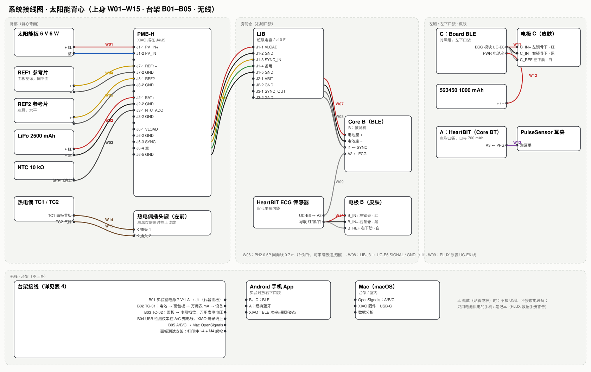

# 接线表（全部线缆，逐针）

> 由三维线束模型自动生成：长度是沿背心/仓内实际走线量出来的，下料长度 = 走线 + 80 mm 余量，向上取整到 50 mm。
> 颜色：电极导联按 PLUX 手册表 2（红 IN+、黑 IN−、白 REF）。

## 1. 上身线缆（W01–W15）

| 编号 | 名称 | 连接器（起 → 止） | 导线：线色 · 起点 → 终点 | 走线长度 | 下料 | 线从哪来 | 走线路径 |
|---|---|---|---|---|---|---|---|
| **W01** | panel_lead | — → 管形端子/镀锡线头 | + 红 · 面板接线盒 + → PMB-H J1-1 PV_IN+ − 蓝 · 面板接线盒 − → PMB-H J1-2 PV_IN− | 221 mm | 350 mm | 面板原线（照片实测：接线盒→防水接头约 4.2 m，其中线把约 3.8 m；接头→剥线端 0.41 m + 芯线 7–8 cm；外径 4.1 mm）。面板侧在 200 mm 处剪断，与接头侧的 100 mm 尾线焊接（2 点 + 热缩）；接头另一侧剪到 200 mm 剥线拧端子 | 面板背后 → 线槽 T1 → 背部仓 PANEL 口（扎带桥固定） |
| **W02** | battery | — → PH2.0 2P 插头 | 红 · 电池 +（保护板后） → J2-1 BAT+ 黑 · 电池 − → J2-2 GND | 50 mm | 150 mm | 电池自带 PH2.0 插头（⚠ 红线对 J2 丝印 +） | 仓内：电池左端 → 跨隔板 → J2 |
| **W03** | ntc | — → PH2.0 2P 插头 | — · NTC 10 kΩ（无极性） → J3-1 NTC_ADC — · NTC → J3-2 GND | 36 mm | 150 mm | 成品 NTC 10k B3950 带 PH2.0 线（采购） | NTC 用耐高温胶带贴在电池中部 |
| **W04** | ref1 | — → PH2.0 2P 插头 | 红 · REF1 电池片 + → J7-1 REF1+ 黑 · REF1 电池片 − → J7-2 GND | 344 mm | 450 mm | 剪下的面板线（2 芯 Ø4.1）0.45 m + 清单「PH2mm 直针带线」插头 1 个，焊 2 点 + 热缩 | REF1 夹子 → 面板左缘 → 线槽 T2 → REF1 口 |
| **W05** | ref2 | — → PH2.0 2P 插头 | 红 · REF2 电池片 + → J8-1 REF2+ 黑 · REF2 电池片 − → J8-2 GND | 482 mm | 600 mm | 剪下的面板线 0.6 m + PH2 插头 1 个，焊 2 点 + 热缩 | 左肩 REF2 → 后育克 → 线槽 T3 → REF2 口 |
| **W06** | J6_back_to_chest | PH2.0 5P 插头 → PH2.0 5P 插头 | 红 · PMB-H J6-1 VLOAD → LIB J1-1 VLOAD 黑 · J6-2 GND → J1-2 GND 黄 · J6-3 SYNC → J1-3 SYNC_IN 绿 · J6-4 空（NC） → J1-4 备用（只到 TP5） 黑/蓝 · J6-5 GND → J1-5 GND | 531 mm | 650 mm | PH2.0 5P 双头同向线 0.7 m（采购；走线 531 mm，0.6 m 不够留弯曲余量）；可在中间串 5P 磁吸连接器 | 背部仓 CHEST 口 → 线槽 T4（右侧腰线）→ 胸前仓 BACK UNIT 口 |
| **W07** | lib_to_core_bat | PH2.0 2P 插头 → PH2.0 2P 插头 | 红 · LIB J2-1 VBIT → Core B 电池座 + 黑 · LIB J2-2 GND → Core B 电池座 − | 59 mm | 150 mm | 清单「PH2.0 连接线」双头 10 cm（⚠ 与 Core 原电池插头红线位置一致） | 仓内，跨过 Core 上方 |
| **W08** | sync_to_I1 | PH2.0 2P 插头 → UC-E6 插头 | — · LIB J3-1 SYNC_OUT → UC-E6 SIGNAL → Core B 口 I1 — · LIB J3-2 GND → UC-E6 GND — · （不接） → UC-E6 VCC / REF 剪短绝缘 | 53 mm | 150 mm | PLUX「UC-E6 转开线」传感器线剪一头（采购）+ PH2 带线压接/焊接 | 仓内 → 右侧窗口绕出 → 插 I1 |
| **W09** | ecg_B_uce6 | — → UC-E6 插头 | — · HeartBIT ECG 传感器 UC-E6 → Core B 口 A2（PLUX 原装线，针对针） | 147 mm | 250 mm | HeartBIT 套件 ECG 传感器自带的 30 cm UC-E6 传感器线（另有 10 cm 一根，太短） | 内袋 → 导线孔 B（铜扣眼）→ 口袋 → 插 A2 |
| **W10a** | lead_B_IN+ | — → 电极按扣 | red · HeartBIT ECG 传感器 IN+ → 电极 B_IN+ | 185 mm | 300 mm | HeartBIT 套件 ECG 传感器自带导联 | 皮肤与里布之间，松紧环固定 |
| **W10b** | lead_B_IN− | — → 电极按扣 | black · HeartBIT ECG 传感器 IN− → 电极 B_IN- | 142 mm | 250 mm | HeartBIT 套件 ECG 传感器自带导联 | 皮肤与里布之间，松紧环固定 |
| **W10c** | lead_B_REF | — → 电极按扣 | white · HeartBIT ECG 传感器 REF → 电极 B_REF | 172 mm | 300 mm | HeartBIT 套件 ECG 传感器自带导联 | 皮肤与里布之间，松紧环固定 |
| **W12** | C_battery | — → PH2.0 2P 插头 | 红 · 523450 + → Board 电源块 PWR + 黑 · 523450 − → PWR − | 118 mm | 200 mm | 清单「523450 1000 mAh」自带线；若插头不同，用「PH2mm 直针带线」改接 | 仓内，绕板上沿 |
| **W11** | C_electrode_cable | UC-E6 插头 → 3-lead 分叉 | 红 · UC-E6 → C 的 ECG 模块 → 电极 C_IN+（左锁骨下） 黑 · — → 电极 C_IN−（右锁骨下） 白 · — → 电极 C_REF（左侧下肋） | 83 mm | 200 mm | PLUX 3-lead 电极线（Board 套件自带，或从 HeartBIT 套件取） | C 外壳左窗 → 导线孔 C → 背心内分叉 → 皮肤 |
| **W11a** | lead_C_IN+ | — → 电极按扣 | red · 3-lead 分叉 → 电极 C_IN+ | 124 mm | 250 mm | 同 W11 | 皮肤与里布之间 |
| **W11b** | lead_C_IN- | — → 电极按扣 | black · 3-lead 分叉 → 电极 C_IN- | 148 mm | 250 mm | 同 W11 | 皮肤与里布之间 |
| **W11c** | lead_C_REF | — → 电极按扣 | white · 3-lead 分叉 → 电极 C_REF | 163 mm | 250 mm | 同 W11 | 皮肤与里布之间 |
| **W13** | pulsesensor | UC-E6 插头 → — | 红 · PulseSensor + → A 口 A3 VCC 黑 · PulseSensor − → A3 GND 紫 · PulseSensor 信号 → A3 SIGNAL | 512 mm | 600 mm | HeartBIT 套件 PulseSensor 原装线（约 60 cm） | A 口袋上沿 → 左前育克松紧环 → 颈侧 → 左耳垂耳夹 |
| **W14** | TC1_panel | — → K 型小插头 | 黄/红 · K 型热电偶 + → 测温仪 K 插头 + 红/蓝 · K 型热电偶 − → 测温仪 K 插头 − | 592 mm | 700 mm | 清单「K 型表面测温电热偶」原装带插头 | 面板背板中心（耐高温铝箔胶带）→ 线槽 → 左前插头袋 |
| **W15** | TC2_airgap | — → K 型小插头 | 黄/红 · K 型热电偶 + → 测温仪 K 插头 + 红/蓝 · K 型热电偶 − → 测温仪 K 插头 − | 597 mm | 700 mm | 清单「K 型表面测温电热偶」原装带插头 | 面板下方背心表面（测热量到人体）→ 线槽 → 插头袋 |

## 2. 板上连接器针脚

| 连接器 | 1 | 2 | 3 | 4 | 5 |
|---|---|---|---|---|---|
| PMB-H J1（KF350 螺丝端子） | PV_IN+ | PV_IN− | | | |
| PMB-H J2（PH2.0） | BAT+ | GND | | | |
| PMB-H J3 | NTC_ADC | GND | | | |
| PMB-H J6（PH2.0 5P → 胸前） | VLOAD | GND | SYNC | 空（NC） | GND |
| PMB-H J7 / J8 | REF1+ / REF2+ | GND | | | |
| LIB J1（PH2.0 5P ← 背部） | VLOAD | GND | SYNC_IN | 备用（只到 TP5） | GND |
| LIB J2（→ Core B 电池座） | VBIT | GND | | | |
| LIB J3（→ Core B I1） | SYNC_OUT | GND | | | |

**XIAO nRF52840 Sense 插座**（插上即连，无需接线）：

| XIAO 脚 | D0/A0 | D1 | D2 | D3 | D4 | D5 | D6 | D7 | D8 | D9 | D10 | 3V3 | GND | 5V |
|---|---|---|---|---|---|---|---|---|---|---|---|---|---|---|
| PMB-H 网络 | NTC_ADC | NTC_EN | SYNC_OUT | LOAD_EN | SDA | SCL | CHG_INH | RANGE_LO | CHRG_N | DONE_N | PV_EN（夜间关断面板输入） | 3V3 | GND | 不接 |

**UC-E6**（BITalino 传感器口，8 针，形似 mini-USB）：只用到 SIGNAL 和 GND；VCC 3.3 V 与 REF（VCC/2）在 W08 里剪短绝缘。PLUX 不同批次线色不同，**以信号名为准，不以颜色为准**。

**BITalino 口位**（盖子上已刻字）：Core B 一侧 I1 / A4 / A3 / A2 / A1，另一侧 O1 / O2 / PWM / A6 / A5。B 用 **A2 = ECG、I1 = SYNC**；C 用板载 ECG 模块；A 用 **A3 = PPG**。

## 3. 电极位置（贴皮肤）

| 电极 | 位置 | 导联色 | 接到 |
|---|---|---|---|
| B_IN+ | 左锁骨上（离中线 85 mm） | 红 | HeartBIT ECG 传感器 → B 的 A2 |
| B_IN− | 右锁骨上 | 黑 | 同上 |
| B_REF | 右侧下肋（肋弓下缘，离中线 100 mm） | 白 | 同上 |
| C_IN+ | 左锁骨下（B_IN+ 正下方 50 mm） | 红 | C 的 3-lead 电极线 → Board ECG 模块 |
| C_IN− | 右锁骨下（B_IN− 正下方 50 mm） | 黑 | 同上 |
| C_REF | 左侧下肋（与 B_REF 镜像） | 白 | 同上 |

两组都是 Einthoven I 导联（测量电极按 PLUX 手册 §2.3 放在锁骨处；参考电极从髂嵴上移到下肋骨面——同样是骨性、肌电少的位置，但导联才能 ≤ 30 cm 够得着），B 和 C 上下错开 50 mm，参考电极左右镜像，满足 TC-05「同一受试者、同一时间、导联镜像对称」。电极中心距 ≥ 50 mm，Ø24 的 PLUX 电极和常见 Ø40–50 的一次性电极都放得下。

## 4. 台架接线（不上身）

| 编号 | 用途 | 从 | 到 | 怎么接 | 材料 | 说明 | 备注 |
|---|---|---|---|---|---|---|---|
| B01 | 台架电源代替面板 | 可调直流电源（实验室） | PMB-H J1（螺丝端子） | 红 → J1-1 PV_IN+；黑 → J1-2 PV_IN− | 香蕉头/鳄鱼夹 → 剥线 | 7.0 V、限流 1.0 A。板上有反接保护，接反不会坏 | 充电器烧机、固件联调（不用晒太阳） |
| B02 | TC-01 功耗测量（A 或 C） | 设备原电池插头 | 设备电池座 | 电池 + → 面包板 → 万用表 mA 档（串联）→ 面包板 → 设备 +；− 直通 | 清单「PH2mm 直针带线」2 根 + 直针座 1 个插面包板 + 杜邦线 | B 不用：PMB-H 的 U5（INA226 0x42）已经在测 B 的负载电流 | A 需打开 HeartBIT 外壳（两半卡扣） |
| B03 | TC-02 面板 I-V 曲线 | 面板防水快接头 | 电阻档位 + 万用表 | 面板 + → 电阻 → 面板 −；万用表并在电阻两端读电压，I = V / R | 5 W 水泥电阻 3.3/4.7/6.8/10/15/22/33/68/150 Ω（采购），开路 = Voc，短路 = Isc（万用表 10 A 档） | 面板在测试支架上，REF1 同平面记录辐照度，TC1 记录背板温度 | 晴天正午，10 分钟内测完一组 |
| B04 | 充电 / 电量 | Mac 或 USB 充电器 | A、C 的 micro-USB；XIAO 的 USB-C | 经清单「多功能 USB 检测仪」串在中间 | 原装线 | A、C 只在不佩戴时充电；B 没有 USB（由背部单元供电） | 检测仪读 mAh，顺便验证电池容量 |
| B05 | 数据（台架） | A / B / C | Mac（OpenSignals） | A：Mac 自带蓝牙配对经典蓝牙；B、C：BLE | 无线 | 套件里的 USB 蓝牙适配器在 Mac 上用不到 | 固件：XIAO 用 USB-C 接 Mac 烧录 |

## 5. 无线数据链路

| 设备 | 方式 | 收到哪里 | 内容 |
|---|---|---|---|
| B（Core BLE，太阳能供电） | BLE | Android 手机 App | 心电 1000 Hz + I1 同步脉冲 |
| C（Board BLE，电池） | BLE | Android 手机 App | 心电 1000 Hz（对照组）+ 加速度 |
| A（Core BT，HeartBIT） | 经典蓝牙 SPP | Android 手机 App（安卓支持经典蓝牙） | PPG 心率参考 |
| XIAO（PMB-H 上） | BLE | Android 手机 App | 面板 / 电池 / 负载功率、参考片辐照度、IMU 姿态、NTC 温度 |
| 台架 | BLE / 经典蓝牙 | Mac：OpenSignals | TC-01、TC-05 等室内实验 |

> 你的手机是 Android：三台 BITalino 和 XIAO 可以**同时**连到同一部手机，走路做实验时不用带电脑。iPhone 做不到这点（不支持经典蓝牙串口），所以 A 原先只能连电脑。

