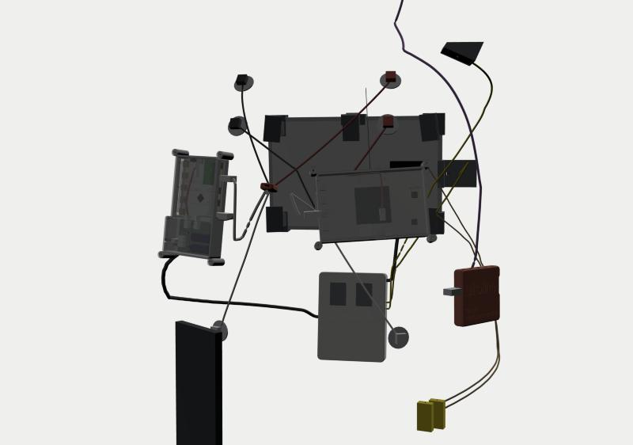
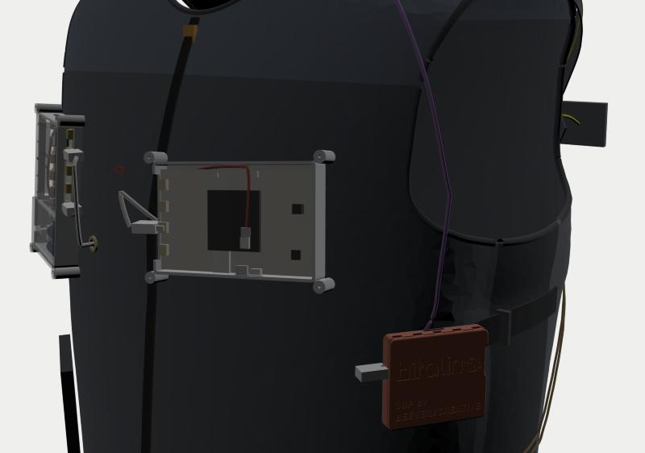

# 物料对照与系统说明

2026-10-12

这份文件回答四个问题：

1. 有哪些东西要贴皮肤？安全吗？
2. 三块 BITalino 分别放在哪里？
3. 哪些结构不上身？
4. 你清单里的每一样东西、HeartBIT 套件里的每一样东西分别用在哪？

---

## 1. 要贴皮肤的东西

**要贴，但只有两类：**

| 贴在哪 | 是什么 | 属于谁 | 数量 |
|---|---|---|---|
| 左、右锁骨处 + 右侧下肋（肋弓下缘） | 一次性心电电极（Ag/AgCl 凝胶） | B（被测机，太阳能供电） | 3 片 |
| B 的两片正下方 50 mm + 左侧下肋 | 一次性心电电极 | C（对照组，电池） | 3 片 |
| 左耳垂 | PulseSensor 光电心率传感器，装在打印的耳夹里 | A（HeartBIT） | 1 个 |

太阳能板、电池、电路板、三个仓都**不碰皮肤**。

**电极贴法**按 PLUX 手册 §2.3 的 I 导联：测量电极贴锁骨。参考电极手册写的是髂嵴，但那里离传感器超过 30 cm，原装导联够不着，所以改贴下肋——同样是骨性、肌电少的位置。

- B、C 两组上下错开 50 mm。
- 两组的参考电极左右镜像。
- 这正好满足 v3.1 TC-05 的要求："同一受试者、同一时间、导联镜像对称"。
- 导联线颜色：红 = IN+，黑 = IN−，白 = REF（手册表 2）。

**背心建议贴身穿**：

- 里布是 3D 网眼，透气，可以直接接触皮肤。
- 导联从电极出来，在皮肤和里布之间走，每隔约 8 cm 有一个松紧环固定，最后从两个铜扣眼"导线孔"穿到外面的口袋里。
- 锁骨附近背心离皮肤留了 10 mm，不会压扁电极按扣。
- 如果里面一定要穿 T 恤，导联得从 T 恤领口或下摆绕出来。能用，但麻烦，而且容易拉扯电极。

### 安全（务必看）

BITalino **不是医疗器械**，是科研用的生理信号采集板。电极是医用一次性耗材。

| 风险 | 措施 |
|---|---|
| **市电耦合触电**（PLUX 数据手册原文警告："direct or indirect coupling to the mains may result in shocking hazard"） | 佩戴时： • 绝不插任何 USB，不连任何插着电源的设备。数据只走蓝牙到手机。 • 胸前仓已经**取消了 B 的 USB 口**，B 只从背部锂电取电。 • A、C 只在脱下来以后充电。 • Mac 连 BITalino 走蓝牙，不走线。 |
| 皮肤刺激 | 电极一次性使用，单次 ≤ 24 h。贴前用酒精棉擦净、晾干。皮肤破损处不贴。发红发痒就停用。 |
| 热 | 晴天面板背面可达 60–70 °C。 • 面板和背心之间最少有 18 mm 空气层。 • 背心承载区有 1000D 加强片和 HDPE 衬板。 • 热电偶 TC2 专门测面板下方的背心表面；**超过 40 °C 就不要长时间佩戴**。 • HP600 导热垫只放在背部仓里，**不放在人体一侧**（v3 §5.4）。 |
| 锂电 | 背部仓用浅色 PETG，放在面板下方的阴影区以外。电池上贴 NTC，由固件把充电限制在 0–45 °C。 |
| 线缆拉扯 | 背 → 胸的 W06 可以在中间串 5P 磁吸连接器，被勾到时自动脱开。 |

---

## 2. 三块 BITalino 的位置（都上身）

| 代号 | 是什么 | 放在哪 | 供电 | 接什么 | 数据 |
|---|---|---|---|---|---|
| **A** | HeartBIT 套件的 Core **BT**（经典蓝牙），原装红白外壳 | **左前下方口袋 P2**，靠腋下（78×72×18 mm） | 自带 700 mAh | 口 A3 ← PulseSensor（左耳垂耳夹，W13） | 经典蓝牙 → **Android 手机** |
| **B** | Core **BLE**（裸板，被测机） | **右胸**，打印的胸前仓里，和 LIB 叠放 | 背部锂电 → PMB-H → LIB | A2 ← HeartBIT ECG 传感器（W09/W10），I1 ← SYNC（W08） | BLE → Android 手机 |
| **C** | Board **BLE**（整板，对照组） | **左胸口袋 P3**（紧挨 C 的电极，导联才够得着），打印的 C 外壳（126.5×85.8×18 mm），523450 电池垫在板子下面 | 清单里的 523450 1000 mAh | 板载 ECG 模块 ← 3 导联电极线（W11） | BLE → Android 手机 |

**为什么三台都上身：**

- B 和 C 同时戴，是 TC-05 心电质量对照。
- A 的耳垂 PPG 心率和 B、C 的心电心率做 TC-25 一致性分析（Bland–Altman）。
- 三台都还要在台架上做 TC-01 功耗对比，看经典蓝牙和 BLE 的功耗差。

**你用 Android 手机，是个好消息**：

- 安卓支持经典蓝牙串口，所以 A、B、C 加上 PMB-H 上的 XIAO，四台设备可以**同时**连到同一部手机。
- 走路做实验时不用带电脑。iPhone 做不到这点。
- 手机放在右下口袋（适配 ≤ 165×78×9 mm）。

**Mac**：

- 在 Mac 上用 OpenSignals 看三台 BITalino 的数据。Mac 自带蓝牙，经典蓝牙和 BLE 都能连，所以 HeartBIT 套件里的 USB 蓝牙适配器**用不到**（它是给没有蓝牙的 Windows 电脑用的）。
- XIAO 的固件用 USB-C 接 Mac 烧录；只在背心脱下来的时候做。

---

## 3. 不上身的结构（台架）

| 结构 | 是什么 | 文件 / 做法 | 用在哪个实验 |
|---|---|---|---|
| **面板测试支架** | 底座 ×2 + 夹槽 ×2（打印），M4×25 螺栓 + 蝶形螺母 ×4。刻度 0 = 竖直，90 = 平放，每档 15°。支点高 100 mm，全行程不碰桌面 | `3D打印/stand_base`、`stand_cradle` | TC-02 面板 I-V、参考片标定、TC-03b、TC-21、TC-24、充电器烧机 |
| **面板遮挡罩 ×3** | 同一个纸样用三种面料各做一个：遮光布（TC-24 遮光对照）、ND 网/窗纱（TC-03b 模拟小面板）、面料样品（TC-21 衣物遮挡）。四角车成盒角，边缘穿松紧绳，直接套在背心上的面板或台架上的面板上 | `背心/纸样_附件_*`（COVER） | TC-03b / TC-21 / TC-24 |
| REF1 在台架上的位置 | 台架夹槽占了面板短边，所以 REF1 改夹在**上长边**中部（边框截面四边一样） | 同一个 `ref1_holder` | 参考片标定 |
| **功耗测量（TC-01）** | 电池 → 面包板 → 万用表 mA 档串联 → 设备 | 清单里的面包板、杜邦线、PH2 直针带线、万用表；**不用焊** | A、C 的功耗。B 不用测，PMB-H 的 INA226（0x42）一直在测它 |
| 面板 I-V（TC-02） | 面板直接接一组 5 W 水泥电阻（采购），万用表测电压，I = V/R；开路得 Voc，短路得 Isc | 采购电阻套装 | 面板真实 Voc / Isc / Pmax |
| 台架供电 | 实验室可调电源 7 V、限流 1 A，接到 PMB-H 的 J1（代替面板） | — | 固件联调、充电器烧机 |
| 充电与电量 | 清单里的「多功能 USB 检测仪」串在 A、C 的充电线和 XIAO 的烧录线上 | — | 电池容量、充电电流 |
| 电脑端 | Mac + OpenSignals | — | 室内实验、数据检查 |

---

## 4. 你的清单（元件总揽.csv）逐行对照

| # | 清单物品 | 数量 | 用在哪 | 状态 |
|---|---|---|---|---|
| 1 | 数显恒温焊台 | 1 | 一共要焊 10 个点：超级电容 4 点、两片参考片 4 点、W08 SYNC 线 2 点 | ✅ 工具 |
| 2 | 395×460 18 V 30 W 太阳能板 | 1 | 不用（副院长已换 6 V 6 W）。⚠ **不能接 PMB-H**：开路电压约 22 V，远超输入 TVS 的 10 V | ⏸ 闲置 |
| 3 | 掌上型万用表 | 1 | TC-01 串联测电流、TC-02 测电压 | ✅ 台架 |
| 4 | 迷你型热电偶测温仪 | 1 | 读 TC1（面板背板）、TC2（面板下方背心表面）。插头平时停在左前「热电偶插头袋」 | ✅ 上身（读数时插上） |
| 5 | EVK10941 | 1 | AEM10941 输入上限 5 V，6 V 面板会超压，所以本方案不用。以后如果有 < 5 V 的柔性小板，可以做低光对比支线 | ⏸ 闲置 |
| 6 | 杜邦线 | 若干 | TC-01：面包板接万用表 | ✅ 台架 |
| 7 | PH2mm 直针带线 | 50 | W04 / W05 参考片引线、TC-01 转接 | ✅ |
| 8 | 导热硅脂 | 1 | 抹在 TC1 热电偶尖端和面板背板之间，测温更准 | ✅ |
| 9 | 剥线钳 | 1 | W01 面板线剥头、W08 | ✅ 工具 |
| 10 | 523450 1000 mAh 锂电池 | 1 | **C 的电池**（W12），垫在 Board 下面 | ✅ 上身 |
| 11 | YJL3404A | 1 | 备件：和 PMB-H 上的 AO3400A（Q2/Q3/Q4/Q6）同为 SOT-23 N-MOS、脚位相同，坏了可以手焊替换 | ⏸ 备件 |
| 12 | 焊锡线 | 1 | 同第 1 行 | ✅ 工具 |
| 13 | PH2.0 连接线（直针） | 若干 | W07（LIB → Core B 电池座，10 cm 双头）；W04 / W05 接长 | ✅ |
| 14 | 绝缘套管 / 数据保护线 | 若干 | 所有焊点套热缩；背心上外露的线段（W06 进出仓口、W13 颈部段）加护套 | ✅ |
| 15 | BITalino | 2 | **B**（Core BLE，被测机）和 **C**（Board BLE，对照组） | ✅ 上身 |
| 16 | 多功能 USB 检测仪 | 1 | 台架：A、C 充电电流和电量，XIAO 烧录 | ✅ 台架 |
| 17 | 面包板 | 1 | TC-01 功耗测量，免焊 | ✅ 台架 |
| 18 | 板材钳 | 3 | 台架：把测试支架底座夹在桌边防风；缝纫时夹住多层织带 | ✅ 工具 |
| 19 | 2.7 V 10 F 电容 | 3 | LIB 上 SC1、SC2；第 3 只备用 | ✅ |
| 20 | K 型表面测温热电偶 | 2 | TC1：面板背板中心（耐高温铝箔胶带 + 导热硅脂）。TC2：面板正下方的背心表面，测传到人体的热（W14/W15） | ✅ 上身 |
| 21 | TEUCER HP600 散热硅胶垫 | 1 | 剪成 20×20 mm，放在背部仓底的**导热垫台**上，垫在 PMB-H 充电区（CN3791 / M1 / D5 / L1）背面。**不放人体一侧** | ✅ |
| 22 | 一次性使用心电电极 | 1 包 | 每次佩戴 6 片（B 3 + C 3） | ✅ 贴皮肤 |
| 23 | BITalino HeartBIT 套件 | 1 套 | 见第 5 节 | ✅ |

---

## 5. HeartBIT 套件逐项

| 套件里的东西 | 用在哪 |
|---|---|
| BITalino Core **BT** + 原装红白外壳 + 700 mAh 电池 | **A**，左前下方口袋 P2，不用改 |
| ECG 传感器（含 3 根 30 cm 导联 + UC-E6 线） | 给 **B** 用：传感器放在胸骨处的里布内袋 P6，导联到 B 的三片电极（走线 14–19 cm）；30 cm 的 UC-E6 线（走线 15 cm）穿导线孔 B 插 B 的 A2 |
| PulseSensor（含 UC-E6 线，61 cm） | 插 A 的 A3，装进打印的**耳夹**，夹左耳垂。线经左前育克的松紧环上到颈侧，走线 51 cm，余 10 cm |
| PLUX 电极 Ø24 mm | 和清单里的一次性电极混用 |
| USB 蓝牙适配器 | Mac 自带蓝牙，用不到 |
| 充电线 | 给 A、C 充电（不佩戴时） |

Board 套件（C）如果带了 3 导联电极线，就用作 W11。如果没带，从 HeartBIT 套件借一根，或者买 PLUX 3-lead electrode cable。

---

## 6. 还要买的东西（汇总）

| 物料 | 规格 | 数量 | 用途 |
|---|---|---|---|
| XIAO nRF52840 **Sense** | 预焊排针版 | 1（建议 2） | PMB-H 主控 |
| 1S 锂电池 | 2500 mAh，带保护板，PH2.0，外形 ≤ 50×64×10.5 mm | 1 | 背部主电池（⚠ 红线对 J2 的 "+"） |
| NTC 10 kΩ B3950 | 带 PH2.0 2P 线 | 1 | W03 |
| 参考电池片 | 环氧封装，≤ 40×30×3 mm，**Isc ≤ 150 mA** | 2 | REF1、REF2。超过这个电流，0.47 Ω 检流电阻配 INA226 会超量程 |
| PH2.0 5P 双头**同向**线 | **0.7 m** | 1 | W06（实际走线 0.53 m） |
| PLUX「UC-E6 转开线」传感器线（Arduino sensor cable） | — | 1 | W08 SYNC → I1。不买的话 SYNC 不接，改用软件对时 |
| M2 自攻螺丝（盘头 PA） | M2×6 ×10（PMB-H 4、挂钩 4、LIB 2），M2×8 ×12（三个盖子各 4） | 1 盒 | — |
| M4×25 螺栓 + 蝶形螺母 | — | 各 4 | 测试支架 |
| 5 W 水泥电阻 | 3.3 / 4.7 / 6.8 / 10 / 15 / 22 / 33 / 68 / 150 Ω | 各 1 | TC-02 I-V |
| 遮挡罩面料 | 遮光布 0.4 m、窗纱或 ND 网 0.4 m（多层叠用）、3 mm 松紧绳 3 m | — | 面板遮挡罩 ×3 |
| 背心面料与辅料 | 见《制造与装配指南》§4 | — | — |
| 铜扣眼 Ø7 mm | — | 2 | 导线孔 B、C |
| 10 mm 松紧带 | — | 1 m | 导联固定环、PPG 线环 |
| 耐高温铝箔胶带、医用胶带、2 mm 双面泡棉胶 | — | 各 1 | TC1 固定、导联固定、电池垫 |
| 可选：5P 磁吸连接器 | — | 1 | 串在 W06 中间，防拉扯 |
