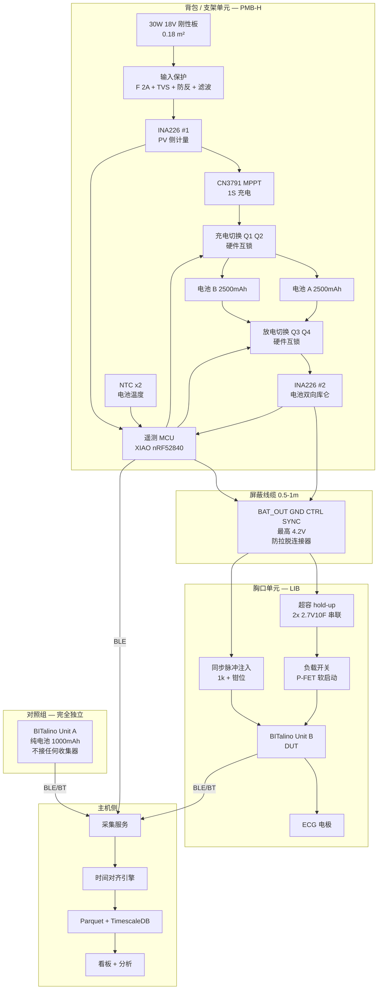

# 太阳能采集供电健康监测系统 — 生产级架构设计 v2.0

> **版本** v2.0 · **日期** 2026-09-15 · **取代** v1.0（`太阳能可穿戴健康监测-生产级架构.md`）
> **触发变更**：副院长确认方案变更 —— **确定使用 18V/30W 刚性板**，不再采购小型柔性板。
> 器件辨识完成：`YJL3404A` = MOSFET；`TEUCER HP600` = 散热硅胶垫（导热垫）。
> 新增能力：**实验室具备 PCB 制板设备**。

---

# 变更记录（v1.0 → v2.0）

| 章节 | 变更 | 影响等级 |
|---|---|---|
| §2 能量模型 | **结论翻转**：从"连续采集不可行、必须降占空比到 6.7%"改为 **"连续采集可行，EAR 1.0–3.9"** | 🔴 根本性 |
| §2.4 | 新增设计变量：**自主度（Autonomy Days）** 取代"收不够"成为主要约束 | 🔴 根本性 |
| §3 架构 | 新增 **ADR-006 双电池交替** 与 **ADR-007 分体式拓扑**；PMB 拆分为 PMB-H + LIB | 🔴 根本性 |
| §5.7 EMC | **风险等级上调**：功率等级从 0.27 W 升至 8 W（约 30 倍），开关噪声源强度大幅上升 | 🔴 头号风险 |
| §4 Phase | Phase 3「低功耗节点」从**必需**降级为**可选产品化方向** | 🟡 重要 |
| §7 BOM | 采购清单重写：电池扩容成为 P0；柔性板从 P0 移除；新增 EMC 与热管理物料 | 🟡 重要 |
| §5.4 工艺 | 引入实验室制板能力，给出三情形决策矩阵；AEM10941 不再进入主板 → **QFN 问题消失** | 🟡 重要 |
| §5.5.2 | 电量计方案改为 **INA226 双向库仑积分**，去掉 MAX17048（封装焊不了 + 算法黑盒） | 🟢 简化 |
| §5.6 | 超级电容用途重定位：从"弱光缓冲"改为 **电池切换时的 hold-up 供电** | 🟢 简化 |
| §11 安全 | 新增 18V 功率链与 ECG 前端的隔离要求；热安全约束收紧 | 🟡 重要 |
| §1.5 | `YJL3404A`/`TEUCER HP600` 辨识完成，❓ 清零 | 🟢 |

**v1.0 中失效、不要再引用的内容**：§0.1 的 P0-1/P0-2/P0-3、§2 全部数字、§2.3 的 6.7% 占空比结论、§7 P0-1 柔性板、§5.4 的 QFN 手焊困境。

## 置信度标记

✅ 高置信可行动 · ⚠️ 经验值，动手前查手册/实测 · ❓ 待你确认 · 🚨 阻断性

---

# 0. 执行摘要

## 0.1 一句话

> 方案从「面板贴在衣服上的自供电可穿戴」变成了「**面板随身携带（背包/支架）+ 分体式低压可穿戴单元**」。
> **能量问题解决了**（裕量 1.0–3.9 倍，连续采集可行）；
> **新的头号问题是电磁兼容** —— 一个 8W 级开关电源现在要和一个 µV 级心电放大器共处一身。
> 整个架构的重心，从"怎么省电"转移到了"**怎么让强电源不污染弱信号**"。

## 0.2 好消息：能量瓶颈解除

| 场景 | 面板输出 | 日收集 | vs 消耗 5.76 Wh/day | EAR |
|---|---|---|---|---|
| 户外背包垂直面，晴，2h | 8.3 W | 14.1 Wh | ✅ | **2.4** |
| 户外阴天，2h | 3.5 W | 6.0 Wh | ✅ 勉强 | **1.04** |
| 室内紧靠南窗 <0.5m，6h | 4.4 W | 22.5 Wh | ✅ | **3.9** |
| 室内距窗 2m，6h | 1.1 W | 5.4 Wh | ⚠️ 临界 | **0.94** |
| 室内纯人工照明 | 0.045 W | 0.4 Wh | ❌ | 0.07 |

**v1.0 的结论（自供电率仅 7%、必须把占空比压到 6.7%）已作废。**
现在 BITalino **可以连续采集**，只要设备每天能获得**户外 2 小时**或**紧靠窗 6 小时**的光照。

> ⚠️ 唯一仍然不成立的场景是**纯人工照明的室内**（办公室日光灯下）。任何情况下都不要宣称"在室内灯光下自动充电"。

## 0.3 代价：项目定位与命名出现张力（说一次，然后按你的决定执行）

395×460mm 的刚性板不可能装在衣服上。方案实际上从
`self-powered solar-harvesting wearable`（面板在身上）
变成了
`solar-harvested, body-carried power supply for a wearable monitor`（面板随身，供电给可穿戴）。

邮件原文明确要求过称呼与用词。**这两者不是同一件事，审稿人/答辩时大概率会问。**
我的建议措辞（既诚实又不违反用词禁令）：

```
✅ solar-harvesting wearable health monitoring system
✅ body-carried photovoltaic energy harvesting for wearable biosignal acquisition
✅ 太阳能采集供电的可穿戴健康监测系统
⚠️ 慎用："self-powered wearable"（会被理解为面板在身上）
❌ 仍然禁用：wireless power transfer / WPT / 无线电能传输 / 接收线圈
```

副院长已经拍板用这块板，我按这个执行。上面只是建议在报告里把「面板安装位置」写清楚，避免定位被质疑。**这是 §13 的 Q1。**

## 0.4 新的头号技术风险：EMC 🚨

```
v1.0：0.27 W 收集器（µW–mW 级开关）  ←  弱噪声源
v2.0：8 W MPPT 充电器（18V / 1.7A 开关）  ←  强噪声源，约 30 倍功率

同一个人身上，同时存在：
  · 18V、1.7A、数百 kHz 的开关变换器
  · 满量程约 ±1.5 mV 的心电放大器（分辨率约 1.5 µV）

二者相差 9 个数量级。
```

**这个问题不能靠滤波解决，必须靠架构解决。** v2 给出两条硬措施：

1. **ADR-007 分体式拓扑**：18V 全部留在背包单元，只有 <4.2V 走到胸口。噪声源与放大器物理分离约 0.5–1 m。
2. **ADR-006 双电池交替**：一块电池在充电，另一块给 BITalino 供电，定时交换。**采集时，供电链上根本没有开关电源在工作** —— 这是物理隔离，不是抑制。

## 0.5 新架构总览

```
        ┌─────────── 背包 / 支架单元（18V 区域） ───────────┐
        │                                                    │
  30W 板 ──► 保护 ──► CN3791 MPPT ──► [充电切换] ──┬─ 电池 A │
   18V        F/TVS/D      ▲                        └─ 电池 B │
                           │                           │  │   │
                      遥测 MCU ◄── INA226 ×2 ─────────┘  │   │
                           │                              │   │
                           └──── [放电切换] ◄──────────────┘   │
                                      │                        │
        └──────────────────────────────┼────────────────────────┘
                                       │  4-5 芯屏蔽线缆（<4.2V）
        ┌──────────────────────────────┼──── 胸口单元 ─────────┐
        │                              ▼                        │
        │   超容 hold-up ──► 负载开关 ──► BITalino ──► ECG 电极  │
        │   (切换时不断电)              └─► 同步脉冲 → I1        │
        └────────────────────────────────────────────────────────┘
```

## 0.6 今天就能做的 4 件事

1. **称一下太阳能板的重量**，并确认是玻璃层压还是 ETFE/PET 层压 —— 这决定它能不能背在身上（§13 Q1）。
2. **实测 Voc 和 Isc**（万用表 10A 挡、10A 孔），定 TVS 档位。
3. **TC-01：实测 BITalino 功耗**，替换本文所有 ⚠️ 的 0.240 W。**这仍然是第一优先级实验。**
4. 把 §13 的问题清单和 §7 的采购清单整理成一封邮件。

---

# 1. 器件状态更新

## 1.1 已确认（❓ 清零）

| 器件 | v1.0 状态 | v2.0 确认结果 | 在架构中的用途 |
|---|---|---|---|
| 18V 30W 刚性板 | 🚨 与需求不符 | ✅ **方案确认使用** | 唯一能量源（背包/支架安装） |
| `YJL3404A` | ❓ 未识别 | ✅ **MOSFET** | 负载开关 / 电池切换的原型验证件 |
| `TEUCER HP600` | ⚠️ 推测 TIM | ✅ **散热硅胶垫（导热垫）** | ⚠️ **用途需纠正，见 §1.2** |
| PCB 制造 | 需外发打样 | ✅ **实验室自有设备** | 迭代周期从 5–7 天缩短到当天 |

## 1.2 🚨 关于 TEUCER HP600 的用途纠正

**散热硅胶垫是导热的，不是隔热的。放错位置会把热量送进人体。**

```
✅ 正确用途：器件 → 外壳/散热片 的导热路径
   · CN3791 模块的电感与 MOS 管  →  金属外壳
   · 电池组表面  →  均温板（避免局部热点）
   · 热电偶结点  →  被测表面（改善接触热阻）

❌ 错误用途：放在太阳能板背面和人体之间
   → 面板背面在阳光下可达 60–70 °C ⚠️
   → 导热垫会高效地把这些热量传给皮肤
   → 这是把散热件当隔热件用，后果是烫伤

✅ 人体侧需要的是【隔热】：空气间隙（10–20 mm）+ 低导热泡沫/气凝胶垫
   → 这是新增的 P0 采购项（§7）
```

## 1.3 EVK10941 的处置：别让它闲置

方案改为高压大板后，AEM10941（输入 ≤5V）在主链路上已无位置。
**但不要放弃它** —— 花几十块钱买**一小块 5–6V / 1W 柔性板**，就能保住一条有价值的研究线：

> **收集器对比研究**：同一负载、同一光照条件下，
> 「大面积高压板 + CN3791 MPPT」 vs 「小面积低压板 + AEM10941 超低功耗收集器」
> 的效率、启动阈值、弱光表现对比。
>
> 这让论文从"我们做了一个系统"升级为"我们比较了两种能量采集路径并给出选型依据"。
> 成本几十元，价值很高。列为 §7 的 P1-15。

## 1.4 BITalino / HeartBIT：核验项仍然未完成

v1.0 §1.4 的核验**尚未有结果反馈**，这些项仍然阻塞：

```
□ 主板总数：2 还是 3？
□ 每块板的完整丝印型号与版本（拍照）
□ 🚨 BT（蓝牙经典）还是 BLE？  ← 影响功耗模型与主机软件栈
□ HeartBIT 套件装箱清单逐项核对
□ 🚨 BITalino 电池座引脚极性（拍照记录）
□ BITalino 数字输入 I1 的电平范围
□ 实测功耗（TC-01）
```

> ⚠️ 能量裕量变充裕之后，**BT vs BLE 的影响下降了**（不再是可行性问题，只是裕量大小问题）。
> 但**极性核验（§6.3）的重要性没有任何下降** —— 接反一次废一块板，和能量预算无关。

## 1.5 待核实清单（新增项）

```
太阳能板机械特性（新增，因为要随身携带）
□ 🚨 实测重量（kg）—— 决定能否背负
□ 层压类型：玻璃 / ETFE / PET
□ 边框：铝框 / 无框
□ 背面接线盒位置与出线方式
□ 实测 Voc（决定 TVS 档位）
□ 实测 Isc
□ 实测工作时背面温度（晴天正午）

YJL3404A（已知是 MOSFET，但参数未知）
□ N 沟道还是 P 沟道？
□ Vds / Id / Rds(on) / Vgs(th)
□ 封装（SOT-23？）
   → 只有 1 个，无法用于生产，仅作原型验证。正式件见 §7

实验室 PCB 设备能力（新增，决定 §5.4 工艺路线）
□ 机器类型：雕刻机 / 蚀刻线 / 其他
□ 是否支持【过孔金属化】？
□ 是否能做【阻焊层】？
□ 最小线宽 / 最小间距（mm）
□ 是否有回流炉 / 热风台 / 钢网 / 贴片机？
□ 最大板尺寸

电池
□ 523450 电池组是否自带 PCM 保护板？其阈值？
□ ❓ 你消息里「锂电池组，」这句似乎没说完，想确认什么？
```

---

# 2. 能量收支模型 v2（结论已翻转）

## 2.1 面板模型

```
面积 A = 0.395 × 0.460 = 0.1817 m²
STC 效率 η = 30 W ÷ (0.1817 m² × 1000 W/m²) = 16.5%
温度系数 ≈ −0.4 %/°C（晶硅典型值）⚠️，基准电池温度 25 °C

输出功率 P = 30 × (G / 1000) × [1 − 0.004 × (Tcell − 25)]
```

> **温度修正不是可选项。** 晴天正午面板电池温度可达 60 °C，输出会比 STC 标称低约 14%。
> v1.0 忽略了这一项；v2 全部计入。

## 2.2 场景产能表

| 场景 | 平面辐照度 G | 电池温度 | 面板输出 | 有效时长 | 日收集（含 85% 链路效率） |
|---|---|---|---|---|---|
| 户外水平正对，晴 | 900 W/m² | 60 °C | **23.2 W** | 参考 | — |
| **户外背包垂直面，晴，朝向一般** | 300 W/m² ⚠️ | 45 °C | **8.3 W** | 2 h | **14.1 Wh** |
| 户外阴天 | 120 W/m² | 30 °C | **3.5 W** | 2 h | **6.0 Wh** |
| **室内紧靠南窗 <0.5 m** | 150 W/m² ⚠️ | 30 °C | **4.4 W** | 6 h | **22.5 Wh** |
| 室内距窗 2 m | 35 W/m² ⚠️ | 25 °C | **1.1 W** | 6 h | **5.4 Wh** |
| 室内纯人工照明 500 lux | 1.5 W/m² | 25 °C | 0.045 W | 8 h | **0.4 Wh** |

⚠️ 辐照度数值是经验估计，**必须用参考电池片实测替换**（TC-02/TC-03）。室内窗边的辐照度对朝向、季节、玻璃镀膜极其敏感，跨度可达 5 倍。

## 2.3 负载模型（未变）

| 状态 | 功率 | 备注 |
|---|---|---|
| BITalino 连续采集 1000 Hz | **约 240 mW** ⚠️ | **待 TC-01 实测替换，这是全部计算的地基** |
| 日消耗（连续 24 h） | **5.76 Wh/day** | 240 mW × 24 h |
| 遥测 MCU | 约 2 mW | |
| PMB 静态（负载关断时） | 约 0.3 mW | |

## 2.4 EAR 与新的设计变量：自主度

```
EAR = 日收集 ÷ 日消耗（5.76 Wh）
```

| 场景 | 日收集 | **EAR** | 判定 |
|---|---|---|---|
| 户外背包晴 2h | 14.1 Wh | **2.45** | ✅ 充裕 |
| 室内靠窗 6h | 22.5 Wh | **3.91** | ✅ 充裕 |
| 户外阴天 2h | 6.0 Wh | **1.04** | ✅ 临界通过 |
| 室内距窗 2m 6h | 5.4 Wh | **0.94** | ⚠️ 略亏 |
| 纯人工照明 | 0.4 Wh | 0.07 | ❌ |

> **结论：连续采集可行。** 日常使用中只要保证「每天户外 2 小时」**或**「工作时把背包放在窗边」，系统就是能量净正的。

### 🔴 但约束换了位置：现在的瓶颈是电池容量

能量够了，但**存不下**。日收集 14–22 Wh，而现有 1000 mAh 电池只有 3.7 Wh。
这意味着：白天早早充满，之后能量全部浪费；一旦连续两天阴雨，系统立刻断电。

离网光伏系统的标准设计变量是 **自主度（Autonomy Days）** —— 在完全没有光照的情况下能撑几天：

| 电池容量 | 能量 | **自主度** | 0.5C 充电电流 | 充电功率 |
|---|---|---|---|---|
| 1000 mAh（现有） | 3.70 Wh | **0.64 天** ❌ | 0.50 A | 1.9 W |
| 2000 mAh | 7.40 Wh | 1.28 天 | 1.00 A | 3.9 W |
| **2500 mAh ×2（推荐）** | 9.25 Wh ×2 | **3.21 天** ✅ | 1.25 A | 4.9 W |
| 3000 mAh | 11.10 Wh | 1.93 天 | 1.50 A | 5.8 W |
| 5000 mAh | 18.50 Wh | 3.21 天 | 2.50 A | 9.8 W |

**推荐：2 × 2500 mAh**，理由有三：
1. 自主度 3.2 天，符合离网系统 3–5 天的工程惯例，能扛过连续阴雨
2. 正好配合 **ADR-006 双电池交替架构**（这才是主要理由）
3. 单块 1.25 A 充电电流在 CN3791 的能力范围内 ⚠️（需核实其最大充电电流）

> **1000 mAh 的现有电池不作废**：它继续用于 Unit A（对照组），对照组不接太阳能，0.64 天自主度对单次 2–4 小时的对照实验完全够用。

### 为什么 30W 板配 5W 负载不算"浪费"

面板能力（8–23 W）远超充电器吸收能力（约 5 W）。这**不是设计缺陷，是离网光伏的标准做法**，叫做 **oversized array for low-light robustness**：

```
按"晴天正午刚好够用"来选板  →  阴天、冬天、朝向不佳时全部失效
按"阴天也够用"来选板        →  晴天时限流，多余能量弃掉，但系统全年可用

30W 板在阴天仍能输出 3.5 W，足以满负荷充电。
这才是它的价值 —— 不是峰值功率，是【最差情况下的保底能力】。
```

**这个论证要写进报告。** 否则"用 30W 板驱动 0.24W 负载"看起来像不会算账。

## 2.5 占空比调度：从"必需"降级为"优化手段"

v1.0 里占空比是**可行性的前提**（不降到 6.7% 就不可能自供电）。
v2.0 里它变成**可选的优化**，用途转变为：

| 原用途（v1.0） | 新用途（v2.0） |
|---|---|
| 让系统勉强能量平衡 | 延长阴雨天的自主时间（从 3.2 天延到 10+ 天） |
| — | 在 `CRITICAL` 状态下的降级运行策略 |
| — | 作为实验变量，研究"占空比 vs 临床信息量"的权衡 |

§8.2 的能量状态机保留，但 `FULL_RATE`（连续采集）从"例外"变成**默认状态**。

---

# 3. 架构

## 3.1 新增架构决策

### ADR-006：双电池交替 —— 用物理隔离解决 EMC，而不是滤波 🔴

**决策**：两块电池，任一时刻**一块在充电、另一块在供电**，由 MCU 定时（默认 30 分钟）交换角色。切换瞬间由超级电容维持负载供电不中断。

```
          ┌──── 充电切换 ────┐            ┌──── 放电切换 ────┐
          │                  │            │                  │
 MPPT ────┤ Q1 ──► 电池 A ───┼────────────┤ Q3 ──────────────┼──► 超容 ──► 负载
 充电器   │                  │            │                  │
          │ Q2 ──► 电池 B ───┼────────────┤ Q4 ──────────────┘
          └──────────────────┘            └──────────────────┘

  状态 1： Q1 开 Q2 关 | Q3 关 Q4 开   →  A 充电，B 供电
  状态 2： Q1 关 Q2 开 | Q3 开 Q4 关   →  B 充电，A 供电

  🚨 硬件互锁：Q1/Q2 不得同时导通，Q3/Q4 不得同时导通
     否则两块电池直接并联，0.5V 压差下环流可达数安培
```

**理由**：
供电链上**根本没有开关电源在工作**。这不是把噪声滤掉，是让噪声**不存在于测量回路里**。
对一个要测 µV 级信号的系统，这是唯一可靠的做法。

**超容终于找到了它的正确用途**：
```
切换需要 break-before-make（先断后通），中间有几百微秒到几毫秒的空窗。
5 F / 5.4 V 超容组储能 15.2 J，在 240 mW 负载下可维持 63 秒。
相对于几毫秒的切换窗口，裕量超过 10000 倍。 ✅ 绰绰有余
```

**代价与风险**：
- 需要 4 个功率 MOSFET + 硬件互锁 + 精心的时序设计
- 两块电池的老化不同步，需要在 manifest 里分别记录循环次数
- 切换瞬间负载电压会有一个小台阶（两块电池 SoC 不同）→ 需验证不会在 ECG 上产生伪迹（TC-05b）

**为什么不用更简单的 ADR-004（时分复用，采集时关充电）？**
两者**都要做**。ADR-004 是软件策略（简单、零成本），ADR-006 是硬件保障（彻底、可在连续采集下工作）。
Phase 1 先做 ADR-004 验证噪声到底有多严重；如果 TC-05 显示可接受，ADR-006 可以简化掉。**先测量，再决定要不要上复杂度。**

### ADR-007：分体式拓扑 —— 18V 不上胸口 🔴

**决策**：系统拆成两个物理单元，18V 功率链全部留在背包单元，只有 <4.2V 低压经屏蔽线缆到达胸口单元。

```
┌─────────── 背包 / 支架单元 PMB-H ────────────┐
│  30W 板、18V 保护、CN3791 MPPT、             │
│  电池 A/B、充放切换、INA226 ×2、             │
│  NTC、遥测 MCU、BLE                          │
│  ← 所有开关电源、所有 18V、所有发热在这里     │
└───────────────────┬──────────────────────────┘
                    │ 4–5 芯【屏蔽】线缆，长约 0.5–1 m
                    │ 载有：BAT_OUT+ / GND / GND / CTRL / SYNC
                    │ ⚠️ 最高电压 4.2 V
┌───────────────────▼────── 胸口单元 LIB ──────┐
│  超容 hold-up、负载开关、同步脉冲注入、       │
│  ESD 保护、JST-PH 到 BITalino                │
│  ← 无开关电源，无 18V，几乎不发热             │
│  尺寸约 25 × 20 mm                            │
└──────────────────────────────────────────────┘
```

**四个问题一次解决**：

| 问题 | 分体式如何解决 |
|---|---|
| EMC：开关噪声耦合进 ECG | 噪声源距放大器 0.5–1 m，且中间无共模路径 |
| 安全：18V 接近心电电极 | 18V 根本不进入胸口单元，物理上不可能 |
| 热：充电器发热贴身 | 发热全在背包，胸口单元功耗 <1 mW |
| 人因：重量分布 | 面板+电池（约 2–3 kg）由背包承担，胸口仅几十克 |

**代价**：多一根线缆（可能被拉扯）→ 必须有**防拉脱设计**（磁吸断开连接器或易断设计），见 §5.8。

### ADR-008：用 INA226 双向库仑积分代替专用电量计 🟢

**决策**：去掉 MAX17048，用电池节点的 INA226 做双向电流积分实现库仑计。

**理由**：
1. **封装**：MAX17048 是 TDFN/WLP，底部焊盘，实验室设备和你的烙铁都做不了
2. **科研可信度**：MAX17048 的 ModelGauge 是黑盒算法，你不知道它内部做了什么修正。**原始库仑积分虽然会漂移，但它是可解释的**，论文里能写清楚
3. **精度**：INA226 的 16 位分辨率 + 0.05 Ω 分流 → 50 µA LSB，优于基于电压的 SoC 估计

**实现要点**：
```
SoC(t) = SoC(0) + ∫ I_bat dt / Q_nominal

必须处理：
□ MCU 不能断电，否则积分丢失  →  累计值每 60 s 写入 flash
□ 漂移累积  →  每次【充满事件】（CV 阶段电流降至 0.05C）重置为 100%
□ 每次【深放事件】（电压降至 3.2 V）重置为已标定的下限
□ 温度修正：容量随温度变化，需记录 NTC 并在后处理中修正
□ 初始标定：一次完整的满充-满放循环，得到真实的 Q_nominal
```

⚠️ 这比 MAX17048 多了一些固件工作，但对研究项目来说是净收益。

## 3.2 全景架构图



## 3.3 保留自 v1.0 的决策

| ADR | 内容 | v2 状态 |
|---|---|---|
| ADR-001 | PMB 拥有电池，BITalino 当纯负载 | ✅ 保留，更加成立 |
| ADR-002 | 双充电路径（HV/LV） | 🔄 **修订**：主链路只保留 HV（CN3791）；LV（AEM10941）降级为独立的对比研究支路 |
| ADR-003 | BITalino 作参考仪器 | 🔄 **弱化**：能量充裕后，BITalino 可以作为最终负载；Phase 3 的自研节点变为可选 |
| ADR-004 | 时分复用（采集时不充电） | ✅ 保留，作为 ADR-006 的简化版先行验证 |
| ADR-005 | 硬件级时间同步 | ✅ 保留，完全不变 |

---

# 4. 演进路线 v2

```
Phase 0 ──► Phase 1 ──► Phase 2 ──► Phase 3（可选）
器件核验    能量链+EMC   佩戴原型     产品化/低功耗节点
(W1-2)      (W3-6)      (W7-11)      (W12+)
```

| Phase | 目标 | 出口标准 | v1.0 → v2.0 变化 |
|---|---|---|---|
| **0** | 器件核验、基线实测、建仓库、下采购单 | 所有 ❓ 清零；TC-01/TC-02 完成 | 不变 |
| **1** | 台架验证能量链 + **回答 EMC 问题** | **TC-05 噪声对照给出定量结论** → 据此决定要不要上 ADR-006 | 🔴 重心从"能量够不够"转为"噪声多大" |
| **2** | 分体式佩戴原型（PMB-H + LIB） | 热安全 PASS；连续采集 EAR ≥ 1.0；72h 无人值守 | 🔴 目标从"占空比可行"改为"连续采集可行" |
| **3** | 产品化方向（可选） | 视 Q3 答复而定 | 🟡 从必需降为可选 |

> **Phase 1 的关键决策点在 W5–W6**：TC-05 的结果决定架构走向。
> - 若噪声可接受（Δ噪声底 < 10 µV_rms）→ 只用 ADR-004 软件时分复用，**砍掉 ADR-006 双电池**，省一半复杂度
> - 若噪声不可接受 → 上 ADR-006
>
> **先测量，再决定复杂度。不要一开始就把双电池架构焊出来。**

---

# 5. 硬件详细设计 v2

## 5.1 PV 输入段（18V，功率上调后的重新选型）

```
                    ┌── 面板端保险丝（就近装在接线盒！）
                    │
太阳能板 (+) ──┬── F1 2A 慢断 ──┬── D1 ──┬── L1 ──┬──► CN3791 VIN
               │                 │        │  磁环   │
              TVS1              C1       共模扼流   C2
            SMAJ26A          220µF/35V              100nF
               │                 │                   │
太阳能板 (−) ──┴─────────────────┴───────────────────┴──► PGND
```

**相对 v1.0 的修订**：

| 器件 | v1.0 | v2.0 | 理由 |
|---|---|---|---|
| F1 位置 | PMB 上 | **面板接线盒内** | 线缆一旦短路，保险丝必须在**电源侧**才有用。装在负载端保护不了线缆本身 |
| TVS1 | SMAJ24A | **SMAJ26A** ⚠️ | 待实测 Voc 后定档。规则：**击穿电压 > 实测 Voc × 1.15**，否则晴天持续导通发热 |
| D1 | SS34 | **SS54 或理想二极管** | 电流从 0.5A 升到 1.7A，SS34 的 3A 额定余量不足 |
| C1 | 100 µF | **220 µF / 35V 低 ESR** | 输入功率提高，需要更大的输入储能 |
| L1 | 无 | **新增共模扼流圈 + 磁环** | 🚨 EMC：抑制经线缆传导的共模噪声 |

> 🚨 **18V/1.8A 短路会拉电弧。** 面板线缆必须：
> - 使用 18 AWG 硅胶线（耐温、柔软、耐弯折）
> - 连接器选 XT30（额定 30A，远超需求，接触电阻低且不易脱落）
> - **面板端必须有保险丝**

## 5.2 MPPT 充电段

```
CN3791 关键配置（⚠️ 全部需对照数据手册核算）：

  MPPT 电压设定点：  VIN 分压到 MPPT 引脚
    目标 ≈ 0.76 × Voc ≈ 16.5 V（待实测 Voc 后重算）

  充电电流设定：     Rcs 采样电阻
    2500 mAh 电池 @ 0.5C = 1.25 A

  ⚠️ 必须核实：CN3791 的最大充电电流额定值
     若 < 1.25 A  →  降到 0.4C，或改用 LT3652（2A，输入 32V，带 MPPT）
     
  ⚠️ 必须核实：CN3791 模块的电感饱和电流与 MOS 额定值
     淘宝模块的用料往往低于芯片能力，1.25A 连续可能发热严重
```

**发热估算**：输入 18V × 0.31A = 5.6 W，输出 4.2V × 1.25A = 5.25 W，损耗约 0.35 W。
不大，但集中在电感和同步整流管上。**用 TEUCER HP600 导热垫把它们耦合到金属外壳**（§1.2 的正确用法）。

## 5.3 电池切换电路（ADR-006 的实现）

```
充电切换（高边，P-FET，源极接充电器输出）：
                    CHG_OUT (4.2V)
                         │
            ┌────────────┴────────────┐
            │                         │
        ┌───┴───┐                 ┌───┴───┐
        │  Q1   │  P-FET          │  Q2   │  P-FET
        │ S   D │                 │ S   D │
        └───┬───┘                 └───┬───┘
            │                         │
         BAT_A+                    BAT_B+

放电切换（高边，P-FET，源极接各自电池）：
         BAT_A+                    BAT_B+
            │                         │
        ┌───┴───┐                 ┌───┴───┐
        │  Q3   │                 │  Q4   │
        └───┬───┘                 └───┬───┘
            │                         │
            └────────────┬────────────┘
                         │
                     LOAD_OUT ──► 线缆 ──► LIB 超容 ──► BITalino
```

### 🚨 三条强制安全规则

```
规则 1：硬件互锁
  Q1/Q2 的栅极驱动之间、Q3/Q4 之间，必须有【硬件】互锁
  （反相器 + 与门，或用带互锁的专用驱动）
  ⛔ 不能只靠固件保证"不同时导通"—— MCU 跑飞就是两块电池直接并联

规则 2：Break-before-make
  切换时序：先断开旧路径 → 等待 t_dead → 再导通新路径
  t_dead 建议 1 ms（远大于 MOSFET 关断时间，也远小于超容 63s 的维持能力）
  放电侧的空窗由超容填补；充电侧的空窗无所谓

规则 3：体二极管方向
  🚨 P-FET 的体二极管方向必须【阻止】反向电流
  Q3/Q4 若方向接反，即使栅极关断，体二极管也会让两块电池经二极管并联
  → 必须采用【背靠背双 FET】或选用带反向阻断的负载开关 IC
  ← 这是双电池架构最容易出错的地方，原理图评审时重点检查
```

⚠️ **推荐直接用成品 IC 规避这个坑**：理想二极管 ORing 控制器（如 `LM66100`，带反向阻断）或专用电池切换 IC，比自己搭 4 个分立 FET 可靠得多。列入 §7 P0-9。

### 环流风险量化

```
若 Q1/Q2 意外同时导通，两块电池压差 ΔV = 0.5 V，
内阻各约 50 mΩ ⚠️，走线约 20 mΩ：
  I_环流 = 0.5 / (0.05 + 0.05 + 0.02) = 4.2 A

→ 远超 2500 mAh 电池的安全放电率
→ 会触发 PCM 保护，反复触发会损伤电芯
→ 这就是为什么必须硬件互锁
```

## 5.4 PCB 工艺决策矩阵（利用实验室设备）

实验室有制板设备，这改变了打样节奏，但**不一定**改变贴装能力。三种情形：

| 情形 | 设备能力 | PMB-H 怎么做 | LIB 怎么做 | 迭代周期 |
|---|---|---|---|---|
| **A：仅雕刻机**<br>（无过孔金属化、无阻焊） | 单/双面铜，铆钉过孔 | 自制 2 层板；**细间距器件（INA226 VSSOP-10）改用成品模块插接** | 自制，全大封装 | **当天** ✅ |
| **B：蚀刻线 + 过孔金属化 + 阻焊** | 接近工业 2 层板 | 自制 2 层板，可直接贴 VSSOP-10 | 自制 | **1–2 天** ✅ |
| **C：B + 回流炉/热风/钢网** | 完整原型线 | 全部自制，任意封装 | 自制 | **1–2 天** ✅✅ |

> **好消息：QFN 问题已经消失。** AEM10941（QFN-40）不再进入主链路（§1.3），
> 现在最难的封装只剩 **INA226 的 VSSOP-10（0.5 mm 间距）**，情形 A 下用模块规避即可。
> **所以三种情形下，Rev B 都不需要外发 PCBA。**

### 无论哪种情形都建议的做法

```
□ PMB-H 用 2 层板即可（功率板，地平面完整比层数更重要）
□ 🚨 PCB 上做【物理分区】，用一条 ≥3 mm 的无铜隔离带分开：
     [18V 功率区]  |隔离带|  [电池与低压区]  |隔离带|  [MCU 数字区]
□ 开关回路（电感-MOS-二极管-输入输出电容）面积最小化
□ 星型接地：功率地与信号地在【电池负极】单点汇合
□ 大电流走线：1.25A 用 1oz 铜需 ≥1 mm 线宽；雕刻机建议直接留 2–3 mm 铜皮
□ 雕刻机无阻焊 → 焊完必须用 IPA 清洗 + 涂三防漆（贴身器件防汗防潮）
□ 留足测试点：TP_PV+ TP_BAT_A TP_BAT_B TP_LOAD TP_GND×3 + 开尔文焊盘×2
```

## 5.5 计量链（v2 更新）

```
INA226 #1 @ PV 侧：Rshunt = 0.05 Ω
  量程：最大 1.8 A → 90 mV
  🚨 超过 INA226 的 81.92 mV 满量程！→ 必须改用 0.02 Ω
  0.02 Ω：1.8 A → 36 mV ✅   分辨率 2.5µV/0.02Ω = 125 µA ✅
  功耗：1.8² × 0.02 = 65 mW（可接受，占 8W 的 0.8%）

INA226 #2 @ 电池节点：Rshunt = 0.02 Ω（双向，兼作库仑计）
  充电 +1.25 A → +25 mV  |  放电 −0.07 A → −1.4 mV
  分辨率 125 µA，对 70 mA 的放电电流 → 0.18% ✅ 够用
```

> ⚠️ **v1.0 的 0.1 Ω 选型在 v2 会超量程**，这是功率上调后必须重算的地方。
> **凡是 v1.0 里的电阻/电流/发热数值，都要按新的功率等级重算一遍。**

开尔文四线连接的要求不变（见 v1.0 §6.4，仍然有效）。

## 5.6 超级电容：用途重定位

| | v1.0 | v2.0 |
|---|---|---|
| 主要用途 | 弱光缓冲、脉冲缓冲 | **电池切换时的 hold-up 供电** |
| 位置 | PMB 电池节点 | **LIB（胸口单元）负载侧** |
| 数量 | 2 串（5.4V 5F） | 2 串（5.4V 5F），第 3 只备用 |
| 漏电顾虑 | 🚨 严重（占室内收集的 39%） | ✅ **不再是问题**（280 µW vs 收集 1–8 W，占比 <0.03%） |
| 预充电路 | 必需 | 仍然必需（浪涌与能量多少无关） |
| 均压电阻 | 必须 1 MΩ（省电） | **可用 100 kΩ**（均压快，漏电已无所谓） |

> **这是个好例子**：同一个器件，在能量预算改变后，约束条件完全反转。
> v1.0 花大力气优化的 280 µW 漏电，在 v2.0 里已经无关紧要 —— 但**预充浪涌的风险一点没变**，因为那是电荷问题，不是能量问题。

## 5.7 🚨 EMC：现在是头号风险

### 风险等级重估

```
                      v1.0            v2.0           变化
开关电源功率          0.27 W          8 W            ×30
开关电流              ~50 mA          ~1.7 A         ×34
输入电压              5 V             18 V           ×3.6
噪声源与 ECG 距离     同一块板         0.5-1 m        ✅ 改善（ADR-007）
测量时噪声源状态      运行             【关闭】        ✅ 消除（ADR-006）
```

**净效果**：噪声源强度上升约 30 倍，但通过 ADR-006 + ADR-007 两条架构措施，
耦合路径被**物理切断**而非衰减。**架构手段的效果远优于滤波。**

### 五层防护（按有效性排序）

| # | 措施 | 归属 | 有效性 | Phase |
|---|---|---|---|---|
| 1 | **ADR-006 双电池**：测量时供电链无开关电源 | 架构 | ★★★★★ | 2（若 TC-05 需要） |
| 2 | **ADR-007 分体式**：噪声源距放大器 0.5–1 m | 架构 | ★★★★★ | 2 |
| 3 | **ADR-004 时分复用**：采集时关闭充电 | 固件 | ★★★★☆ | 1 |
| 4 | **屏蔽线缆 + 共模扼流 + 磁环** | 线缆 | ★★★☆☆ | 1 |
| 5 | **π 型滤波 + 最小开关回路 + 星型地** | PCB | ★★★☆☆ | 1 |

### 线缆布置纪律（免费但有效）

```
⛔ PV 线缆与 ECG 导联线【绝不平行走线】
✅ 若必须交叉，保持 90° 垂直交叉
✅ 间距 > 100 mm（v1.0 是 50 mm，功率上调后加倍）
✅ PV 线缆双绞 + 屏蔽层单端接地（接在 PMB-H 的功率地）
✅ ECG 导联线尽可能短，走人体表面，不与任何电源线共路径
✅ 每次实验拍照记录线缆布置，保证可复现
```

### TC-05 的判据收紧

功率上升后，v1.0 的「Δ噪声底 < 10 µV_rms」需要重新审视：
- 如果实测远低于 10 µV → 说明架构措施有效，**可以砍掉 ADR-006 省复杂度**
- 如果接近或超过 → 必须上 ADR-006，并重测

⚠️ 正式报告中的阈值应引用 IEC 60601-2-25 对心电设备噪声的量化要求，而不是我给的经验值。

## 5.8 机械与人因（因大板而新增）

### 防拉脱设计 🚨

背包单元与胸口单元之间有一根线缆穿过身体。**跌倒、更衣、剧烈动作时会被拉扯。**

```
必须：
□ 采用【磁吸式】连接器，或
□ 设计【易断点】（breakaway），拉力超过约 20 N 时先断连接器而非扯动电极
□ 线缆预留松弛量，固定在衣物上（走线夹）
□ 断连后系统必须安全：超容维持 → MCU 检测到负载丢失 → 记录事件 → 关断输出
□ 重新连接时不得产生浪涌（软启动已覆盖）
```

### 重量与佩戴 ❓

```
待实测：
□ 面板重量（玻璃层压约 2.5–3 kg / ETFE 层压约 0.6–1 kg ⚠️）
□ 电池 2×2500mAh 约 100 g
□ PMB-H + 外壳 约 150 g
□ 总重估计 1–3.5 kg

⚠️ 若超过 2 kg，需评估目标人群的可接受性：
   健康成年人短时间：可接受（相当于一台笔记本）
   老年人/患者/长时间：需要支架方案而非背负方案
   → 这是 §13 Q1 的一部分
```

### 热管理（新增约束）

```
太阳能板背面在晴天可达 60–70 °C ⚠️

  面板正面（受光）
  ═══════════════════  ← 60–70 °C
  ░░░░░░░░░░░░░░░░░░░  ← 【空气间隙 10–20 mm】+ 支撑脚
  ▓▓▓▓▓▓▓▓▓▓▓▓▓▓▓▓▓▓▓  ← 【隔热层】EVA 泡沫 / 气凝胶垫（新增采购）
  ┃┃┃┃┃ 背包织物 ┃┃┃┃┃
  ～～～～ 人体 ～～～～  ← 目标 < 41 °C ⚠️

🚨 TEUCER HP600（导热垫）绝不能放在这条路径上（§1.2）
   它只用于：CN3791 的电感/MOS → 金属外壳
             电池表面 → 均温板
             热电偶结点 → 被测表面
```

**热电偶从 2 点增加到 4 点测量** → 需补购 2 支（§7 P1）：
`TC-A` 面板背面 · `TC-B` 隔热层人体侧 · `TC-C` 电池表面 · `TC-D` 充电器外壳

---

# 6. 焊接与装配（相对 v1.0 的增量）

> v1.0 §6 的 SOP 全部仍然有效，**特别是 S-2 锂电池引线端接 和 S-3 BITalino 极性核验，重要性没有任何下降**。
> 本节只列 v2 新增或修改的作业。

## 6.1 【修改】S-1 面板引出线 — 功率上调后的变更

| 项 | v1.0 | v2.0 |
|---|---|---|
| 线径 | 未指定 | **18 AWG 硅胶线**（1.7A 连续 + 柔软耐弯折） |
| 连接器 | XT30 或螺钉端子 | **XT30**（不要用螺钉端子，会松动） |
| 保险丝位置 | PMB 上 | 🚨 **面板接线盒内**（就近保护线缆） |
| 屏蔽 | 无 | **加屏蔽层，单端接地** + 磁环 |
| 遮光操作 | 必需 | 必需，**且因功率更大更要严格** |

## 6.2 【新增】S-8 电池切换电路装配

```
难度 ★★★★  —— 这是整个项目最容易出错的电路

装配前：
□ 原理图评审：4 个 FET 的体二极管方向逐个画出来确认（§5.3 规则 3）
□ 互锁逻辑在纸上验证：列出 4 种栅极组合，确认无一会导致电池并联

装配中：
□ 先只装【充电侧】Q1/Q2，不装放电侧
□ 用两个【可调电源】模拟两块电池（设 3.9V 和 3.7V，限流 100 mA）
   ← 🚨 绝对不要一开始就用真电池测试互锁！限流电源能救你
□ 逐一测试 4 种栅极组合，用电流表看是否有环流
□ 确认无环流后，再装放电侧 Q3/Q4，重复测试
□ 全部通过后，才换成真电池

验证：
□ 万用表测：Q1 关断时，BAT_A+ 与 CHG_OUT 之间【双向都不通】
   ← 这一条专门验证体二极管方向。若单向导通 = 方向错了，返工
□ 同样测 Q2/Q3/Q4
□ 示波器看切换波形：LOAD_OUT 在切换瞬间的跌落应 < 100 mV
```

## 6.3 【新增】S-9 分体线缆与防拉脱连接器

```
□ 选用 4–5 芯【屏蔽】线缆，长度 0.5–1 m（先留长，装配后裁剪）
□ 线序定义并【写在两端的标签上】：
     1 = BAT_OUT+   2 = GND   3 = GND   4 = CTRL_LOAD   5 = SYNC
□ 屏蔽层【只在 PMB-H 端】接功率地（单端接地，避免地环路）
□ 两端各装磁吸连接器（或易断连接器）
□ 🚨 验证：拔掉连接器时，系统应安全降级而不是异常
     → 超容维持供电几十秒 → MCU 记录事件 → 有序关断
□ 🚨 验证：BAT_OUT+ 与 GND 短接时，应由保险丝/限流保护，不得起火
```

## 6.4 【新增】S-10 热管理装配

```
导热路径（用 TEUCER HP600 散热硅胶垫）：
□ 裁剪导热垫，覆盖 CN3791 模块的电感和 MOS 管
□ 压在金属外壳内壁上，压缩量约 20–30%（垫子要略厚于间隙）
□ 电池表面贴一片导热垫 → 均温板（防止局部热点）

隔热路径（用 EVA 泡沫/气凝胶垫，新采购）：
□ 面板背面 → 支撑脚形成 10–20 mm 空气间隙
□ 空气间隙之后 → 隔热层 → 背包
□ 🚨 确认这条路径上【没有】任何导热垫

热电偶贴附（4 点）：
□ TC-A 面板背面中心   □ TC-B 隔热层人体侧
□ TC-C 电池表面       □ TC-D 充电器外壳
□ 每支用导热硅脂 + Kapton 固定，上覆隔热棉避免被风吹到
```

## 6.5 上电检查清单（v2 增补项）

在 v1.0 §6.9 清单基础上**增加**：

```
【18V 路径专项】
□ 面板接线盒内保险丝已装，规格 2A 慢断
□ TVS 击穿电压 > 实测 Voc × 1.15
□ D1 方向正确（二极管档验证）
□ 🚨 万用表测：18V 区域与电池/低压区域之间无意外导通
□ 🚨 万用表测：18V 区域与 LIB 线缆的任何一芯之间【绝缘】

【双电池专项】
□ 4 种栅极组合全部测过，无环流（用限流电源，非真电池）
□ 4 个 FET 的关断态双向阻断已验证
□ 硬件互锁：强制 MCU 输出错误组合，验证互锁生效

【分体专项】
□ 线缆两端线序一致（逐芯通断测试）
□ 屏蔽层单端接地，另一端浮空（测量确认）
□ 拔插测试：热插拔 10 次，系统无异常

【热专项】
□ 满功率充电 30 min 后，TC-C（电池）< 45 °C
□ TC-D（充电器外壳）< 70 °C
□ 手触无烫手部位
```

---

# 7. 采购清单（你要的部分）

> 按优先级分档，**每一项都给了"为什么"**，方便你直接转给副院长。
> ⚠️ 型号是建议，实际采购时以能买到的等效件为准。

## P0 — 不买就推不动（共 11 项）

| # | 物料 | 规格 | 数量 | 为什么必须买 |
|---|---|---|---|---|
| 1 | **1S 锂电池** | 3.7V **2500 mAh**，**带 PCM 保护板**，PH2.0 出线 | **4** | 🔴 现有 1000 mAh 自主度仅 0.64 天，连续阴雨即断电。2500×2 = 3.2 天自主度。4 块 = 双电池架构 + 备份 |
| 2 | **MPPT 充电模块** | CN3791 模块，输入 ≤28V，充电电流可调至 ≥1.25A | **3** | 🔴 唯一的充电路径。⚠️ 下单前确认模块的最大充电电流与电感规格 |
| 3 | **INA226 模块** | I²C，可外接分流电阻 | **4** | 🔴 EAR 的全部依据。PV 侧 + 电池侧各一，双机 ×2 |
| 4 | **精密分流电阻** | **0.02 Ω**，1%，2512 | **20** | 🔴 v1.0 的 0.1Ω 在新功率下超量程（§5.5），必须换 |
| 5 | **辐照度参考** | 标定参考硅电池片（优先）**或** 照度计 | **1** | 🔴 没有它，所有"不同光照下"的实验结论都无法复现。⚠️ 照度计测 lux ≠ W/m²，报告中必须写明换算假设 |
| 6 | **遥测 MCU** | Seeed XIAO nRF52840 | **3** | 🔴 计量 + 调度 + 同步的载体 |
| 7 | **功率 MOSFET** | P 沟道 AO3401 / N 沟道 AO3400，SOT-23 | **各 30** | 🔴 电池切换 + 负载开关。现有 YJL3404A 只有 1 个，不够也不可复现 |
| 8 | **心电电极** | 标准 snap 式一次性凝胶电极 | **500 片** | 🔴 纯耗材。按每次 3 片 × 每天 2 次 × 90 天估 |
| 9 | **理想二极管 / 电池切换 IC** | LM66100 或同类带反向阻断 | **10** | 🔴 规避 §5.3 规则 3 的体二极管陷阱，比分立 FET 可靠得多 |
| 10 | **隔热材料** | EVA 泡沫垫 / 气凝胶垫，3–5 mm 厚 | **1 卷** | 🔴 面板背面 60–70 °C，人体侧必须隔热。**导热垫不能替代**（§1.2） |
| 11 | **18V 线缆与连接器** | 18AWG 屏蔽硅胶线 2 m、XT30 公母各 5、2A 慢断保险丝座+保险丝 10 | 1 套 | 🔴 18V/1.8A 短路会拉弧，保险丝和合格线缆是安全底线 |

## P1 — 强烈建议（影响数据质量与安全）

| # | 物料 | 规格 | 数量 | 理由 |
|---|---|---|---|---|
| 12 | **可调直流电源** | 0–30V / 0–5A，**带限流** | 1 | 上电检查和 §6.2 的互锁测试都必须用限流电源。**这是最能防止烧板的一台仪器** |
| 13 | **直流电子负载** | 60–150 W，恒流可调 | 1 | 面板 I-V 曲线、电池放电曲线 |
| 14 | **K 型表面热电偶** | 与现有测温仪配套 | **4** | 热点从 2 个增加到 4 个（§5.8） |
| 15 | **小型柔性光伏板** | 5–6V / 约 1W | 2 | 让 EVK10941 不闲置，保住"收集器对比研究"这条线（§1.3）。成本极低，论文价值高 |
| 16 | **EMC 物料** | 共模扼流圈、磁环夹、铜箔屏蔽胶带 | 各 10 | 🚨 头号风险的缓解措施 |
| 17 | **保护器件** | SMAJ26A、SS54、220µF/35V 低ESR、Polyfuse | 各 10 | 按新功率等级重选（§5.1） |
| 18 | **NTC 热敏电阻** | 10kΩ B3950 | 10 | 电池温度保护（0–45 °C 充电窗口） |
| 19 | **防拉脱连接器** | 磁吸式 5 芯 或 易断连接器 | 4 | 🚨 分体式的安全件（§5.8） |
| 20 | **PCB 耗材** | 覆铜板、铣刀/钻头、过孔铆钉、三防漆、IPA | 1 批 | 配合实验室制板设备；**无阻焊板必须涂三防漆**（贴身防汗） |
| 21 | **装配耗材** | 助焊剂、吸锡带、Kapton 胶带、热缩管、走线夹 | 各 1 | |

## P2 — 可选（取决于研究范围与 Q3/Q5 答复）

| # | 物料 | 触发条件 |
|---|---|---|
| 22 | TEG 温差发电模块 + 散热片 | **仅当副院长确认继续热电路线**（Q5） |
| 23 | ADS1292R / MAX86150 模块 | 仅当 Phase 3 启动（Q3） |
| 24 | 示波器（≥50 MHz） | **若 Workspace 没有则强烈建议** — EMC 排查离不开它 |
| 25 | 红外热像仪 | 热分布深度研究；也可借用 |
| 26 | 函数信号发生器 | ECG 体模激励（手机音频输出可先顶替） |
| 27 | 背负/支架结构件 | 取决于 Q1 的安装方案选择 |

## 面板安装方案：三选一，取决于 Q1 ❓

我按「背负式」写了整份架构，但如果实际场景不同，采购项要换：

| 方案 | 适用场景 | 需要采购 | 对架构的影响 |
|---|---|---|---|
| **A 背负式**（本文假设） | 户外活动、健康成年人 | 背包 + 面板固定件 + 隔热层 | 热安全与人因是重点 |
| **B 随行支架**（轮椅/助行器/婴儿车） | 康复、老年、辅助器具场景 | 支架夹具 + 可调角度云台 | ✅ **热与重量问题大幅缓解**，且临床场景更贴切 |
| **C 固定基站**（窗台/床边） | 居家监测、病房 | 支架 + 更长线缆 | ❌ 失去"可穿戴"定位，变成"太阳能充电座" |

> 💡 **我的建议是方案 B**。理由：
> - 0.18 m² 的板装在轮椅靠背或助行器上毫无违和感，而挂在人背上有点勉强
> - 重量由器具承担，彻底消除人因与热安全的主要顾虑
> - **"辅助器具搭载光伏 + 可穿戴生理监测"在康复医学和辅助技术领域是有明确临床价值的场景**，比"给健康人背个板子"更有说服力
> - 仍然完全符合"太阳能采集供电的健康监测系统"的定位
>
> 这条值得在 Q1 里向副院长提出来。

## 采购备注

```
□ 电池（P0-1）交期可能较长，且部分快递不收锂电池 → 【最先下单】
□ CN3791 模块（P0-2）：淘宝模块用料参差，建议买 2 个不同卖家的做对比
□ 参考电池片（P0-5）：标定过的不便宜；退而求其次买照度计 + 在报告里
  写明"lux→W/m² 采用 XXX 光谱假设"，这是可接受的学术处理
□ 可调限流电源（P1-12）：如果 Smart Healthcare Workspace 有，就不用买（Q7）
□ 示波器（P2-24）：同上，优先确认 Workspace 资源
```

---

# 8. 固件更新（相对 v1.0 的增量）

> v1.0 §8 的状态机、GATT 规格、工程结构、离线日志设计**全部保留**。本节只列变化。

## 8.1 状态机：默认状态改变

| 状态 | v1.0 | v2.0 |
|---|---|---|
| `FULL_RATE`（连续采集） | 仅 SoC ≥ 80% 时的例外 | **默认工作状态** |
| `DUTY_CYCLE` | 主工作模式 | 降级为阴雨天的**节能模式** |
| 阈值 | SoC 80% 进入 FULL_RATE | **SoC 40% 即可进入 FULL_RATE**（能量充裕，不必保守） |

## 8.2 新增模块：电池切换管理器

```c
// firmware/pmb-telemetry/src/battery_switch.c
//
// 职责：管理 Q1-Q4，实现 ADR-006 的双电池交替
// 🚨 这个模块的每一行都关系到硬件安全，必须有完整单元测试

typedef enum { ROLE_CHARGE, ROLE_DISCHARGE, ROLE_IDLE } bat_role_t;

// 强制不变式（用 assert 在运行时检查）：
//   1. 任意时刻，Q1 与 Q2 不同时导通
//   2. 任意时刻，Q3 与 Q4 不同时导通
//   3. 任意时刻，同一块电池不同时处于 CHARGE 和 DISCHARGE
//   4. 至少有一块电池处于 DISCHARGE（否则负载失电）

void battery_swap(void) {
    // Break-before-make，放电侧的空窗由超容填补
    uint32_t t0 = micros();

    gpio_set(PIN_Q3, OFF);          // 断开旧的放电路径
    gpio_set(PIN_Q4, OFF);
    delay_us(T_DEAD_US);            // 1000 µs 死区

    assert(!gpio_get(PIN_Q3) && !gpio_get(PIN_Q4));   // 不变式 2

    swap_roles();                   // 交换角色记录

    gpio_set(new_discharge_pin, ON);
    delay_us(T_DEAD_US);
    gpio_set(new_charge_pin, ON);

    log_event(EVT_BATTERY_SWAP, micros() - t0);
    // 🚨 切换事件必须记录 —— 后处理时要检查 ECG 上是否出现对应伪迹
}
```

**必须做的单元测试**（host 编译运行，不上硬件）：
```
□ 遍历所有可能的状态转换，断言 4 条不变式从不被违反
□ 注入"MCU 在切换中途复位"的场景，验证恢复后状态安全
□ 注入"一块电池电压异常"的场景，验证降级到单电池模式
□ 模糊测试：随机调用序列 10^6 次，不变式不得违反
```

## 8.3 新增模块：库仑计（ADR-008）

```c
// src/coulomb_counter.c
//
// 用 INA226 的双向电流积分代替专用电量计

void coulomb_tick(void) {          // 1 Hz 调用
    int32_t i_ua = ina226_read_current_ua(INA_BATTERY);
    accumulated_uas += i_ua;       // µA·s 累加

    // 每 60 s 持久化，防止掉电丢失
    if (++tick_count % 60 == 0) nvs_write_accumulator();

    // 满充事件重标定：CV 阶段电流降至 0.05C 以下
    if (is_cv_phase() && i_ua < (capacity_mah * 50)) {
        accumulated_uas = capacity_mah * 3600000;   // 重置为 100%
        log_event(EVT_SOC_RECALIBRATE_FULL, 0);
    }

    // 深放事件重标定
    if (v_bat_mv < 3200) {
        accumulated_uas = soc_empty_calibrated;
        log_event(EVT_SOC_RECALIBRATE_EMPTY, 0);
    }
}
```

⚠️ **初始标定必须做**：一次完整的满充→满放循环，测出真实的 `capacity_mah`。
标称 2500 mAh 的电池实测可能只有 2200–2400 mAh，不标定会让所有 SoC 读数系统性偏高。

## 8.4 主机软件栈

v1.0 §9 的仓库结构、run manifest、时间对齐引擎、数据模型、CI **全部保留不变**。
需要增补的字段：

```yaml
# manifest 新增字段
hardware:
  pmb_h:                          # 背包单元
    revision: rev-a
    build_hash: <hash>
  lib:                            # 胸口单元
    revision: rev-a
    build_hash: <hash>
  battery_a:
    model: 2500mAh-XXXX
    serial: BAT-A-01
    cycles_before_run: 5
    capacity_calibrated_mah: 2380   # ← 实测值，不是标称值
  battery_b: { ... }
  cable:
    length_mm: 800
    shielded: true
  mounting: backpack              # backpack | wheelchair | fixed

config:
  battery_swap_period_s: 1800
  charge_current_ma: 1250
  emc_strategy: [adr004, adr006, adr007]   # 本次启用了哪些措施
```

```sql
-- 数据库新增
ALTER TABLE power_samples ADD COLUMN active_discharge_battery CHAR(1);  -- 'A' | 'B'
ALTER TABLE power_samples ADD COLUMN t_panel_c SMALLINT;   -- TC-A
ALTER TABLE power_samples ADD COLUMN t_skin_c  SMALLINT;   -- TC-B
ALTER TABLE power_samples ADD COLUMN t_bat_c   SMALLINT;   -- TC-C
ALTER TABLE power_samples ADD COLUMN t_chgr_c  SMALLINT;   -- TC-D
ALTER TABLE power_samples ADD COLUMN irradiance_wm2 REAL;  -- 参考电池片
```

---

# 9. 验证方案更新

> v1.0 §10 的测试用例表保留。本节列变化与新增。

## 9.1 变化的用例

| ID | v1.0 判据 | v2.0 判据 | 说明 |
|---|---|---|---|
| **TC-05** | Δ噪声底 < 10 µV_rms | **同上，但这是 Phase 1 的关键决策点** | 结果决定要不要上 ADR-006（§4） |
| **TC-06** | 72h EAR | 同上 | 目标从 EAR≈1 提高到 **EAR ≥ 1.5** |
| **TC-07** | 皮肤侧 < 41 °C | 同上，但**测 4 点** | 热源功率上升，风险上升 |
| **TC-11** | 户外 EAR ≥ 1.0 | **连续采集下 EAR ≥ 1.5** | 不再需要占空比 |

## 9.2 新增用例

| ID | 名称 | 目的 | 判据 |
|---|---|---|---|
| **TC-13** | 🚨 **电池切换互锁验证** | 证明任何条件下都不会发生电池并联 | 4 种栅极组合 + 故障注入，环流 = 0；用限流电源测 |
| **TC-14** | **切换瞬态对 ECG 的影响** | 验证 ADR-006 本身不引入伪迹 | 切换时刻前后 ±2 s 的 ECG 无可检出阶跃；负载电压跌落 < 100 mV |
| **TC-15** | **超容 hold-up 时长** | 验证切换空窗的裕量 | 断开供电后，负载维持 > 30 s（设计值 63 s） |
| **TC-16** | **线缆拉脱安全** | 分体式的失效模式 | 拔脱后系统有序降级；短路时保险丝动作；100 次拔插无异常 |
| **TC-17** | **面板温度与输出的关系** | 标定温度系数 | 得到实测 %/°C，替换 −0.4% 的假设值 |
| **TC-18** | **收集器对比**（若买了柔性板） | AEM10941 vs CN3791 | 同光照下的效率、启动阈值、弱光表现对比曲线 |
| **TC-19** | **自主度实测** | 验证 3.2 天的设计值 | 遮光后连续运行时长 ≥ 2.5 天 |

## 9.3 TC-13 的做法（最关键的安全测试）

```
🚨 全程使用【可调限流电源】，绝不用真电池

设置：
  电源 1 → BAT_A 节点，设 3.90 V，限流 100 mA
  电源 2 → BAT_B 节点，设 3.70 V，限流 100 mA
  （0.2 V 压差，足以暴露任何并联路径）

测试矩阵（Q1,Q2,Q3,Q4 各 2 态 = 16 种组合）：
  对每一种组合：
    □ 记录两路电源的电流读数
    □ 任一路电流 > 10 mA  ⇒  存在意外通路，FAIL
    □ 特别检查【全部关断】状态：电流应接近 0
      （若不为 0 ⇒ 体二极管方向错误，§5.3 规则 3）

故障注入：
  □ 强制 MCU 输出 Q1=ON, Q2=ON  ⇒  硬件互锁应阻止，电流仍为 0
  □ 强制 Q3=ON, Q4=ON           ⇒  同上
  □ MCU 复位过程中（GPIO 高阻）⇒  所有 FET 应默认关断
  □ 拔掉 MCU 供电               ⇒  同上

只有 16 种组合 + 4 项故障注入【全部通过】，才允许接入真电池。
```

---

# 10. 安全更新

> v1.0 §11 全部有效。本节为功率上调后的增补。

## 10.1 🚨 18V 功率链与 ECG 前端的隔离

```
新增风险：系统中出现了 18V / 1.8A 的能量源，
        而心电电极直接贴在胸口皮肤上。

强制要求：
□ ADR-007 分体式 —— 18V 物理上不进入胸口单元（第一道也是最强的一道）
□ PMB-H 上 18V 区域与低压区域之间 PCB 隔离带 ≥ 3 mm
□ 18V 线缆与 LIB 线缆【不共用线束、不共用连接器】
□ 面板端保险丝（限制故障电流）
□ 🚨 单点故障分析：假设 18V 经任一单一故障接到 BAT_OUT+，
    后果是什么？→ 必须有 TVS/钳位保证不会传到电极
□ 电极端本身：BITalino 的 ECG 输入有限流电阻，但不是医用隔离级别
    → 这是【研究原型】，不得用于临床，必须在报告中声明
```

## 10.2 热安全（约束收紧）

| | v1.0 | v2.0 |
|---|---|---|
| 热源 | 0.27 W 收集器 | **8 W 充电器 + 60–70 °C 面板** |
| 测点 | 2 点 | **4 点** |
| 隔热 | 未考虑 | **必需**（P0-10） |
| TC-07 | 阶段 1 离体 + 阶段 2 上身 | 同上，**但阶段 1 不通过绝不上身** |

🚨 **在 TC-07 阶段 1 通过之前，面板与人体的任何接触测试都禁止进行。**

## 10.3 锂电池（新增双电池相关）

```
在 v1.0 §11.2 基础上增加：
□ 两块电池分别编号、分别记录循环次数与标定容量
□ 不得混用不同批次/不同健康度的电池做切换（压差大 → 切换瞬态大）
□ 每月做一次容量标定，发现容量衰减 > 20% 即更换
□ 🚨 双电池架构的最大风险是意外并联 → TC-13 必须通过
□ 容量从 1000 增至 2500 mAh，热失控时的能量也增加 2.5 倍
    → 无人值守实验的防火措施要求同步提高（防火袋/沙盆，远离易燃物）
```

## 10.4 面板机械安全（新增）

```
□ 刚性板边缘可能锋利 → 包边处理
□ 背负时的跌倒风险：板子在背后，向后跌倒时会硌到脊柱
    → 🚨 若采用背负方案，必须在板与背之间有缓冲层
    → 这也是推荐方案 B（支架式）的一个理由
□ 风阻：0.18 m² 的平板在大风天会产生可观的力矩
□ 反光：可能影响他人（骑行/驾驶场景需评估）
□ 户外跌落：面板若为玻璃层压，破碎会产生锐利碎片
```

---

# 11. 风险登记册 v2

| ID | 风险 | 概率 | 影响 | v2 变化 | 缓解 |
|---|---|---|---|---|---|
| **R-05** | 🚨 **开关噪声污染 ECG** | **高** | **高** | 🔺 **升为头号风险**（功率 ×30） | ADR-004/006/007 三重措施；TC-05 尽早做 |
| **R-13** | 🚨 **电池意外并联** | 中 | **高** | 🆕 新增（双电池架构带来） | 硬件互锁 + TC-13 全通过才接真电池 |
| **R-14** | 🚨 **面板热量伤及皮肤** | 中 | **高** | 🔺 升级（60–70 °C 热源） | 隔热层 + 空气间隙 + TC-07 阶段 1 门禁 |
| **R-15** | 面板过重/人因不可接受 | **中高** | 中 | 🆕 新增 | 先称重（今天就能做）；备选支架方案 B |
| **R-16** | 分体线缆被拉脱 | 中 | 中 | 🆕 新增 | 磁吸/易断连接器 + TC-16 |
| **R-17** | 18V 经单一故障传至电极 | 低 | **极高** | 🆕 新增 | ADR-007 + 隔离带 + 单点故障分析 |
| R-01 | 18V 误接 AEM10941 | 低 | 高 | 🔻 降低（AEM 已移出主链路） | 物理标签 |
| R-02 | BITalino 极性接反 | 中 | 高 | ➡️ 不变 | §6.3 强制流程，双人复核 |
| R-03 | 柔性板采购延期 | — | — | ✅ **已消除**（不再依赖） | — |
| R-04 | AEM10941 元件库缺货 | — | — | ✅ **已消除**（不进主板） | — |
| R-06 | BITalino 是 BT 版功耗高 | 中 | 低 | 🔻 **降低**（能量充裕，不再是可行性问题） | TC-01 |
| R-07 | 伦理审批周期长 | 中 | 中 | ➡️ 不变 | **立即启动**，与硬件并行 |
| R-08 | 电池只有 1 块 | — | — | 🔻 P0-1 采购解决 | — |
| R-10 | 邮件转述有误 | 低 | 高 | 🔻 **降低**（你已当面确认） | §12 剩余问题 |
| R-12 | 无人值守热事件 | 低 | **极高** | 🔺 升级（电池容量 ×2.5） | 防火措施加强；首次 72h 有人值守分段 |
| R-18 | 实验室制板设备能力不足以做细间距 | 中 | 低 | 🆕 新增 | §5.4 情形 A 用模块规避 |

## 里程碑（v2 调整）

| 周 | 交付物 | 门禁 |
|---|---|---|
| W1 | 器件核验完成、面板称重与 Voc/Isc 实测、**TC-01 功耗基线**、采购单发出 | 所有 ❓ 清零 |
| W2 | 仓库+manifest 规范、伦理申请提交、PCB 设备能力摸底 | 采购已下单 |
| W3–4 | PMB-H Rev A（自制 PCB）、固件 v0.1、TC-02/TC-17 | 上电检查全过 |
| **W5–6** | 🔴 **TC-05 噪声对照** + TC-04 效率 | **决策点：要不要上 ADR-006** |
| W7 | 据 TC-05 结果确定 Rev B 方案；TC-13 互锁（若上双电池） | TC-13 全通过 |
| W8 | LIB + 分体线缆、TC-15/TC-16、**TC-07 阶段 1 热安全** | **热安全 PASS 才能上身** |
| W9–10 | 整机联调、TC-06 72h、TC-19 自主度 | EAR ≥ 1.5 |
| W11 | TC-08 双机一致性、TC-11 户外、TC-07 阶段 2 | 连续采集 EAR ≥ 1.5 |
| W12+ | Phase 3（可选）/ 论文与报告 | 视 Q3 |

⚠️ **W5–6 是整个项目的枢纽。** TC-05 的结果决定后面是简单路线还是复杂路线。不要在此之前投入双电池的硬件工作。

---

# 12. 需要确认的问题（剩余 6 项）

> v1.0 的 Q2（收集器）、Q5 的一半、Q10 已由这次确认解决。剩下这些。

| # | 问题 | 为什么要问 | 我的建议 |
|---|---|---|---|
| **Q1** | 🔴 **面板怎么跟着人走？背负 / 装在轮椅助行器上 / 固定基站？** | 决定热安全、人因、机械件采购，以及项目的临床定位 | **建议方案 B：装在轮椅/助行器/婴儿车上**。重量由器具承担，热风险大幅下降，且"辅助器具搭载光伏 + 可穿戴监测"在康复医学领域有明确临床价值，比"给人背块板子"更有说服力 |
| **Q2** | 项目名称与用词：面板不在身上了，还叫 "self-powered wearable" 吗？ | 定位与论文措辞，避免答辩被质疑 | 建议改为 `solar-harvesting wearable health monitoring system`，并在方法部分明确写清面板安装位置。**WPT 相关词汇仍然全部禁用** |
| **Q3** | BITalino 是最终负载吗？还需要自研低功耗节点吗？ | 能量充裕后，这从"必需"变成"可选"，直接影响 Phase 3 是否启动 | 建议：**Phase 1–2 就用 BITalino**（能量够了）。Phase 3 视时间与目标再定 |
| **Q5** | 热电对照实验还做吗？ | 到货的只有测温热电偶，**没有发电模块** | 若做需补购 TEG（P2-22）。若不做，现有热学器件用于热安全验证（已写入 TC-07） |
| **Q6** | 人体实验伦理审批的路径与时限？ | 采集 ECG 属人体数据，**事后补批通常无效** | 请指明机构与流程，我方 W2 前提交 |
| **Q7** | Smart Healthcare Workspace 准入进度？有哪些仪器？ | 决定 P1-12（限流电源）、P2-24（示波器）要不要自购 | 请确认是否可用：**可调限流电源、示波器、电子负载、恒温箱、照度计/辐照度计、红外热像仪** |

## 给副院长的邮件要点（建议结构）

```
1. 器件已全部核验完毕，方案变更已理解并完成架构重做
2. 【好消息】30W 板使能量问题彻底解决：
   连续采集可行，能量裕量 1.0–3.9 倍（附场景表）
   原先"必须把采样占空比压到 6.7%"的限制已解除
3. 【新的技术重点】电磁兼容：
   8W 开关电源与 µV 级心电放大器共处一身，
   已设计分体式拓扑 + 双电池交替两条架构措施
4. 【需要决策】面板安装方式（Q1）—— 建议装在辅助器具上
5. 【需要采购】P0 共 11 项（附清单），其中电池交期最长，建议先行
6. 【需要启动】伦理审批（Q6）—— 这是关键路径，越早越好
```

---

# 13. 附录：关键数字速查 v2

| 量 | v1.0 | **v2.0** | 来源 |
|---|---|---|---|
| 面板面积 | 0.182 m² | 0.1817 m² | 铭牌 |
| 面板效率 | 16.5% | 16.5% | 计算 |
| 温度系数 | 未计 | **−0.4 %/°C** ⚠️ | 晶硅典型值，待 TC-17 实测 |
| 户外背包输出 | — | **8.3 W** | G=300, Tc=45°C |
| 室内靠窗输出 | — | **4.4 W** | G=150, Tc=30°C |
| 日收集范围 | 0.39 Wh | **5.4 – 22.5 Wh** | §2.2 |
| BITalino 日耗 | 5.81 Wh | 5.76 Wh ⚠️ | **待 TC-01 实测** |
| **EAR** | **0.067** | **0.94 – 3.91** | 🔴 **结论翻转** |
| 临界占空比 | 6.7% | **不再受限（可连续）** | 🔴 |
| 推荐电池 | 1000 mAh | **2500 mAh × 2** | 自主度 3.2 天 |
| 自主度 | 0.64 天 | **3.21 天** | §2.4 |
| 充电电流 | 0.5 A | **1.25 A**（0.5C） | |
| 充电功率 | 1.9 W | **4.9 W** | |
| PV 侧分流电阻 | 0.1 Ω ❌超量程 | **0.02 Ω** | §5.5 |
| 超容储能 | 15.2 J | 15.2 J | 不变 |
| 超容 hold-up 时长 | — | **63 s** | 15.2J / 0.24W |
| 切换死区 | — | **1 ms** | §8.2 |
| 面板背温 | — | **60–70 °C** ⚠️ | 待实测 |
| 皮肤温度上限 | 41 °C ⚠️ | 41 °C ⚠️ | IEC 60601-1，查表核实 |
| 开关电源功率 | 0.27 W | **8 W（×30）** | 🔴 EMC 风险源 |

## 本文档的局限

1. **辐照度场景值是经验估计**，跨度可达 5 倍（尤其室内窗边），必须用参考电池片实测替换。§2 的全部 EAR 数字随之更新。
2. **BITalino 功耗（0.240 W）仍是估计值**，TC-01 尚未完成。它是所有计算的地基。
3. **面板安装方式未定**（Q1），本文按背负式撰写；若改为支架式，§5.8 的热与人因分析需重写（会变宽松）。
4. **CN3791 的最大充电电流、电感规格未核实**，若不足 1.25 A 需改用 LT3652 或降低充电倍率。
5. **实验室 PCB 设备能力未知**，§5.4 给了三情形矩阵，需摸底后收敛。
6. **`YJL3404A` 虽确认是 MOSFET，但参数未知且仅 1 个**，不进入正式 BOM，只作原型验证。
7. **双电池架构（ADR-006）是否需要，取决于 TC-05 的结果。** 不要在 W5–6 之前投入它的硬件工作。

---

*v2.0 结束。TC-01 的实测功耗、面板实测重量与 Voc/Isc、实验室制板设备能力、以及 Q1 的安装方案 —— 这四项任何一项有了结果，告诉我，我更新对应章节和下游计算。*
