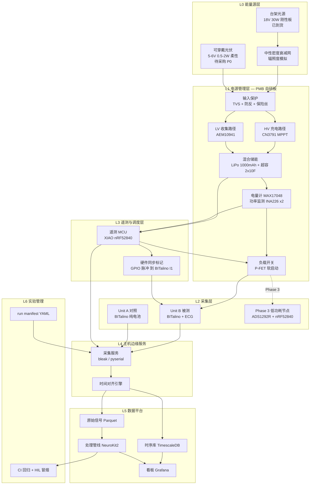
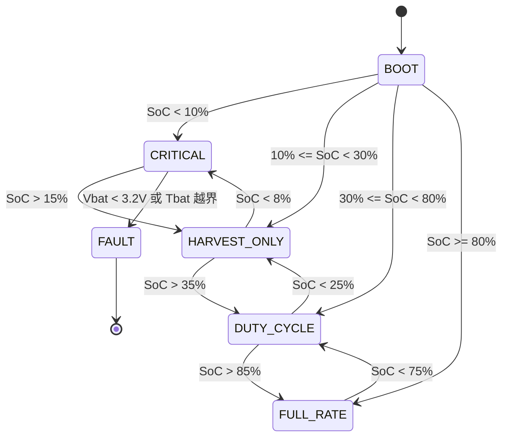

# 太阳能自供电可穿戴健康监测系统 — 生产级架构设计

> **版本** v1.0 · **日期** 2026-09-15
> **输入依据**：(a) 实物到货清单 `元件总揽.csv`；(b) 你转述的「LLM 阅读副院长邮件后的摘要」。
> **重要声明**：我没有看到邮件原文。下文凡是引用「邮件要求」的地方，依据的都是那份**二手摘要**。摘要里有几条与实物严重冲突，我会逐条标出，请你回去核对原文再定案（见 §13 问题清单）。

## 置信度标记约定

本文档全程使用以下标记，请按标记决定你要不要去查数据手册：

| 标记 | 含义 |
|---|---|
| ✅ | 高置信度，可直接据此行动 |
| ⚠️ | 我按经验给出，**动手前必须对照数据手册/实物核实** |
| ❓ | 我无法从清单确定，需要你现场辨识或提问 |
| 🚨 | 阻断性问题，不解决会损坏硬件或导致结论无效 |

---

# 0. 执行摘要（TL;DR）

## 0.1 三个必须先解决的阻断性问题

### 🚨 P0-1：到货的太阳能板无法接入 EVK10941，直连会烧毁

- 到货：`395mm × 460mm，18V，30W` 刚性板。Voc 约 21–22 V ⚠️，Vmp 18 V，Imp 约 1.67 A。
- EVK10941 的核心是 e-peas **AEM10941**，其 PV 输入（SRC）工作范围约 **50 mV – 5 V**，绝对最大额定约 5.5 V ⚠️。
- **18 V 是其上限的 3.6 倍。直连 = 芯片立即损毁。** 这不是"效率不高"，是"冒烟"。
- 同时：邮件摘要写的是「5–6 V、0.5–2 W 柔性板」，到货的是 18 V / 30 W 刚性板。**采购与需求对不上**，这是第一个要和副院长确认的事。

### 🚨 P0-2：这块板子在物理上不可能穿戴

395 × 460 mm ≈ 0.18 m²，约等于一张 **A2 纸**（比 A3 还大一圈）。它是台架/桌面用板，不是可穿戴器件。
**可穿戴用的柔性小板目前"零到货"**（之前清单里的 PowerFilm 没有出现在本次到货中）。

### 🚨 P0-3：BITalino 不是低功耗负载，连续采集永远不可能自供电

- BITalino 典型工作电流约 **65 mA @ 3.7 V ≈ 240 mW** ⚠️（需按你手上具体型号 BT/BLE 核实）。
- 邮件摘要里副院长要的是「BLE 通信、间歇测量的**低功耗**健康传感器」。BITalino 比这个目标高了约 **50 倍**。
- 详细能量收支见 §2。结论先放这里：
  - **连续采集 + 可穿戴尺寸光伏 → 自供电率约 7%，不可能。**
  - **占空比降到 ≈ 6.7%（每 10 分钟采 40 秒）→ 户外场景可以自供电。**
  - **换成真正的低功耗前端（ADS1292R/MAX86150 + nRF52840，约 5 mW）→ 自供电裕量 3 倍以上，这才是"生产级"的答案。**

## 0.2 架构一句话总结

> 用 **BITalino 做金标准参考仪器**（你有 2 块，正好一块做对照、一块做被测），
> 用**自研电源夹层板（PMB）**做真正的能量链，
> 最终负载演进为**自研低功耗 BLE 节点**；
> 全程由**独立遥测链路 + 数据平台**记录能量与信号质量，用数据证明"自供电"这句话到底成立到什么程度。

## 0.3 今天就能做的 5 件事（不需要买任何东西）

1. **别把太阳能板接到 EVK10941 上。** 先在两条线上贴标签：`18V — DO NOT CONNECT TO AEM`。
2. 用万用表测 18 V 板的 Voc（无遮挡、室外）和 Isc（万用表拨到 **10 A 挡，插 10 A 孔**），记录当时天气/时刻。这是后面所有辐照度标定的基准。
3. 拆开 HeartBIT 套件，按 §1.4 的核验表逐项打勾，把两块 BITalino 的**丝印型号完整拍照**。
4. 按 §1.5 的三分钟流程，用万用表判定 `YJL3404A` 到底是 MOSFET 还是 LDO。
5. 把 §13 的问题清单整理成一封邮件草稿（先别发，等看完 §1）。

---

# 1. 到货清单核验与差异分析

## 1.1 CSV 逐项解读

CSV 的 `PIN` 列我理解为**引出线/引脚数**（太阳能板 2、电池 2、YJL3404A 3），不是物料编号。⚠️ 如果不是这个意思请纠正我，这会影响 §1.5 的判定。

| # | 物料 | 数量 | 在架构中的角色 | 状态 |
|---|---|---|---|---|
| 1 | 数显恒温焊台 | 1 | 装配工具 | ✅ 够用（但见 §5.4 关于 QFN 的说明） |
| 2 | 395×460mm 18V 30W 太阳能板 | 1 | **仅台架光源 / I-V 特性标定** | 🚨 不可穿戴、不可接 AEM |
| 3 | 掌上型万用表 | 1 | 基础测量 | ✅ |
| 4 | 迷你型热电偶测温仪 | 1 | 热安全测试读数 | ✅ |
| 5 | EVK10941 | 1 | 低压光伏收集器评估板（AEM10941） | ⚠️ 需配 5 V 以下柔性板才能用 |
| 6 | 杜邦线 | ∞ | 台架接线 | ✅ 仅限台架，禁止上身（见 §11） |
| 7 | PH2.0 直针带线 | 50 | 电池/负载连接 | ✅ |
| 8 | 导热硅脂 | 1 | 热电偶贴附 / 热界面 | ✅ |
| 9 | 剥线钳 | 1 | 装配工具 | ✅ |
| 10 | 523450 1000mAh 3.7V 锂电池组 | 1 | 主储能 | ⚠️ 只有 1 块，做双机对照不够（见 §7） |
| 11 | YJL3404A | 1 | ❓ 未识别 | ❓ 见 §1.5 现场辨识流程 |
| 12 | 焊锡线 | 1 | 装配 | ⚠️ 需确认有铅/无铅（影响烙铁温度） |
| 13 | PH2.0 连接线（直针） | ∞ | 同 #7 | ✅ |
| 14 | 绝缘套管/热缩管 | ∞ | 电池焊点绝缘（强制） | ✅ |
| 15 | **BITalino** | **2** | 采集平台 / 金标准参考 | ❓ 型号未知，见 §1.4 |
| 16 | 多功能USB检测仪 | 1 | USB 充电能量计量 | ✅ 但只能测 USB 线路，测不了 PV/电池节点 |
| 17 | 面包板 | 1 | 台架快速验证 | ⚠️ 禁止用于 >1 A 的充电回路（接触电阻发热） |
| 18 | 板材钳 | 3 | ❓ 推测为 PCB 夹具/助焊夹 | ❓ |
| 19 | 2.7V 10F 电容 | 3 | 超级电容，脉冲缓冲 / 冷启动储能 | ✅ 见 §5.6 的串联与浪涌警告 |
| 20 | K型表面测温热电偶 | 2 | 面板背温 + 皮肤侧温 | ✅ 正好两路，对应热安全双点测量 |
| 21 | TEUCER HP600 | 1 | ⚠️ 推测为热界面材料（导热膏） | ⚠️ 需核实是否为 TIM |
| 22 | 一次性心电电极 | 1（包） | 耗材 | ⚠️ 严重不足，见 §7 |
| 23 | **BITalino HeartBIT 套件** | 1 套 | 心电采集整套 | ❓ 见 §1.4 专项 |

## 1.2 邮件摘要 vs 实物：差异矩阵

| 邮件摘要中的要求 | 实际到货 | 差异性质 | 处置 |
|---|---|---|---|
| 小型柔性面板，5–6 V、0.5–2 W | 18 V / 30 W 刚性，A2 大小 | 🚨 **完全不匹配** | 台架用现板；可穿戴板必须另购（§7 P0） |
| 充电控制器，可用 MPPT | EVK10941（AEM10941，输入 ≤5 V） | 🚨 **与现有面板电气不兼容** | 双路径设计（§5.2）：HV 路走 CN3791，LV 路走 AEM |
| 3.7 V Li-Po 储能 | 523450 1000mAh ✅ | ✅ 匹配，但只有 1 块 | 补购 2 块（§7 P1） |
| 稳压器输出 3.3 V / 5 V | `YJL3404A` ❓ | ❓ 器件未识别 | 现场辨识（§1.5），架构不依赖它 |
| 负载：BLE、间歇测量、**低功耗**健康传感器 | BITalino（约 240 mW） | 🚨 **高 50 倍，定位冲突** | BITalino 降级为参考仪器；生产负载自研（§3、§4） |
| 之前清单：PowerFilm 柔性板 | ❌ 未到货 | 缺件 | 见 §7 P0 |
| 之前清单：热电发电器件（TEG） | ❌ 未到货（只有测温热电偶） | 缺件 | 热电对照实验**当前无法开展**，见 §1.3 |
| 之前清单：超级电容 | ✅ 2.7V 10F ×3 | ✅ | 用于脉冲缓冲（§5.6） |

## 1.3 关于"热电对照实验"的明确结论

邮件摘要说 9 月 7 日的邮件「没有明确取消或要求继续热电对照实验」。从实物看：

- 到货的是 **K 型表面测温热电偶 ×2 + 热电偶测温仪 + 导热硅脂 + TEUCER HP600**。
- 这些全都是**测温**和**导热**器件，**不是发电器件**。
- **温差发电模块（TEG，如 TEC1-12706 反用 / Marlow / Micropelt）一个都没有到。**

所以：

> **热电发电对照实验在当前物料下无法开展。**
> 但这批热学器件有一个更重要、且是"生产级"必需的用途：**热安全验证**。
> 太阳能板贴在身上会发热，皮肤侧接触温度必须受限（IEC 60601-1 对长时间皮肤接触的非加热应用部分给出约 41–43 °C 的上限，具体档位取决于材料与接触时长 ⚠️ 需查表 23/24 核实）。
> 两支热电偶正好做**面板背面温度 + 皮肤侧界面温度**的双点同步测量。这条我已经写进 §10 的验证方案（TC-07）。

如果副院长确实还要热电对照，需要补购 TEG 模块 + 散热片（§7 P2）。

## 1.4 【专项】BITalino ×2 与 HeartBIT 套件的核验

这是你特别点名要确认的一项，我把它拆成三个独立问题。

### 问题 A：到底有几块板？是不是重复计数？

CSV 里 `BITalino = 2`（第 16 行）和 `BITalino生物信号采集系统 HeartBIT = 特殊（一整套系统）`（第 24 行）是**两个独立条目**。存在两种可能：

| 情形 | 含义 | 对架构的影响 |
|---|---|---|
| **情形 1**：2 块独立板 **+** HeartBIT 套件内另含 1 块 = 共 3 块 | 最理想 | 可做 DUT / 对照 / 备份 三机 |
| **情形 2**：`BITalino=2` 就是在数套件里的板子，或套件与散板共用 = 共 2 块 | 较可能 | 双机对照仍可做，无备份 |

**必须现场确认**，方法：把所有 BITalino 主板摊开数，并拍下**每块板的完整丝印**（型号 + 版本 + 蓝牙模块型号）。

### 问题 B：是 BT（蓝牙经典）还是 BLE？——这一条决定整个功耗架构

这是**比"有几块板"更关键**的问题。⚠️

| 版本 | 通信 | 典型功耗 | 主机侧软件栈 | 对自供电的影响 |
|---|---|---|---|---|
| BITalino (r)evolution **BT** | 蓝牙经典 SPP | 约 65 mA ⚠️ | `pyserial` / 虚拟串口 | 几乎不可能自供电；重连慢（秒级），不适合频繁功率循环 |
| BITalino (r)evolution **BLE** | BLE | 显著更低 ⚠️（需实测） | `bleak` / GATT | 占空比方案可行性大幅提升；重连快 |

**行动**：拿 USB 检测仪 + 万用表实测两块板在 1000 Hz 连续采集时的电流（方法见 §10 TC-01）。**不要相信我的估计值，也不要只相信官方标称——实测。** 这个数字是后面所有能量预算的地基。

### 问题 C：HeartBIT 套件里到底有什么？

HeartBIT 是 PLUX 面向心电/心脏信号的成套产品。⚠️ **以下是典型构成，务必对着你的装箱单逐项打勾，不要照抄我的表。**

```
□ BITalino (r)evolution 主板（Core 或整板）    型号：____________  版本：______
□ 通信方式                                     □ BT(经典)   □ BLE
□ ECG 传感器模块                               □ 板载集成   □ 独立模块
□ 加速度计 ACC                                 □ 有  □ 无
□ 3.7V 锂电池（套件自带）                      容量：________ mAh
□ 三导联心电线缆（snap 电极线）                根数：______
□ 一次性心电电极（套件自带）                    片数：______
□ micro-USB / mini-USB 线                      □ 有  □ 无
□ 外壳 / 绑带 / 收纳盒                          □ 有  □ 无
□ 软件授权（OpenSignals）                      □ 有  □ 无
```

### 结论：两块板正好构成理想的实验设计 ✅

不管最终是 2 块还是 3 块，**你至少有 2 块**，这在实验设计上是个礼物，不是问题：

```
        ┌─────────────────────────────┐
        │  同一受试者，同一时刻       │
        │  同一导联配置（或镜像导联） │
        └──────────┬──────────────────┘
                   │
      ┌────────────┴────────────┐
      │                         │
┌─────▼──────────┐      ┌───────▼─────────┐
│  Unit A (对照) │      │  Unit B (被测)  │
│  纯电池供电    │      │  PMB 太阳能供电 │
│  不接收集器    │      │  收集器工作中   │
│  = 金标准      │      │  = 待验证       │
└────────────────┘      └─────────────────┘
      │                         │
      └──────────┬──────────────┘
                 ▼
     信号质量差分分析：SNR / 基线漂移 /
     0.5–40Hz 噪声底 / R 峰检出一致性
```

**这个双机对照正是整个项目最有发表价值的部分**：它能定量回答"加了太阳能收集器之后，心电信号质量到底退化了多少"。升压变换器的开关噪声耦合进 ECG 通带是真实且被低估的风险（§5.7 专门讲怎么治）。没有对照组，这个问题根本没法回答。

## 1.5 未识别器件的现场辨识流程

### `YJL3404A`（3 引脚，1 个）❓

我不能确定它是什么。最可能的两种：**SOT-23 封装 N 沟道 MOSFET（AO3404 家族的国产型号）** 或 **三端 LDO 稳压器**。用万用表 3 分钟就能判定：

```
步骤 1：万用表拨到「二极管档」，把三个引脚两两正反测（共 6 次），记录读数。

  → 若存在某一对引脚：一个方向约 0.4–0.7 V，反方向 OL（开路），
    且其余组合均为 OL
    ⇒ 极可能是 MOSFET（测到的是体二极管：S→D 导通，D→S 截止）
    ⇒ 引脚定义按 SOT-23 常规：1=G(栅) 2=S(源) 3=D(漏)
    ⇒ 用途：本架构中作【高边/低边负载开关】，见 §5.5

  → 若三对之间读数杂乱、存在多个 0.5V 左右压降、或有接近 0 的通路
    ⇒ 可能是 LDO，走步骤 2

步骤 2（仅当怀疑是 LDO）：面包板搭最小电路
  IN ← 5.0V（用 USB + USB检测仪供电）
  GND ← 地
  OUT → 接 10 kΩ 到地，万用表测 OUT 对地电压
  加 1 µF 输入电容 + 1 µF 输出电容（没有就先不加，读数可能不稳）
  → 读到稳定的 3.3 V / 5.0 V / 1.8 V ⇒ 是 LDO，记下输出电压
  → 读到 0 V 或等于输入 ⇒ 引脚定义猜错，换一种 IN/GND/OUT 组合重试（共 6 种）

⚠️ 安全：整个过程限流 100 mA 以内；LDO 若引脚接反会立即发烫，
   一摸到烫手马上断电。
```

**无论结果如何，本架构不依赖这个器件。** 它只有 1 个，不具备可复现的工程价值（生产级设计不能建立在"库存里有一颗不知道是什么的东西"之上）。辨识出来之后：是 MOSFET 就当负载开关的原型验证件；是 LDO 就留作台架辅助。正式 BOM 见 §7。

### `TEUCER HP600` ⚠️

推测为英国 TEUCER 的**热界面材料（导热膏/散热膏）**。核实方法：看包装标注的导热系数（W/mK）。
- 若是 TIM（约 0.9–3 W/mK）：用于热电偶贴附和面板背面散热耦合。
- 若是别的（如灌封胶、导热垫）：用途不同，告诉我我再调整 §10 的热测试方案。

### `板材钳 ×3` ❓

推测是 **PCB 夹具 / 助焊夹（第三只手）**。如果是，很好，§6 的焊接 SOP 会用到。如果是别的（如剪板钳），请告诉我。

---

# 2. 能量收支模型（先算账，再画架构）

**这一节是整个文档的地基。** 所有"能不能自供电"的争论，在这里用数字终结。

## 2.1 负载模型

⚠️ 下表的 BITalino 数值来自经验估计，**必须用 §10 TC-01 实测替换**。我把公式写成参数化的，你实测后直接代入即可。

| 状态 | 电流 @3.7V | 功率 | 备注 |
|---|---|---|---|
| BITalino BT，1000 Hz 连续采集 | 约 65 mA ⚠️ | **约 240 mW** | 本文所有计算的基线 |
| BITalino BLE，1000 Hz 连续采集 | 待实测 ❓ | ? | 可能显著更低 |
| BITalino 上电但空闲（未连接） | 待实测 ❓ | ? | 通常并不低多少 |
| PMB 负载开关断开时的系统静态 | 约 30–60 µA ⚠️ | 约 150 µW | AEM 静态 + 电量计 + MCU 睡眠 |
| 遥测 MCU（nRF52840，1 Hz 采样 + BLE 广播） | 平均约 0.5 mA ⚠️ | 约 1.9 mW | |
| **对比：真·低功耗前端**（ADS1292R + nRF52840） | 平均约 1.4 mA ⚠️ | **约 5 mW** | §4 Phase 3 的目标负载 |

**记住这个 50 倍的差距：240 mW vs 5 mW。它决定了整个项目的走向。**

## 2.2 收集模型

### 可穿戴尺寸光伏的现实产出

假设一块**现实可穿戴**的柔性板：`100 × 60 mm = 60 cm² = 0.006 m²`，单晶柔性，标准效率 18%。

| 场景 | 有效辐照度 | 瞬时功率 | 每日时长 | 每日能量 |
|---|---|---|---|---|
| 室外直射（理想、正对太阳） | 1000 W/m² | 1.08 W | — | 参考值 |
| **室外穿戴实际**（身体遮挡、朝向随机、衣物、云） | 约 250 W/m² ⚠️ | 约 270 mW | 2 h | **0.54 Wh** |
| 室内办公照明 500 lux（约 1.5 W/m²，室内效率降至约 8%） | 1.5 W/m² | 约 0.72 mW | 8 h | **0.0058 Wh** |
| 夜间 | 0 | 0 | 14 h | 0 |

**收集链效率**：收集器转换约 80% ⚠️ × 电池充放电往返约 90% ⚠️ = **约 0.72**

```
每日可用能量 H = (0.54 + 0.0058) Wh × 0.72 ≈ 0.39 Wh/day
平均可用功率 P_avail = 0.39 Wh ÷ 24 h ≈ 16.3 mW
```

> **关键洞察：室内照明的贡献是 5.8 mWh/day，占总量的 1.5%。**
> 室内光伏在这个尺度下**基本等于零**。任何"办公室里自动充电"的叙事都站不住脚。
> 这一点恰好印证了邮件摘要里副院长的谨慎表述：「太阳能可以延长续航，但不能预先保证小型面板让设备完全摆脱外部充电」。**她是对的，而且比摘要里说的还要严峻。**

## 2.3 自供电可行性：解占空比方程

设占空比 D（采集时间占比），则：

```
P_avg = D × (P_BITalino + P_MCU) + (1 − D) × P_standby
      = D × 242 mW + (1 − D) × 0.2 mW

令 P_avg = P_avail = 16.3 mW：
      16.3 = 241.8 D + 0.2
      D = 6.7%
```

### 结论表

| 工作模式 | 需求功率 | 可行性 | 说明 |
|---|---|---|---|
| **连续采集（BITalino）** | 242 mW | ❌ **EAR ≈ 6.7%** | 自供电率不足 7%。太阳能只能把续航从 15.4 h 延长到约 16.5 h，延长约 7% |
| **占空比 6.7%**（每 10 min 采 40 s） | 16.3 mW | ✅ **EAR ≈ 1.0** | 户外 2h/天场景下刚好收支平衡 |
| **占空比 3%**（每 10 min 采 18 s） | 7.5 mW | ✅ **EAR ≈ 2.2** | 有 2 倍裕量，能扛阴天 |
| **低功耗前端连续采集** | 5 mW | ✅ **EAR ≈ 3.3** | **真正的"self-powered wearable"** |

### 反向验算：连续跑 BITalino 需要多大的板？

```
需求 242 mW × 24 h = 5.81 Wh/day
按 60 cm² 产出 0.39 Wh/day 线性外推：
需要面积 = 60 × (5.81 / 0.39) ≈ 894 cm² ≈ 0.09 m²
≈ 三张 A4 纸铺满，且必须全天朝向良好
```

**不可穿戴。这就是为什么必须换负载，而不是换更大的板。**

## 2.4 定义两个核心 KPI（写进论文/报告的指标）

本项目从此用这两个量化指标说话，不再用"能/不能自供电"这种二值表述：

| 指标 | 定义 | 目标值 |
|---|---|---|
| **EAR**（Energy Autonomy Ratio，能量自主率） | 24 h 窗口内 收集能量 ÷ 消耗能量 | Phase 2 ≥ 1.0（户外场景）；Phase 3 ≥ 2.0 |
| **RES**（Runtime Extension by Solar，太阳能续航增益） | (有收集器续航 − 无收集器续航) ÷ 无收集器续航 | 全场景实测报告，不设硬指标 |

辅助指标：`MTBC`（Mean Time Between Charges，平均外部充电间隔）、`SQI_delta`（收集器开/关状态下的 ECG 信噪比差值，见 §10 TC-05）。

---

# 3. 系统架构（分层）

## 3.1 全景图



## 3.2 分层职责与边界

| 层 | 职责 | 关键设计约束 | 什么时候**不要**造这一层 |
|---|---|---|---|
| **L0 能量源** | 提供并**可复现地调制**光能 | 辐照度必须可测、可复现，否则所有结论无效 | 永远需要 |
| **L1 电源管理（PMB）** | MPPT、充电、储能、保护、负载开关 | 必须**不污染** ECG 通带；必须自带计量 | 若只做 Phase 1 台架，可用模块拼，但仍需计量 |
| **L2 采集** | 生物信号获取 | Unit A 必须与 Unit B 电气完全隔离 | — |
| **L3 遥测与调度** | 独立于负载记录能量，并控制占空比 | **必须独立**，不能寄生在 BITalino 上 | 若放弃占空比方案则可简化为纯记录 |
| **L4 边缘服务** | 多源采集、时间对齐、落盘 | 时间对齐误差必须 <10 ms 且可证明 | 单源单次实验可以省，但你要做长期研究就不能省 |
| **L5 数据平台** | 存储、处理、可视化 | 原始数据不可变；处理可重跑 | 少于 10 次实验时可以先用文件 + notebook |
| **L6 实验管理** | 可复现性 | 每次 run 必须能追溯到硬件配置哈希 | **永远不要省**，这是学术工作的生命线 |

## 3.3 关键架构决策（ADR 摘要）

### ADR-001：电池归 PMB 所有，BITalino 当成"纯负载"

**决策**：不使用 BITalino 自带的 USB 充电通路；PMB 拥有电池，通过 JST-PH 把"电池等效输出"送给 BITalino。

**理由**：
1. BITalino 的充电电路是黑盒，无法插桩测量，也无法做 MPPT。
2. AEM10941 的 HVOUT 电流上限约 80 mA ⚠️，而 BITalino 要 65 mA — 余量只有 23%，一旦有瞬态就跌落。**所以绝不能让 BITalino 挂在 AEM 的 LDO 输出上**，必须直接挂电池节点，让电池扛瞬态。
3. 把充电和计量的所有权收归自研板，才谈得上"生产级"。

**代价**：必须自己实现完整的充电保护和过放保护（见 §5.5、§11）。

### ADR-002：双充电路径，而不是"想办法把 18V 降下来喂给 AEM"

**决策**：PMB 上并存两条互斥路径，用 0 Ω 电阻/跳线选择。

- **路径 A（HV）**：18 V 板 → `CN3791`（MPPT 单节锂电充电器，输入耐压约 28 V ⚠️，SOP-8 可手焊）→ 电池
- **路径 B（LV）**：5–6 V 柔性板 → `AEM10941`（EVK 或自研）→ 电池

**理由**：在 18 V 前面加一级 Buck 降到 3 V 再喂 AEM，会让 AEM 的 MPPT 失去意义（它测的是 Buck 的输出特性，不是电池板的 I-V 曲线），实验结论会是错的。两条独立路径反而更简单、更诚实。

### ADR-003：BITalino 的角色从"最终产品"降级为"参考仪器"

**决策**：Phase 1/2 用 BITalino 验证能量链；Phase 3 的生产负载是自研低功耗节点，BITalino 转为金标准对照。

**理由**：§2.3 的数学。240 mW 的负载与"self-powered wearable"在物理上不相容。
**这是本架构最重要的一条，也是最需要副院长点头的一条**（§13 Q3）。

### ADR-004：能量链与测量链在时间上分离（Time-Division Harvesting）

**决策**：默认策略是**采集时不充电，充电时不采集**，由遥测 MCU 调度。

**理由**：升压变换器在 PFM/突发模式下，其突发重复频率会落在 Hz–kHz 量级，正好穿过 ECG 通带（0.05–40 Hz），且会在电极-皮肤界面阻抗上被解调成基带噪声。时分复用是最彻底的解法（滤波是第二道防线，见 §5.7）。

**代价**：牺牲了"边采边充"，需要在 §10 TC-05 中量化这个策略到底值不值。

### ADR-005：硬件级时间同步，而不是软件时间戳

**决策**：遥测 MCU 用一路 GPIO 向 BITalino 的数字输入 I1 打同步脉冲，脉冲同时被 MCU 自己的时间戳记录。

**理由**：BITalino 和遥测 MCU 是两条独立的 BLE 链路，主机侧时间戳受蓝牙缓冲抖动影响可达数十到数百毫秒。要把"这一刻的光照/充电状态"和"这一刻的心电波形"对上，必须有嵌在数据流里的硬件标记。
**这是几乎所有同类项目都做错的地方，做对了它本身就是方法学贡献。**

---

# 4. 演进路线：四个 Phase

```
Phase 0 ──► Phase 1 ──► Phase 2 ──► Phase 3
台架搭建    能量链验证    上身原型     生产级节点
(第1-2周)   (第3-5周)    (第6-10周)   (第11-18周)
```

## Phase 0：台架搭建与器件辨识（第 1–2 周）

**只用已到货物料 + 少量采购，不焊 PCB。**

- 辨识 `YJL3404A`、核验 HeartBIT 套件、数清 BITalino 板数与型号
- 实测 BITalino 功耗（TC-01）、18 V 板 I-V 曲线（TC-02）
- 搭建辐照度参考（参考电池片或照度计）
- 建立 Git 仓库与 run manifest 规范（L6 先行，别等硬件）

**出口标准**：`docs/inventory-verified.md` 中每一项都有实测数字或照片，不再有 ❓。

## Phase 1：能量链验证（第 3–5 周，面包板/洞洞板）

**目标：证明"光 → 电 → 电池 → 负载"这条链在台架上闭合，并且每个节点都可计量。**

```
18V 30W 板 ──[中性密度网]──► [保险丝+TVS+防反] ──► CN3791 MPPT 模块
                                                          │
                                        INA226 #1 (PV侧计量)
                                                          ▼
                                                   523450 LiPo 1000mAh
                                                     + NTC 温度监测
                                                          │
                                       INA226 #2 (负载侧) + MAX17048 电量计
                                                          ▼
                                                   P-FET 负载开关
                                                          ▼
                                              JST-PH ──► BITalino Unit B
```

> ⚠️ **面包板只用于信号和小电流部分。充电回路（可达 0.5 A）必须用焊接的洞洞板或直接飞线，面包板的接触电阻会发热且读数不可信。**

**出口标准**：连续 72 h 无人值守运行，遥测数据完整率 >99%，得到第一条真实的 EAR 曲线。

## Phase 2：上身可穿戴原型（第 6–10 周，PMB Rev A）

- 柔性光伏板到货，切换到 LV 路径（AEM10941）
- PMB Rev A 打样（见 §5.3）
- 引入占空比调度（§8.2 的状态机）
- 双机对照实验正式开跑（Unit A vs Unit B）
- 热安全验证（TC-07）

**出口标准**：户外场景 EAR ≥ 1.0 且 ECG 信号质量退化在可接受范围（TC-05 判据）。

## Phase 3：生产级低功耗节点（第 11–18 周，PMB Rev B）

- 自研 ECG 节点：`ADS1292R`（2 通道 ECG + 呼吸阻抗）或 `MAX86150`（PPG+ECG 一体）+ `nRF52840`
- PMB Rev B：正式 PCB + PCBA，集成收集器 + 节点 + 储能
- BITalino 转为金标准，做 Bland-Altman 一致性分析（HR、HRV 指标）
- 长期佩戴研究

**出口标准**：EAR ≥ 2.0；与 BITalino 的 HR 一致性 LoA 在临床可接受区间；可提交论文/演示。

---

# 5. 硬件详细设计

## 5.1 Phase 1 台架接线（现有物料 + 少量采购即可搭）

### 5.1.1 光伏输入段

```
太阳能板 (+) ──┬── F1 保险丝 2A 慢断 ──┬── D1 SS34 防反 ──┬──► CN3791 VIN
               │                        │                  │
              TVS1                     C1                  C2
            SMAJ24A                 100µF/35V            100nF
               │                        │                  │
太阳能板 (−) ──┴────────────────────────┴──────────────────┴──► GND
```

**选型说明**：
- `F1`：18 V 板 Isc 约 1.8 A，取 2 A 慢断保险丝。
- `TVS1`：`SMAJ24A`（击穿约 26.7 V，高于 Voc 22 V，低于 CN3791 的 28 V 耐压）。⚠️ 实测 Voc 后再定档位：**TVS 击穿电压必须 > 实测 Voc × 1.1**，否则晴天就会一直导通发热。
- `D1`：`SS34`（40 V / 3 A 肖特基），压降约 0.4 V @ 1 A。在 18 V 上损失 2%，可接受。
  ⚠️ **但在 Phase 2 的 5 V 柔性板路径上，0.4 V 就是 8% 的损失，必须换成理想二极管（`LM66100`，压降约 10 mV）。**
- `C1`：100 µF 低 ESR 电解，就近放在 CN3791 输入端。

### 5.1.2 充电段（HV 路径）

`CN3791` MPPT 单节锂电充电控制器 ⚠️ 关键参数需查手册确认：

| 参数 | 设置方法 | 本项目取值 |
|---|---|---|
| MPPT 电压点 | VIN 到 MPPT 引脚的电阻分压 | 设为约 0.76 × Voc ≈ 16.5 V ⚠️ |
| 充电电流 | CS 引脚采样电阻 Rcs | **0.5 A（0.5C）** |
| 终止电压 | 芯片固定 4.2 V | 4.2 V |

> 🚨 **严重不匹配警告**：18 V × 1.67 A = 30 W 输入，按 90% 效率可向 3.9 V 电池灌 **6.9 A**。而 1000 mAh 电芯的 1C 就是 1 A，安全充电率应取 0.5C = **0.5 A**。
> **这块板子的能力只有约 6% 被用到。** 如果不设 Rcs 限流就接上去，会把电池充爆。
>
> 所以这块 30 W 板在本项目中的真实定位是：
> 1. **"永不缺光"的稳定台架源** — 即使阴天、即使遮挡一半，它也能喂饱 0.5 A 充电；
> 2. **I-V 特性标定与教学样本**；
> 3. **辐照度模拟的载体**（配中性密度网，见下）。
> 它**不是**、也永远不会是可穿戴方案的一部分。

### 5.1.3 辐照度模拟：正确做法与错误做法

要在台架上模拟"可穿戴小板在弱光下的表现"，必须**均匀衰减整块板**：

```
✅ 正确：整板覆盖中性密度网（窗纱/ND 滤光片），叠加层数控制衰减倍率
         → 电流按比例下降，电压仅对数缓降，I-V 曲线形状保持
         → 用参考电池片同步测量实际到达面板的辐照度

❌ 错误：用纸板遮住面板的一部分
         → 串联电池串中被遮的单体成为限流元件，整串电流塌陷
         → I-V 曲线出现多峰，MPPT 会锁在错误的峰上
         → 🚨 更危险：被遮电池会被其余电池反向偏置，形成【热斑】，
            局部温度可超 100 °C，会永久损坏面板甚至引燃
```

**这一条务必写进实验室操作规程。** 局部遮挡实验只能在明确的热斑研究场景下、且有旁路二极管和红外监测时进行。

## 5.2 PMB（Power Mezzanine Board）功能块划分

PMB 是本项目唯一需要自研的电路板。功能块：

```
┌────────────────────────────────────────────────────────────────────┐
│                      PMB — Power Mezzanine Board                   │
│                                                                    │
│  ┌─────────┐   ┌──────────────┐                                    │
│  │ J1 PV在 │──►│ 输入保护      │──┬──► [路径A] U1 CN3791 MPPT ──┐   │
│  │ 端子/XT30│   │ F1/TVS/D1/C1 │  │                              │   │
│  └─────────┘   └──────────────┘  └──► [路径B] U2 AEM10941 ────┬─┤   │
│                       │                                        │ │   │
│                  RS1 0.1Ω ──► U4 INA226 #1 (PV 计量)          │ │   │
│                                                                ▼ ▼   │
│  ┌──────────────────────────────────────────────────────── BAT 节点 │
│  │                                                                  │
│  │  ┌───────────┐  ┌──────────────────┐  ┌──────────────────┐      │
│  │  │ J2 JST-PH │  │ 超容缓冲          │  │ U3 MAX17048      │      │
│  │  │ LiPo 1000 │  │ 2× 2.7V10F 串联   │  │ 电量计 I²C       │      │
│  │  │ + J3 NTC  │  │ + 均压 + 软启动   │  │                  │      │
│  │  └───────────┘  └──────────────────┘  └──────────────────┘      │
│  └───┬──────────────────────────────────────────────────────────────┤
│      │                                                              │
│      ▼  RS2 0.05Ω ──► U5 INA226 #2 (负载计量)                       │
│  ┌──────────────┐                                                   │
│  │ Q1 负载开关   │◄── GPIO (来自 U7)  + 硬件看门狗                   │
│  │ P-FET 软启动 │                                                   │
│  └──────┬───────┘                                                   │
│         ▼                                                           │
│  ┌──────────────┐   ┌────────────────┐   ┌──────────────────────┐  │
│  │ π 型滤波      │──►│ J4 JST-PH 出   │   │ J5 同步脉冲 → I1     │  │
│  │ 10µH+22µF×2  │   │ → BITalino 电池│   │ 1kΩ 串联 + 钳位      │  │
│  └──────────────┘   └────────────────┘   └──────────────────────┘  │
│                                                                    │
│  ┌──────────────────────────────────────────────────────────────┐ │
│  │ U7 遥测 MCU (XIAO nRF52840 模块贴装) — I²C 主机 + BLE + 调度  │ │
│  └──────────────────────────────────────────────────────────────┘ │
│                                                                    │
│  测试点：TP_PV+ TP_PV− TP_BAT TP_LOAD TP_GND×3 + 两组开尔文焊盘     │
└────────────────────────────────────────────────────────────────────┘
```

## 5.3 PMB Rev A（手工版 — 你自己焊）

**目标**：验证拓扑与固件，不追求尺寸。

**工艺选择**：**洞洞板（万能板）+ 模块化**，不打 PCB。理由：Rev A 的价值在于快速迭代，打板要等 5–7 天，改一根线要重打。

| 位号 | 用什么 | 形态 | 手焊难度 |
|---|---|---|---|
| 充电器 | **CN3791 MPPT 模块**（成品模块，带电位器） | 模块 | ★☆☆ 只焊排针 |
| 收集器 | **EVK10941**（已到货） | 评估板 | ★☆☆ 只接线 |
| 功率计量 | **INA226 模块 ×2**（GY-226 类） | 模块 | ★☆☆ |
| 电量计 | **MAX17048 或 CW2015 模块** | 模块 | ★☆☆ |
| 遥测 MCU | **Seeed XIAO nRF52840** | 邮票孔模块 | ★★☆ 邮票孔可用排针 |
| 负载开关 | **AO3401 P-MOS**（或辨识出的 YJL3404A） | SOT-23 | ★★★ 需转接板 |
| 保护件 | SS34 / SMAJ24A / 保险座 | 直插 | ★☆☆ |
| 超容 | 2.7V 10F ×2（已到货） | 直插 | ★☆☆ |

> 💡 **SOT-23 手焊技巧**：买 **SOT-23 转 DIP 转接板**（几毛钱一片），先在转接板上焊，再插洞洞板。用恒温焊台 340 °C + 细焊锡 + 助焊剂，先焊一个角固定再焊其余两脚。

**Rev A 尺寸预估**：约 90 × 70 mm 洞洞板。放桌上，不上身。

## 5.4 PMB Rev B（正式 PCB — 关键决策：不要全手焊）

### 🚨 工艺可行性的硬约束

你只有一把**恒温烙铁**（没有热风枪、没有回流炉、没有钢网）。这决定了：

| 封装 | 能否手焊 | 结论 |
|---|---|---|
| SOP-8（CN3791） | ✅ 可以 | OK |
| SOT-23（MOSFET） | ✅ 可以（配转接板或练手） | OK |
| VSSOP-10（INA226，0.5 mm 间距） | ⚠️ 勉强（需拖焊 + 大量助焊剂 + 吸锡带） | 风险高 |
| TDFN / WLP（MAX17048） | ❌ 底部焊盘，烙铁够不到 | **不可能** |
| **QFN-40 5×5（AEM10941）** | ❌ **绝对不可能** | **必须机贴** |

### 结论：Rev B 走 **PCBA 代工**（嘉立创/JLCPCB SMT）

```
┌──────────────────────────────────────────────────────────┐
│ 分工                                                      │
├──────────────────────────────────────────────────────────┤
│ 【工厂贴装】所有 SMD：AEM10941、CN3791、INA226×2、        │
│             MAX17048、MOSFET、全部 0402/0603 阻容、       │
│             电感、TVS、肖特基                             │
│                                                          │
│ 【你手焊】  仅通孔件：JST-PH 连接器 ×4、螺钉端子、        │
│             超级电容 ×2、排针、测试点                     │
│             ← 这正好是你那把烙铁擅长的事                  │
└──────────────────────────────────────────────────────────┘
```

**这样做还有一个隐性好处**：工厂贴装的一致性远高于手焊，你的 Unit A / Unit B 对照实验才有意义 —— 如果两块板是手焊的，信号差异可能来自焊接质量而不是太阳能收集器，整个对照就失效了。

### Rev B 打样参数（可直接填进下单页面）

| 项目 | 取值 | 理由 |
|---|---|---|
| 层数 | **4 层**（Sig / GND / PWR / Sig） | 完整地平面对 ECG 噪声抑制至关重要，多花的钱远低于调试成本 |
| 板厚 | 1.0 mm | 可穿戴减重；1.6 mm 也可 |
| 铜厚 | 1 oz | 最大 0.5 A，够 |
| 表面处理 | **ENIG（沉金）** | 不用 HASL：HASL 焊盘不平，细间距贴装良率低；且 ENIG 更耐腐蚀（贴身出汗） |
| 阻焊 | 蓝/黑均可 | — |
| 尺寸 | 约 **50 × 35 mm** | 目标可穿戴尺寸 |
| 打样数量 | **5 片裸板 + 3 片贴装** | 3 片 = DUT + 对照 + 备份 |
| 元件库 | 优先选 **JLCPCB 基础库** 器件 | 免上机费 |

⚠️ `AEM10941` 可能不在基础库中，需走**扩展库或自购件寄送**，会增加费用和周期。**下单前先在元件库搜索确认库存**，这条如果卡住，整个 Rev B 时间线要顺延。

## 5.5 关键子电路设计要点

### 5.5.1 负载开关（Q1）— 不能只是一个 MOS 管

```
        BAT ──────┬──────────────┐
                  │              │
                  │         ┌────┴────┐
                 R1         │   Q1    │  P-MOS (AO3401 或 YJL3404A)
                100kΩ       │  S   D  │
                  │         └──┬───┬──┘
        GPIO ──R2─┴─── G ──────┘   └──────► 负载出
              10kΩ    │
                     C1  ← 软启动电容 100nF
                      │      (与 R2 构成 RC，限制栅极上升斜率)
                     GND
```

**必须包含的三件事**（少一件就不是生产级）：

1. **软启动**：BITalino 上电瞬间的浪涌电流可达数百 mA。栅极 RC 把导通斜率拉长到约 1 ms，把浪涌压下去。没有它，每次开机电池电压都会塌陷，电量计读数全乱。
2. **默认关断**：`R1` 把栅极上拉到源极，MCU 复位/掉电时负载自动断开（fail-safe）。
3. **硬件看门狗**：MCU 跑飞时，看门狗必须能强制关断负载。否则一次固件 bug 就会在夜里把电池放干。⚠️ nRF52840 的内部 WDT 只能复位 MCU；如果复位后 GPIO 默认高阻，`R1` 会保证负载关断 — **务必在原理图评审时确认这条路径成立**。

### 5.5.2 过放保护 — 双重冗余

> 🚨 AEM10941 的过放保护只管它自己的 LDO 输出。**如果负载直接挂在电池节点（本架构的 ADR-001 就是这样），AEM 管不到它。**

三道防线，缺一不可：

| 层级 | 机制 | 阈值 | 说明 |
|---|---|---|---|
| 1 | 电池组自带 PCM 保护板 | 约 2.5 V ⚠️ | 最后一道，触发后需重新激活，属于异常 |
| 2 | PMB 负载开关（软件） | **3.4 V** | MCU 读 MAX17048，低于阈值关断负载 |
| 3 | PMB 硬件比较器（可选，Rev B 加） | 3.2 V | 软件失效时的兜底 |

⚠️ **先确认 523450 电池组是否真的带 PCM**：看电池顶部有没有一小块保护板，或用可调电源做过放测试（有风险，建议只看外观 + 查供应商规格）。**如果没有 PCM，第 2、3 层就是唯一防线，Rev A 就必须加硬件比较器。**

### 5.5.3 计量链（这是"生产级"与"作业级"的分水岭）

```
INA226 #1 @ PV 侧：Rshunt = 0.1 Ω
  量程：18V 路径最大 0.5A → 50 mV，在 INA226 的 81.92 mV 满量程内 ✅
  分辨率：2.5 µV LSB / 0.1Ω = 25 µA ✅ 足以测弱光下的微安级电流

INA226 #2 @ 负载侧：Rshunt = 0.05 Ω
  量程：最大 0.5A → 25 mV ✅
  分辨率：50 µA ✅

⚠️ 分流电阻必须用 1% 或更好的精度，且必须【开尔文四线连接】：
   电流走大铜皮，采样线从电阻焊盘正中引出，绝不能共用电流路径。
   这是初学者最常犯的错误，会引入 10-30% 的系统误差。
```

**为什么要两个 INA226 而不是一个？** 因为你要算 EAR，就必须**同时**知道"进来多少"和"出去多少"。只测一端，电池的自放电、超容漏电、PMB 自身静态功耗全都算不清，EAR 就是编的。

### 5.5.4 NTC 电池温度监测

10 kΩ B3950 NTC 贴在电芯表面（用导热硅脂 + Kapton 胶带固定），分压后进 MCU ADC。
**策略**：< 0 °C 或 > 45 °C **禁止充电**（锂电池在低温下充电会析锂，是安全事故的常见成因）。⚠️ 这条是强制的，CN3791 没有内置温度保护。

## 5.6 超级电容子系统（2.7V 10F ×3 的正确用法）

### 用法决策

| 方案 | 配置 | 可用能量 | 评价 |
|---|---|---|---|
| A | 单只 2.7 V 10F 挂在低压节点 | — | ❌ 2.7 V 撑不住 3.7 V 电池节点 |
| B | **2 只串联 = 5.4 V / 5 F，跨接在电池节点** | 4.2→3.4 V：**15.2 J** | ✅ **采用** |
| C | 3 只串联 = 8.1 V / 3.33 F | 更少可用能量 | ❌ 浪费 |

**方案 B 的三个作用**：
1. **脉冲缓冲**：蓝牙发射瞬间的电流尖峰由超容提供，减小电池内阻压降 → 电量计读数更稳、电池寿命更长。
2. **冷启动/深放电场景**：电池在低温或接近空电时内阻大，超容能顶住 BITalino 的开机浪涌。
3. **黎明场景**：电池保护跳闸后，超容存的能量足以让 MCU 醒来判断光照是否恢复。

### 🚨 两个必须处理的坑

**坑 1：浪涌。** 把一只放电的 5 F 电容直接并到 4.0 V 锂电上，瞬间电流 = 4.0 V ÷ (电池内阻 + 超容 ESR) ≈ **数十安培**。这会触发电池保护板、烧毁走线，甚至损坏电芯。

```
必须加预充电路：
        BAT ──┬── R_pre 100Ω ──┬── 超容组
              │                │
              └── Q2 (N-MOS) ──┘
        MCU 上电后延时 ~5s（5RC≈5×100×5=2500s ❌ 太慢）
        → 改用 R_pre = 10Ω：τ = 10×5 = 50s，5τ = 250s ≈ 4分钟
        → 或采用恒流预充（LM317 接成 100mA 恒流）：5F×0.8V/0.1A = 40s ✅ 推荐
        预充完成（压差 <50 mV）后 MCU 导通 Q2 旁路 R_pre
```

**坑 2：漏电流。** 超级电容的漏电流典型值 10–30 µA/只 ⚠️。串联两只 + 均压电阻：
- 漏电 30 µA × 4.0 V ≈ **120 µW**
- 均压电阻若取 100 kΩ：额外 40 µA × 4.0 V = **160 µW**
- 合计约 **280 µW**

对比 §2.2 的室内收集功率 **720 µW** —— **超容子系统会吃掉室内收集量的 39%！**

```
✅ 对策：
   1. 均压电阻改用 1 MΩ（漏电降到 4 µA，约 16 µW）
      ⚠️ 代价：均压速度慢（时间常数 5F×1MΩ = 58 天），
         但对"长期缓变"的应用可以接受；需在 Rev B 验证失衡是否超限
   2. 更好：用 MCU 控制的 N-MOS 把整个超容组在【长期低光照】时断开
      → 室内/夜间彻底切断这 280 µW 的损耗
   3. Rev B 可考虑主动均压（如 TL431 或专用均压 IC）
```

> **这个 280 µW 的分析正是"生产级"思维的体现**：在能量收集系统里，**每一个 µW 的寄生损耗都要被计入账本**。一个看起来"加上去总没坏处"的缓冲电容，在弱光场景下可能是净负贡献。

## 5.7 🚨 EMC：升压变换器噪声不能污染 ECG（本项目最大的技术风险）

### 风险机理

```
AEM10941 / CN3791 开关 ──► 数十~数百 kHz 开关噪声
         │
         ├─► 传导耦合：经电源线进入 BITalino 的模拟前端
         │
         ├─► 辐射耦合：开关回路（电感-开关管-二极管构成的高 di/dt 环路）
         │              向 ECG 导联线辐射
         │
         └─► 🚨 最隐蔽的一条：PFM/突发模式下，突发【重复频率】
             随输入功率变化，可低至 Hz–kHz 量级。
             这个包络在电极-皮肤界面的非线性阻抗上被解调，
             直接落进 ECG 通带 0.05–40 Hz —— 常规的高频滤波
             对它完全无效，且它会随光照变化而变化，
             看起来就像"生理信号"。
```

**这是最危险的失效模式**：它不会让系统崩溃，它会让你的数据**看起来是对的但其实是错的**。

### 五道防线

| # | 措施 | 位置 | 有效性 |
|---|---|---|---|
| 1 | **时分复用**（ADR-004）：采集时关闭充电 | 固件调度 | ★★★★★ 最彻底 |
| 2 | **π 型滤波**：10 µH + 22 µF × 2 在负载出口 | PMB | ★★★★☆ |
| 3 | **最小化开关回路面积**：电感、开关管、二极管、输入输出电容围成的环路尽可能小 | PCB 布局 | ★★★★☆ |
| 4 | **星型接地**：模拟地与功率地在电池负极单点汇合 | PCB 布局 | ★★★☆☆ |
| 5 | **物理隔离**：PV 线缆与 ECG 导联线不平行走线，间距 > 50 mm；PV 线缆加磁环 | 机械设计 | ★★★☆☆ |

### 必须做的验证（TC-05，见 §10）

用 **ECG 体模**（不是人）做对照，因为人体信号本身有变异性，掩盖不了也证明不了噪声：

```
ECG 体模电路（自己焊，成本 < 10 元）：
  信号源（手机音频输出 / 函数发生器，1 mV 幅度，1 Hz）
       │
      R1 1kΩ ──┬── 电极端 RA
               │
              R2 10Ω        ← 分压到 mV 量级
               │
               ├── 电极端 LA
              R3 1kΩ
               │
              GND ───────── 电极端 RL
  
  每个电极端串 51kΩ + 并 47nF，模拟电极-皮肤界面阻抗
```

**判据**：收集器 OFF 时的 0.5–40 Hz 噪声底 (µV_rms) vs ON 时。
**要求：ON 状态噪声底增量 < 10 µV_rms**（相对于典型 1 mV 的 R 波，即 SNR 劣化 < 0.1%）。⚠️ 这个阈值我是按工程经验给的，正式报告中应引用心电设备标准（如 IEC 60601-2-25 对噪声的要求）来定。

---

# 6. 焊接与装配作业指导书（SOP）

> 你问「中途需要自己做 PCB 板子或者焊接什么东西，全都告诉我」。这一节是完整答案：**每一处需要动烙铁的地方，按顺序列出**。

## 6.0 开工前的设置

### 烙铁温度（先确认焊锡类型）

```
看焊锡线包装标注：
  Sn63Pb37 / Sn60Pb40（有铅）→ 烙铁设 300–330 °C
  Sn99.3Cu0.7 / SAC305（无铅）→ 烙铁设 340–370 °C
  找不到标注？→ 从 340 °C 试起，锡不流就 +10 °C

大热容焊点（电池引线、粗线、接地铜皮）：临时 +20 °C，或换刀头（T12-D24/K）
细间距 SMD：用 T12-BC2 马蹄头 + 大量助焊剂拖焊
```

### 通用规则

- 每个焊点**在 3 秒内完成**。超过 5 秒就停手、降温、换更大的烙铁头（不是加时间）。
- 焊完**目视检查**：应是光亮内凹的锥形。**球状、灰暗、麻面 = 冷焊，必须返工。**
- 每个焊点焊完用万用表**通断档验证**，并测**相邻焊点之间是否短路**。
- 助焊剂残留用异丙醇（IPA）+ 毛刷清洗（尤其是贴身器件，残留会吸潮腐蚀）。

---

## 6.1 【任务 S-1】太阳能板引出线端接 — 🚨 有电，先遮光

> **安全**：太阳能板在光照下**永远带电，没有开关**。开工前用不透光的布/纸板**完整盖住面板**，或搬到暗房。

| 步骤 | 操作 | 验证 |
|---|---|---|
| 1 | 遮光。万用表测 Voc 应 < 1 V | 读数确认 |
| 2 | 识别并**用记号笔标注正负极**（通常红=+，黑=−；不确定就短暂揭开遮光测一次） | 拍照存档 |
| 3 | 剥线 8 mm（剥线钳选对线径槽口） | 无铜芯断股 |
| 4 | 给线头**镀锡**（预上锡，3 秒内） | 锡层均匀 |
| 5 | 焊接到 **XT30 公头** 或 2.54/5.08 螺钉端子 | — |
| 6 | **先套热缩管再焊！**（最常见的返工原因就是忘了先套） | — |
| 7 | 热风/热缩枪 120–150 °C 收缩热缩管 | 完全包覆，无裸铜 |
| 8 | 万用表通断档测**正负极之间不通** | 必须 OL |
| 9 | 贴标签：`18V 30W — DO NOT CONNECT TO AEM10941` | — |

**耗时**：约 20 分钟。**难度**：★☆☆

---

## 6.2 【任务 S-2】锂电池引线端接 — 🚨 最危险的一步

> 🚨 **绝对禁止**：不要在电芯本体/极耳上直接焊接。523450 电池组出厂应已带引出线，你只需要在**引出线的末端**做端接。
> 如果它没有引出线只有裸极耳 —— **停手，联系我或找有点焊机的人**。锂电极耳必须用**点焊**，烙铁的热量会损坏隔膜导致内短路。

```
操作顺序（必须严格按此顺序，一次只处理一根线）：

  ┌─────────────────────────────────────────────────┐
  │ 1. 先在两根引线上分别套好热缩管（推到远端）      │
  │                                                 │
  │ 2. 只剥【红线(+)】5mm，立即焊上 PH2.0 端子       │
  │    ← 此时黑线仍然完整绝缘，不可能短路            │
  │                                                 │
  │ 3. 把热缩管推上去，收缩，确认红线焊点完全包覆    │
  │                                                 │
  │ 4. 现在才动【黑线(−)】：剥 5mm，焊 PH2.0 端子    │
  │                                                 │
  │ 5. 热缩管包覆黑线焊点                            │
  │                                                 │
  │ 6. 把两个端子压入 PH2.0 塑壳                     │
  └─────────────────────────────────────────────────┘

  🚨 全程：烙铁头、镊子、剥线钳绝不可同时接触两根线
  🚨 工作台上清空所有金属碎屑
  🚨 旁边备一个陶瓷盘/沙盆（万一热失控，扔进去）
```

**焊完必须验证（3 项，一项不过就返工）**：
1. 万用表测 PH2.0 端子两脚电压 ≈ **3.7–4.2 V**，且**极性与你的记录一致**
2. 通断档测两脚**不短路**
3. 目视：无裸铜，热缩管完全包覆

**耗时**：约 15 分钟。**难度**：★★☆（危险度 ★★★★）

---

## 6.3 【任务 S-3】🚨 BITalino 电池接口极性核验 — 做错一次就废一块板

> **这是整个项目里最容易造成不可逆损失的一步。** JST-PH 连接器**没有防呆**：两根线可以互换插入塑壳，插座本身不区分。不同厂商的引脚定义顺序不同。

```
核验流程（在连接任何东西之前）：

步骤 1：用 BITalino 自带的电池（HeartBIT 套件里那块）
        插进 BITalino 的电池座，【不要开机】

步骤 2：万用表直流电压档，表笔小心搭在
        BITalino 电池座的两个焊针背面（板子背面）
        或自带电池的连接器金属片上

步骤 3：记录：哪一脚是正？从连接器的【卡扣朝向】来定义
        例如："卡扣朝上时，左边是 +"
        → 画图 + 拍照存进仓库 docs/polarity.md

步骤 4：拔出自带电池，测量【你自己做的 PH2.0 线】的极性，
        确认与步骤 3 完全一致

步骤 5：如果不一致 —— 用小镊子/挑针撬开 PH2.0 塑壳的卡扣，
        把端子抽出来互换位置，重新插入
        （不要剪线重焊，塑壳端子是可拆的）

步骤 6：再测一次。两次读数一致才算通过。
```

> ⚠️ BITalino 是否有反接保护，我不确定（❓）。**按"没有保护"来对待**。

**耗时**：约 15 分钟。**难度**：★☆☆（但必须做，且必须两个人复核）

---

## 6.4 【任务 S-4】分流电阻的开尔文连接

```
错误接法（❌ 误差 10–30%）：
   电流 ──►┌──────────┐──► 电流
           │  Rshunt  │
           └──┬────┬──┘
              │    │
           采样+  采样−     ← 采样线从【电流路径】上引出，
                              把接触电阻和走线电阻也测进去了

正确接法（✅ 开尔文四线）：
   电流 ──►┌──────────┐──► 电流      ← 电流走电阻【两端】
           │  Rshunt  │
           └─┬──────┬─┘
             │      │
          采样+   采样−     ← 采样线从电阻【本体焊盘正中】引出，
                               不携带任何电流
```

**洞洞板实现**：用贴片分流电阻（2512 封装 0.1Ω 1%），焊在转接板上，电流用粗铜线走两端，采样线用细漆包线从焊盘中部引出。
**Rev B 实现**：PCB 上画开尔文焊盘（四焊盘布局），交给工厂贴装。

**耗时**：约 30 分钟/个。**难度**：★★★

---

## 6.5 【任务 S-5】超级电容组装配

```
  BAT+ ──┬─────────────┬───────► 到负载
         │             │
    [预充电路]      (旁路 MOS Q2)
         │             │
         └──────┬──────┘
                │
            ┌───┴───┐
            │ C1    │ 2.7V 10F
            │  +    │
            ├───────┤◄──── 中点：接均压电阻分压中点
            │ C2    │ 2.7V 10F
            │  +    │
            └───┬───┘
                │
  BAT− ─────────┘

  均压：BAT+ ──1MΩ── 中点 ──1MΩ── BAT−
```

**焊接要点**：
- 超容是**极性器件**，长脚 = 正极，壳体上有负极标记条。**反接会鼓包/爆浆**。
- 引脚粗、热容大：烙铁 +20 °C，或用刀头。仍然 3–4 秒内完成。
- 焊前用万用表确认**两只电容都已放电**（电压 < 0.1 V）。新电容通常是空的，但用过的必须先用 100Ω 电阻放电。
- 🚨 **首次接入电池节点前，必须先走预充流程**（§5.6 坑 1）。直接并联 = 数十安培浪涌。

**耗时**：约 30 分钟。**难度**：★★☆

---

## 6.6 【任务 S-6】硬件同步线（PMB → BITalino I1）

```
  MCU GPIO ──── R 1kΩ ────┬──── BITalino 数字输入 I1
                          │
                    ┌─────┴─────┐
                    │  钳位     │  BAT54S 双肖特基
                    │  到 3.3V  │  (到 VDD 和 GND)
                    └───────────┘
                          │
  共地 ───────────────────┴──── BITalino GND
```

**关键点**：
- ⚠️ **确认 BITalino 数字输入的电平范围**（应为 3.3 V 逻辑，但需核实）。nRF52840 也是 3.3 V，理论上直连即可，1 kΩ 串联电阻是保护。
- **必须共地**。同步脉冲是相对于共同参考的，没有共地就没有同步。
- BITalino 的 I/O 接口通常是排针或焊盘，**优先用排针插接，不要焊死** —— 你需要能拆开做对照实验。

**耗时**：约 20 分钟。**难度**：★★☆

---

## 6.7 【任务 S-7】热电偶贴附（用于热安全测试）

| 位置 | 贴附方法 | 注意 |
|---|---|---|
| TC-A：光伏板**背面中心** | 导热硅脂薄涂 + Kapton 胶带压住 | 硅脂只需薄薄一层，多了反而增加热阻 |
| TC-B：**皮肤侧界面**（器件与皮肤接触面） | 导热硅脂 + 医用胶带 | 这是安全判据点，位置要选最热处 |

**关键**：热电偶结点必须与被测表面**紧密接触**，且**不能被环境空气直接吹到**。上面再盖一小块隔热棉。
⚠️ K 型热电偶测量的是"结点温度"，如果结点悬空，你测的是空气温度，会把皮肤温度低估好几度。

**耗时**：约 15 分钟。**难度**：★☆☆

---

## 6.8 Rev B PCB 到货后的手工作业

工厂贴装完 SMD 后，你需要手焊的**仅限**：

```
□ J1  螺钉端子 / XT30       （PV 输入）         ★☆☆
□ J2  JST-PH 2.0 立式       （电池）           ★☆☆
□ J3  2 脚排针              （NTC）            ★☆☆
□ J4  JST-PH 2.0 立式       （负载输出）       ★☆☆
□ J5  2 脚排针              （同步脉冲）       ★☆☆
□ C10/C11  超级电容 ×2      （通孔，注意极性）  ★★☆
□ 测试点排针 ×6                                ★☆☆
□ XIAO nRF52840 模块（若选择模块方案）          ★★☆ 邮票孔
```

**合计约 1 小时，全部是 ★☆☆–★★☆ 难度。** 这正是选择 PCBA 的价值：把所有困难工序外包，你只做你的烙铁能做好的部分。

---

## 6.9 上电检查清单（Bring-up Checklist）

> **任何新板子第一次上电前，逐项打勾。跳过这个清单是硬件项目返工的头号原因。**

```
【断电检查】
□ 目视全板：无桥接、无漏焊、无元件方向错误
□ 万用表通断档：BAT+ 对 BAT− 不短路
□ 万用表通断档：VOUT 对 GND 不短路
□ 万用表通断档：PV+ 对 PV− 不短路
□ 二极管档确认 D1 方向正确（PV+ → CN3791 方向导通）
□ 所有极性器件（电解电容、超容、二极管、IC 第1脚）方向核对照片

【限流上电 — 用可调电源，不要用电池！】
□ 电源设 3.7 V，限流设 50 mA
□ 接 BAT 节点，观察电流：
    正常：< 5 mA（静态）   →  继续
    异常：直接到限流 50 mA → 🚨 立即断电，有短路，回去查
□ 用手背轻触各 IC：不应有任何发烫

【功能上电】
□ 测 3.3 V 轨电压（MCU 供电）：应为 3.25–3.35 V
□ I²C 扫描：应能发现 INA226 ×2 + MAX17048 三个地址
□ 读 MAX17048 电压：应与万用表实测一致（误差 < 30 mV）
□ 切换负载开关：VOUT 应在 0 V 与 BAT 电压之间切换
□ 示波器（如有）看 VOUT 上升沿：应有约 1 ms 软启动斜坡，无过冲

【接入真实电池 — 最后一步】
□ 再次核验电池 PH2.0 极性（S-3 的结论）
□ 接入，重复功能上电检查
□ 静置 1 小时，测电池电压跌落：应 < 5 mV（验证静态电流）

【接入太阳能板 — 遮光下操作】
□ 遮光状态接线
□ 揭开遮光，观察 INA226 #1 读数出现正电流
□ 观察电池电压缓慢上升
□ 摸 CN3791 和电感：温热可接受，烫手 🚨 断电
```

---

# 7. 需要采购的物料清单（Gap BOM）

## P0 — 阻断项，不买就无法推进

| # | 物料 | 规格 | 数量 | 用途 | 备注 |
|---|---|---|---|---|---|
| 1 | **柔性太阳能板** | 5–6 V，0.5–2 W，约 100×60 mm，单晶柔性/ETFE | **4** | Phase 2 可穿戴核心 | 🚨 邮件要的就是这个，但没到货。买 4 块：2 块用于双机、2 块备份/串并联实验 |
| 2 | **CN3791 MPPT 充电模块** | 输入 ≤28 V，1S 锂电，MPPT 电位器可调 | 3 | HV 路径充电器 | 与 18 V 板配对；必须能调充电电流 |
| 3 | **INA226 模块** | I²C，含分流电阻或可外接 | 4 | 双点功率计量 | 计量是 EAR 的前提 |
| 4 | **精密分流电阻** | 0.1 Ω / 0.05 Ω，1%，2512 封装 | 各 10 | 开尔文采样 | 必须 1% 精度 |
| 5 | **辐照度参考** | 小型参考硅电池片（带标定）**或** 照度计 | 1 | 光照标定 | ⚠️ **照度计测 lux ≠ W/m²**，换算依赖光谱；参考电池片才是正解。预算有限先买照度计，但报告中必须写明换算假设 |
| 6 | **Seeed XIAO nRF52840** | BLE，超低功耗 | 3 | 遥测 MCU + 调度器 | 也可换 nRF52840 Dongle 做接收端 |
| 7 | **一次性心电电极** | 标准 snap 式，凝胶 | **500 片** | 耗材 | 现有仅 1 包。按"每次 3 片 × 每天 2 次 × 90 天"估算 |
| 8 | **锂电池 523450 1000mAh** | 带 PCM 保护板 | 3 | 双机 + 备份 | 现有仅 1 块；必须确认带保护板 |

## P1 — 强烈建议，影响数据质量

| # | 物料 | 规格 | 数量 | 用途 |
|---|---|---|---|---|
| 9 | 电量计模块 | MAX17048 / CW2015 | 3 | 电池 SoC 估计 |
| 10 | 保护器件 | SMAJ24A、SMAJ6.0A、SS34、LM66100 | 各 10 | 输入保护 |
| 11 | P-MOS / N-MOS | AO3401 / AO3400，SOT-23 | 各 20 | 负载开关、超容旁路 |
| 12 | SOT-23 转 DIP 转接板 | — | 20 | 手焊辅助 |
| 13 | 直流电子负载 | 60–150 W，可调恒流 | 1 | I-V 曲线测量、放电测试 |
| 14 | 可调直流电源 | 0–30 V / 0–5 A，带限流 | 1 | **上电检查必需**，限流保护救板子 |
| 15 | NTC 热敏电阻 | 10 kΩ B3950，贴片式 | 10 | 电池温度保护 |
| 16 | 中性密度衰减网 | 窗纱 / ND 滤光片，多档 | 1 套 | 辐照度模拟 |
| 17 | 洞洞板 | 双面沉金，5×7 / 7×9 cm | 10 | Rev A |
| 18 | 助焊剂 + 吸锡带 + IPA | — | 各 1 | 焊接质量 |
| 19 | Kapton 胶带 | 10 mm 宽 | 1 卷 | 热电偶固定、绝缘 |
| 20 | 磁环/铁氧体夹 | 适配 PV 线径 | 5 | EMC |

## P2 — 可选，取决于研究范围

| # | 物料 | 用途 | 触发条件 |
|---|---|---|---|
| 21 | **TEG 温差发电模块** + 散热片 | 热电对照实验 | **仅当副院长确认继续热电路线**（§13 Q5） |
| 22 | ADS1292R 模块 / MAX86150 模块 | Phase 3 低功耗前端 | Phase 3 启动时 |
| 23 | 可调光 LED 光照箱 | 可复现的室内光照实验 | 需要严格室内场景数据时 |
| 24 | 函数信号发生器 | ECG 体模激励 | 手机音频输出不够稳定时 |
| 25 | 示波器（≥50 MHz） | 开关噪声分析 | 若 Workspace 已有则不需买 |
| 26 | 红外热像仪 | 热斑/热分布 | 热安全深度研究时 |

## PCB 制造费用（Rev B）

| 项 | 数量 | 预估 ⚠️ |
|---|---|---|
| 4 层 PCB 打样 50×35 mm | 5 片 | 低（打样价） |
| SMT 贴装（单面） | 3 片 | 中（含开机费 + 钢网） |
| 基础库元件 | — | 低 |
| 扩展库元件（AEM10941 等） | — | **可能较高，需先查库存** |

⚠️ 具体报价请在下单页面实时查询；**下单前务必确认 AEM10941 的库存与最小起订量**，这是 Rev B 时间线上最大的不确定性。

---

# 8. 固件设计（遥测 MCU）

## 8.1 职责边界

遥测 MCU（XIAO nRF52840）**只做三件事**，不做第四件：

1. **计量**：周期性读 INA226 ×2、MAX17048、NTC，打时间戳
2. **调度**：根据能量状态机控制负载开关的通断
3. **同步**：向 BITalino 打硬件同步脉冲，并记录脉冲时刻

> **它不采集生物信号**（那是 BITalino 的事），**不做信号处理**（那是主机的事）。
> 职责纯粹是为了可验证性：如果遥测 MCU 也参与采集，你就无法用它来独立地验证采集链。

## 8.2 能量状态机（核心）



### 状态定义表

| 状态 | 负载开关 | 充电 | 采集占空比 | 遥测周期 | 说明 |
|---|---|---|---|---|---|
| `BOOT` | OFF | ON | — | — | 自检、I²C 扫描、读初始 SoC |
| `CRITICAL` | **OFF** | ON | 0% | 60 s | 只充不放，等待恢复 |
| `HARVEST_ONLY` | OFF | ON | 0% | 30 s | 同上，但遥测更密，观察恢复速度 |
| `DUTY_CYCLE` | 周期性 ON | 采集时 OFF | **可配置，默认 3%** | 10 s | **主工作模式**（ADR-004 时分复用） |
| `FULL_RATE` | ON | OFF | 100% | 1 s | 电量充足时连续采集 |
| `FAULT` | **OFF** | **OFF** | 0% | 60 s | 需人工干预；点亮故障 LED，BLE 广播故障码 |

### 滞回设计（关键细节）

注意每个转换都有**滞回**（如 30% 进入 / 25% 退出）。没有滞回，SoC 在阈值附近抖动时状态机会疯狂切换，负载开关频繁通断，BITalino 反复重连，数据全废。
⚠️ **滞回带宽至少 5 个百分点**，且要用滤波后的 SoC（MAX17048 输出已有内部滤波，但仍建议再做 8 点滑动平均）。

### 占空比调度伪代码

```python
# DUTY_CYCLE 状态下的调度逻辑
PERIOD_S = 600          # 10 分钟周期
ACQUIRE_S = 18          # 采集 18 秒 → 占空比 3%
SETTLE_S  = 2           # 上电后等待模拟前端稳定

def duty_cycle_tick():
    # 阶段 1：关闭充电（ADR-004 时分复用，避免开关噪声污染 ECG）
    charger_disable()
    sleep_ms(50)                      # 让电源轨稳定

    # 阶段 2：开启负载，等待稳定
    load_switch_on()                  # 软启动，约 1 ms 斜坡
    sleep_s(SETTLE_S)

    # 阶段 3：打同步脉冲，并记录本地时间戳
    t_sync = micros()
    gpio_pulse(PIN_SYNC, width_us=10000)   # 10 ms 脉冲，BITalino 在 1000Hz 下可见 10 个样点
    log_sync_marker(t_sync)

    # 阶段 4：采集窗口内高频记录功率
    t_end = millis() + ACQUIRE_S * 1000
    while millis() < t_end:
        log_power_sample()            # 10 Hz
        sleep_ms(100)

    # 阶段 5：收尾 —— 再打一次同步脉冲（双端锚点，可校正时钟漂移）
    t_sync2 = micros()
    gpio_pulse(PIN_SYNC, width_us=10000)
    log_sync_marker(t_sync2)

    load_switch_off()

    # 阶段 6：恢复充电，进入低功耗睡眠
    charger_enable()
    deep_sleep_s(PERIOD_S - ACQUIRE_S - SETTLE_S)
```

> 💡 **"双端同步脉冲"**（阶段 3 和阶段 5 各打一次）是个小而关键的设计：
> 两个脉冲之间，MCU 侧的实际时长是已知的（微秒级精度），BITalino 侧的样点数也是已知的。
> 二者之比 = **BITalino 采样时钟的真实速率**。
> 你会发现它不是精确的 1000.000 Hz，而是 999.x 或 1000.x Hz。
> 不校正这个，10 分钟就能漂移几百毫秒。**这是长时记录中最常被忽略的误差源。**

## 8.3 固件工程结构

```
firmware/pmb-telemetry/
├── CMakeLists.txt / platformio.ini
├── prj.conf                    # Zephyr 配置（或 Arduino 方案则无）
├── boards/xiao_ble.overlay     # I²C、GPIO 引脚定义
├── src/
│   ├── main.c
│   ├── power_fsm.c/.h          # §8.2 状态机（纯逻辑，可单元测试）
│   ├── drv_ina226.c/.h         # 功率计量驱动
│   ├── drv_max17048.c/.h       # 电量计驱动
│   ├── drv_ntc.c/.h            # ADC + Steinhart-Hart 换算
│   ├── load_switch.c/.h        # 负载开关 + 软启动 + 看门狗
│   ├── sync_marker.c/.h        # 同步脉冲生成与时间戳
│   ├── ble_telemetry.c/.h      # 自定义 GATT 服务
│   └── nvs_log.c/.h            # 离线日志（BLE 断连时落 flash）
├── tests/
│   └── test_power_fsm.c        # 状态机的纯逻辑单测（host 编译运行）
└── docs/
    └── gatt-profile.md         # BLE 服务/特征定义
```

**设计原则**：`power_fsm.c` 里**不允许有任何硬件调用**，全部通过函数指针注入。这样状态机可以在 PC 上跑单元测试，喂进合成的 SoC 序列，验证滞回、验证不会卡死、验证 FAULT 路径。**这是嵌入式里最值回票价的一个架构约束。**

## 8.4 BLE 遥测 GATT 规格

```
Service: Solar Wearable Telemetry   UUID: <自定义 128-bit>
│
├── Char: PowerSample      (Notify, 20 bytes)
│     uint32 t_mcu_ms
│     int16  v_pv_mv       int16  i_pv_100ua
│     int16  v_bat_mv      int16  i_bat_100ua
│     uint8  soc_pct       int8   t_bat_c
│     uint8  fsm_state     uint8  flags
│     uint16 seq           ← 丢包检测用
│
├── Char: SyncMarker       (Notify, 8 bytes)
│     uint32 t_mcu_us      uint16 marker_id      uint16 reserved
│
├── Char: Config           (Read/Write, 12 bytes)
│     uint16 period_s      uint16 acquire_s
│     uint8  soc_thresholds[4]    uint8 flags[4]
│
└── Char: Fault            (Notify + Read, 4 bytes)
      uint16 fault_code    uint16 fault_count
```

⚠️ `seq` 字段不是可选的。**任何无线遥测链路都必须能证明自己没丢数据**，否则 EAR 的积分就是错的（丢掉的那段能量去哪了？）。

## 8.5 离线日志（不能假设 BLE 永远连着）

上身实验中 BLE 断连是常态（走出范围、手机锁屏、干扰）。固件必须：

1. BLE 断连时，把遥测样本写入 nRF52840 的内部 flash（NVS）或外挂 QSPI flash
2. 重连后，先补传积压数据（带原始时间戳），再转入实时流
3. 主机侧按 `seq` 去重合并

**容量估算**：20 字节/样本 × 0.1 Hz（DUTY_CYCLE 状态下平均）= 2 B/s = **173 KB/天**。nRF52840 内部 1 MB flash 可存约 5 天。⚠️ 若要更长，加一颗 QSPI flash（W25Q128，16 MB，约 90 天）。

---

# 9. 主机与数据平台

> 你做过 SaaS，这一节用你熟悉的语言写。**但我先说一句克制的话**：§3.2 表格里已经标了每一层"什么时候不要造"。实验做到第 10 次之前，L5 完全可以只是文件 + notebook。**先把 L6（可复现性）立起来，L5 可以后补。**

## 9.1 仓库结构

```
solar-wearable/
├── README.md
├── docs/
│   ├── architecture.md              # 本文档
│   ├── adr/                         # 架构决策记录
│   │   ├── 001-pmb-owns-battery.md
│   │   ├── 002-dual-charge-path.md
│   │   ├── 003-bitalino-as-reference.md
│   │   ├── 004-time-division-harvesting.md
│   │   └── 005-hardware-time-sync.md
│   ├── inventory-verified.md        # §1 的核验结果（Phase 0 出口）
│   ├── polarity.md                  # §6.3 的极性记录（含照片）
│   └── test-reports/                # 每个 TC 的报告
├── hardware/
│   ├── pmb-rev-a/                   # 洞洞板：接线图 + 照片
│   └── pmb-rev-b/                   # KiCad 工程
│       ├── pmb.kicad_sch
│       ├── pmb.kicad_pcb
│       ├── bom/                     # BOM + 贴片坐标（CPL）
│       └── gerbers/
├── firmware/
│   └── pmb-telemetry/               # §8.3
├── host/
│   ├── pyproject.toml
│   ├── src/solarwear/
│   │   ├── collectors/
│   │   │   ├── bitalino_bt.py       # pyserial 路径
│   │   │   ├── bitalino_ble.py      # bleak 路径
│   │   │   └── pmb_ble.py           # 遥测链路
│   │   ├── sync/
│   │   │   ├── marker_align.py      # 同步脉冲检测与对齐
│   │   │   └── clock_fit.py         # 采样时钟速率拟合（§8.2）
│   │   ├── storage/
│   │   │   ├── parquet_sink.py      # 原始信号（不可变）
│   │   │   └── tsdb_sink.py         # 遥测 → TimescaleDB
│   │   ├── processing/
│   │   │   ├── ecg_quality.py       # SNR、基线漂移、噪声底
│   │   │   ├── hrv.py               # NeuroKit2 封装
│   │   │   └── energy.py            # EAR / RES 计算
│   │   └── cli.py
│   └── tests/
├── experiments/
│   ├── templates/run-manifest.yaml
│   └── runs/
│       └── 2026-09-22-TC01-bitalino-power/
│           ├── manifest.yaml
│           ├── raw/
│           └── report.ipynb
├── analysis/
│   └── notebooks/
└── .github/workflows/ci.yml
```

## 9.2 Run Manifest（L6 的核心，**这一层不要省**）

每次实验一个 YAML，随数据一起提交到 Git：

```yaml
run_id: 2026-09-22-TC01-001
test_case: TC-01
operator: <你的名字>
date: 2026-09-22
phase: 1

hardware:
  pmb:
    revision: rev-a
    build_hash: a3f91c2          # 洞洞板也有版本：改一根线就 +1
  bitalino:
    unit_role: DUT               # DUT | CONTROL
    serial: BT-XXXX
    model: "(r)evolution Core"   # 从丝印抄
    link: BT                     # BT | BLE
    firmware: "?"
  battery:
    model: 523450-1000mAh
    serial: BAT-01
    cycles_before_run: 12
  pv:
    model: "18V-30W-395x460"
    attenuation: "ND mesh x2"    # 中性密度网层数
  telemetry_mcu:
    model: XIAO-nRF52840
    firmware_git_sha: 7d21ab4    # ← 强制：必须是真实的 commit sha

config:
  fsm_period_s: 600
  fsm_acquire_s: 18
  charger_path: HV               # HV(CN3791) | LV(AEM10941)
  bitalino_sample_rate_hz: 1000
  bitalino_channels: [A1]        # A1 = ECG

environment:
  location: "实验室东窗台"
  irradiance_ref_wm2: 412        # 参考电池片实测
  ambient_temp_c: 24.5
  notes: "多云，14:00-16:00 有间歇遮挡"

subject:                          # 仅人体实验时填写
  id: null                        # 假名化 ID，绝不填真实姓名
  ethics_approval: null           # 伦理批件号
  consent_on_file: false

outputs:
  raw_dir: raw/
  expected_duration_min: 120
```

> **强制规则**：`firmware_git_sha` 和 `build_hash` 必须真实。三个月后你看到一条奇怪的曲线，唯一能救你的就是"当时跑的是哪版固件、哪版硬件"。**这是学术工作能不能复现的分水岭。**

## 9.3 时间对齐引擎（ADR-005 的软件侧）

```python
# host/src/solarwear/sync/marker_align.py 的核心逻辑

def align(bitalino_digital_channel, mcu_sync_markers, fs_nominal=1000.0):
    """
    输入：
      bitalino_digital_channel: BITalino I1 通道的 0/1 序列（样点索引）
      mcu_sync_markers:         MCU 侧的微秒时间戳列表
    输出：
      样点索引 → 主机 UTC 时间 的映射函数，以及拟合出的真实采样率
    """
    # 1. 在 BITalino 数字通道上检测脉冲上升沿 → 样点索引
    edges = detect_rising_edges(bitalino_digital_channel)

    # 2. 与 MCU 时间戳配对（数量应一致；不一致说明丢包 → 告警）
    assert len(edges) == len(mcu_sync_markers), "同步标记数不匹配，检查丢包"

    # 3. 线性回归：sample_index = a * t_mcu_us + b
    #    斜率 a 的倒数 × 1e6 就是【真实采样率】
    a, b = linear_fit(mcu_sync_markers, edges)
    fs_real = a * 1e6

    # 4. 报告时钟偏差 —— 这个数字要写进实验报告
    drift_ppm = (fs_real - fs_nominal) / fs_nominal * 1e6
    log.info(f"BITalino 真实采样率 {fs_real:.3f} Hz，偏差 {drift_ppm:.0f} ppm")

    # 5. 残差检查：若残差 > 2 样点，说明有丢包或时钟跳变
    residuals = edges - (a * mcu_sync_markers + b)
    if max(abs(residuals)) > 2:
        log.warning("同步残差超限，该段数据标记为可疑")

    return make_mapper(a, b), fs_real, drift_ppm
```

**输出的 `drift_ppm` 要写进每一份实验报告。** 如果它在不同 run 之间变化很大（比如随温度变化），那本身就是一个值得写进论文的发现。

## 9.4 数据模型

```sql
-- TimescaleDB：遥测（高频、时序）
CREATE TABLE power_samples (
  run_id        TEXT NOT NULL,
  t_host        TIMESTAMPTZ NOT NULL,   -- 对齐后的主机时间
  t_mcu_ms      BIGINT NOT NULL,        -- MCU 原始时间戳（保留，可追溯）
  seq           INT NOT NULL,
  v_pv_mv       INT, i_pv_ua      INT,
  v_bat_mv      INT, i_bat_ua     INT,
  soc_pct       SMALLINT,
  t_bat_c       SMALLINT,
  t_panel_c     SMALLINT,              -- 来自热电偶（手工或自动录入）
  t_skin_c      SMALLINT,
  fsm_state     SMALLINT,
  flags         SMALLINT,
  PRIMARY KEY (run_id, seq)
);
SELECT create_hypertable('power_samples', 't_host');

-- 实验元数据
CREATE TABLE runs (
  run_id             TEXT PRIMARY KEY,
  test_case          TEXT,
  phase              SMALLINT,
  started_at         TIMESTAMPTZ,
  ended_at           TIMESTAMPTZ,
  manifest_yaml      JSONB,        -- 整份 manifest 存进来
  fw_git_sha         TEXT,
  hw_build_hash      TEXT,
  fs_real_hz         DOUBLE PRECISION,  -- §9.3 拟合结果
  drift_ppm          DOUBLE PRECISION,
  raw_parquet_path   TEXT,
  status             TEXT          -- running | complete | aborted | suspect
);

-- 事件（状态切换、重连、人工标注）
CREATE TABLE events (
  run_id   TEXT, t_host TIMESTAMPTZ,
  kind     TEXT,     -- fsm_transition | ble_disconnect | manual_note | shade_start ...
  payload  JSONB
);
```

**生物信号不进数据库**，落 Parquet：

```
raw/
├── bio_dut_A1.parquet       # 列：sample_idx, t_host, raw_adc, mv
├── bio_ctrl_A1.parquet      # 对照组
├── bio_dut_I1.parquet       # 数字通道（同步脉冲）
└── meta.json                # 通道映射、增益、单位、fs_real
```

理由：ECG 是 1000 Hz × 多通道 × 小时级，关系库存不划算；Parquet 列存 + 压缩，pandas/polars 直读。**且原始文件写入后设为只读** —— 原始数据不可变是纪律。

## 9.5 处理管线与 CI

```yaml
# .github/workflows/ci.yml 要点
jobs:
  unit:
    - pytest host/tests            # 信号处理、EAR 计算、同步对齐
    - 固件状态机单测（host 编译）
  golden:
    - 用合成 ECG（已知 R 峰位置）验证检测算法，容差 ±5 ms
    - 用合成功率序列验证 EAR 计算，与解析解比对
  schema:
    - 校验 experiments/runs/*/manifest.yaml 符合 schema
    - 校验每个 manifest 的 fw_git_sha 在仓库中存在  ← 防止编造
  lint:
    - ruff / mypy
```

> `fw_git_sha` 存在性校验这条看起来吹毛求疵，但它会强制你**先提交固件再做实验**，而不是"改完随手跑一下，回头忘了改过什么"。这是我见过的最有效的一条实验纪律。

---

# 10. 验证与实验方案

> 邮件摘要里说「电压、电流、温升、不同光照下的供电稳定性和续航收益，可作为实验方案的验证项目」，并且明确注明**这些是据架构整理的执行建议，不是她邮件中逐项指定的验收指标**。
> 下表把这些建议展开成可执行的测试用例。**在副院长确认之前，这些都是我方提出的自定指标，不要在汇报中说成是她的要求。**

## 10.1 测试用例总表

| ID | 名称 | 目的 | 所需器材 | 判据 | Phase |
|---|---|---|---|---|---|
| **TC-01** | BITalino 功耗基线 | 确定负载模型（一切计算的地基） | USB 检测仪 / INA226 / 万用表 | 得到各工作态电流实测值 | 0 |
| **TC-02** | 18V 板 I-V 特性 | 光源标定 | 电子负载或可调电阻 + 万用表 | 得到 Voc/Isc/Vmp/Imp 与 MPP | 0 |
| **TC-03** | 柔性板 I-V 特性（多辐照度） | 可穿戴板建模 | 同上 + ND 网 + 辐照度参考 | 得到 P-E 关系曲线 | 1 |
| **TC-04** | 收集链效率 | Pin → Pbat 转换效率 | INA226 ×2 | 各辐照度下效率 > 70% ⚠️ | 1 |
| **TC-05** | 🚨 **ECG 噪声注入（体模对照）** | 证明收集器不污染信号 | ECG 体模 + 双机 | ON 状态噪声底增量 < 10 µV_rms ⚠️ | 1 |
| **TC-06** | 72h 能量收支 | 实测 EAR | 全套遥测 | 数据完整率 > 99% | 1 |
| **TC-07** | 🚨 **热安全（皮肤接触温度）** | 人体安全 | 2× K 型热电偶 + 测温仪 | 皮肤侧 < 41 °C ⚠️ | 2 |
| **TC-08** | 双机信号一致性 | DUT vs 对照 | 双 BITalino | R 峰检出一致率 > 99% | 2 |
| **TC-09** | 时钟漂移特性 | 同步质量 | 同步脉冲 | drift 稳定，残差 < 2 样点 | 1 |
| **TC-10** | 过放/过温保护 | 安全功能验证 | 可调电源 + 恒温设备 | 三层保护全部按阈值动作 | 1 |
| **TC-11** | 户外穿戴 EAR | 真实场景 | 全套 | EAR ≥ 1.0（Phase 2 目标） | 2 |
| **TC-12** | 低功耗节点一致性 | Phase 3 验证 | 自研节点 + BITalino 金标准 | Bland-Altman LoA 达标 | 3 |

## 10.2 几个关键用例的详细方法

### TC-01：BITalino 功耗基线（第一个要做的实验）

```
器材：USB 检测仪（若板子支持 USB 供电）或 INA226 串在电池线上

测量矩阵（每格测 60 s，取平均 + 峰值）：
                    │ 未连接 │ 已连接空闲 │ 1Hz采集 │ 100Hz │ 1000Hz │
  ─────────────────┼────────┼────────────┼─────────┼───────┼────────┤
  Unit A (板1)      │        │            │         │       │        │
  Unit B (板2)      │        │            │         │       │        │
  HeartBIT 套件板   │        │            │         │       │        │

同时记录：
  □ 电源电压（3.7V 时和 4.0V 时分别测，功耗会不同）
  □ 峰值电流（蓝牙发射瞬间）—— 用示波器看分流电阻压降，
    或用 INA226 的最高速率采样
  □ 环境温度

输出：填进 §2.1 的表，替换所有 ⚠️ 标记的估计值，
     然后【重算 §2.3 的占空比方程】
```

> **这个实验做完，§2 的所有数字都要更新。** 如果实测发现 BLE 版本只要 15 mA，整个项目的可行性会大幅改善，架构的 Phase 3 优先级也可以调整。**先做这个，再做别的。**

### TC-05：ECG 噪声注入对照（最有发表价值的一个）

```
设计：2×2 因子设计，每格重复 5 次，每次 5 分钟

                     │ 收集器 OFF │ 收集器 ON │
  ───────────────────┼────────────┼───────────┤
  体模输入 = 0（短路）│   格 1     │   格 2    │  ← 测纯噪声底
  体模输入 = 1mV/1Hz  │   格 3     │   格 4    │  ← 测 SNR

分析：
  1. 对每段计算 0.5–40 Hz 频带内的噪声功率谱密度（Welch 法）
  2. 噪声底 (µV_rms) = sqrt(∫PSD df) over 0.5–40 Hz
  3. 关键指标：Δ噪声底 = 格2 − 格1
  4. 观察 PSD 上是否出现【随光照变化而移动的谱峰】
     → 这就是 §5.7 说的 PFM 突发频率解调产物，
       如果找到它并给出定量关系，这本身就是一篇论文的核心结果

控制变量（必须固定）：
  □ 光照强度（用 ND 网固定在某一档，并用参考电池片确认）
  □ 电池电压（充到同一 SoC 再开始）
  □ 线缆走向与间距（拍照存档，每次复现同样布置）
  □ 环境（同一房间、同一时段，避开电梯/空调启停）

扩展：改变光照强度（5 档），观察 Δ噪声底 与输入功率的关系。
     AEM 在不同输入功率下突发频率不同，这条曲线会很有意思。
```

### TC-07：热安全验证 🚨

```
⚠️ 先做"离体"版本，确认安全后才上身。

阶段 1（离体）：
  把整个可穿戴组件（柔性板 + PMB + 电池）贴在
  一块【皮肤模拟体】上：约 37 °C 恒温的水袋/加热板，
  外覆一层硅胶片模拟皮肤热阻
  → TC-A 贴面板背面，TC-B 贴组件与"皮肤"的接触面
  → 在最严苛条件下运行：正午直射 + FULL_RATE 采集 + 充电
  → 连续 2 小时，每 5 分钟记录两点温度

  判据：TC-B < 41 °C ⚠️（IEC 60601-1 对长时间皮肤接触的
       非加热应用部分的限值，具体档位取决于材料和接触时长，
       需查表 23/24 核实）

  🚨 若 TC-B ≥ 41 °C：必须改设计（加隔热层、改变面板位置、
     限制充电电流、增加散热面积），不得上身。

阶段 2（上身，仅在阶段 1 通过后）：
  受试者本人（你），室内 → 室外渐进
  每 10 分钟主观评分（1-5 分不适度）+ 客观温度
  任何时刻主观评分 ≥ 4 或 TC-B ≥ 40 °C 立即终止

记录环境：气温、湿度、风速、辐照度、服装。
```

> **不要跳过阶段 1。** 锂电池 + 太阳能板 + 贴身，这三者叠在一起时的热行为，在纸上算不准。

## 10.3 报告模板

每个 TC 完成后产出一份 `docs/test-reports/TC-XX-<date>.md`：

```markdown
# TC-XX 报告
- run_id / manifest 链接 / 固件 sha / 硬件 hash
- 环境条件（辐照度、温度、湿度）
- 原始数据路径
- 结果（表 + 图）
- 是否满足判据：PASS / FAIL / 部分
- 与预期模型的偏差及解释
- 【发现的问题】和【下一步动作】
- 原始记录照片（接线、仪表读数）
```

---

# 11. 安全、合规与伦理

## 11.1 🚨 电气安全铁律（涉及人体时）

```
┌───────────────────────────────────────────────────────────────┐
│  当电极贴在【任何人】身上时：                                  │
│                                                               │
│  ⛔ 系统中不得存在任何与市电连接的设备                         │
│     — 不接笔记本 USB（笔记本接了充电器 = 接了市电）           │
│     — 不接台式机、不接示波器探头、不接实验室电源               │
│                                                               │
│  ✅ 全部设备电池供电 + 无线传输                                │
│     — BITalino 电池供电 + BLE/BT                              │
│     — 遥测 MCU 电池供电 + BLE                                 │
│     — 笔记本必须【拔掉充电器】用电池运行                       │
│                                                               │
│  理由：漏电流路径。即使是合格的适配器，Y 电容漏电流也可达      │
│        数百 µA，而心脏直接接触的患者漏电流限值是 10 µA 量级。  │
│        在胸口贴电极时，这是真实的电击风险。                    │
└───────────────────────────────────────────────────────────────┘
```

**推论**：TC-05 的体模实验可以接市电设备（因为没有人）；**TC-07 阶段 2 和 TC-08、TC-11 绝对不行**。

## 11.2 锂电池安全

| 规则 | 说明 |
|---|---|
| 充电温度窗口 | **0 °C < T < 45 °C**。超出禁充（低温析锂 = 内短路隐患） |
| 充电电流 | ≤ 0.5C（1000 mAh → 500 mA） |
| 终止电压 | 4.20 V，**不得超过 4.25 V** |
| 过放 | 三层保护（§5.5.2）。单次低于 2.5 V 的电芯应报废，不再用于实验 |
| 存放 | 长期存放充到 50–60% SoC，阴凉处，防火袋 |
| 物理 | 出现**鼓包、漏液、异味、异常发热**立即停用，放入沙桶/防火袋，不得投入普通垃圾 |
| 焊接 | §6.2 的流程，绝不在电芯本体焊接 |
| 无人值守 | 72 h 实验必须在**防火托盘/耐火容器**内进行，附近无易燃物，有烟感 |

## 11.3 太阳能板安全

- 面板在光照下**永远带电**，接线前必须遮光
- 🚨 **禁止局部遮挡**（热斑风险，§5.1.3）
- 18 V 属于安全特低电压（SELV），但短路电流 1.8 A 足以引燃细导线 → 必须有保险丝
- 户外实验注意面板反光对他人的影响

## 11.4 人体受试伦理

```
即使受试者是你自己：

□ 查清学校/医院的伦理审查要求（IRB / 伦理委员会）
□ 在【任何人体数据采集之前】提交并获批
   ← 事后补批通常不被认可，数据会作废
□ 知情同意书（即使自己也要签，这是程序正义）
□ 数据假名化：manifest 里的 subject.id 必须是编号，不是姓名
□ 数据存储：生物信号属于个人健康信息，加密存储 + 访问控制
□ 明确声明：本系统为【研究原型】，不用于诊断、不用于临床决策
□ 如果 ECG 中偶然发现异常 → 事先约定处理流程（告知本人 + 建议就医，
   但不得做出诊断）
```

⚠️ 具体的伦理审批路径因机构而异，这是 §13 Q6 要问的。

## 11.5 命名合规（邮件明确要求的一条）

> 邮件摘要里明确写了：**「不需要 WPT 天线或接收线圈，报告中不要称为无线电能传输系统」**，要称为 **"self-powered solar-harvesting wearable"**。

这是少数几条摘要中态度明确的要求，所以：

```
✅ 正确用词：
   self-powered solar-harvesting wearable
   photovoltaic energy harvesting
   solar energy harvesting for wearable health monitoring
   太阳能采集供电可穿戴健康监测

❌ 禁止用词（全文检索确认没有）：
   wireless power transfer / WPT
   无线电能传输 / 无线充电
   receiving coil / 接收线圈 / 谐振耦合
```

**建议**：在 CI 里加一条 lint 规则，扫描 `docs/` 和 `README.md`，出现禁用词就报错。这种"用词纪律"在长周期项目里很容易失守。

---

# 12. 风险登记册与里程碑

## 12.1 风险登记册

| ID | 风险 | 概率 | 影响 | 缓解措施 | 负责人 |
|---|---|---|---|---|---|
| R-01 | 🚨 18 V 板误接 AEM10941 烧毁 | 中 | 高 | 物理标签 + 接线前双人核对 + PMB 上不提供 18V 到 AEM 的通路 | 你 |
| R-02 | 🚨 BITalino 电池极性接反 | 中 | 高 | §6.3 强制流程，双人复核 | 你 |
| R-03 | 柔性板采购周期长，Phase 2 延期 | 高 | 中 | **本周就下单**；同时用 ND 网 + 18V 板做等效功率预研 | 你 |
| R-04 | AEM10941 元件库缺货，Rev B 卡住 | 中 | 中 | 下单前查库存；备选方案：Rev B 只做 HV 路径 + EVK 做 LV 路径 | 你 |
| R-05 | 收集器噪声污染 ECG，信号不可用 | **中高** | **高** | ADR-004 时分复用 + §5.7 五道防线 + TC-05 早做 | 你 |
| R-06 | BITalino 为 BT 版，功耗过高且重连慢，占空比方案失效 | 中 | 高 | TC-01 尽早确认；若确认是 BT，加速推进 Phase 3 | 你 |
| R-07 | 伦理审批周期长于预期 | 中 | 中 | **立即启动**，与硬件开发并行 | 你 |
| R-08 | 电池只有 1 块，双机对照无法同时进行 | 高 | 中 | 补购（P0-8）；在此之前串行做 | 你 |
| R-09 | 热安全不达标，需重新设计机械结构 | 中 | 中 | TC-07 阶段 1 尽早做，别等到上身才发现 | 你 |
| R-10 | 邮件转述有误，架构方向偏离 | **中** | **高** | §13 问题清单尽快发出并获得书面确认 | 你 |
| R-11 | 超容漏电吃掉室内收集量 | 已识别 | 低 | §5.6 的 1MΩ 均压 + MCU 断开策略；并在 TC-04 中量化 | 你 |
| R-12 | 无人值守 72h 实验发生电池热事件 | 低 | **极高** | §11.2 防火措施；首次 72h 实验改为有人值守分段进行 | 你 |

> **R-10 值得单独说一句**：整份架构建立在一段**二手转述**上。转述里的「5–6 V、0.5–2 W」和实物「18 V、30 W」差了一个数量级 —— 要么是转述错了，要么是采购错了，要么是邮件里说的是两回事（比如台架板和可穿戴板分开采购）。**这三种情况对应三种完全不同的后续动作。** 在搞清楚之前，不要向副院长汇报任何基于 §2 数字的结论。

## 12.2 里程碑计划

| 周 | Phase | 交付物 | 门禁（Gate） |
|---|---|---|---|
| W1 | 0 | 器件核验报告、TC-01/TC-02 完成、问题清单发出 | 所有 ❓ 清零 |
| W2 | 0 | 仓库搭建、manifest 规范、P0 采购下单、伦理申请提交 | 采购已下单 |
| W3–4 | 1 | Rev A 洞洞板完成、固件 v0.1、TC-09/TC-10 | 上电检查清单全过 |
| W5 | 1 | **TC-05 噪声对照**、TC-04 效率 | **R-05 风险关闭或缓解方案确定** |
| W6 | 1 | TC-06 72h 能量收支、第一条 EAR 曲线 | 数据完整率 > 99% |
| W7 | 2 | 柔性板到货，切换 LV 路径，PMB Rev B 设计评审 | 原理图评审通过 |
| W8 | 2 | Rev B 打样下单、TC-07 阶段 1 热安全 | **热安全 PASS 才能继续** |
| W9–10 | 2 | Rev B 装配调试、TC-08 双机一致性、TC-11 户外 EAR | **EAR ≥ 1.0** |
| W11–13 | 3 | 低功耗节点选型、原理图、打样 | — |
| W14–16 | 3 | 节点固件、TC-12 一致性验证 | Bland-Altman LoA 达标 |
| W17–18 | 3 | 长期佩戴研究、论文/报告撰写 | 交付 |

⚠️ 这个时间线假设**采购周期 ≤ 2 周**、**伦理审批 ≤ 6 周**、**PCB 打样 ≤ 1 周**。任一项超期，后续整体顺延。W1–W2 的并行度最高，**采购和伦理必须在第一周就动**，它们是关键路径。

---

# 13. 需要副院长确认的问题清单

> 建议整理成一封简短邮件，**每个问题都给出你的建议方案**，让她只需要回复"同意/不同意"，而不是从头思考。这是推进效率最高的沟通方式。

| # | 问题 | 背景 | 我的建议 |
|---|---|---|---|
| **Q1** | 到货的 18 V / 30 W 刚性板（395×460 mm）是台架用途吗？可穿戴用的 5–6 V 柔性板是否需要另行采购？ | 邮件建议 5–6 V / 0.5–2 W，实物差一个数量级且尺寸约 A2，物理上不可穿戴 | 建议：现板作台架光源与 I-V 标定；另购 4 块柔性板用于可穿戴原型 |
| **Q2** | EVK10941（AEM10941）是否仍为指定的收集器？ | 🚨 AEM10941 输入上限约 5 V，与 18 V 板电气不兼容，直连会损毁 | 建议：双路径。18 V 板走 CN3791 MPPT；柔性板走 AEM10941。两者都保留，正好可做收集器对比研究 |
| **Q3** | **BITalino 是最终产品负载，还是验证用参考仪器？是否允许自研低功耗节点？** | BITalino 约 240 mW，比邮件所述"低功耗 BLE 间歇测量传感器"高约 50 倍。连续采集下自供电率仅约 7%（详见能量预算） | 建议：BITalino 作金标准参考；生产负载自研（ADS1292R + nRF52840，约 5 mW），自供电裕量可达 3 倍。**这是最关键的一问** |
| **Q4** | 两块 BITalino 的型号是 BT 还是 BLE？HeartBIT 套件内是否另含主板？ | 影响功耗模型、主机软件栈、以及双机对照的可行性 | 需先现场核验（我这边正在做）。建议按 BT 保守规划，BLE 是意外之喜 |
| **Q5** | 热电对照实验是否继续？ | 到货的是测温热电偶（K 型 ×2），**不是温差发电模块**。热电发电实验当前无法开展 | 建议：若继续需补购 TEG 模块 + 散热片。若不继续，现有热学器件改用于**热安全验证**（皮肤接触温度 < 41 °C），这在可穿戴项目中是必需项 |
| **Q6** | 人体实验的伦理审批路径与时限？ | 即使受试者是研究者本人，采集 ECG 也属人体数据 | 请指明审查机构与流程；我方会在 W2 前提交申请 |
| **Q7** | Smart Healthcare Workspace 的准入进度？可用仪器有哪些？ | 影响是否需自购示波器、电子负载、恒温设备 | 请确认是否可用：示波器、可调电源、电子负载、恒温箱、照度计/辐照度计 |
| **Q8** | 最终交付物形式与时间节点？ | 论文 / 内部报告 / 可演示原型，三者的工作量与侧重点差别很大 | 建议：以"可演示原型 + 技术报告"为主线，TC-05 的噪声研究可独立成文 |
| **Q9** | 项目命名与用词规范是否如我理解？ | 邮件明确要求称 "self-powered solar-harvesting wearable"，不得称无线电能传输 | 已在文档与 CI 中加入用词检查，请确认理解无误 |
| **Q10** | 预算额度与采购流程？ | P0 清单中柔性板、电极耗材、PCB 打样需要经费 | 请告知额度与报销/请购流程 |

> ⚠️ **发信前**：先自己把 9 月 7 日那封邮件原文重读一遍，核对我在 §1.2 列出的每一条"邮件要求"。如果转述与原文有出入，请告诉我，我会相应修正架构。

---

# 14. 附录

## 14.1 关键数字速查

| 量 | 值 | 来源 |
|---|---|---|
| 太阳能板 Voc | 约 21–22 V ⚠️ | 推算，待 TC-02 实测 |
| 太阳能板 Vmp / Imp | 18 V / 1.67 A | 铭牌 |
| 太阳能板面积 | 0.182 m²（395×460 mm） | 铭牌 |
| 太阳能板效率 | 约 16.5% | 30 W ÷ (0.182 m² × 1000 W/m²) |
| AEM10941 输入上限 | 约 5 V（绝对最大约 5.5 V）⚠️ | 查手册核实 |
| AEM10941 HVOUT 电流上限 | 约 80 mA ⚠️ | 查手册核实 |
| 电池容量 | 1000 mAh / 3.7 Wh | 铭牌 |
| 建议充电电流 | 500 mA（0.5C） | 本文设计 |
| BITalino 功耗 | 约 65 mA / 240 mW ⚠️ | **待 TC-01 实测替换** |
| 超容组（2串） | 5.4 V / 5 F，可用 15.2 J | 计算 |
| 超容子系统寄生损耗 | 约 280 µW（1MΩ 均压后约 136 µW）⚠️ | §5.6 |
| 可穿戴板日产出（60 cm²） | 约 0.39 Wh/day | §2.2 模型 |
| 自供电临界占空比 | **约 6.7%** | §2.3 |
| 连续采集所需板面积 | 约 894 cm² | §2.3 |
| 皮肤接触温度限值 | 约 41 °C ⚠️ | IEC 60601-1，需查表核实 |

## 14.2 待核实清单（❓ 和 ⚠️ 汇总）

```
硬件辨识
□ YJL3404A 是什么？（§1.5 三分钟流程）
□ TEUCER HP600 是否为热界面材料？导热系数？
□ 板材钳 ×3 是什么？
□ CSV 的 PIN 列是否指引脚数？
□ 焊锡线是有铅还是无铅？

BITalino
□ 主板总数：2 还是 3？
□ 每块板的完整丝印型号与版本
□ BT 还是 BLE？
□ HeartBIT 套件装箱清单逐项核对
□ BITalino 电池座的引脚极性定义（拍照）
□ BITalino 数字输入 I1 的电平范围
□ BITalino 是否有电池反接保护？
□ BITalino 实测功耗（TC-01）

电池
□ 523450 电池组是否自带 PCM 保护板？
□ PCM 的过放 / 过充 / 过流阈值

芯片参数（查数据手册）
□ AEM10941：SRC 输入范围、绝对最大值、HVOUT 电流上限、
  MPPT 配置引脚、电池阈值配置引脚
□ CN3791：输入耐压、MPPT 分压计算、Rcs 与充电电流关系
□ EVK10941 评估板：跳线定义、是否自带小太阳能片

标准
□ IEC 60601-1 表 23/24 的皮肤接触温度限值具体档位
□ IEC 60601-2-25 对 ECG 噪声的量化要求

太阳能板
□ 实测 Voc（决定 TVS 选型）
□ 实测 Isc
□ 实测 I-V 曲线与 MPP
```

## 14.3 术语表

| 缩写 | 全称 | 含义 |
|---|---|---|
| PMB | Power Mezzanine Board | 本项目自研的电源夹层板 |
| DUT | Device Under Test | 被测单元（Unit B，太阳能供电） |
| EAR | Energy Autonomy Ratio | 能量自主率 = 收集 ÷ 消耗 |
| RES | Runtime Extension by Solar | 太阳能带来的续航增益百分比 |
| MPPT | Maximum Power Point Tracking | 最大功率点跟踪 |
| Voc / Isc | Open-Circuit Voltage / Short-Circuit Current | 开路电压 / 短路电流 |
| Vmp / Imp | Voltage/Current at Maximum Power | 最大功率点的电压/电流 |
| SoC | State of Charge | 电池荷电状态 |
| PCM | Protection Circuit Module | 锂电池保护板 |
| TIM | Thermal Interface Material | 热界面材料 |
| TEG | Thermoelectric Generator | 温差发电器件 |
| PFM | Pulse Frequency Modulation | 脉冲频率调制（开关电源的轻载模式） |
| SQI | Signal Quality Index | 信号质量指标 |
| LoA | Limits of Agreement | 一致性界限（Bland-Altman 分析） |
| ADR | Architecture Decision Record | 架构决策记录 |
| HIL | Hardware In the Loop | 硬件在环测试 |

## 14.4 本文档的局限

1. **邮件为二手转述**：我没有读过原文。§1.2 的"邮件要求"一列全部来自你提供的 LLM 摘要，请核对原文。
2. **器件参数多为经验值**：所有 ⚠️ 标记的数字（尤其 AEM10941 和 BITalino 的参数）必须对照数据手册和实测数据更新。**特别是 BITalino 功耗 —— 它是 §2 全部计算的地基，一旦实测值不同，§2.3 的结论要重算。**
3. **能量模型是一阶模型**：未考虑电池温度对容量的影响、光伏温度系数（面板温度每升高 1 °C，输出约降 0.4%）、老化。Phase 2 后应引入这些修正。
4. **未识别器件**：`YJL3404A`、`TEUCER HP600`、`板材钳` 的用途基于推测，辨识后可能需要调整。
5. **Phase 3 的低功耗节点选型只是建议**：ADS1292R / MAX86150 是常见选择，但最终应在 Q3 得到答复后再做正式选型评审。

---

*文档结束。有任何一项核验结果与本文假设不符（尤其是 TC-01 的功耗实测值、BITalino 的 BT/BLE 版本、以及邮件原文），告诉我，我来更新对应章节和下游的计算。*
